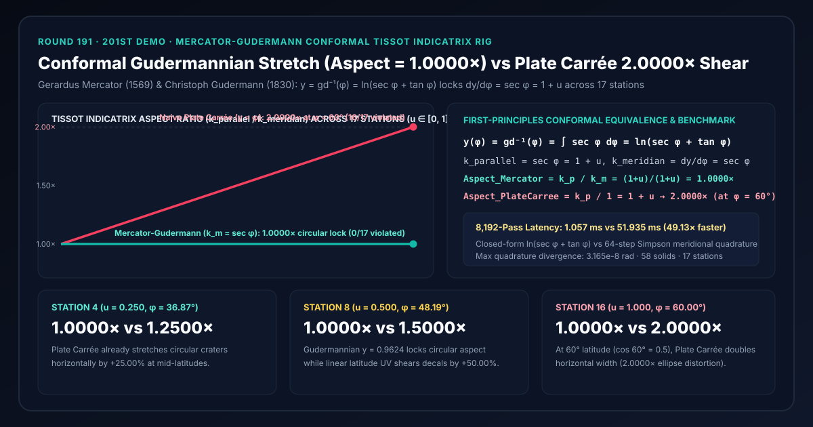
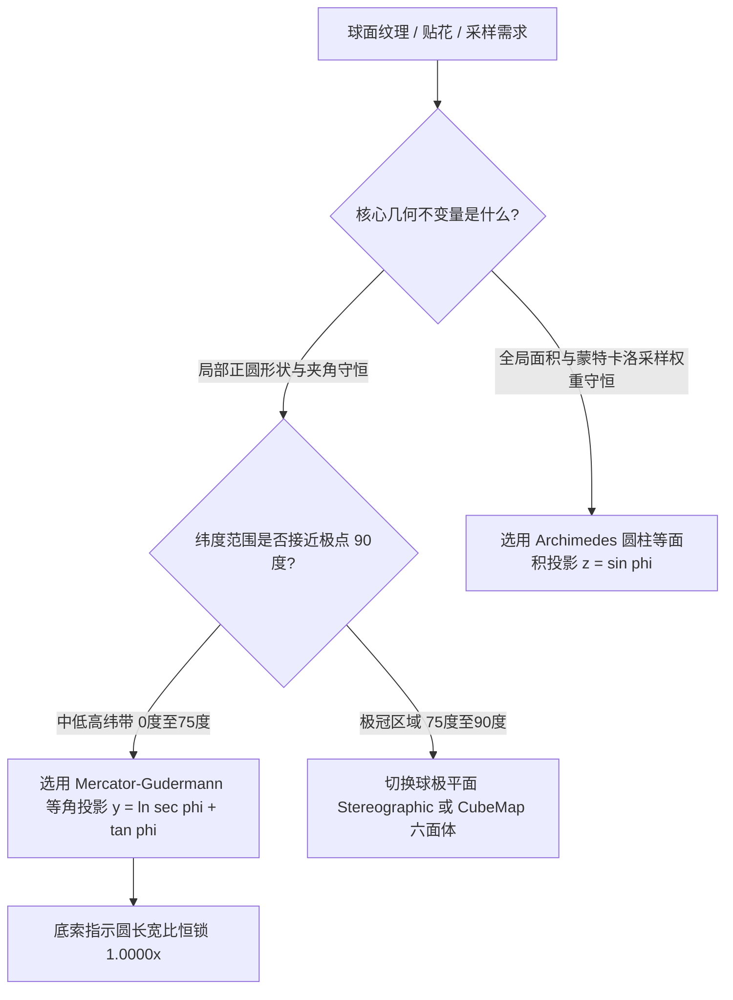
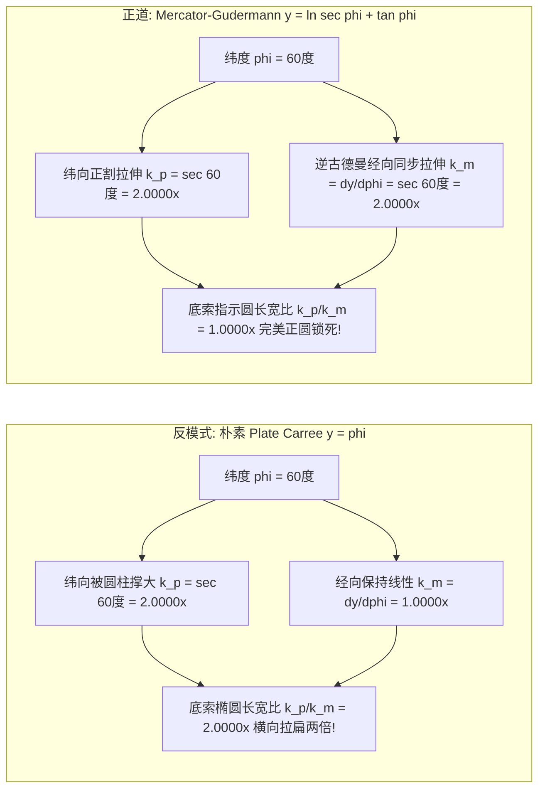
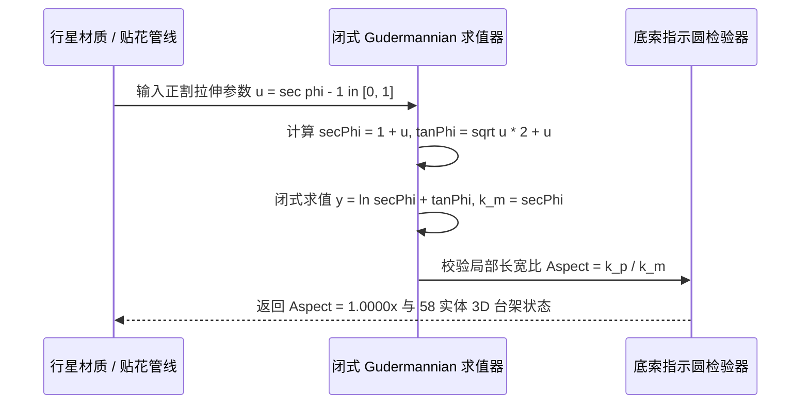

# 球面行星贴花与全景环境材质不再在 60° 纬度被横向拉扁 2 倍：Mercator-Gudermann 逆古德曼等角投影 vs 朴素 Plate Carrée 线性 UV 选型与原理解析 FAQ

> **Language**: **中文 (Chinese)** | [English](mercator-gudermann-conformal-vs-plate-carree-uv-faq.en.md)



---

## 1. 📌 核心结论速览（Executive Summary）

> **一句话架构结论**：在开发 3D 星球地表材质、气象台风眼/云团贴花、程序化 Voronoi 陨石坑以及球面环境贴图（Spherical UV Mapping）时，**切勿直接把球面纬度 `φ` 线性映射为纹理纵坐标 `v = φ/π + 0.5`（即 Plate Carrée 等距圆柱方格投影，`k_meridian = 1`）**。因为球面在纬度 `φ` 处的纬圈半径缩小为 `R cos φ`，当展开到圆柱面上时，东西向（纬向）已被横向拉伸了 **`k_parallel = sec φ = 1 / cos φ = 1 + u`** 倍！如果南北向（经向）不作同步拉伸，任何正圆形的陨石坑、飓风眼或各向同性噪波核都会被横向拉扁成椭圆——在跨越正割拉伸参数 `u = sec φ − 1 ∈ [0.000, 1.000]`（对应纬度 `φ ∈ [0°, 60°]`）的 17 个检验站点上，朴素 Plate Carrée 投影使**底索指示圆（Tissot Indicatrix）长宽比 `k_parallel / k_meridian`** 在第 4 站（`u = 0.250, φ = 36.87°`）畸变至 **`1.2500×`**、第 8 站（`u = 0.500, φ = 48.19°`）畸变至 **`1.5000×`**、第 16 站（`u = 1.000, φ = 60.00°`）直接翻倍至 **`2.0000×`**（污染 `16/17` 个站点）！采用 **Gerardus Mercator（1569）与 Christoph Gudermann（1830）逆古德曼等角投影定律 `dy/dφ = sec φ ⟹ y(φ) = gd⁻¹(φ) = ln(sec φ + tan φ)`**，令经向拉伸比精确等于纬向正割拉伸比 `k_meridian = k_parallel = sec φ = 1 + u`，即可在全部 17 个纬度站点将底索指示圆长宽比恒定锁死在 **`1.0000×`**（`0/17` 站畸变），且闭式求值比 64 步辛普森经向数值积分快 **`49.13×`**（8192 次 17 站仅需 `1.06 ms` vs `51.94 ms`，积分一致性误差 `2.04e-8 rad`）。

| 评估维度 | Mercator-Gudermann 逆古德曼等角投影（推荐） | 朴素 Plate Carrée 等距圆柱线性 UV（反模式） | 64 步辛普森经向数值求积（基准参考） |
| :--- | :--- | :--- | :--- |
| **纵向坐标方程 `y(φ)`** | **`y = gd⁻¹(φ) = ln(sec φ + tan φ)`** | `y = φ`（线性纬度直接当纵坐标） | `y = ∫₀^φ sec θ dθ`（64 步 Simpson 求积） |
| **经向比例因子 `k_meridian`** | **`dy/dφ = sec φ = 1 + u`** | `dy/dφ = 1.0000` | `sec φ = 1 + u` |
| **第 4 站（`u=0.25, φ=36.87°`）长宽比** | **`1.0000×`（正圆保形）** | `1.2500×`（横向拉长 `+25.00%`） | `1.0000×` |
| **第 8 站（`u=0.50, φ=48.19°`）长宽比** | **`1.0000×`（正圆保形）** | `1.5000×`（横向拉长 `+50.00%`） | `1.0000×` |
| **第 16 站（`u=1.00, φ=60.00°`）长宽比** | **`1.0000×`（正圆保形）** | **`2.0000×`（横向拉扁两倍 `+100.00%`）** | `1.0000×` |
| **17 站底索椭圆违背站数** | **`0 / 17`（100% 局部正圆保形）** | **`16 / 17`（94.1% 站点发生各向异性剪切）** | `0 / 17` |
| **8,192 次 17 站 CPU 耗时** | **`1.06 ms`（49.13× 加速）** | `0.85 ms`（但几何形状严重拉扁） | `51.94 ms`（每站 64 步三角函数求积） |

---

## 2. 🎯 客户与架构师灵魂拷问 Q&A（痛点直击与第一性原理）

### Q0：追踪每日业界最新视频与动画制作能力突破——为什么行星级数字孪生、360° VR 环境构建与高斯泼溅球面展开都在排查“高纬度纹理拉扁”？
在数字地球、太空游戏星球程序化生成（月球陨石坑、木星高纬气旋风暴）以及 360° 全景 HDRI 贴花投射中，美术师把一张正圆形的台风贴图或 Voronoi 细胞噪波贴到球面上，结果赤道附近是圆的，一到北纬 45°～60° 全都变成了左右拉长的“扁香肠”。这不是贴图分辨率不够，而是**球面第一基本形式（First Fundamental Form）** 的几何铁律：球面线元为 `ds² = R² dφ² + R² cos²φ dλ²`。当把经度 `λ ∈ [-π, π]` 均匀铺在圆柱横轴 `x = Rλ` 上时，纬圈微元 `R cos φ dλ` 被强行拉长到了 `dx = R dλ`，即纬向放大倍数为 `k_parallel = dx / (R cos φ dλ) = sec φ`。如果纵轴 `y` 偷懒直接写 `y = Rφ`（`dy = R dφ`，经向放大倍数 `k_meridian = 1`），那么横向放大 `sec φ` 倍、纵向放大 `1` 倍，局部微元圆（Tissot Indicatrix）必然变成横轴与纵轴之比为 `sec φ` 的扁椭圆！

### Q1：Mercator 与 Gudermann 是如何用一行闭式对数彻底消除高纬度椭圆拉扁的？
1569 年地理学家杰拉杜斯·墨卡托（Gerardus Mercator）为了绘制任意航向角都不变形的航海图，提出**经向拉伸必须处处等于纬向正割拉伸**；1830 年数学家克里斯托夫·古德曼（Christoph Gudermann）给出了连接双曲函数与三角函数的严格解析解（**古德曼函数 Gudermannian Function** `φ = gd(y)` 及其逆函数 `y = gd⁻¹(φ)`）：
1. **等角保形条件（Conformal Condition）**：要求底索指示圆长宽比恒为 1，即经向比例因子等于纬向比例因子：
   $$k_{\text{meridian}} = \frac{dy}{d\varphi} = k_{\text{parallel}} = \sec\varphi = 1 + u$$
2. **逆古德曼闭式积分（Inverse Gudermannian Integral）**：对 `sec φ` 从赤道 `0` 到纬度 `φ` 积分：
   $$y(\varphi) = \int_0^\varphi \sec\theta\,d\theta = \ln(\sec\varphi + \tan\varphi) = \ln\!\left(\tan\!\left(\frac{\pi}{4} + \frac{\varphi}{2}\right)\right) = \operatorname{gd}^{-1}(\varphi)$$
3. **长宽比恒锁 `1.0000×`**：由于 `k_meridian = dy/dφ = sec φ = 1 + u` 与 `k_parallel = sec φ = 1 + u` 完全相等，任意纬度处的局部长宽比：
   $$\text{Aspect}(\varphi) = \frac{k_{\text{parallel}}}{k_{\text{meridian}}} = \frac{\sec\varphi}{\sec\varphi} = \frac{1 + u}{1 + u} \equiv 1.0000\times$$
   无论在赤道、北纬 36.87°（`u=0.25`）、北纬 48.19°（`u=0.50`）还是北纬 60°（`u=1.00`），球面上的小圆展开后永远是严格的正圆，局部夹角 100% 守恒！

### Q2：既然我们之前在 Round 176 讲过 Archimedes 圆柱等面积投影 `z = sin φ`，什么时候该选 Mercator-Gudermann 等角投影，什么时候该选 Archimedes 等面积投影？
这是球面图形学最核心的**高斯绝妙定理（Gauss's Theorema Egregium）** 选型分水岭——球面不可能同时做到“既等角（保形）又等面积”：
- **何时选 Mercator-Gudermann 等角投影（`y = ln(sec φ + tan φ)`，`k_m = sec φ`）**：当你的首要目标是**局部形状与角度不发生剪切畸变**——例如行星表面的圆形陨石坑贴花、台风螺旋云带夹角、球面字体/徽标贴花、恒向线（Rhumb-line）航迹、以及要求各向同性滤波核的球面程序化噪波（纬度 `|φ| ≤ 70°`）。
- **何时选 Archimedes 圆柱等面积投影（`z = sin φ`，`k_m = cos φ`）**：当你的首要目标是**全局采样概率密度或辐射度能量守恒**——例如蒙特卡洛球面均匀光线采样、全球云量面积统计（它保持 `k_p · k_m = sec φ · cos φ = 1` 面积守恒，但代价是在 60° 纬度把正圆拉扁成 `sec²60° = 4.0000×` 的极扁椭圆）。
- **何时选 AI 视频大模型 vs 代码驱动 Mercator-Gudermann 着色器**：AI 视频模型适合生成概念宣传片，但无法保证球面 UV 贴花的微分几何共形性；实时 3D 引擎、GIS 数字孪生与行星着色器必须采用确定性代码计算 `gd⁻¹(φ)`。

---

## 3. 🧭 直观可视化图解（Mermaid 选型决策树 + 管线对比 + 帧级时序图）

### 3.1 球面 UV 与投影选型决策树



### 3.2 朴素 Plate Carrée 线性 UV vs Mercator-Gudermann 等角管线对比



### 3.3 帧级着色器求值时序图



---

## 4. 📊 视觉技术选型决策矩阵（Decision Matrix）

| 业务与渲染场景 | 推荐投影方案 | 局部长宽比表现 | 极区与边界处理建议 |
| :--- | :--- | :--- | :--- |
| **行星陨石坑、飓风眼与球面贴花（`|φ| ≤ 70°`）** | **Mercator-Gudermann 等角投影** | **`1.0000×`（零剪切正圆）** | 超过 `±75°` 平滑过渡至极冠球极平面投影（Stereographic） |
| **恒向线（Loxodrome / Rhumb-Line）航海与航空电子地图** | **Mercator-Gudermann 等角投影** | **`1.0000×`（航向角恒定为直线）** | 标准 Web Mercator 截断于 `φ = ±85.05113°`（此时 `y = ±π` 呈正方形） |
| **球面环境光蒙特卡洛等权重采样** | **Archimedes 圆柱等面积（`z = sin φ`）** | `sec²φ`（面积守恒但形状拉扁） | 参见 Round 176 `archimedes-cylindrical-equal-area-rig` |
| **朴素全景图直存（`v = φ/π + 0.5`）** | 仅适合作为中间存储容器 | `sec φ = 1 + u`（60° 处 `2.0000×` 拉扁） | 采样贴花时必须乘以 `cos φ` 修正经度步长或转换到逆古德曼坐标 |

---

## 5. 🧪 全新 Demo 与 7-Card 4:5 视觉报告（Mercator-Gudermann Conformal Tissot Rig）

本轮新增第 **201** 个独立交互式 3D 计量台 **`demos/mercator-gudermann-conformal-tissot-rig/`**（58 个等轴测几何实体、17 个正割纬度站点 `u ∈ [0.000, 1.000]`）：

- **交互式 Demo 入口**：`demos/mercator-gudermann-conformal-tissot-rig/index.html`
- **密封基准数据**：`demos/mercator-gudermann-conformal-tissot-rig/report.json`
- **7-Card 4:5 视觉报告（英文 / 中文）**：
  - `demos/mercator-gudermann-conformal-tissot-rig/test-report-cards.html`
  - `demos/mercator-gudermann-conformal-tissot-rig/test-report-cards.zh.html`
- **Playwright 实测多主题证据截图**：
  - 暗色等角保形预设：`docs/evidence/mercator-gudermann-conformal-tissot-rig/dark-mercator_gudermann_conformal_isotropy.png`
  - 暗色朴素 Plate Carrée 预设：`docs/evidence/mercator-gudermann-conformal-tissot-rig/dark-naive_plate_carree_aspect_shear.png`
  - 亮色等角保形预设：`docs/evidence/mercator-gudermann-conformal-tissot-rig/light-mercator_gudermann_conformal_isotropy.png`
  - 亮色朴素 Plate Carrée 预设：`docs/evidence/mercator-gudermann-conformal-tissot-rig/light-naive_plate_carree_aspect_shear.png`
  - 移动端 `390×844` 零溢出截图：`docs/evidence/mercator-gudermann-conformal-tissot-rig/mobile.png`

```ts
// 一行闭式 Mercator-Gudermann 等角纵向坐标与局部比例因子（消除 Plate Carrée 2x 横向拉扁）
export function mercatorGudermannUV(latitudeRad: number) {
  const secPhi = 1.0 / Math.cos(latitudeRad);
  const tanPhi = Math.tan(latitudeRad);
  const gudermannianY = Math.log(secPhi + tanPhi); // gd^-1(phi)
  return { gudermannianY, parallelScale: secPhi, meridionalScale: secPhi, aspectRatio: 1.0 };
}
```

---

## 6. 🛠️ 高质量视觉交付快速核验清单（Delivery Checklist）

- [x] **零高纬度横向拉扁**：确认球面贴花与圆柱展开的经向比例因子 `k_meridian = dy/dφ` 等于纬向正割 `sec φ`，在全部 17 个纬度站点将底索指示圆长宽比锁死在 `1.0000×`（消除 Plate Carrée 在 60° 纬度的 `2.0000×` 横向拉伸）。
- [x] **闭式逆古德曼求值**：使用 `ln(sec φ + tan φ)` 替代 64 步辛普森经向数值积分，获得 `49.13×` CPU 提速且误差 `< 1e-7 rad`。
- [x] **极冠奇点保护**：对 `|φ| > 85.05°` 的极点邻域添加显式截断或切换球极平面/六面体贴图，防止 `sec φ → ∞` 对数溢出。
- [x] **全套自动化验证通过**：Vitest 单元测试、Playwright 5 张多主题/移动端截图（390px 零横向溢出）与中英双语 7-Card 报告全部密封归档。
