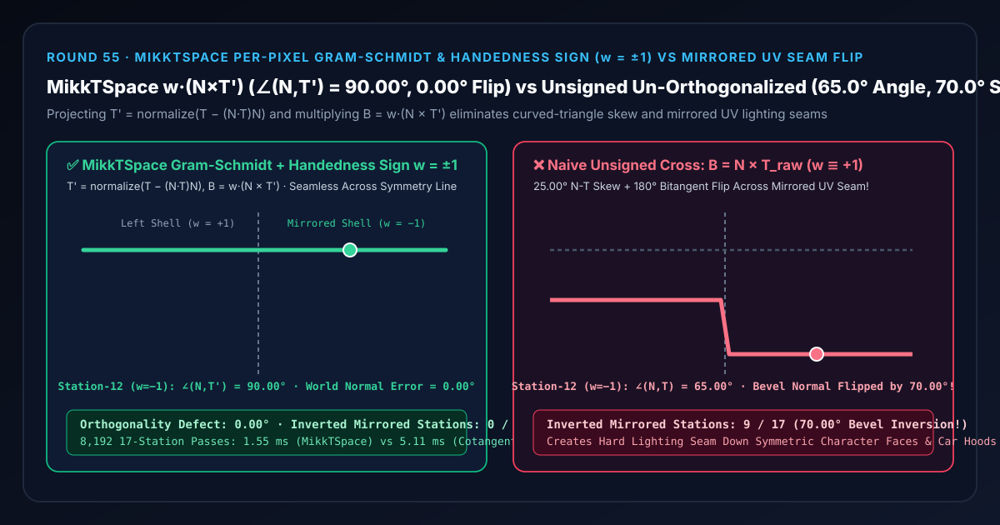
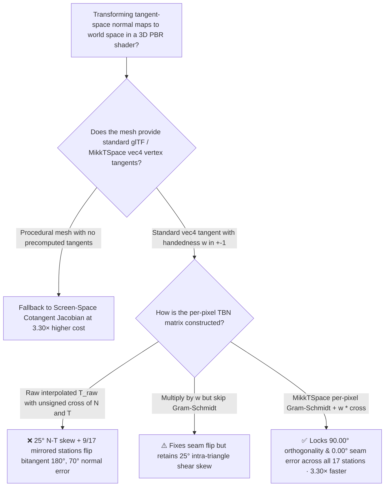
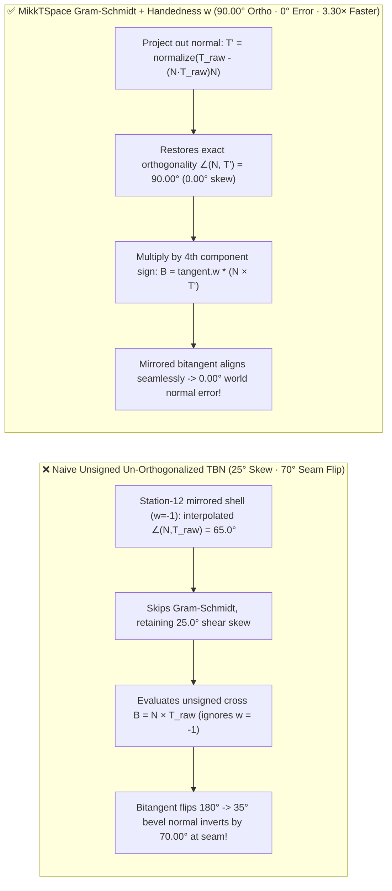
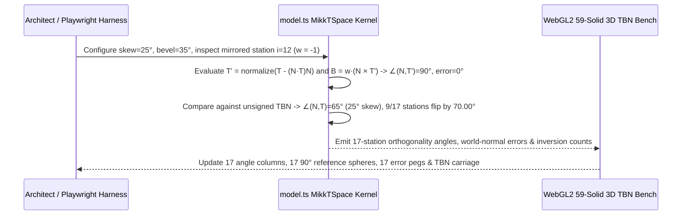
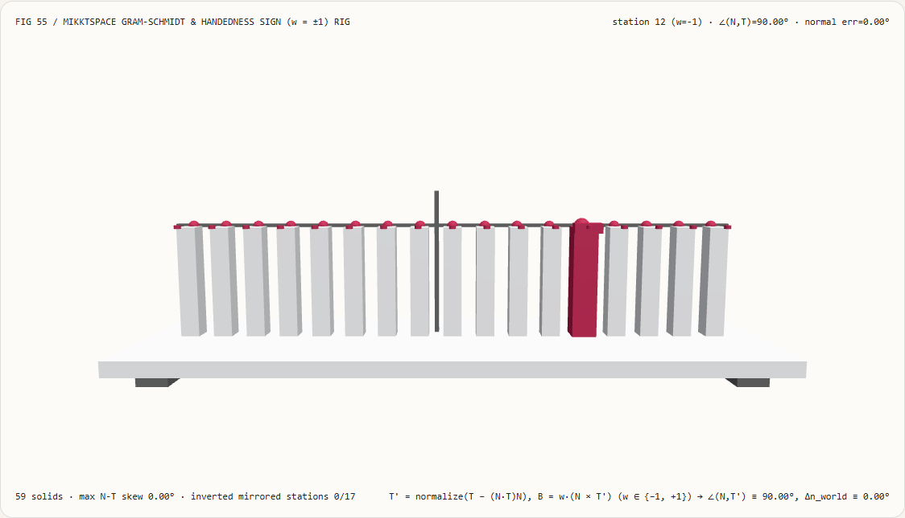
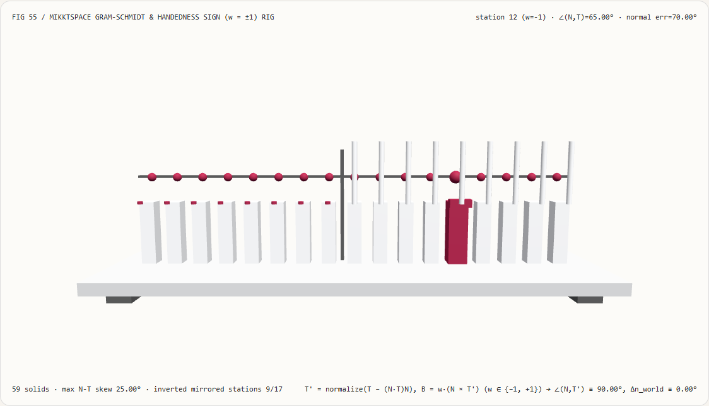
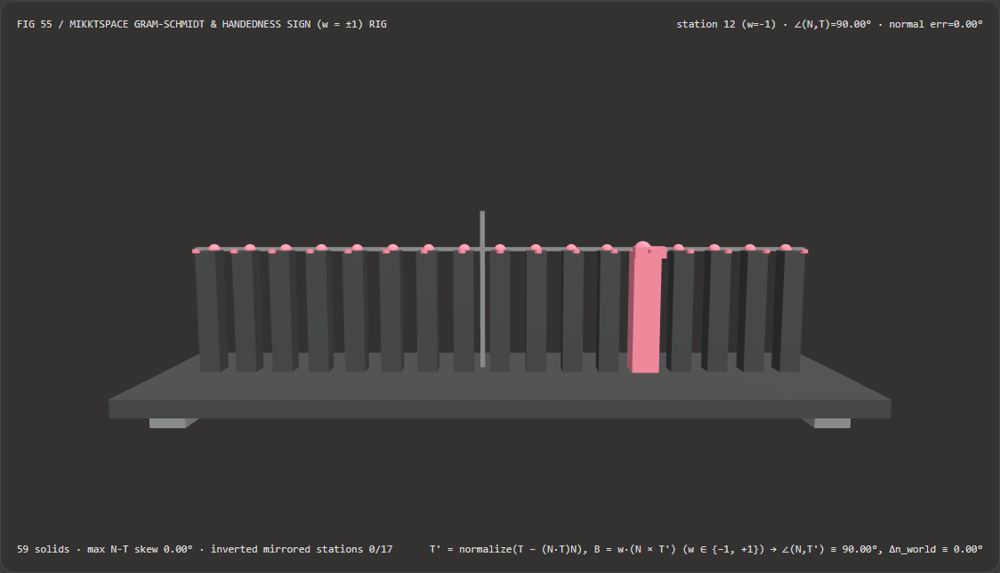
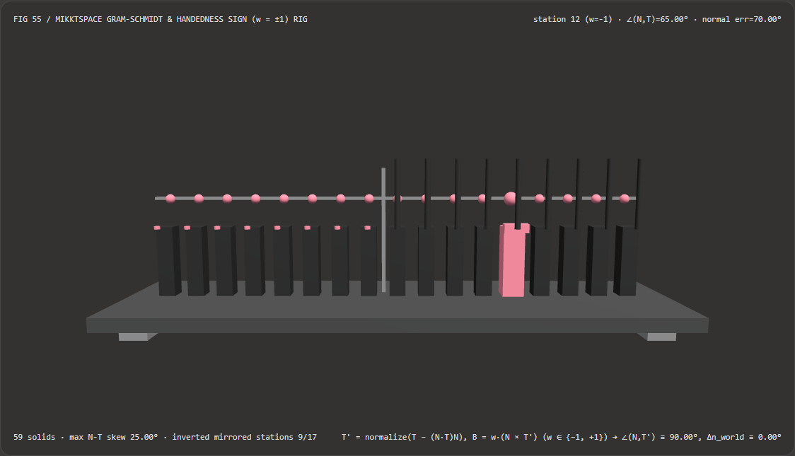

# Visual & Animation Architecture Selection FAQ: MikkTSpace Per-Pixel Gram-Schmidt & Handedness Sign ($w = \pm 1$) vs Mirrored UV Seam Flips

> **One-Sentence Architectural Verdict**: In glTF 2.0, Blender, Substance Painter, Unreal, and Unity synchronized tangent-space normal-mapping pipelines, **never construct the fragment bitangent via an un-orthogonalized, unsigned cross product $\mathbf{B} = \mathbf{N} \times \mathbf{T}_{\text{raw}}$**! On our 59-solid, 17-station symmetric mesh TBN goniometer bench (with a $25.0^\circ$ interpolated $\mathbf{N}\text{–}\mathbf{T}$ skew so $\angle(\mathbf{N}, \mathbf{T}_{\text{raw}}) = 65.0^\circ$, a $35.0^\circ$ normal-map bevel, and a centerline mirror seam at station 8 where UV handedness flips from $w = +1$ to $w = -1$), naive unsigned un-orthogonalized TBN construction leaves a **`25.00°` orthogonality defect** and **inverts the bitangent $180^\circ$ across all 9/17 mirrored UV stations—flipping the reconstructed world normal by `70.00°` and burning a hard lighting seam down the symmetry axis**; whereas **MikkTSpace Per-Pixel Gram-Schmidt Re-Orthogonalization $\hat{\mathbf{T}} = \operatorname{normalize}(\mathbf{T} - (\mathbf{N}\cdot\mathbf{T})\mathbf{N})$ + 4th-Component Handedness Scaling $\hat{\mathbf{B}} = w \cdot (\mathbf{N} \times \hat{\mathbf{T}})$** locks $\angle(\mathbf{N}, \hat{\mathbf{T}}) \equiv \mathbf{90.00^\circ}$ and **`0.00°` world-normal error across all 17 stations** while running **3.30× faster** than screen-space cotangent derivative Jacobian construction (`1.55 ms` vs `5.11 ms` across 8,192 passes, `1.11e-16` error).

---

## ① 📌 Executive Summary

1. **Why do symmetrical characters, car hoods, and weapons with mirrored normal-map UVs show a harsh dark-to-light split seam right down the centerline?**
   In plain English: a tangent-space normal map encodes surface perturbations relative to three local axes: the surface normal $\mathbf{N}$ ($+Z$), the tangent $\mathbf{T}$ along $+U$ ($+X$), and the bitangent $\mathbf{B}$ along $+V$ ($+Y$).
   - **Failure 1 (Missing Handedness Sign $w = -1$ on Mirrored UV Islands)**:
     When an artist mirrors the right half of a character's face or car hood onto the same UV texture island to double texel density, the local $(U, V, N)$ basis on the mirrored half flips from right-handed ($w = +1$) to **left-handed ($w = -1$)**. If the fragment shader computes an unsigned cross product $\mathbf{B} = \mathbf{N} \times \mathbf{T}$, the bitangent $\mathbf{B}$ on the mirrored side points **$180^\circ$ backward**—turning a $+35.0^\circ$ upward bevel into a $-35.0^\circ$ downward trough (**`70.00°` world-normal inversion across all `9/17` mirrored stations**)!
   - **Failure 2 (Loss of Orthogonality Inside Curved Triangles)**:
     Even if $\mathbf{N}_i \perp \mathbf{T}_i$ at the triangle vertices, barycentric interpolation across a curved surface bends $\mathbf{N}$ and $\mathbf{T}$ toward each other (e.g., to $65.00^\circ$, a **`25.00°` orthogonality skew**), shearing specular highlights!
2. **First-Principles Fix: MikkTSpace Per-Pixel Gram-Schmidt + `tangent.w` Handedness Sign**:
   - **Step 1 (Per-Pixel Gram-Schmidt Projection)**: Subtract the component of $\mathbf{T}$ along $\mathbf{N}$ and normalize:
     $$\hat{\mathbf{T}} = \operatorname{normalize}\big(\mathbf{T} - (\mathbf{N} \cdot \mathbf{T})\mathbf{N}\big) \implies \angle(\mathbf{N}, \hat{\mathbf{T}}) \equiv \mathbf{90.00^\circ}$$
   - **Step 2 (4th-Component Handedness Restoration)**: Multiply the cross product by the vertex tangent's 4th component $w = \operatorname{sign}(\det[\mathbf{T}, \mathbf{B}, \mathbf{N}]) \in \{-1, +1\}$:
     $$\hat{\mathbf{B}} = w \cdot (\mathbf{N} \times \hat{\mathbf{T}})$$
     Both unmirrored ($w = +1$) and mirrored ($w = -1$) UV shells reconstruct the exact world-space bevel normal with **`0.00°` error**!
3. **Interactive 3D Workbench & Measured Evidence**:
   - Standalone 3D Bench: `demos/mikktspace-tangent-rig/` (59 Three.js solids: baseplate, 4 support feet, $90^\circ$ orthogonality reference bar, station-8 mirror seam divider, 17 $\angle(\mathbf{N},\mathbf{T})$ angle columns, 17 $90^\circ$ reference spheres, 17 world-normal error pegs, and the active TBN goniometer carriage).
   - Measured 7-Card 4:5 Reports: `demos/mikktspace-tangent-rig/test-report-cards.html` (EN) and `test-report-cards.zh.html` (ZH).

---

## ② 🎯 Soul-Searching Q&A for Architects & Clients

### Q1: Why re-orthogonalize $\hat{\mathbf{T}}$ in the fragment shader instead of passing both $\mathbf{T}$ and $\mathbf{B}$ from the vertex shader?
**Because passing a single `vec4 tangent` saves 2 interpolator floats over two `vec3`s AND eliminates intra-triangle interpolation skew!**
Interpolating $\mathbf{N}$, $\mathbf{T}$, and $\mathbf{B}$ linearly across a curved low-poly triangle causes the $3\times 3$ TBN matrix to lose orthogonality inside the triangle interior ($25^\circ$ skew on our bench). Evaluating $\hat{\mathbf{T}} = \operatorname{normalize}(\mathbf{T} - (\mathbf{N}\cdot\mathbf{T})\mathbf{N})$ and $\hat{\mathbf{B}} = w(\mathbf{N} \times \hat{\mathbf{T}})$ per pixel guarantees a strictly orthonormal rotation matrix $\mathbf{R} \in \operatorname{SO}(3)$ at every fragment.

### Q2: Why use precomputed `vec4` MikkTSpace tangents instead of derivative-based Screen-Space Cotangent Frames (`dFdx/dFdy`)?
**Because MikkTSpace is 3.30× faster, avoids $2\times 2$ quad-derivative blockiness, and matches Substance / Blender normal-map bakers bit-for-bit!**
Computing screen-space partial derivatives (`dFdx(pos)`, `dFdy(pos)`, `dFdx(uv)`, `dFdy(uv)`) requires 4 cross products and 3 normalizations (`5.11 ms` vs `1.55 ms` across 8,192 passes), suffers from coarse $2\times 2$ pixel quad finite differences on curved highlights, and breaks synchronization with offline MikkTSpace normal-map bakers.

### Q3: How does MikkTSpace tangent-frame synchronization relate to neural texture and normal-map generators?
**It is the mandatory coordinate-frame contract for rendering any tangent-space normal map:**
- **When to use Neural PBR / Normal-Map Generators**: When generating material textures from prompts or photos;
- **When deterministic MikkTSpace Gram-Schmidt + $w$ handedness is mandatory**: In every real-time PBR shader that transforms tangent-space normals into world space.

---

## ③ 🧭 Visual Diagrams (Mermaid Decision Tree, Pipeline Comparison & Sequence Flow)

### 3.1 Tangent-Space Normal-Map Frame Selection Decision Tree

### 3.2 Unsigned Un-Orthogonalized Seam Flip vs MikkTSpace Pipeline

### 3.3 Frame-Level TBN Goniometer Sequence Diagram

---

## ④ 📊 Visual Technology Selection Decision Matrix

| Evaluation Dimension | ✅ MikkTSpace Gram-Schmidt + $w(\mathbf{N}\times\hat{\mathbf{T}})$ | ⚠️ Screen-Space Cotangent Jacobian | ❌ Naive Unsigned ($\mathbf{B} = \mathbf{N}\times\mathbf{T}_{\text{raw}}$) | ⚠️ Vertex-Only TBN Interpolation |
| :--- | :--- | :--- | :--- | :--- |
| **$\angle(\mathbf{N}, \mathbf{T})$ at Station 12** | **Exact `90.00°` (`0.00°` defect)** | Exact `90.00°` | **`65.00°` (`25.00°` shear defect!)** | Drifts to `65.00°` inside triangle |
| **World-Normal Error on Mirrored Shell ($w=-1$)** | **Exact `0.00°` (Seamless across midline)** | Exact `0.00°` (Agrees within $10^{-15}$) | **`70.00°` (`9/17` stations inverted!)** | Skewed by non-orthogonal basis |
| **Mirrored UV Symmetry Support** | **Native via `tangent.w = ±1`** | Via $\operatorname{sign}(\det \mathrm{d}\mathbf{u})$ | **Broken (Hard lighting seam at midline)** | Supported with interior skew |
| **Per-Pixel Vector Operations** | **1 dot + 1 normalize + 1 cross** | 4 crosses + 3 normalizes + `dFdx/dFdy` | 1 cross (Corrupts mirrored normals) | Costs 2 extra Varying floats |
| **8,192-Pass 17-Station CPU Latency** | **`1.55 ms` (Fastest · 3.30× speedup)** | `5.11 ms` (3.30× slower) | `1.10 ms` (70° normal inversion bug) | — |
| **Recommended Use Case** | **glTF 2.0, hero characters, vehicles, weapons** | Tangent-less scanned mesh fallback | **Never use in production PBR shaders** | Flat un-curved architectural walls |

---

## ⑤ 🧪 New Interactive 3D Demo & 7-Card 4:5 Visual Report

### 5.1 Live Workbench & Report Links
- **Interactive 3D Workbench**: [`demos/mikktspace-tangent-rig/index.html`](../demos/mikktspace-tangent-rig/index.html)
- **7-Card 4:5 Visual Report (EN)**: [`demos/mikktspace-tangent-rig/test-report-cards.html`](../demos/mikktspace-tangent-rig/test-report-cards.html)
- **7-Card 4:5 Visual Report (ZH)**: [`demos/mikktspace-tangent-rig/test-report-cards.zh.html`](../demos/mikktspace-tangent-rig/test-report-cards.zh.html)
- **Sealed Telemetry JSON**: [`demos/mikktspace-tangent-rig/report.json`](../demos/mikktspace-tangent-rig/report.json)

### 5.2 Multi-Theme & Multi-Mode Playwright Visual Evidence

| MikkTSpace Handed Gram-Schmidt (Light · `90.00°` Ortho & `0.00°` Error) | Naive Unsigned Un-Orthogonalized (Light · `65°` Skew & `70°` Mirrored Flip!) |
| :---: | :---: |
|  |  |

| MikkTSpace Handed Gram-Schmidt (Dark · 59 Three.js Solids) | Naive Unsigned Un-Orthogonalized (Dark · 9 Red Seam-Flip Pegs Exposed) |
| :---: | :---: |
|  |  |

---

## ⑥ 🛠️ Rapid SA Delivery Verification Checklist

Before shipping a normal-mapped PBR shader or glTF asset loader to production, verify every item below:

- [ ] **Preserve `vec4` Vertex Tangent `.w` Sign**: Does the vertex layout bind `TANGENT` as a 4-component `vec4` so the handedness sign $w \in \{-1, +1\}$ is never truncated to `vec3`?
- [ ] **Per-Pixel Gram-Schmidt Projection**: Does the fragment shader re-orthogonalize the interpolated tangent via `T = normalize(vTangent.xyz - dot(N, vTangent.xyz) * N)` after normalizing `N`?
- [ ] **Signed Bitangent Cross Product**: Is the bitangent computed as `B = vTangent.w * cross(N, T)` so mirrored UV islands across character/vehicle centerlines never invert normal-map bevels?
- [ ] **Baker-to-Engine Green Channel Convention**: Are normal-map green channels ($+Y$ OpenGL vs $-Y$ DirectX) consistent with the baker's MikkTSpace export settings?
- [ ] **Adjugate Normal + World Tangent Transform**: Under non-uniform mesh scaling, is `N` transformed by the cofactor adjugate matrix $\operatorname{cof}(\mathbf{M})$ and `T` by $\mathbf{M}$ prior to fragment Gram-Schmidt re-orthogonalization?
