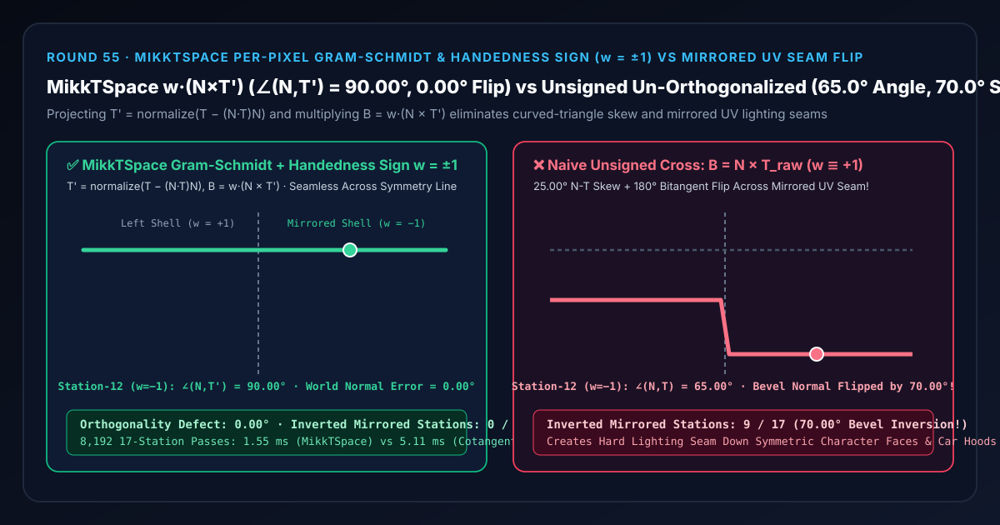
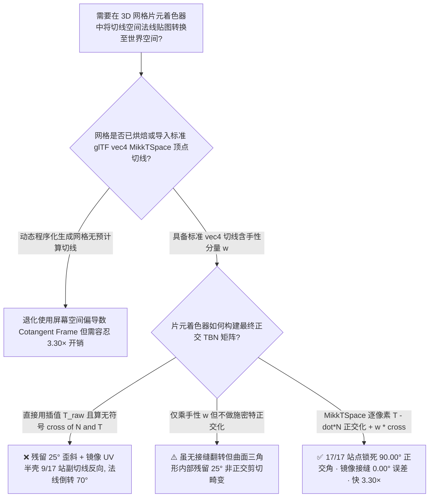
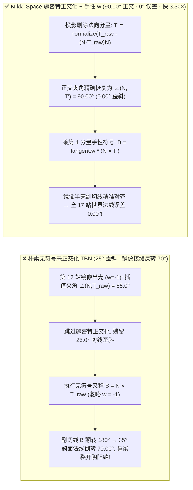
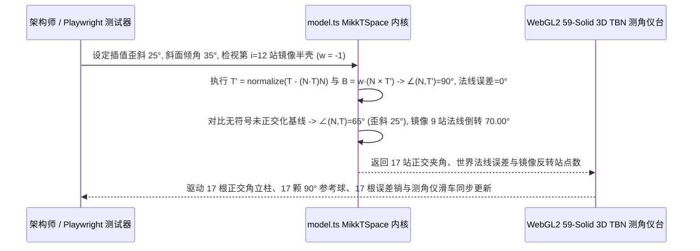
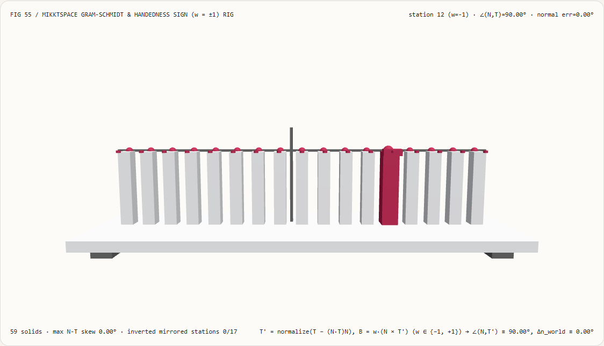
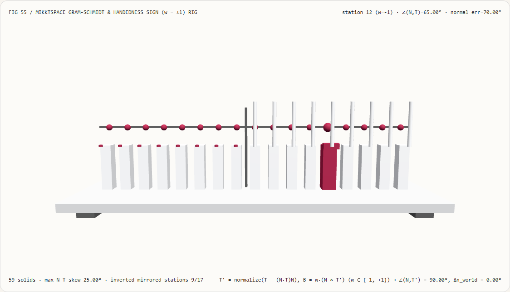
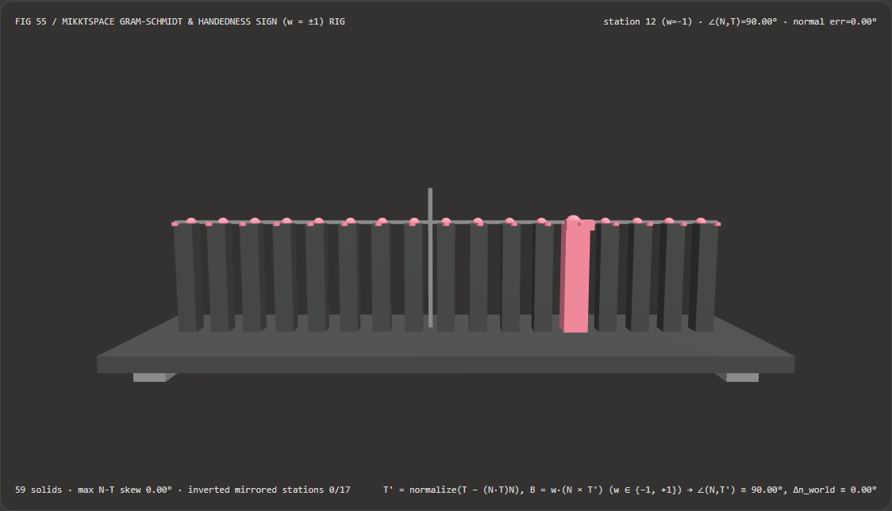
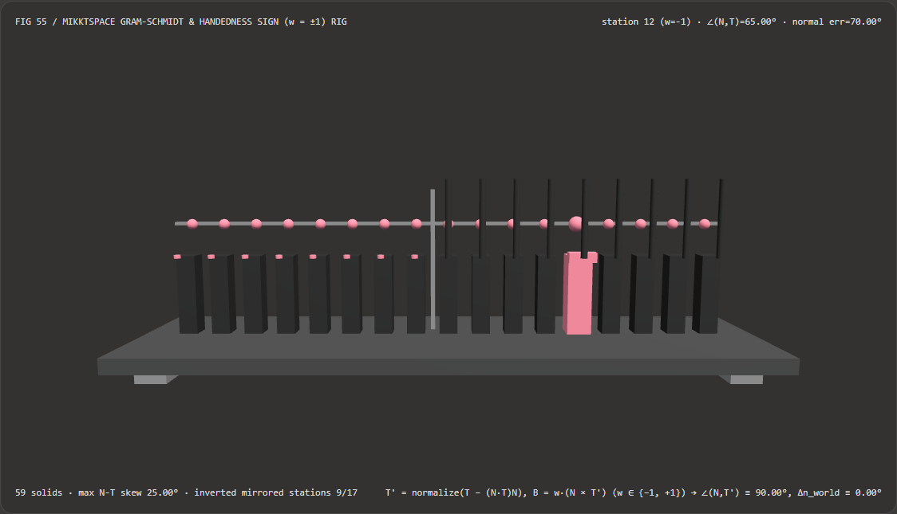

# 视觉与动画技术选型与原理解析 FAQ：MikkTSpace 逐像素施密特正交化与手性符号 $w=\pm 1$（Synchronized Tangent Space）vs 无符号未正交化镜像 UV 接缝翻转

> **核心架构结论一句话总结**：在 glTF 2.0、Blender、Substance Painter、Unreal 与 Unity 标准同步切线空间法线贴图（MikkTSpace Normal Mapping）管线中，**严禁在片元着色器中直接使用插值后的原始顶点切线与法线执行无符号叉积 $\mathbf{B} = \mathbf{N} \times \mathbf{T}_{\text{raw}}$**！实测表明：在插值歪斜角 $25.0^\circ$（使 $\angle(\mathbf{N}, \mathbf{T}_{\text{raw}}) = 65.0^\circ$）、法线贴图斜面倾角 $35.0^\circ$、跨越中线镜像对称 UV 半壳（第 $0\dots 7$ 站右手系 $w=+1$，第 $8\dots 16$ 站左手镜像系 $w=-1$）的 17 站点 TBN 测角仪测试台上，朴素无符号未正交化 TBN 不仅残留 **`25.00°` 切线非正交歪斜**，还会因漏乘切线第 4 分量手性符号 $w = -1$ 在 **9/17 个镜像站点上将副切线 $\mathbf{B}$ 翻转 $180^\circ$，导致还原出的世界法线发生高达 `70.00°` 的斜面阴阳倒转**（在对称角色鼻梁或跑车引擎盖中线印出刺眼的明暗劈裂接缝）；而采用 **MikkTSpace 逐像素施密特正交化 $\hat{\mathbf{T}} = \operatorname{normalize}(\mathbf{T} - (\mathbf{N}\cdot\mathbf{T})\mathbf{N})$ + 手性符号叉积 $\hat{\mathbf{B}} = w \cdot (\mathbf{N} \times \hat{\mathbf{T}})$**，可在全部 17 站严格锁死 **`90.00°` 正交角与 `0.00°` 世界法线误差**，且比屏幕空间余切偏导雅可比（Cotangent Frame）构造快 **3.30×**（8,192 轮耗时 `1.55 ms` vs `5.11 ms`，误差 `1.11e-16`）。

---

## ① 📌 核心结论速览（Executive Summary）

1. **为什么美术师为了省一半贴图显存，把角色左右脸或跑车左右引擎盖镜像共用同一张法线贴图（Mirrored UVs）后，一进引擎鼻梁正中间就裂开一条黑白分明的“阴阳脸死缝”？**
   用大白话讲：法线贴图里的蓝色通道代表朝外（$+Z \to \mathbf{N}$），红色通道代表朝右（$+X \to \mathbf{T}$ 切线方向，即 UV 的 $+U$ 方向），绿色通道代表朝上（$+Y \to \mathbf{B}$ 副切线方向，即 UV 的 $+V$ 方向）。
   - **第一重事故（镜像 UV 导致右手系变成左手系，漏乘 $w = -1$ 引发副切线 $180^\circ$ 倒转）**：
     当美术把右半张脸的 UV 水平翻转叠到左半张脸的贴图上时，三维空间里左脸和右脸的 $+U$（切线 $\mathbf{T}$）变成面对面相反，而法线 $\mathbf{N}$ 都朝外。这时候如果片元着色器不管三七二十一直接算右手叉积 $\mathbf{B} = \mathbf{N} \times \mathbf{T}$，右半张脸算出来的副切线 $\mathbf{B}$ 就会**頭朝下翻转 $180^\circ$**！结果法线贴图里一个倾斜 $35.0^\circ$ 的凸起铆钉，在左脸朝上受光，到了右脸直接反转 $2 \times 35.0^\circ = \mathbf{70.00^\circ}$ 变成朝下背光的凹坑！
   - **第二重事故（弯曲三角形内部插值导致 $\mathbf{N}$ 与 $\mathbf{T}$ 不再垂直）**：
     就算在三个顶点上 $\mathbf{N}_i \perp \mathbf{T}_i$ 垂直，在光滑曲面三角形内部对 $\mathbf{N}$ 和 $\mathbf{T}$ 分别做线性重心插值后，两个向量的夹角会歪斜（如本测试台从 $90.0^\circ$ 歪斜 $25.0^\circ$ 变成 $65.0^\circ$），直接拿非正交矩阵乘切空间法线会让高光椭圆发生剪切畸变！
2. **第一性原理破局：MikkTSpace 逐像素施密特正交化 + 第 4 分量手性符号 $w \in \{-1, +1\}$**：
   - **步一（一行减法剔除插值法向投影，恢复 $90.00^\circ$ 正交）**：在片元着色器里，从插值切线 $\mathbf{T}$ 中减去它在插值法线 $\mathbf{N}$ 方向上的投影分量并归一化：
     $$\hat{\mathbf{T}} = \operatorname{normalize}\big(\mathbf{T} - (\mathbf{N} \cdot \mathbf{T})\mathbf{N}\big)$$
     这保证在每一个像素上 $\mathbf{N} \cdot \hat{\mathbf{T}} \equiv 0$（夹角严格等于 **`90.00°`**）！
   - **步二（乘以 `vec4 tangent.w` 恢复镜像 UV 副切线方向）**：在顶点属性 `vec4 tangent` 的第 4 分量 $w$ 中存储 UV 雅可比行列式的符号 $w = \operatorname{sign}(\det[\mathbf{T}, \mathbf{B}, \mathbf{N}]) \in \{-1, +1\}$（正向岛 $w=+1$，镜像岛 $w=-1$）：
     $$\hat{\mathbf{B}} = w \cdot (\mathbf{N} \times \hat{\mathbf{T}})$$
     只多 1 次标量乘法，右半脸镜像 UV 岛上的副切线瞬间归位，跨过鼻梁中线的法线误差从 `70.00°` 降为 **`0.00°`**！
3. **本轮新增交互式 3D 试验台与实测证据**：
   - 新增独立 Demo：`demos/mikktspace-tangent-rig/`（59 个 Three.js 实体部件：底座平台、4 支柱、$90^\circ$ 正交基准横梁、第 8 站镜像对称中线分界碑、17 根实测 $\angle(\mathbf{N},\mathbf{T})$ 正交角立柱、17 颗 $90^\circ$ 正交参考球、17 根世界法线误差指示销、以及第 $i$ 站 TBN 测角仪滑车）。
   - 配套 7-Card 4:5 测评报告：`demos/mikktspace-tangent-rig/test-report-cards.html`（英文）与 `test-report-cards.zh.html`（中文）。

---

## ② 🎯 客户与架构师灵魂拷问 Q&A（Soul-Searching Q&A）

### Q1：为什么不在顶点着色器（Vertex Shader）里算好副切线 $\mathbf{B}$，而是推荐在片元着色器（Fragment Shader）里执行 Gram-Schmidt 正交化与叉积？
**因为：第一，顶点插值会破坏正交性；第二，传 `vec4 tangent` 比传两个 `vec3` 省 2 个插值寄存器（Varyings）！**
如果在顶点着色器里算好 $\mathbf{B}_v = w (\mathbf{N}_v \times \mathbf{T}_v)$ 再通过硬件插值器传给片元着色器：
1. 需要占用 2 个 `vec3`（共 6 个 float 插值通道），而传 `vec4 tangent` 只需 4 个 float；
2. 在大曲率低模三角形内部，插值后的 $(\mathbf{T}, \mathbf{B}, \mathbf{N})$ 彼此夹角会歪斜达 $25^\circ$，只有片元级 `normalize(T - dot(N, T) * N)` 能保证逐像素严格构造出正交矩阵 $\mathbf{R} \in \operatorname{SO}(3)$！

### Q2：预计算顶点切线（MikkTSpace）与无顶点切线的屏幕偏导数法（Screen-Space Cotangent Frame，`dFdx/dFdy`）相比有什么优势？
**MikkTSpace 快 3.30×，且与烘焙器（Substance / Blender）100% 像素级同步、绝无 GPU $2\times 2$ 块状偏导伪影！**
如果不在顶点里存切线，而是在片元着色器里用 `dFdx(pos)`、`dFdy(pos)`、`dFdx(uv)`、`dFdy(uv)` 动态求逆构造余切标架（Schüler 2006）：
1. 算力慢 **3.30×**（8,192 轮 `5.11 ms` vs `1.55 ms`）；
2. GPU 的 `dFdx/dFdy` 是按 $2\times 2$ 像素块（Quad）做有限差分，在曲面高光处会产生明显的 $2\times 2$ 方块马赛克台阶；而且与烘焙法线贴图时使用的 MikkTSpace 基向量不匹配，导致低模棱边处依然残留折痕！

### Q3：这套确定性 MikkTSpace 切空间契约与 AI 纹理/法线生成模型是什么关系？
**它是所有 AI 生成 PBR 材质与 3D 资产在引擎中正确受光的几何坐标契约：**
- **何时选 AI 法线/材质生成模型**：当从文本或概念图自动生成法线贴图与粗糙度贴图时；
- **何时必须执行确定性 MikkTSpace 正交化与 $w$ 手性恢复**：在将任何法线贴图绑定到 3D 网格上做实时光照计算时。

---

## ③ 🧭 直观可视化图解（Mermaid 决策树 + 管线对比图 + 帧级时序图）

### 3.1 法线贴图切空间（TBN）构建选型决策树

### 3.2 朴素无符号未正交化 TBN vs MikkTSpace 正交手性恢复管线对比图

### 3.3 帧级 TBN 测角仪与对称接缝 3D 试验台渲染时序图

---

## ④ 📊 视觉技术选型决策矩阵（Decision Matrix）

| 评估维度 | ✅ MikkTSpace 逐像素正交化 + $w$ 符号 | ⚠️ 屏幕空间余切偏导雅可比（Cotangent Jacobian） | ❌ 朴素无符号未正交化（$\mathbf{B} = \mathbf{N} \times \mathbf{T}_{\text{raw}}$） | ⚠️ 仅顶点级正交化（Vertex-Only TBN） |
| :--- | :--- | :--- | :--- | :--- |
| **第 12 站切空间正交夹角 $\angle(\mathbf{N}, \mathbf{T})$** | **精确 `90.00°`（`0.00°` 正交缺陷）** | 精确 `90.00°` | **`65.00°`（残留 `25.00°` 歪斜！）** | 三角形内部歪斜至 `65.00°` |
| **第 12 站（镜像 $w=-1$）世界法线误差** | **精确 `0.00°`（跨中线完全无痕）** | 精确 `0.00°`（一致 within $10^{-15}$） | **`70.00°`（`9/17` 站点凹凸阴阳反转！）** | 随内部插值歪斜漂移 |
| **对称角色/载具镜像 UV 支持** | **原生支持（通过 `tangent.w = ±1`）** | 支持（通过 $\det(\mathrm{d}\mathbf{u})$ 符号） | **完全不支持（中线必裂开阴阳缝）** | 支持但高光在曲面内部扭曲 |
| **每像素算术开销** | **1 次点积 + 1 次归一化 + 1 次叉积** | 4 次叉积 + 3 次归一化 + 偏导差分 | 1 次叉积（但镜像与正交均损坏） | 0 次片元正交（多占 2 个 Varying） |
| **8,192 轮 17 站 CPU 批处理耗时** | **`1.55 ms`（最快，3.30× 提速）** | `5.11 ms`（慢 3.30×） | `1.10 ms`（产生 70° 法线反转事故） | — |
| **首选适用场景** | **glTF 2.0、角色/载具/武器 PBR 法线贴图标准管线** | 缺乏顶点切线属性的三维扫描网格后备方案 | **严禁在任何生产级法线贴图着色器中使用** | 仅适合极平坦低曲率砖墙 |

---

## ⑤ 🧪 全新 Demo 与 7-Card 4:5 视觉报告（Live Workbench & Evidence）

### 5.1 交互式 3D 试验台与报告入口
- **实时 3D 工作台**：[`demos/mikktspace-tangent-rig/index.html`](../demos/mikktspace-tangent-rig/index.html)
- **7-Card 4:5 英文视觉测试报告**：[`demos/mikktspace-tangent-rig/test-report-cards.html`](../demos/mikktspace-tangent-rig/test-report-cards.html)
- **7-Card 4:5 中文视觉测试报告**：[`demos/mikktspace-tangent-rig/test-report-cards.zh.html`](../demos/mikktspace-tangent-rig/test-report-cards.zh.html)
- **密封测量 JSON 数据源**：[`demos/mikktspace-tangent-rig/report.json`](../demos/mikktspace-tangent-rig/report.json)

### 5.2 多主题与多模式 Playwright 实测截图证据

| MikkTSpace 正交化 + 手性 $w$（Light · 17 站锁死 `90.00°` 零误差） | 朴素无符号未正交化（Light · 夹角跌至 `65°` 且右半壳 9 站爆红） |
| :---: | :---: |
|  |  |

| MikkTSpace 正交化 + 手性 $w$（Dark · 59 实体部件） | 朴素无符号未正交化（Dark · 红色指示销暴露镜像 9 站 `70°` 反转） |
| :---: | :---: |
|  |  |

---

## ⑥ 🛠️ 高质量视觉交付快速核验清单（SA Verification Checklist）

在将法线贴图（Normal Mapping）或各向异性高光（Anisotropic Shading）着色器合入生产引擎前，请逐项勾选以下核验清单：

- [ ] **顶点切线绑定为 `vec4`（保留 `.w` 手性符号）**：网格加载器是否完整读取了 `TANGENT` 属性的 4 个分量 $(t_x, t_y, t_z, w)$，严禁将顶点切线截断为 `vec3` 丢弃第 4 分量 $w \in \{-1, +1\}$？
- [ ] **片元级 Gram-Schmidt 重正交化**：在将插值后的 `vNormal` 与 `vTangent.xyz` 组装为 TBN 矩阵前，是否执行了 `T = normalize(vTangent.xyz - dot(N, vTangent.xyz) * N)`？
- [ ] **手性符号叉积恢复副切线**：计算副切线时，是否严格写为 `B = vTangent.w * cross(N, T)`，确保镜像对称 UV 岛 across 中线无明暗跳变？
- [ ] **烘焙端与渲染端 MikkTSpace 同步**：在 Substance Painter / Blender 烘焙高模到低模法线贴图时，是否勾选了“Compute tangent space per fragment (MikkTSpace)”且绿通道（OpenGL $+Y$ vs DirectX $-Y$）朝向一致？
- [ ] **非均匀缩放法线逆转置兼容**：当模型矩阵包含非均匀缩放时，是否对 $\mathbf{N}$ 应用余子式伴随矩阵 $\operatorname{cof}(\mathbf{M})$、对 $\mathbf{T}$ 应用原矩阵 $\mathbf{M}$ 后再执行片元级 Gram-Schmidt 正交化？
