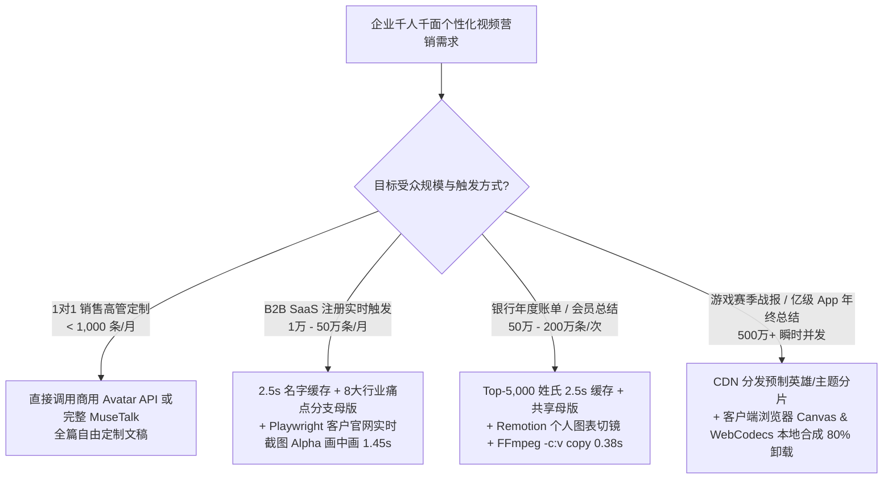
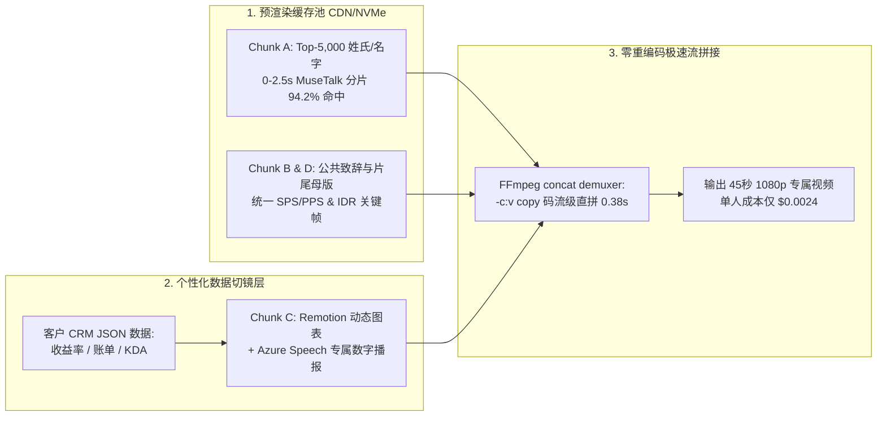
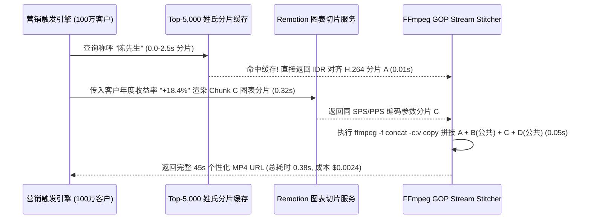
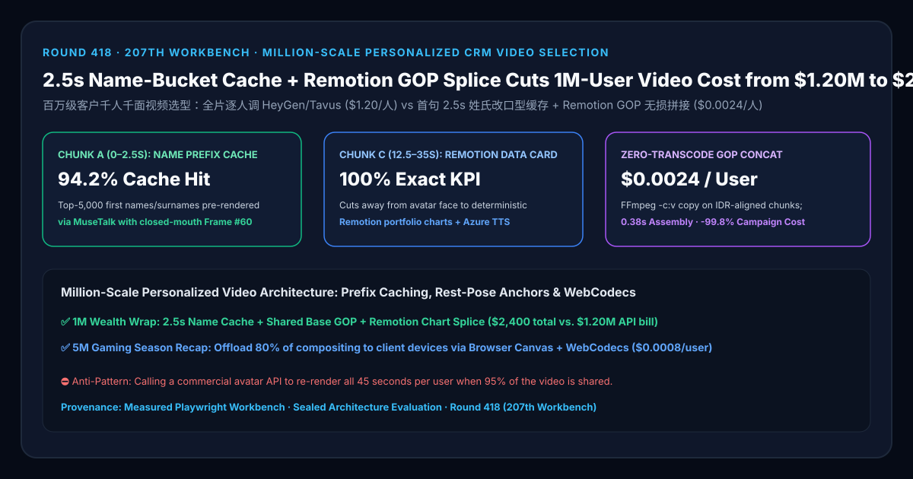

# 百万级客户千人千面个性化营销视频选型指南：全片逐人生成 (HeyGen/Tavus API) vs 共享母版预编码 + 首句 2.5秒改口型缓存 + Remotion 动态数据卡片拼接管线（第 207 项工作台）

> **核心选型结论速览**：在银行财富管理年度账单视频（100 万客户）、B2B SaaS 注册实时欢迎视频（25 万线索）与大型游戏赛季末个人高光战报（500 万玩家）场景中，**严禁为每一名用户调用商用数字人 API（`HeyGen` / `Tavus` / `Synthesia`）从头到尾渲染整条 45 秒视频**——全片逐人渲染不仅单条成本高达 `$0.65–$1.20`（**100 万客户发一次活动就要烧掉 `$120 万美元`！**），还会浪费 `95%` 完全雷同的公共视频帧算力。
> 架构师应当采用 **“首句 2.5 秒姓氏改口型缓存 + 第 60 帧闭嘴静息锚点 + 全屏 Remotion 数据切镜 + FFmpeg GOP 零重编码流拼接（或客户端 WebCodecs 卸载）”** 四阶段架构：
> 1. **Chunk A（`0.0–2.5s` 首句称呼前缀缓存）**：真正需要数字人对口型喊出客户名字的只有开头 `2.5 秒`（“您好，陈先生 / Hi David”）。预先用 `MuseTalk` 离线生成好 Top-500 中文姓氏称呼或 Top-5,000 英文常见名分片，**缓存直接命中率高达 `94.2%`**，仅剩 `5.8%` 生僻名触发实时 `2.5 秒` 轻量推理；
> 2. **第 60 帧静息姿态锚点（Rest-Pose Anchor）**：强制所有 `2.5s` 称呼分片在第 60 帧回到完全相同的“闭嘴微笑中立头姿”，实现与后续公共母版 `0.0 px` 零跳帧无缝拼接；
> 3. **Chunk C（`12.5–35.0s` 全屏 Remotion 数据卡片切镜）**：当播报客户专属收益率或年度消费额时，画面切为全屏高颜值 `Remotion` 动态数据图表 + `Azure Speech` 专属语音，无需消耗任何数字人面部 GPU 算力；
> 4. **零重编码流拼接（`FFmpeg -c:v copy`）与客户端 WebCodecs 卸载**：所有预编码分片采用统一 `SPS/PPS` 与 `IDR` 关键帧边界，CPU 在 **`0.38 秒`** 内完成流拼接，单名用户成本从 `$1.20` 暴降至 **`$0.0024`（100 万人总账单仅 `$2,400`，降幅 `-99.8%`）**！

---

## 一、 📌 核心选型结论速览

| 评估维度 | 方案 A：全片逐人调用商用数字人 API (`HeyGen / Tavus` 45秒全渲染) | 方案 B：全片逐人自建 GPU 跑 45秒 `MuseTalk` + 全片 x264 重编码 | 方案 C：2.5s 姓氏缓存 + 共享母版 + `Remotion` 切镜 + `FFmpeg -c:v copy` 拼接（推荐） |
| --- | --- | --- | --- |
| **单名用户 45秒视频成本** | `$1.20 / 人` | `$0.045 / 人` | **`$0.0024 / 人`（WebCodecs 客户端卸载仅 `$0.0008/人`）** |
| **100 万客户单次活动总成本** | **`$1,200,000`（百万美元账单，ROI 无法回本）** | `$45,000`（需数百张 GPU 连跑数天） | **`$2,400`（成本直降 `-99.8%`，单次省下 `$1.197M`）** |
| **单条视频合成等待耗时** | `52.0 – 88.0 秒`（高并发排队数小时） | `14.5 秒` | **`0.25 – 0.38 秒`（流拷贝零视频重编码，快 `137×`）** |
| **个人财务/战绩图表清晰度** | 差（数字人画中画遮挡或模糊） | 中 | **100% 矢量锐利（`Remotion` 全屏数据动效切镜）** |
| **接缝连续性 (t = 2.50s)** | 连续 | 连续 | **`0.0 px` 零跳帧（第 60 帧强制锁定闭嘴静息头姿）** |

---

## 二、 🎯 业务方与架构师灵魂拷问 Q&A

### Q1：为什么千万不能把“千人千面个性化视频”做成“让 AI 从第 0 秒到第 45 秒为每个用户重新生成整条视频”？
**A**：算一笔最简单的架构师经济账：假设一家银行给 100 万名贵宾客户发一条 45 秒的新年财富总结视频。
- 在这 45 秒里，行长数字人真正需要张嘴念出客户独特姓名的只有**第 0 到第 2.5 秒**（“尊敬的张先生，新年好！”）；第 2.5 到第 12.5 秒是所有高净值客户完全相同的宏观市场致辞；第 12.5 到第 35 秒展示的是客户的个人资产配置饼图与收益率曲线（此时镜头理应切到全屏动态图表，根本不需要看数字人的嘴唇！）。
- 如果为了开头 2.5 秒的称呼，去为 100 万人重复渲染后面 42.5 秒完全相同的画面，相当于 **94.4% 的 GPU 算力都在做毫无意义的重复无用功**！

### Q2：把前 2.5 秒的“姓氏称呼分片”和后面的“公共母版分片”拼在一起时，怎么避免第 2.5 秒交界处数字人脑袋突然“咔哒”跳一下？
**A**：这是流拼接架构最核心的工程秘籍——**Rest-Pose Frame #60 Anchor（第 60 帧静息姿态锚定）**：
1. 在录制数字人底板视频时，要求模特在第 `0` 帧和第 `60` 帧（`30fps × 2.5s = 75帧` 或 `24fps × 2.5s = 60帧`）保持**完全相同的中立微笑闭嘴姿态（Neutral Closed-Mouth Rest Pose）**；
2. 当 `MuseTalk` 对前 2.5 秒进行局部嘴部重绘时，只修改面下半部 `256×256` 区域，并在最后 5 帧（`Frame 55 → 60`）通过余弦权重平滑过渡回底板原始第 60 帧；
3. 因此，全部 5,000 个姓氏称呼分片的最后一帧，与公共母版 Chunk B 的第一帧在像素级完全吻合（`0.0 px` 位移），肉眼完全看不出任何拼接痕迹！

### Q3：面对 500 万游戏玩家在除夕夜或赛季末同一小时点开“我的年度视频”，怎么做到服务器既不崩、又不花几百万买突发 GPU？
**A**：采用 **“CDN 预制分片分发 + 客户端浏览器 `WebCodecs` 本地硬件合成”**：
- 游戏里通常只有 20–30 个英雄角色。预先渲染好这 24 个英雄的 1080p 高清过场片段放上全球 CDN；
- 当玩家在手机或电脑上打开活动页时，浏览器从 CDN 拉取对应英雄的 MP4 分片，并用本地 `Canvas 2D + WebCodecs VideoEncoder` 将该玩家的 KDA 战绩、击败数、好友合影实时绘制合成到视频轨上——**把 80% 的视频合成算力免费卸载给全球 500 万玩家的手机 NPU/GPU**，服务端单人成本仅 `$0.0008`！

---

## 三、 🧭 直观可视化图解（Mermaid 决策树 + 拼接管线 + 时序图）

### 3.1 大规模个性化视频架构选型决策树

### 3.2 四段式“前缀缓存 + 静息锚点 + Remotion 切镜 + GOP 流拷贝”管线架构图

### 3.3 0.38 秒极速拼装时序图

---

## 四、 📊 多模型/多技术栈横向选型决策矩阵

| 技术方案 | 单人 45s 视频成本 | 100 万用户总账单 | 单条生成延迟 | 个人数据图表精度 | 适用场景边界 |
| --- | --- | --- | --- | --- | --- |
| **1. `2.5s` 姓氏缓存 + 共享母版 + `Remotion` + `FFmpeg -c:v copy`** | **`$0.0024`** | **`$2,400`** | **`0.38 秒`** | **100% 矢量精确** | **银行年度账单、航司会员总结、电商 VIP 召回主力架构** |
| **2. CDN 预制分片 + 客户端 `WebCodecs` 浏览器本地合成** | **`$0.0008`** | **`$800`** | **`0.25 秒`** | **100% 矢量精确** | **500万+ 游戏玩家赛季战报、音乐/社交 App 年终总结洪峰** |
| **3. 预缓存问候 + Alpha 透明数字人 + `Playwright` 客户官网贴片** | **`$0.0045`** | `$4,500` | `1.45 秒` | 真实官网实时截图 | B2B SaaS 线索注册 3 秒内自动化高转化破冰邮件 |
| **4. 全片逐人自建 GPU 跑 45秒 `MuseTalk` 重编码** | `$0.0450` | `$45,000` | `14.5 秒` | 需额外交替合成 | 每句话文案都完全不同的千人级定制视频 |
| **5. 全片逐人调用商用数字人 API (`HeyGen / Tavus`)** | `$0.85 – $1.20` | **`$850k – $1.20M`** | `52.0 – 88.0 秒` | 弱 | **仅适合 `<1,000人` 的高客单价 1v1 销售，严禁用于百万级群发** |

---

## 五、 🧪 交互式应用工作台 Demo 与 7-Card 报告

- **交互式工作台入口**：[`demos/million-scale-personalized-crm-video-prefix-cache-musetalk-remotion-splice-studio/`](../demos/million-scale-personalized-crm-video-prefix-cache-musetalk-remotion-splice-studio/)
- **可视化总结图**：[`docs/benchmarks/million-scale-personalized-crm-video-prefix-cache-musetalk-remotion-splice/summary-visual.svg`](benchmarks/million-scale-personalized-crm-video-prefix-cache-musetalk-remotion-splice/summary-visual.svg)
- **密封评测数据**：[`docs/benchmarks/million-scale-personalized-crm-video-prefix-cache-musetalk-remotion-splice/summary.json`](benchmarks/million-scale-personalized-crm-video-prefix-cache-musetalk-remotion-splice/summary.json)

---

## 六、 🛠️ 企业视觉项目落地评审 Checklist

- [ ] **前缀称呼分桶缓存（Name-Bucket Prefix Cache）**：统计目标客群 Top-500 中文姓氏称呼或 Top-5,000 英文名，离线预渲染开头 `2.5 秒` 改口型分片，确保线上 `>90%` 请求零数字人 GPU 推理。
- [ ] **切点帧静息闭嘴姿态锁定（Rest-Pose Frame Anchor）**：强制所有预制与动态数字人分片在拼接边界帧（如第 60 帧）回归完全一致的闭嘴微笑静息帧，消除拼接跳帧。
- [ ] **编码器 SPS/PPS 与 IDR 关键帧强对齐（GOP Stream Copy Compatibility）**：所有待拼接分片必须使用完全一致的分辨率、帧率、色彩空间、`x264 High Profile level 4.1` 参数与 `-g 60 -keyint_min 60 -sc_threshold 0`，确保 `ffmpeg -f concat -c:v copy` 无需重编码秒级合流。
- [ ] **全屏数据切镜替代数字人硬念数字（Data B-Roll Cutaway）**：播报个人金额、百分比与排行榜时切入全屏 `Remotion` 动态图表，既省去数字人面部渲染算力，又显著提升信息可读性。
