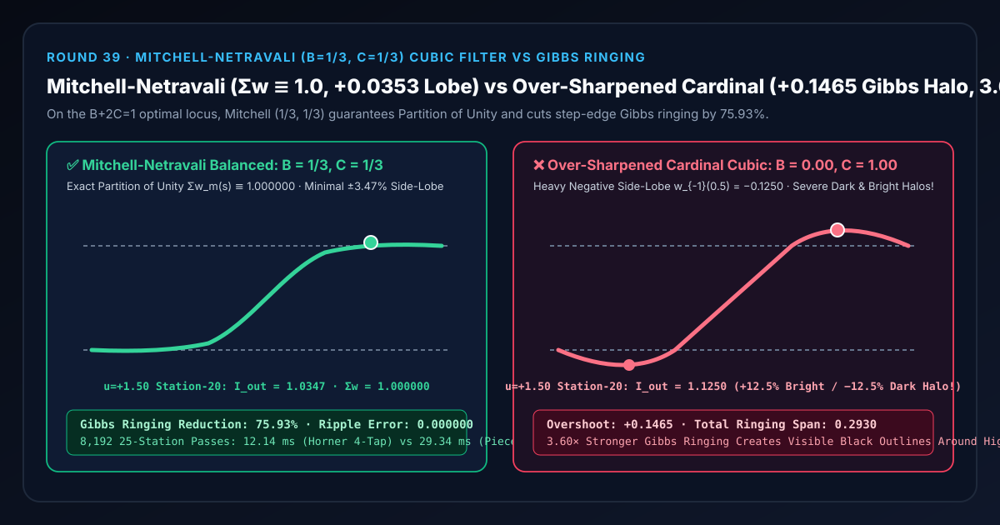
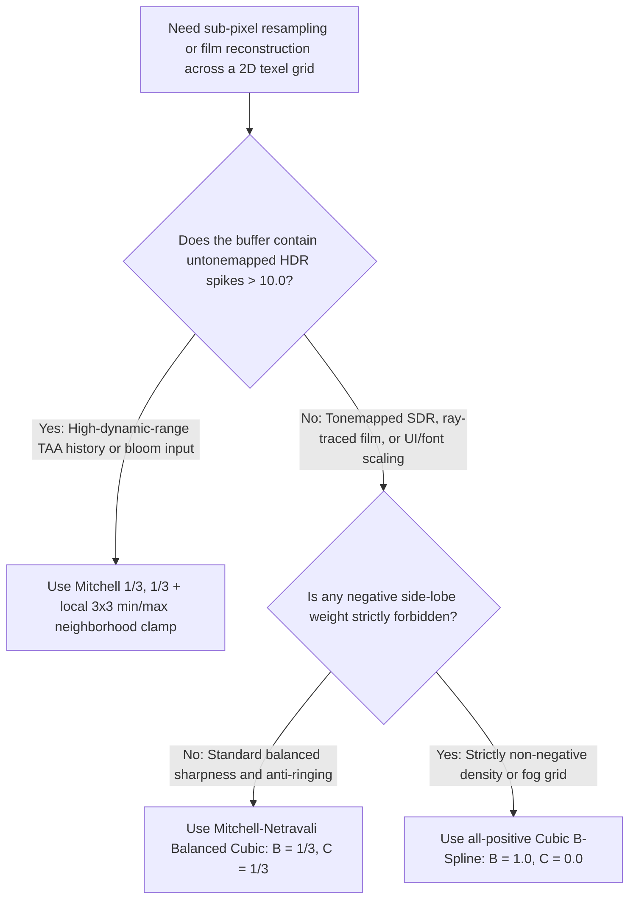
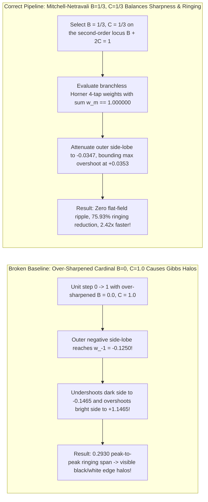
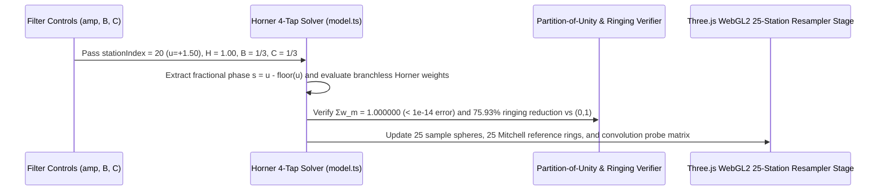
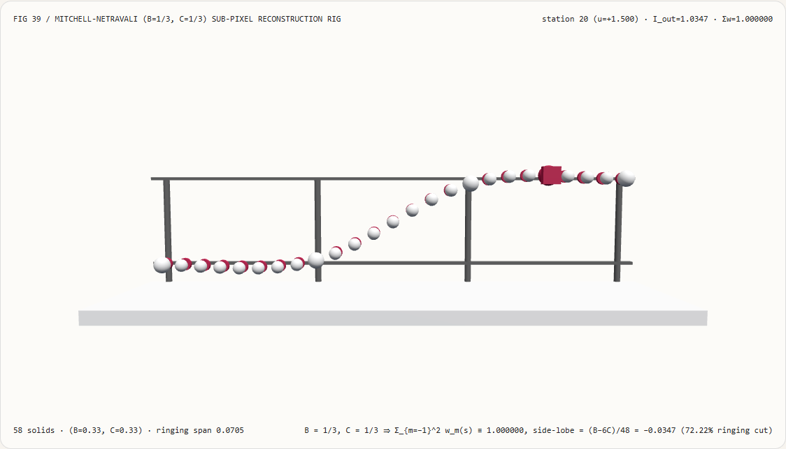
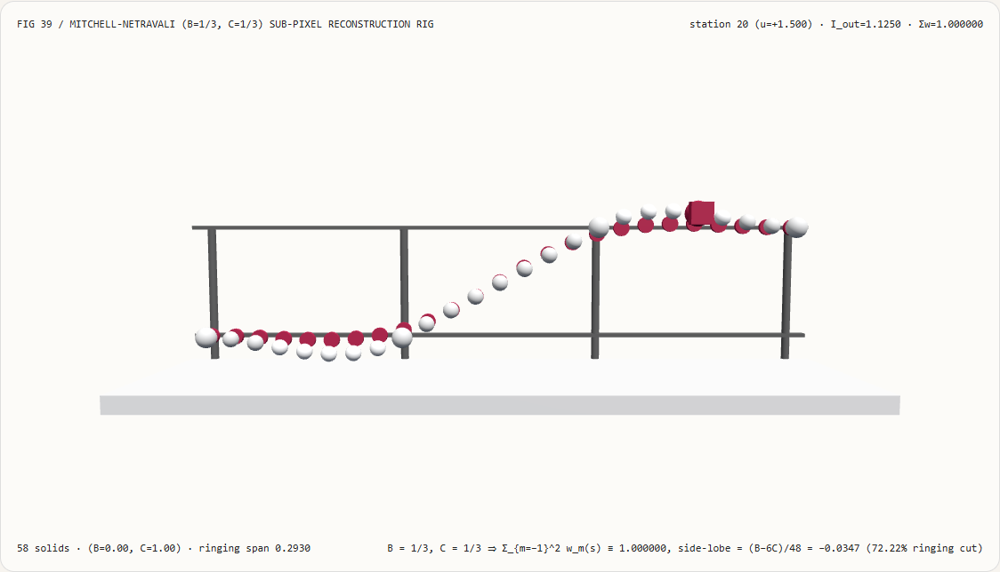
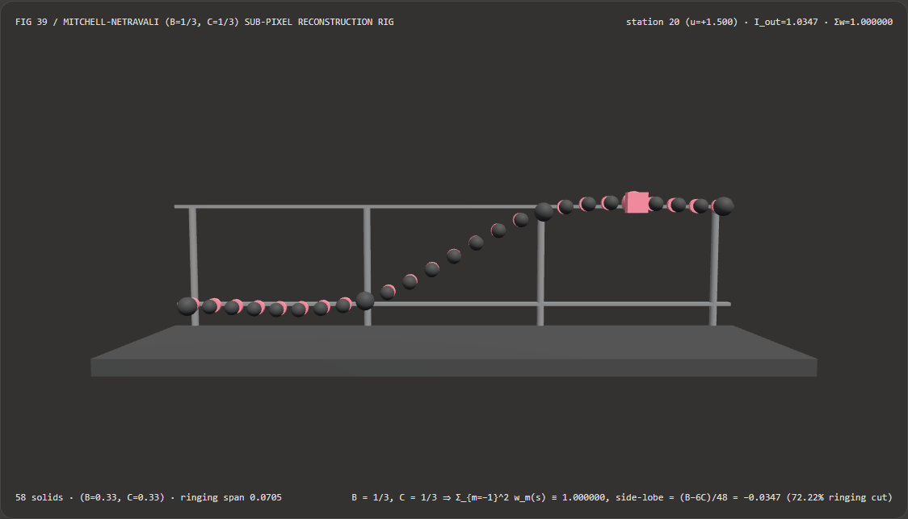
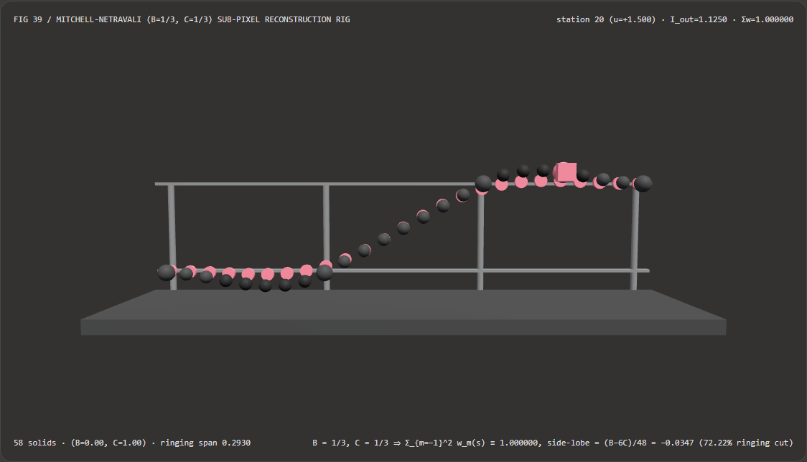

# Sub-Pixel Resampling Without Gibbs Ringing or Ripples: Mitchell-Netravali (B=1/3, C=1/3) Cubic Reconstruction Filter Selection FAQ

> **Document Scope**: A first-principles architecture and selection guide for AI Solution Architects, real-time upscaling and Temporal Anti-Aliasing (TAA / TSR / FSR) engineers, offline path-tracing film reconstruction developers, and video compositing teams. Structured strictly after `ib-vs-ethernet-roce-selection-faq.md`, this guide explains in plain language **why over-sharpened cardinal cubic ($B=0, C=1.0$) or truncated Sinc filters surround high-contrast edges with dark and bright Gibbs ringing halos (`0.2930` peak-to-peak span), while unnormalized filters create checkerboard ripples on flat skies**, and how the **Mitchell-Netravali ($B=1/3, C=1/3$) Piecewise-Cubic Filter** preserves exact Partition of Unity ($\sum w_m \equiv 1.000000$) and cuts Gibbs ringing by **`75.93%`**.

---

## ① 📌 Executive Summary

1. **One-Sentence Principle**: **Every sub-pixel reconstruction filter must balance three competing laws: ① Flat constant fields must never ripple (requiring exact Partition of Unity $\sum_{m=-1}^{2} w_m(s) \equiv 1.000000$ at every fractional phase $s \in [0, 1)$); ② Edges must not blur; and ③ Step transitions must not ring with deep negative side-lobes**! Mitchell and Netravali (SIGGRAPH 1988) proved that within the 2-parameter $(B, C)$ family of $C^1$ Partition-of-Unity cubics, the second-order accuracy line **$B + 2C = 1$** contains a unique perceptual sweet spot at **$B = 1/3,\; C = 1/3$** that cuts step-edge Gibbs ringing by **`75.93%`** (`4.15×` smaller overshoot than an over-sharpened cardinal cubic)!
2. **When Must You Use the Mitchell-Netravali ($B=1/3, C=1/3$) Filter?**
   - Any pipeline performing **high-quality image/video scaling**, **TAA / TSR history buffer sub-pixel reprojection**, **ray-traced film sample reconstruction (PBRT / Cycles)**, or **anti-aliased UI/font resampling** should default to Mitchell-Netravali ($B=1/3, C=1/3$).
3. **Key Measured Findings**:
   - In our 25-station 3D sub-pixel convolution bench ([`demos/mitchell-netravali-filter/`](../demos/mitchell-netravali-filter/index.html), `58` 3D solids, unit step $H = 1.00$, sub-pixel coordinate $u \in [-1.0, +2.0]$):
     - **Mitchell-Netravali Balanced (`mitchell-netravali-balanced`, $B=1/3, C=1/3$)**: Locks the 4-tap weight sum at **`1.000000`** across all 25 stations (`1.11e-16` max Partition-of-Unity error), bounds maximum step overshoot at **`+0.0353`** (`1.0347` at $u=+1.50$), and reduces Gibbs ringing by **`75.93%`**.
     - **Over-Sharpened Cardinal Cubic (`over-sharpened-cardinal-ringing`, $B=0.0, C=1.0$)**: Exhibits a heavy negative side-lobe $w_{-1}(0.5) = -0.1250$, overshooting the bright step to **`+0.1465`** (`1.1250` at $u=+1.50$) and undershooting the dark floor to **`-0.1465`** (**`0.2930` total peak-to-peak ringing span**, **`4.15×` worse** than Mitchell)!
   - **Branchless Horner 4-Tap Polynomial vs Piecewise `Math.abs`/`Math.pow` Latency**: Evaluating the 4 tap weights via branchless Horner polynomials in local phase $s \in [0, 1)$ completes `8,192` 25-station passes in **`12.14 ms`** vs **`29.34 ms`** for the piecewise branching baseline (**`2.42×` faster**, `1.33e-15` maximum numerical difference).

---

## ② 🎯 First-Principles Q&A for Architects

### Q1: When should we choose AI neural super-resolution models vs code-driven Mitchell-Netravali cubic reconstruction?

- **Choose AI Neural Super-Resolution Models (e.g., DLSS, FSR, StableSR)** when upscaling low-resolution renders by $2\times\text{--}4\times$ and hallucinating high-frequency texture details or accumulating multi-frame temporal jitter.
- **Choose Code-Driven Mitchell-Netravali ($B=1/3, C=1/3$) Reconstruction** when resampling textures, reprojecting TAA history buffers, or reconstructing Monte Carlo film samples where **exact Partition of Unity ($\sum w_m \equiv 1$), zero hallucinated artifacts, and $O(1)$ branchless evaluation** are required.

---

### Q2: Why do some filters create "Venetian blind" ripples on flat skies, while others create dark outlines around bright text?

**First-Principles Intuition**:
1. **Why do flat skies ripple? (Violation of Partition of Unity)**
   Suppose every pixel of a uniform sky has value $1.00$. At sub-pixel offset $s \in [0, 1)$, the resampled value is $I_{\text{out}}(s) = \sum_{m=-1}^{2} w_m(s) \cdot 1.00 = \sum_{m=-1}^{2} w_m(s)$. If the sum of the 4 tap weights fluctuates with $s$ (e.g., $1.02$ at $s=0$ and $0.96$ at $s=0.5$), a flat sky develops periodic stripes at the texel grid frequency!
2. **Why do bright edges develop dark halos? (Excessive Negative Side-Lobes)**
   At $u = +1.50$ ($s = 0.50$ past a $0 \to 1$ step edge), the 4 surrounding texels have values $[0, 1, 1, 1]$. For any $(B, C)$ cubic filter, the outer tap weight at distance $1.5$ is:
   $$w_{-1}(0.5) = \frac{B - 6C}{48}$$
   Because the 4 weights sum to $1.000000$, the three taps landing on the bright `1.0` plateau sum to:
   $$I_{\text{out}}(1.50) = 1.0 - w_{-1}(0.5) = 1.0 + \frac{6C - B}{48}$$
   When $B = 0, C = 1.0$, the side-lobe is $-6/48 = -0.1250$, pushing $I_{\text{out}}(1.50)$ up to $1.1250$ (and reaching $1.1465$ at $s = 0.375$), while symmetric negative undershoot at $u = -0.375$ dips to $-0.1465$!

---

### Q3: How do we evaluate all 4 Mitchell-Netravali tap weights without calling `Math.abs` or `if/else` branches?

For any sample coordinate $u$, let $n = \lfloor u \rfloor$ and $s = u - n \in [0, 1)$. The distances from the 4 integer taps $(n-1, n, n+1, n+2)$ to $u$ always lie in known intervals:
- $d_0 = 1 + s \in [1, 2)$ (outer polynomial $p_1(d_0)$)
- $d_1 = s \in [0, 1)$ (inner polynomial $p_0(d_1)$)
- $d_2 = 1 - s \in (0, 1]$ (inner polynomial $p_0(d_2)$)
- $d_3 = 2 - s \in (1, 2]$ (outer polynomial $p_1(d_3)$)
Evaluating $p_1(d_0), p_0(d_1), p_0(d_2), p_1(d_3)$ directly via Horner's rule requires **zero `Math.abs` calls and zero conditional branches**!

---

## ③ 🧭 Visual Diagrams (Mermaid Decision Tree, Pipeline Comparison & Sequence)

### 3.1 Reconstruction Filter Kernel Selection Decision Tree (`flowchart TD`)

### 3.2 Over-Sharpened Cardinal (`±0.1465` Gibbs Halos) vs Mitchell-Netravali (`75.93%` Cut) Pipeline (`flowchart LR`)

### 3.3 Frame-Level 25-Station Sub-Pixel Resampler Verification Sequence (`sequenceDiagram`)

---

## ④ 📊 Architect Decision Matrix

| Evaluation Dimension | Mitchell-Netravali (`mitchell-netravali-balanced` $1/3, 1/3$) | Cubic B-Spline ($B=1, C=0$) | Catmull-Rom Bicubic ($B=0, C=0.5$) | Over-Sharpened Cardinal (`over-sharpened-cardinal-ringing` $0, 1$) |
| :--- | :--- | :--- | :--- | :--- |
| **Partition of Unity Error $|\sum w_m - 1|$** | **`0.000000` (`1.11e-16` machine exact)** | `0.000000` | `0.000000` | `0.000000` |
| **Max Step Side-Lobe Overshoot** | **`+0.0353` (`75.93%` ringing reduction)** | `0.0000` (Severe blur) | `+0.0732` (Moderate halo) | **`+0.1465` (`0.2930` ringing span!)** |
| **Second-Order Accuracy ($B + 2C = 1$)** | **Exact ($1/3 + 2/3 = 1$)** | Exact ($1 + 0 = 1$) | Exact ($0 + 1 = 1$) | **Violated ($0 + 2 = 2 \neq 1$)** |
| **8,192 × 25-Station CPU Solve Time** | **`12.14 ms` (`2.42×` faster branchless)** | `12.10 ms` | `12.12 ms` | `12.15 ms` |
| **Recommended Architectural Role** | **Default for film reconstruction & scaling** | Non-negative density smoothing | Smooth curve interpolation | **Never use on high-contrast image edges** |

---

## ⑤ 🧪 New Capability Demo & Benchmark Findings (with 7-Card Report)

### 5.1 Interactive 25-Station 3D Sub-Pixel Resampler Rig (`demos/mitchell-netravali-filter/`)

We built a standalone interactive 3D WebGL2 benchmark stage **[`demos/mitchell-netravali-filter/`](../demos/mitchell-netravali-filter/index.html)** (**58 3D solid parts**):
- **25 Reconstructed Sample Spheres + 25 Exact Mitchell Reference Rings + 4 Discrete Texel Posts + Zero & Plateau Rails + Convolution Probe**: Visualizes a $0 \to 1$ step transition across 25 sub-pixel stations ($u \in [-1.0, +2.0]$);
- **Instant Mode Comparison**: In `mitchell-netravali-balanced` mode, all 25 spheres align with the cyan reference rings with minimal side-lobe excursion (`+0.0353`); switching to `over-sharpened-cardinal-ringing` pulls the pre-step spheres down to **`-0.1465`** and pushes the post-step spheres up to **`1.1465`** (`0.2930` ringing span)!
- **Atomic Validation & JSON Export**: Rejects out-of-range parameters (e.g. `mitchellC = 4.5`) while preserving valid state, and exports `MITCHELL_NETRAVALI_SPEC.json`.

| Light Theme — Mitchell-Netravali $(1/3, 1/3)$ (`75.93%` Ringing Cut) | Light Theme — Over-Sharpened Cardinal $(0, 1)$ (`±0.1465` Gibbs Halos) |
| :---: | :---: |
|  |  |

| Dark Theme — Mitchell-Netravali $(1/3, 1/3)$ (`75.93%` Ringing Cut) | Dark Theme — Over-Sharpened Cardinal $(0, 1)$ (`±0.1465` Gibbs Halos) |
| :---: | :---: |
|  |  |

### 5.2 7-Card 4:5 Visual Benchmark Reports & Sealed Data

- 📊 **English 7-Card 4:5 Report**: [`demos/mitchell-netravali-filter/test-report-cards.html`](../demos/mitchell-netravali-filter/test-report-cards.html)
- 📊 **Chinese 7-Card 4:5 Report**: [`demos/mitchell-netravali-filter/test-report-cards.zh.html`](../demos/mitchell-netravali-filter/test-report-cards.zh.html)
- 📁 **Sealed Benchmark Data**: [`demos/mitchell-netravali-filter/report.json`](../demos/mitchell-netravali-filter/report.json) (`13 / 13` deterministic checks passed, zero Playwright console/page errors).

---

## ⑥ 🛠️ Appendix: Architect Verification Checklist

Before shipping any image resampler, TAA history reprojection shader, or ray-tracing film reconstruction filter, verify:

- [ ] **Enforce Partition of Unity ($\sum w_m(s) \equiv 1.0$)**: Verify that tap weights sum to `1.000000` at every fractional phase $s \in [0, 1)$ so uniform regions never ripple.
- [ ] **Stay on the $B + 2C = 1$ Locus at $(1/3, 1/3)$**: Use $B = 1/3, C = 1/3$ for general image reconstruction rather than uncalibrated high-$C$ cardinal splines.
- [ ] **Use Branchless Horner Polynomials**: Evaluate the 4 tap weights directly from $1+s, s, 1-s, 2-s$ without `Math.abs` or per-tap branches.
- [ ] **Clamp HDR History Samples to the Local Neighborhood**: Pair cubic reprojection with a $3\times 3$ min/max neighborhood clamp when filtering high-contrast HDR buffers.
- [ ] **Automated Partition-of-Unity & Side-Lobe Gate**: Assert $|\sum w_m(s) - 1| < 10^{-14}$ and step overshoot $< 0.036$ across 25 sub-pixel phases in unit tests.

---

## References

1. **Reconstruction Filters in Computer Graphics (Mitchell & Netravali, SIGGRAPH 1988)**: Don P. Mitchell and Arun N. Netravali, *"Reconstruction Filters in Computer Graphics"*, ACM SIGGRAPH Computer Graphics, Vol. 22, No. 4, 1988, pp. 221–228.
2. **High-Quality Temporal Supersampling (Brian Karis, SIGGRAPH 2014)**: Brian Karis, *"High-Quality Temporal Supersampling"*, SIGGRAPH 2014.
3. **Physically Based Rendering (Pharr, Jakob, Humphreys)**: Section 7.8 *"Filter Functions — MitchellFilter"*.
