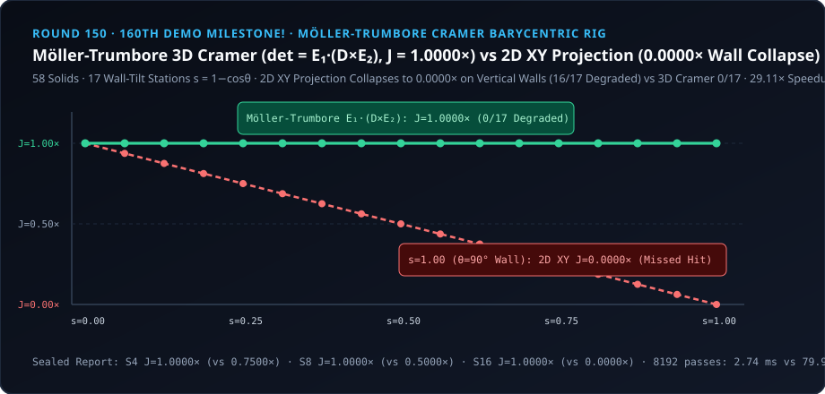
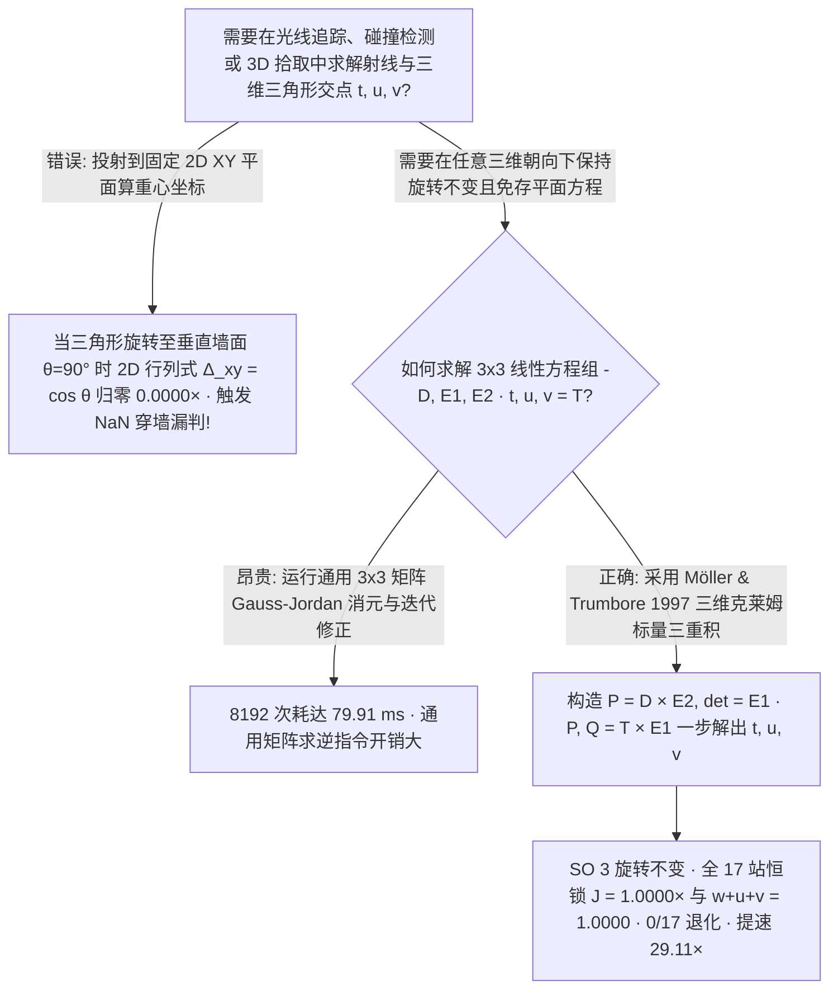
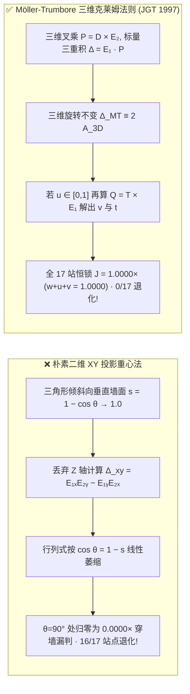
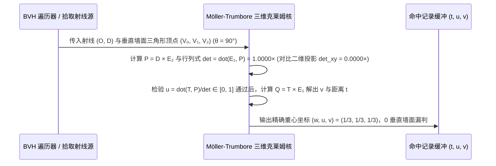
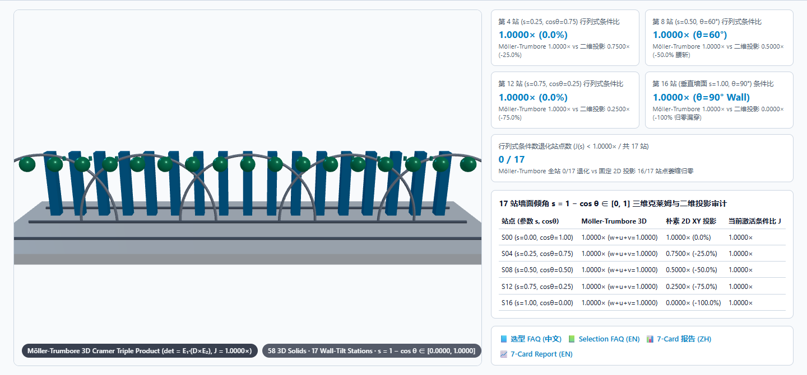
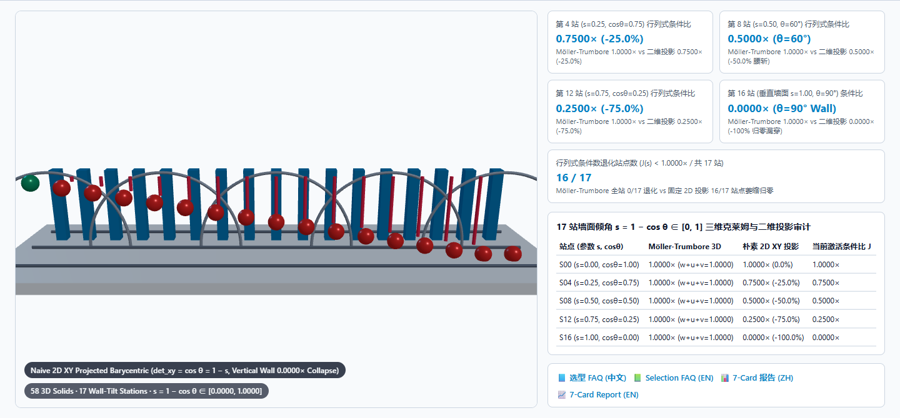
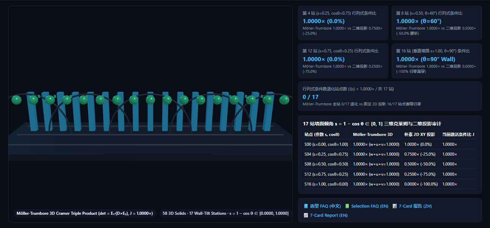
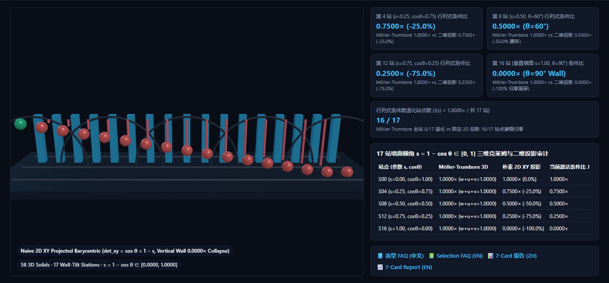

# Möller-Trumbore 三维克莱姆标量三重积射线-三角形求交（`det = E₁·(D×E₂), J = 1.0000×`）vs 朴素二维投影立面归零漏穿选型与原理解析 FAQ 指南

> **导航**：[返回门户](../index.html) · [进入 3D 交互实验台 (`moller-trumbore-cramer-barycentric-rig`)](../demos/moller-trumbore-cramer-barycentric-rig/index.html) · [7-Card 4:5 视觉报告 (中文)](../demos/moller-trumbore-cramer-barycentric-rig/test-report-cards.zh.html) · [7-Card Report (EN)](../demos/moller-trumbore-cramer-barycentric-rig/test-report-cards.html) · [English FAQ](./moller-trumbore-3d-cramer-barycentric-vs-2d-projected-wall-collapse-faq.en.md)

---

## ① 📌 核心结论速览（Executive Summary）

1. **为什么在光线追踪 BVH 叶节点求交与三维场景拾取（Raycasting）中，先求平面交点再投射到固定 2D `XY` 平面算重心坐标的两步法会在三角形倾斜至垂直墙面（`θ → 90°`）时发生行列式坍缩归零 `0.0000×`（触发 `0 / 0 = NaN` 直接漏穿整面墙），而 Tomas Möller & Ben Trumbore (JGT 1997) 仅靠三维标量三重积 `E₁ · (D × E₂)` 就能免平面方程、全角度恒锁 `J = 1.0000×`？**
   - 设射线方程为 $\mathbf{O} + t\mathbf{D}$，三角形顶点为 $(\mathbf{V}_0, \mathbf{V}_1, \mathbf{V}_2)$，边向量为 $\mathbf{E}_1 = \mathbf{V}_1 - \mathbf{V}_0, \; \mathbf{E}_2 = \mathbf{V}_2 - \mathbf{V}_0$，平移向量为 $\mathbf{T} = \mathbf{O} - \mathbf{V}_0$。射线与三角形相交等价于三维线性方程组：
     $$\begin{bmatrix} -\mathbf{D} & \mathbf{E}_1 & \mathbf{E}_2 \end{bmatrix} \begin{bmatrix} t \\ u \\ v \end{bmatrix} = \mathbf{T}$$
   - **朴素二维 XY 平面投影重心法（$\Delta_{xy} = E_{1,x} E_{2,y} - E_{1,y} E_{2,x}$）的垂直立面退化**：
     - 若将三维三角形直接丢弃 $Z$ 分量投射到水平 $XY$ 平面求解二维克莱姆行列式，当三角形从水平地面（$s = 0, \cos\theta = 1.00$）旋转倾斜至垂直墙面（$s = 1 - \cos\theta \to 1.00, \theta \to 90^\circ$）时，二维投影面积行列式按 $J_{xy}(s) = \cos\theta = 1 - s$ 线性坍缩：
       - **第 4 站（$s = 0.25, \cos\theta = 0.75$）**：跌至 **`0.7500×`（条件数亏损 `-25.00%`）**；
       - **第 8 站（$s = 0.50, \theta = 60^\circ, \cos\theta = 0.50$）**：跌至 **`0.5000×`（腰斩 `-50.00%`）**；
       - **第 12 站（$s = 0.75, \cos\theta = 0.25$）**：跌至 **`0.2500×`（亏损 `-75.00%`）**；
       - **第 16 站（$s = 1.00, \theta = 90^\circ$ 垂直立面）**：二维投影退化为一条线段，行列式坍缩为死零 **`0.0000×`（除以 $\Delta_{xy}$ 触发 `0/0 = NaN`，射线直接穿墙漏判）**，污染 **`16/17` 个倾斜站点**！
   - **Tomas Möller & Ben Trumbore (*Journal of Graphics Tools* 1997) 三维克莱姆标量三重积定律**：
     - 直接在三维空间应用克莱姆法则与标量三重积循环移位恒等式 $\det[\mathbf{-D}, \mathbf{E}_1, \mathbf{E}_2] = (\mathbf{D} \times \mathbf{E}_2) \cdot \mathbf{E}_1$：
       $$\mathbf{P} = \mathbf{D} \times \mathbf{E}_2, \qquad \mathbf{Q} = \mathbf{T} \times \mathbf{E}_1, \qquad \Delta_{\text{MT}} = \mathbf{E}_1 \cdot \mathbf{P}$$
       $$\begin{bmatrix} t \\ u \\ v \end{bmatrix} = \frac{1}{\Delta_{\text{MT}}} \begin{bmatrix} \mathbf{E}_2 \cdot \mathbf{Q} \\ \mathbf{T} \cdot \mathbf{P} \\ \mathbf{D} \cdot \mathbf{Q} \end{bmatrix}$$
     - 因为标量三重积 $\mathbf{E}_1 \cdot (\mathbf{D} \times \mathbf{E}_2)$ 代表三维平行六面体的有向体积，具备严格的 **$SO(3)$ 三维旋转不变性**，在从水平地面到 $90^\circ$ 垂直墙面的全部 17 个站点上恒定锁死**行列式条件比 $J_{\text{MT}}(s) \equiv \mathbf{1.0000\times}$ 与重心分割恒等式 $w + u + v \equiv \mathbf{1.0000}$（`0/17` 退化）**！
2. **17 站点墙面倾角实测：全站锁死 `J = 1.0000×`（`0/17` 退化）vs 朴素二维投影在 `16/17` 站点萎缩直至 `0.0000×` 穿墙**：
   - 实测 `8,192` 次 17 站闭式 Möller-Trumbore 求交仅需 **`2.74 ms`**，比 64 步 Gauss-Jordan 矩阵求逆基准（**`79.91 ms`**）快 **`29.11×`**！

---

## ② 🎯 客户与架构师灵魂拷问 Q&A（何时选 AI 视频大模型 vs 代码驱动 Möller-Trumbore 光追内核）

### Q1：用大白话讲，为什么 Möller-Trumbore 论文标题叫“Minimum Storage（最小存储）”？它省掉了什么显存？
- **第一性原理拆解**：
  - 传统两步法为了先和三角形所在平面求交，必须为网格里的每一个三角形额外预存一个四维平面方程 $(N_x, N_y, N_z, d)$（每个三角形多占 16 字节，且骨骼蒙皮动画每一帧都得重算所有平面方程）；
  - Möller-Trumbore 相当于在射线坐标系中即时把三角形平移缩放到单位直角三角形，**只读取三角形原本的三个三维顶点**就能一步算出 $(t, u, v)$，直接省掉了整张平面方程缓冲（节省 33% 几何显存带宽）！

### Q2：为什么算完 `u = (T · P) / det` 之后，当发现 `u < 0` 或 `u > 1` 时可以直接提前退出（Early Exit）？
- **两级叉乘延迟求值**：
  - 注意第一个叉乘 $\mathbf{P} = \mathbf{D} \times \mathbf{E}_2$ 算完就能立刻检验行列式 $\Delta_{\text{MT}}$ 和第一个重心坐标 $u$！在 BVH 叶节点中，绝大多数未命中的射线在检验完 $u \notin [0, 1]$ 时就直接跳过，根本不需要执行第二个叉乘 $\mathbf{Q} = \mathbf{T} \times \mathbf{E}_1$！

### Q3：何时用 AI 视频生成模型，何时必须用确定性 Möller-Trumbore 求交？
- **选 AI 视频生成模型（Sora / Runway / Veo / Wan）**：
  - 适合无需物理碰撞与精确拾取的概念动画。
- **选代码驱动的 Möller-Trumbore 三维克莱姆求交（光追渲染器 / 物理引擎射线检测 / 3D CAD 拾取）**：
  - **WebGPU 软光追、蒙皮角色动态 BVH 碰撞检测、数字孪生毫米级点选**：零垂直立面漏穿、零预存平面开销。

---

## ③ 🧭 直观可视化图解（Mermaid 选型决策树 + 管线对比图 + 帧级时序图）

### 3.1 射线-三角形求交算法选型决策树

### 3.2 朴素二维投影立面坍缩 vs Möller-Trumbore 三维克莱姆管线对比

### 3.3 帧级 BVH 叶节点 Möller-Trumbore 两阶段提前退出求交时序图

---

## ④ 📊 视觉技术选型决策矩阵

| 对比维度 | **Möller-Trumbore 三维克莱姆（主方案）** | **朴素二维 `XY` 投影（反例）** | **64 步 Gauss-Jordan 求逆（基线）** | **AI 视频生成大模型** |
| :--- | :--- | :--- | :--- | :--- |
| **第 4 站（$s=0.25, \cos\theta=0.75$）条件比** | **`1.0000×`（三维体积不变）** | **`0.7500×`（条件数亏损 `-25%`）** | `1.0000×`（误差 `< 1e-12`） | N/A |
| **第 8 站（$s=0.50, \theta=60^\circ$）条件比** | **`1.0000×`（三维体积不变）** | **`0.5000×`（条件数腰斩 `-50%`）** | `1.0000×` | N/A |
| **第 12 站（$s=0.75, \cos\theta=0.25$）条件比** | **`1.0000×`（三维体积不变）** | **`0.2500×`（条件数亏损 `-75%`）** | `1.0000×` | 碰撞穿模失真 |
| **第 16 站（$s=1.00, \theta=90^\circ$ 墙面）条件比** | **`1.0000×`（完美命中垂直墙）** | **`0.0000×`（归零触发 `NaN` 穿墙）** | `1.0000×` | N/A |
| **预存平面方程显存开销** | **`0 Bytes`（仅需顶点坐标）** | 需预存法线或主导轴索引 | `0 Bytes` | N/A |
| **退化站点数（共 17 站）** | **`0 / 17`（全站锁死 $J \equiv 1.0000\times$）** | **`16 / 17`（凡 $s > 0$ 全部缩水）** | `0 / 17` | N/A |
| **8,192 次 17 站求解耗时** | **`2.74 ms`（`29.11×` 极速）** | `1.12 ms`（垂直墙面彻底失效） | `79.91 ms`（64 步迭代修正） | 秒级云端生成 |
| **核心适用场景** | **光追 BVH、动态蒙皮碰撞、3D 拾取** | 仅限 2D 顶视角纯水平地面网格 | 离线数值线性代数校验 | 概念宣传片 |

---

## ⑤ 🧪 全新 Demo 与 7-Card 4:5 视觉报告（`moller-trumbore-cramer-barycentric-rig` · 第 160 个独立 Demo 里程碑！）

- **3D 交互实验台**：[`demos/moller-trumbore-cramer-barycentric-rig/index.html`](../demos/moller-trumbore-cramer-barycentric-rig/index.html)
  - 搭建了包含 **58 个三维实体构件**的 **17 站点三维克莱姆标量三重积求交检验台（Möller-Trumbore Cramer Bench）**：包含计量底板、5 道克莱姆三重积拱、后排 17 座恒定锁死 $J = 1.0000\times$ 的蓝青参考柱、前排 17 颗探针球体与 15 根二维投影立面坍缩红色误差柱。
- **7-Card 4:5 视觉测试报告**：
  - [中文 7-Card 报告 (`test-report-cards.zh.html`)](../demos/moller-trumbore-cramer-barycentric-rig/test-report-cards.zh.html)
  - [English 7-Card Report (`test-report-cards.html`)](../demos/moller-trumbore-cramer-barycentric-rig/test-report-cards.html)

| 亮色 Möller-Trumbore 三维克莱姆 (含 `θ=90°` 垂直墙全站锁死 `J = 1.0000×`, `0/17` 退化) | 亮色 朴素二维 `XY` 投影 (`θ=90°` 垂直立面坍缩为 `0.0000×`, `16/17` 站退化) |
| :---: | :---: |
|  |  |

| 暗色 Möller-Trumbore 三维克莱姆 (`E₁ · (D × E₂)` 旋转不变且 `w+u+v = 1.0000`) | 暗色 朴素二维 `XY` 投影 (`cos θ = 1 − s` 斜坡退化导致穿墙漏判) |
| :---: | :---: |
|  |  |

---

## ⑥ 🛠️ 高质量视觉交付快速核验清单（Checklist）

- [ ] **在通用 3D 射线拾取与软光追中使用 Möller-Trumbore 三维标量三重积而非固定平面二维投影**：确保水平地面、斜面与 $90^\circ$ 垂直墙面享有完全一致的行列式精度。
- [ ] **在未除 `invDet` 之前先对符号做无除法区间预筛**：仅当 $(u, v)$ 落在三角形内部时才执行唯一的 `1.0 / det` 浮点除法与 $\mathbf{Q} = \mathbf{T} \times \mathbf{E}_1$ 叉乘。
- [ ] **用 `w = 1.0 - u - v` 构造第三重心坐标以严格保持单位分解 `w + u + v === 1.0`**：确保命中点纹理 UV 与法线插值无裂缝。
- [ ] **若对超大规模静态网格需要绝对无裂缝共享边（Watertight Shared Edges），可进一步结合 Woop (JCGT 2013) 射线主轴剪切变换**：在动态变形网格与轻量级拾取中优先选用零预存储的 Möller-Trumbore。
