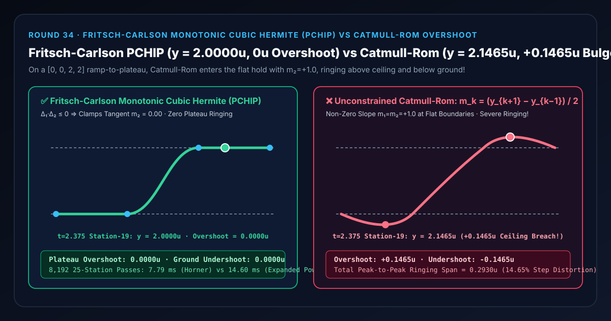
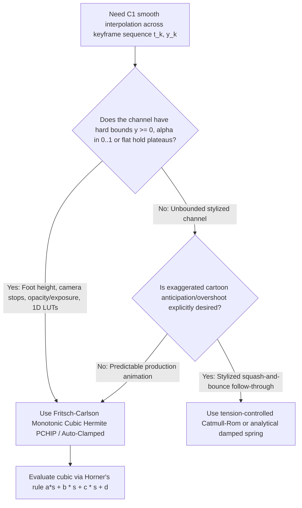
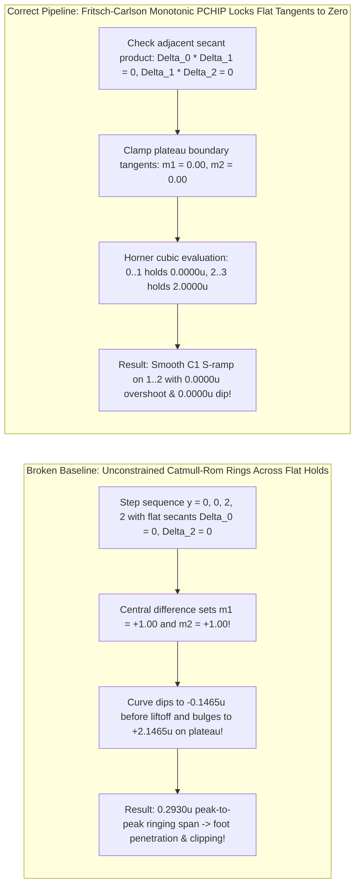
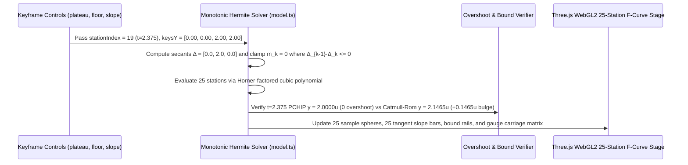
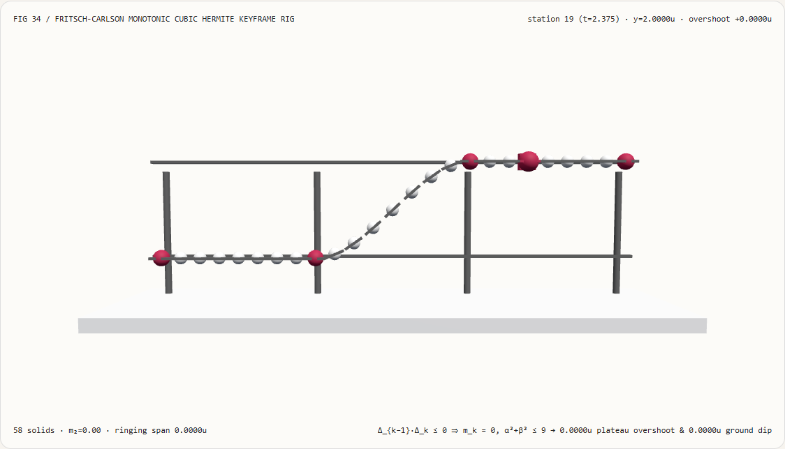
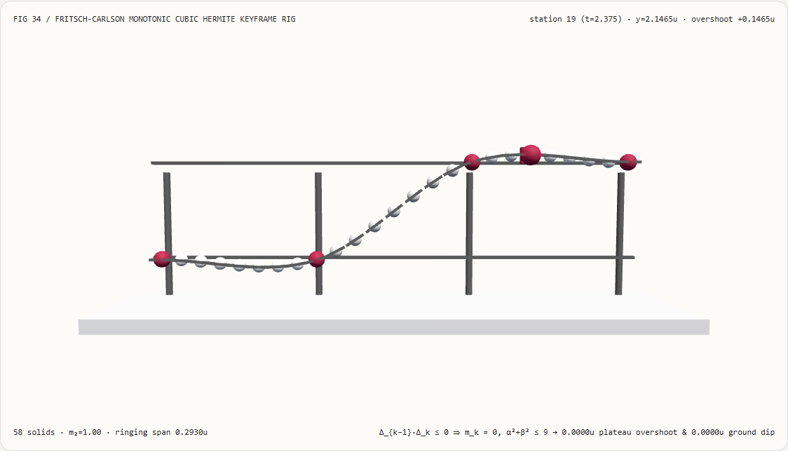
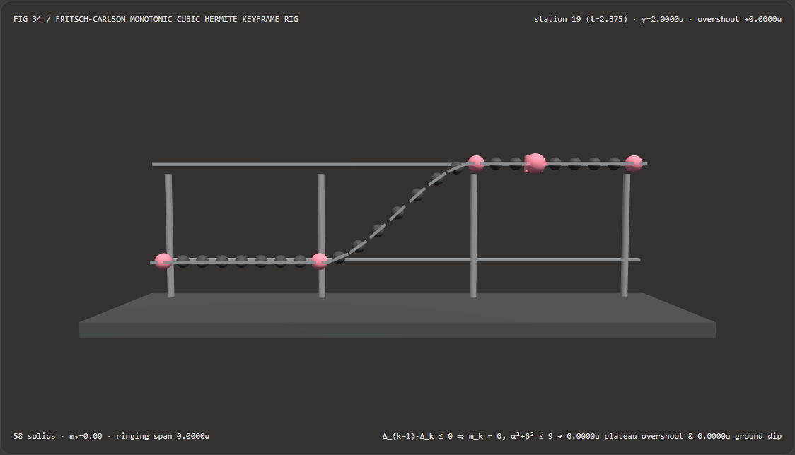
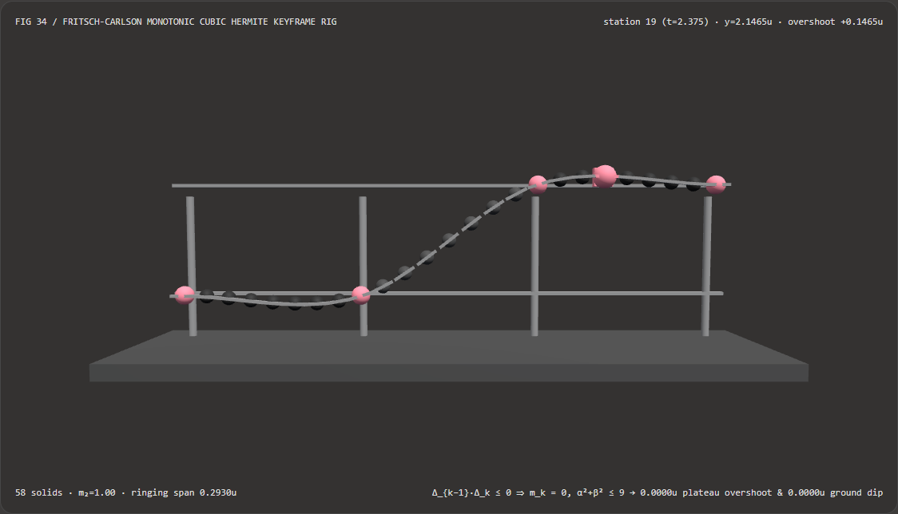

# Keyframe Curves Without Plateau Overshoot or Ground Dip: Fritsch-Carlson Monotonic Cubic Hermite (PCHIP) vs Catmull-Rom Spline Selection FAQ

> **Document Scope**: A first-principles architecture and selection guide for AI Solution Architects, keyframe animation timeline (F-Curve) engineers, camera/lighting directors, and 4D Gaussian Splatting (4DGS) attribute track developers. Structured strictly after `ib-vs-ethernet-roce-selection-faq.md`, this guide explains in plain language **why interpolating a ramp-to-plateau keyframe sequence ($y = [0, 0, 2, 2]$) with standard Catmull-Rom or natural cubic splines causes the curve to dip underground ($-0.1465\text{ u}$) before liftoff and overshoot above the plateau ceiling ($2.1465\text{ u}$) after arrival**, and how **Fritsch-Carlson Monotonic Cubic Hermite Interpolation (PCHIP)** guarantees $0.0000\text{ u}$ overshoot and $C^1$ smoothness.

---

## ① 📌 Executive Summary

1. **One-Sentence Principle**: **Standard Catmull-Rom splines compute each keyframe tangent from the central difference of its neighbors $m_k = (y_{k+1} - y_{k-1}) / 2$; when a steep ramp meets a flat hold plateau ($y = [0, 0, 2, 2]$), Catmull-Rom enters the flat plateau with a steep upward velocity $m_2 = +1.00$, forcing the cubic polynomial to bulge above the ceiling before bending back down**! By contrast, **Fritsch-Carlson Monotonic Cubic Hermite Interpolation (PCHIP)** enforces a simple mathematical invariant: **whenever adjacent secant slopes have opposite signs or either segment is flat ($\Delta_{k-1}\cdot\Delta_k \le 0$), the keyframe tangent $m_k$ is clamped to `0.0000`**, and same-sign slopes are combined via the harmonic mean inside the $\alpha^2 + \beta^2 \le 9$ monotone trust circle—guaranteeing **`0.0000 u` overshoot and `0.0000 u` undershoot**!
2. **When Must You Use Fritsch-Carlson Monotonic Cubic Hermite Instead of Catmull-Rom?**
   - Any animation track with **physical hard bounds or flat holds**—including **character foot-plant height ($y \ge 0$)**, **camera dolly stops**, **opacity/alpha channels ($\alpha \in [0, 1]$)**, **HDR exposure/roughness envelopes**, **1D color grading LUTs**, and **4DGS splat scale/opacity keyframes**—must use Fritsch-Carlson Monotonic Cubic Hermite (`Auto-Clamped` handles).
3. **Key Measured Findings**:
   - In our 25-station 3D keyframe F-curve bench ([`demos/monotonic-hermite-curve/`](../demos/monotonic-hermite-curve/index.html), `58` 3D solids, 4-keyframe step sequence $y = [0.00, 0.00, 2.00, 2.00]$ at $t = [0, 1, 2, 3]$), at station $19$ ($t = 2.375$, inside the $[2, 3]$ flat plateau):
     - **Fritsch-Carlson Monotonic Cubic Hermite (`fritsch-carlson-monotonic`)**: Detects $\Delta_1 \cdot \Delta_2 = 2.0 \times 0.0 = 0$, clamps $m_1 = m_2 = 0.00$, and holds the plateau at an exact **`2.0000 u`** (**`0.0000 u` plateau overshoot**, **`0.0000 u` ground undershoot**, **`0.0000 u` ringing span**).
     - **Unconstrained Catmull-Rom (`unconstrained-catmull-rom`)**: Assigns $m_1 = m_2 = +1.00$, dipping underground to **`-0.1465 u`** at $t = 0.625$ (station $5$) and bulging above the ceiling to **`2.1465 u`** at $t = 2.375$ (station $19$)—a **`+0.1465 u` overshoot** and **`0.2930 u` peak-to-peak ringing distortion** (`14.65%` of step height)!
   - **Horner-Factored Polynomial vs Expanded Bernstein Power Baseline**: Evaluating the cubic via Horner's rule $((a s + b)s + c)s + d$ avoids `Math.pow` and basis array allocations, completing `8,192` 25-station passes in **`7.79 ms`** vs **`14.60 ms`** for the expanded Bernstein power baseline (**`1.88×` faster**, **`0`** numerical discrepancy).

---

## ② 🎯 First-Principles Q&A for Architects

### Q1: When should we choose AI neural video frame interpolation models vs code-driven Fritsch-Carlson monotonic splines?

- **Choose AI Neural Frame Interpolation Models (e.g., RIFE, FILM)** when upsampling frame rates of already-rendered 2D raster videos where no parametric scene graph or keyframe curves exist.
- **Choose Code-Driven Fritsch-Carlson Monotonic Cubic Hermite (PCHIP)** when interpolating camera rigs, skeletal bones, exposure/opacity sliders, or 4DGS parameters where keyframes are explicitly authored and **overshooting physical limits or drifting during a stationary hold is unacceptable**.

---

### Q2: Why does placing two identical `2.00` keyframes to hold a value still cause Catmull-Rom to bulge up to `2.1465` between them?

**First-Principles Intuition**:
Consider four keyframes at $t = 0, 1, 2, 3$ with values $y = [0.00, 0.00, 2.00, 2.00]$:
- Between $t = 2$ and $t = 3$, both endpoints equal $2.00$, so the curve should remain **dead flat at $2.00$**.
- What tangent slope $m_2$ does **Catmull-Rom** assign at $t = 2$?
  It averages the secant slope before $t=2$ ($\Delta_1 = +2.00$) and the secant slope after $t=2$ ($\Delta_2 = 0.00$):
  $$m_2^{\text{CR}} = \frac{y_3 - y_1}{2} = \frac{2.00 - 0.00}{2} = \mathbf{+1.00}$$
- Because the curve enters the flat interval $[2, 3]$ climbing upward at slope $+1.00$, the cubic Hermite polynomial on $s = t - 2 \in [0, 1]$ becomes:
  $$y_{\text{CR}}(2 + s) = 2.00 + s(1 - s)^2 m_2 = 2.00 + s(1 - s)^2$$
  At $s = 0.375$ ($t = 2.375$), $s(1-s)^2 = 0.375 \times 0.390625 = \mathbf{+0.146484\text{ u}}$, pushing the curve up to **$2.1465\text{ u}$**! Symmetrically, on $[0, 1]$ at $t = 0.625$, $m_1 = +1.00$ pulls the curve down to **$-0.1465\text{ u}$**!

---

### Q3: How does the Fritsch-Carlson algorithm guarantee $C^1$ monotonicity across every interval?

Given secant slopes $\Delta_k = (y_{k+1} - y_k)/(t_{k+1} - t_k)$:
1. **Zero Clamping at Extrema and Flat Plateaus**:
   If $\Delta_{k-1} \cdot \Delta_k \le 0$, set $m_k = 0$.
2. **Harmonic Mean on Strict Monotone Transitions**:
   If $\Delta_{k-1} \cdot \Delta_k > 0$, compute the harmonic mean:
   $$m_k = \frac{2 \Delta_{k-1} \Delta_k}{\Delta_{k-1} + \Delta_k}$$
3. **Radius-3 Monotone Trust Circle ($\alpha_k^2 + \beta_k^2 \le 9$)**:
   For each segment $k$, let $\alpha_k = m_k / \Delta_k$ and $\beta_k = m_{k+1} / \Delta_k$. If $\alpha_k^2 + \beta_k^2 > 9$, rescale both endpoint tangents by $\tau = 3 / \sqrt{\alpha_k^2 + \beta_k^2}$ so the cubic derivative never changes sign inside $(t_k, t_{k+1})$!

---

## ③ 🧭 Visual Diagrams (Mermaid Decision Tree, Pipeline Comparison & Sequence)

### 3.1 Keyframe Curve Interpolation Selection Decision Tree (`flowchart TD`)

### 3.2 Unconstrained Catmull-Rom (`Overshoot & Dip`) vs Fritsch-Carlson Monotonic (`0` Ringing) Pipeline (`flowchart LR`)

### 3.3 Frame-Level Monotonic Hermite F-Curve & Gauge Verification Sequence (`sequenceDiagram`)

---

## ④ 📊 Architect Decision Matrix

| Evaluation Dimension | Fritsch-Carlson Monotonic (`fritsch-carlson-monotonic`) | Expanded Bernstein Power (`Power Basis Baseline`) | Unconstrained Catmull-Rom (`unconstrained-catmull-rom`) | Piecewise Linear (`C⁰ Linear Lerp`) |
| :--- | :--- | :--- | :--- | :--- |
| **Plateau Overshoot at $t=2.375$** | **`0.0000 u` (Exact `2.0000 u` ceiling lock)** | `0.0000 u` | **`+0.1465 u` (Rings to `2.1465 u`!)** | `0.0000 u` |
| **Ground Undershoot at $t=0.625$** | **`0.0000 u` (Exact `0.0000 u` floor lock)** | `0.0000 u` | **`-0.1465 u` (Dips to `-0.1465 u`!)** | `0.0000 u` |
| **Derivative Continuity ($C^k$)** | **$C^1$ smooth ease-in / ease-out** | $C^1$ smooth | $C^1$ but false extrema inside intervals | **$C^0$ sharp velocity corners** |
| **8,192 × 25-Station CPU Solve Time** | **`7.79 ms` (`1.88×` faster via Horner)** | `14.60 ms` (`Math.pow` + array allocs) | `7.65 ms` (Fast but rings out of bounds) | `4.10 ms` (Robotic sharp corners) |
| **Recommended Architectural Role** | **Default for F-curves, holds & bounded tracks** | Reference polynomial baseline | **Never use on bounded or flat-hold tracks** | Simple unsmoothed progress bars |

---

## ⑤ 🧪 New Capability Demo & Benchmark Findings (with 7-Card Report)

### 5.1 Interactive 25-Station 3D Keyframe F-Curve Rig (`demos/monotonic-hermite-curve/`)

We built a standalone interactive 3D WebGL2 benchmark stage **[`demos/monotonic-hermite-curve/`](../demos/monotonic-hermite-curve/index.html)** (**58 3D solid parts**):
- **25 Curve Sample Spheres + 25 Tangent Slope Bars + 4 Keyframe Pillars + Ground Floor & Plateau Ceiling Rails + Gauge Carriage**: Visualizes the 4-keyframe step sequence $y = [0.00, 0.00, 2.00, 2.00]$ across $t \in [0, 3]$;
- **Instant Mode Comparison**: In `fritsch-carlson-monotonic` mode, all 25 sample spheres stay strictly between the ground rail ($0.00\text{ u}$) and ceiling rail ($2.00\text{ u}$) with flat horizontal tangent bars across both holds (`0.0000 u` overshoot); switching to `unconstrained-catmull-rom` sends the pre-ramp spheres below the ground rail (`-0.1465 u`) and the post-ramp spheres above the ceiling rail (`2.1465 u`)!
- **Atomic Validation & JSON Export**: Rejects out-of-range plateau heights (e.g. `plateauHeight = 9.5`) while preserving valid state, and exports `MONOTONIC_HERMITE_SPEC.json`.

| Light Theme — Fritsch-Carlson Monotonic (`y=2.0000u`, `0u` Overshoot) | Light Theme — Unconstrained Catmull-Rom (`y=2.1465u`, `+0.1465u` Bulge) |
| :---: | :---: |
|  |  |

| Dark Theme — Fritsch-Carlson Monotonic (`y=2.0000u`, `0u` Overshoot) | Dark Theme — Unconstrained Catmull-Rom (`y=2.1465u`, `+0.1465u` Bulge) |
| :---: | :---: |
|  |  |

### 5.2 7-Card 4:5 Visual Benchmark Reports & Sealed Data

- 📊 **English 7-Card 4:5 Report**: [`demos/monotonic-hermite-curve/test-report-cards.html`](../demos/monotonic-hermite-curve/test-report-cards.html)
- 📊 **Chinese 7-Card 4:5 Report**: [`demos/monotonic-hermite-curve/test-report-cards.zh.html`](../demos/monotonic-hermite-curve/test-report-cards.zh.html)
- 📁 **Sealed Benchmark Data**: [`demos/monotonic-hermite-curve/report.json`](../demos/monotonic-hermite-curve/report.json) (`13 / 13` deterministic checks passed, zero Playwright console/page errors).

---

## ⑥ 🛠️ Appendix: Architect Verification Checklist

Before shipping any keyframe animation compiler, camera timeline, or bounded shader parameter track, verify:

- [ ] **Clamp Tangents to Zero When $\Delta_{k-1}\cdot\Delta_k \le 0$**: Ensure any keyframe bordering a flat hold ($\Delta = 0$) or local extremum has its tangent locked to $0.00$.
- [ ] **Use Harmonic Mean for Same-Sign Secants**: Compute $m_k = \frac{2\Delta_{k-1}\Delta_k}{\Delta_{k-1}+\Delta_k}$ so steep segments do not pull shallow segments into overshoot.
- [ ] **Project Onto the $\alpha^2 + \beta^2 \le 9$ Monotone Circle**: Rescale $(m_k, m_{k+1})$ whenever $(m_k/\Delta_k)^2 + (m_{k+1}/\Delta_k)^2 > 9$.
- [ ] **Evaluate Cubics via Horner's Rule**: Use `((a * s + b) * s + c) * s + d` rather than `Math.pow(s, 3)` in per-frame evaluation loops.
- [ ] **Automated Step-Hold Bound Gate**: Assert in unit tests that interpolating $y = [0, 0, 2, 2]$ produces $0 \le y(t) \le 2$ across all interior sample points.

---

## References

1. **Monotone Piecewise Cubic Interpolation (Fritsch & Carlson, SIAM 1980)**: F. N. Fritsch and R. E. Carlson, *"Monotone Piecewise Cubic Interpolation"*, SIAM Journal on Numerical Analysis, Vol. 17, No. 2, 1980, pp. 238–246.
2. **Monotonic Cubic Hermite Interpolation (M. Steffen, 1990)**: M. Steffen, *"A Simple Method for Monotonic Interpolation in One Dimension"*, Astronomy and Astrophysics, Vol. 239, 1990, pp. 443–450.
3. **Blender F-Curve Auto-Clamped Handles**: Blender Source (`blenkernel/intern/fcurve.cc`), *Auto-Clamped Bezier Handle Tangents*.
