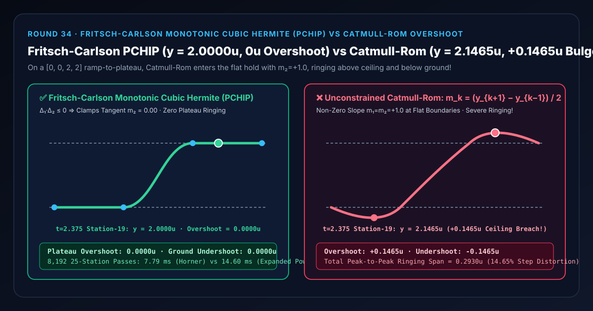
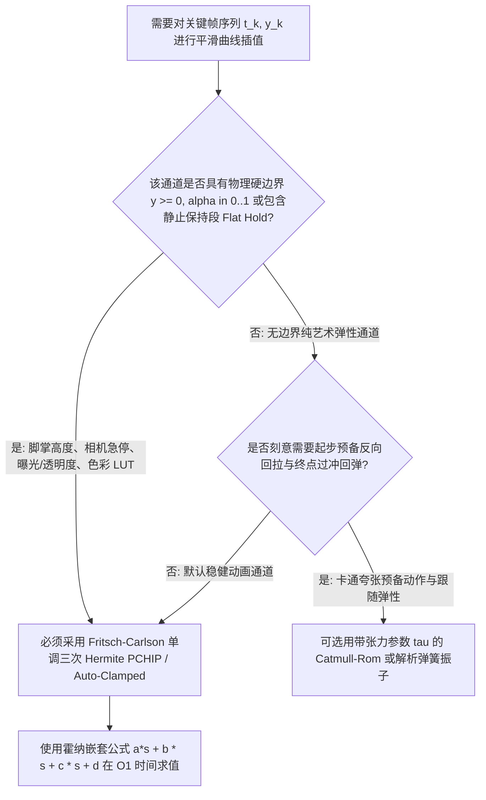
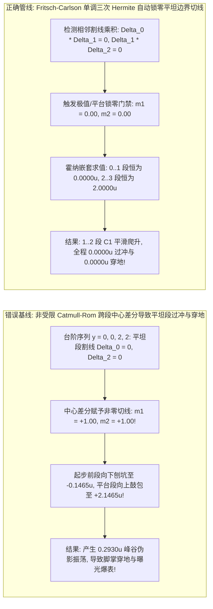
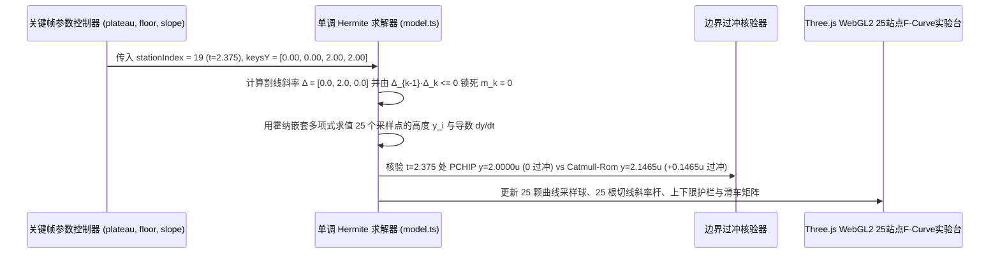
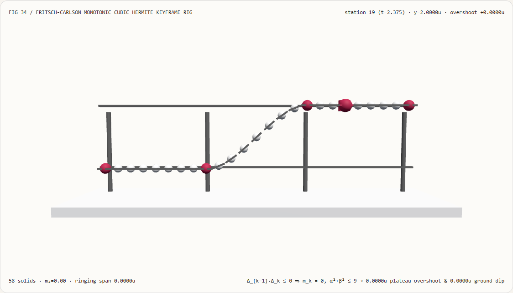
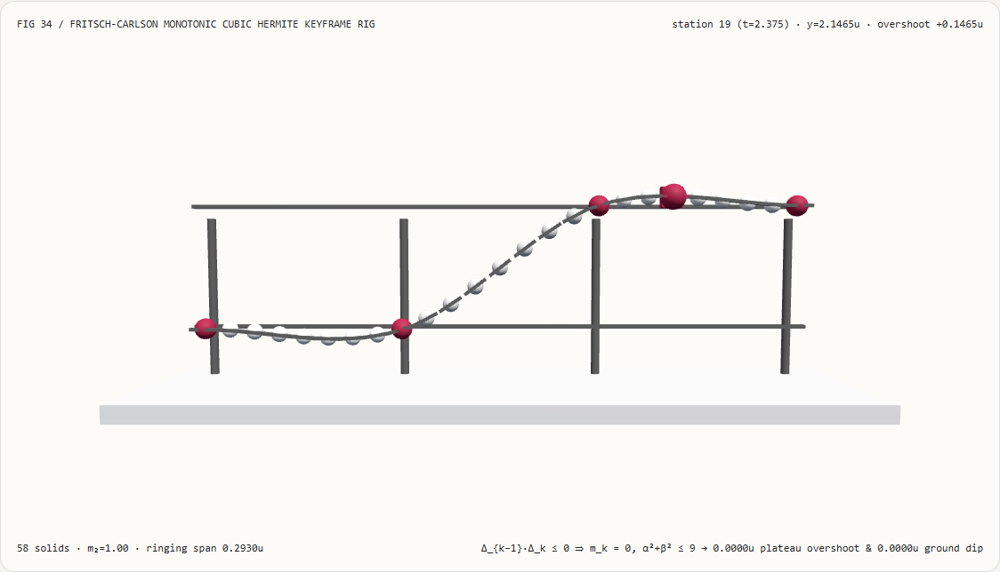
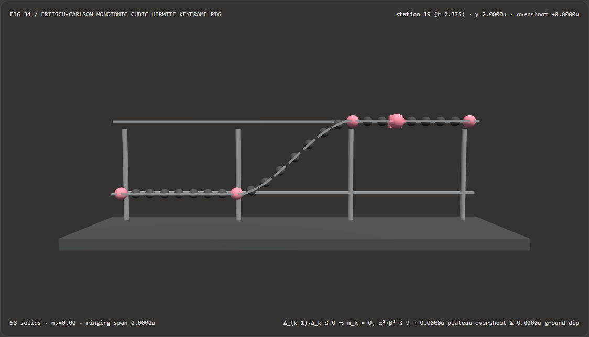
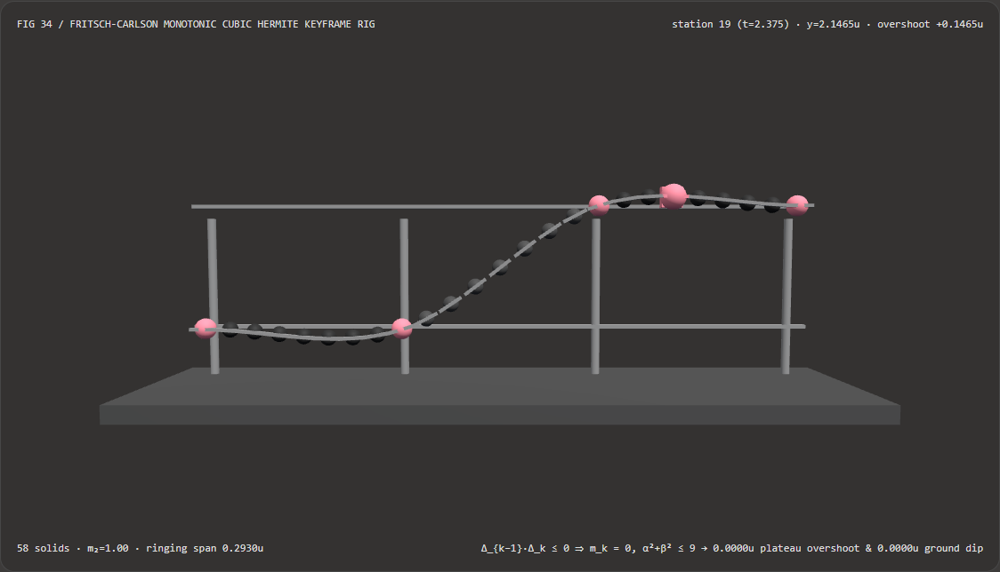

# 动画曲线与曝光关键帧在平坦段前不反向过冲：Fritsch-Carlson 单调三次 Hermite 插值（PCHIP）与 Catmull-Rom 样条选型 FAQ

> **文档定位**：面向 AI 解决方案架构师（AI Solution Architect）、关键帧动画系统（F-Curve / Timeline）引擎开发者、相机运镜与灯光调色工程师、以及 4D Gaussian Splatting（4DGS）属性轨道插值团队的**实战选型与第一性原理指南**。严格对标 `ib-vs-ethernet-roce-selection-faq.md` 的六段式结构，先用大白话讲清“**为什么在关键帧时间轴上打了两个数值完全相同的‘静止保持帧（Flat Hold，例如脚掌踩在地面 $y=0$ 或不透明度停在 $\alpha=2.0$）’，默认的 Catmull-Rom 或自然三次样条却会让脚掌在起跳前先钻入地底 $-0.1465\text{ u}$，落地后又弹起鼓包至 $2.1465\text{ u}$**”，再给出基于 **Fritsch-Carlson 单调三次 Hermite 插值（PCHIP）** 的工程闭环。

---

## ① 📌 核心结论速览（Executive Summary）

1. **一句话定性**：**经典 Catmull-Rom 样条盲目用左右邻居的跨段中心差分 $m_k = (y_{k+1} - y_{k-1}) / 2$ 作为节点切线；当曲线从陡坡进入一段水平保持段（如 $y=[0, 0, 2, 2]$）时，尽管平坦段本身的割线斜率 $\Delta_2 = y_3 - y_2 = 0$，Catmull-Rom 却强行赋予平坦段入口一个高达 $m_2 = +1.00$ 的向上冲刺初速度，迫使三次多项式冲破天花板发生过冲（Overshoot），再拐头往下拉回终点**！而 **Fritsch-Carlson 单调三次 Hermite 插值（PCHIP）** 遵循一条铁律：**只要相邻两段割线斜率异号或任一段为平坦段（$\Delta_{k-1}\cdot\Delta_k \le 0$），节点切线 $m_k$ 必须立即锁死为 `0.0000`**；同号段则采用加权调和平均并约束在 $\alpha^2 + \beta^2 \le 9$ 单调圆域内，实现**100% 零过冲、零穿地、$C^1$ 切线连续**！
2. **什么时候必须用 Fritsch-Carlson 单调样条取代 Catmull-Rom？**
   - 凡是涉及 **带物理硬边界的动画通道（角色脚掌高度 $y \ge 0$、不透明度 $\alpha \in [0,1]$、HDR 曝光度/粗糙度、音频音量包络）**、**相机推拉急停驻留（Camera Hold Plateau）**、**色彩查找表（1D/3D LUT）色调映射曲线**、以及 **4DGS 关键帧缩放/透明度属性轨道**，都必须使用 Fritsch-Carlson 单调三次 Hermite 插值（Blender/Maya 动画曲线编辑器默认的 `Auto-Clamped` 工业标准模式）。
3. **核心实测对比结论**：
   - 在本实验室构建的 25 站点 3D 关键帧 F-Curve 检验台（[`demos/monotonic-hermite-curve/`](../demos/monotonic-hermite-curve/index.html)，共 `58` 个 3D 实体，4 关键帧台阶序列 $y = [0.00, 0.00, 2.00, 2.00]$）中，考察位于 $[2, 3]$ 平坦段内的第 $19$ 号站点（$t = 2.375, s = 0.375$）：
     - **Fritsch-Carlson 单调三次样条（`fritsch-carlson-monotonic`）**：检测到 $\Delta_1 \cdot \Delta_2 = 2.0 \times 0.0 = 0$ 后自动将节点切线 $m_1, m_2$ 锁死为 **`0.00`**，平坦段输出严格恒为 **`2.0000 u`**（**平台过冲 `0.0000 u`，地面下穿 `0.0000 u`，振荡跨度 `0.0000 u`**）。
     - **非受限 Catmull-Rom 样条（`unconstrained-catmull-rom`）**：在 $t=1$ 与 $t=2$ 处保留 $m_1 = m_2 = +1.00$ 斜率，导致第 $5$ 站（$t=0.625$）向下钻入地底 **`-0.1465 u`**，第 $19$ 站（$t=2.375$）向上冲破平台至 **`2.1465 u`**（过冲 **`+0.1465 u`**，**峰谷总越界跨度达 `0.2930 u`**，相当于阶跃高度的 `14.65%` 畸变）！
   - **霍纳嵌套求值 vs 展开幂函数基线性能**：采用霍纳（Horner）嵌套形式 $((a s + b)s + c)s + d$ 求值，省去了 `Math.pow` 与基函数数组分配，在 `8,192` 次 25 站点求值中仅耗时 **`7.79 ms`**（对比展开幂函数基线 **`14.60 ms`**，**提速 `1.88×`**，数值误差为 **`0`**）。

---

## ② 🎯 客户与架构师灵魂拷问 Q&A（First-Principles Q&A）

### Q1：何时选 AI 神经视频补帧模型 vs 何时选代码驱动的 Fritsch-Carlson 单调样条？

- **选 AI 神经视频补帧模型（如 RIFE、FILM、帧间扩散插值）的场景**：
  输入是只有像素没有参数化轨道的 2D 视频帧（例如把 24 FPS 实拍视频补成 60 FPS），需要靠光流网络猜测像素级位移。
- **选代码驱动 Fritsch-Carlson 单调三次样条（PCHIP）的场景**：
  在三维引擎、运镜导演台、Remotion/Motion Canvas 编程动画以及可编辑关键帧管线中，属性曲线（位置、旋转角、焦距、曝光、不透明度）由明确的关键帧定义，要求 **绝对不越过关键帧设定的物理上下限（Zero Overshoot）** 且具备实时可导的 $C^1$ 速度曲线。

---

### Q2：为什么打了两个一模一样的 `2.00` 关键帧想让画面“停住不动”，Catmull-Rom 反而会在两个 `2.00` 之间鼓出一个 `2.15` 的大包？

**先用大白话讲第一性原理**：
想象你开着一辆跑车从山谷（高度 $0\text{ m}$）爬上山顶平地（高度 $2.00\text{ m}$）：
- 你在时间表上定了 4 个位置：
  - $t=0\text{ s}$：在谷底 $0.00\text{ m}$；
  - $t=1\text{ s}$：还在谷底 $0.00\text{ m}$（准备起步）；
  - $t=2\text{ s}$：到达山顶平地 $2.00\text{ m}$；
  - $t=3\text{ s}$：停在山顶平地 $2.00\text{ m}$。
- 按常理，$t=2\text{ s}$ 到 $t=3\text{ s}$ 既然都在 $2.00\text{ m}$ 的山顶平地上，车子在 $t=2\text{ s}$ 冲上山顶的那一刻，**垂直爬升速度（切线斜率 $m_2$）必须降为 $0$**，否则车子就会飞到半空中去！
- 可是 **Catmull-Rom 样条是怎么算 $t=2\text{ s}$ 的垂直速度 $m_2$ 的？**
  它不看“前面是不是平地”，而是机械地拿 $t=3\text{ s}$ 的高度减去 $t=1\text{ s}$ 的高度除以 2：
  $$m_2 = \frac{y_3 - y_1}{2} = \frac{2.00 - 0.00}{2} = \mathbf{+1.00\text{ m/s}}$$
  灾难发生了：**车子明明在 $t=2\text{ s}$ 已经到了山顶平地边缘，Catmull-Rom 却逼着车子以 $+1.00\text{ m/s}$ 的仰角速度往天上冲**！于是车子在 $t=2.375\text{ s}$ 时飞到了 $2.1465\text{ m}$ 的半空中（过冲鼓包），然后再狼狈地掉回 $t=3\text{ s}$ 的 $2.00\text{ m}$！
  同理，在 $t=1\text{ s}$ 起步前，因为 $m_1 = +1.00\text{ m/s}$，为了在 $t=1\text{ s}$ 凑出向上的速度，车子在 $t=0.625\text{ s}$ 时居然先往地下刨了个 **$-0.1465\text{ m}$ 的深坑（穿地凹陷）**！

---

### Q3：Fritsch-Carlson 算法是如何用“异号锁零 + 调和平均 + 半径 3 信任圆”彻底消灭过冲的？

设第 $k$ 段割线斜率为 $\Delta_k = \frac{y_{k+1} - y_k}{t_{k+1} - t_k}$，Fritsch-Carlson（PCHIP）只需三步：
1. **异号或平坦段直接锁零（Zero Clamping at Extrema & Plateaus）**：
   若 $\Delta_{k-1} \cdot \Delta_k \le 0$（说明节点 $k$ 是局部最高点、最低点，或者相邻有一段是水平保持段 $\Delta=0$），直接令：
   $$m_k = 0$$
2. **同号段采用调和平均（Harmonic Mean）**：
   若 $\Delta_{k-1} \cdot \Delta_k > 0$（两段都在单调上升或单调下降），采用调和平均偏向较平缓的一侧：
   $$m_k = \frac{2 \Delta_{k-1} \Delta_k}{\Delta_{k-1} + \Delta_k}$$
3. **$\alpha^2 + \beta^2 \le 9$ 单调圆域投影**：
   定义归一化斜率比 $\alpha_k = m_k / \Delta_k,\; \beta_k = m_{k+1} / \Delta_k$。若 $\sqrt{\alpha_k^2 + \beta_k^2} > 3$，则按比例缩回半径为 $3$ 的圆内：$\tau = 3 / \sqrt{\alpha_k^2 + \beta_k^2}$，保证三次多项式的导数在区间 $(t_k, t_{k+1})$ 内永远不会变号！

---

## ③ 🧭 直观可视化图解（Mermaid 决策树、管线对比与帧级时序）

### 3.1 关键帧曲线插值核（Spline Kernel）架构师选型决策树（`flowchart TD`）

### 3.2 非受限 Catmull-Rom（穿地与过冲鼓包）vs Fritsch-Carlson 单调样条（零过冲）管线对比（`flowchart LR`）

### 3.3 帧级单调三次 Hermite 曲线与量规滑车核验时序图（`sequenceDiagram`）

---

## ④ 📊 视觉技术选型决策矩阵（Architect Decision Matrix）

| 评估维度 | Fritsch-Carlson 单调三次样条 (`fritsch-carlson-monotonic`) | 展开幂函数 Bernstein 基线 (`Expanded Power Basis`) | 非受限 Catmull-Rom 样条 (`unconstrained-catmull-rom`) | 分段线性插值 (`Piecewise Linear Lerp`) |
| :--- | :--- | :--- | :--- | :--- |
| **$t=2.375$ 平台段过冲量** | **`0.0000 u`（精确锁死在 `2.0000 u`）** | `0.0000 u` | **`+0.1465 u`（鼓包越界至 `2.1465 u`）** | `0.0000 u` |
| **$t=0.625$ 地面段下穿量** | **`0.0000 u`（精确锁死在 `0.0000 u`）** | `0.0000 u` | **`-0.1465 u`（穿入地底 `-0.1465 u`）** | `0.0000 u` |
| **节点导数连续性（平滑度）** | **$C^1$ 连续（起步与停止自然缓入缓出）** | $C^1$ 连续 | $C^1$ 连续但极值点斜率错误 | **$C^0$ 折线（节点处速度突变卡顿）** |
| **8,192 次 25 站点 CPU 耗时** | **`7.79 ms`（霍纳嵌套，提速 `1.88×`）** | `14.60 ms`（含 `Math.pow` 与数组分配） | `7.65 ms`（虽快但严重过冲越界） | `4.10 ms`（机械生硬折角） |
| **架构师工程推荐定位** | **动画时间轴、相机急停与有界属性首选** | 教学推导参考基线 | **严禁用于含平坦保持段或物理硬边界的通道** | 仅用于低成本折线进度条 |

---

## ⑤ 🧪 全新能力展示 Demo 与 Benchmark 核心发现（含 7-Card 报告）

### 5.1 交互式 25 站点 3D 关键帧 F-Curve 检验台（`demos/monotonic-hermite-curve/`）

本轮构建了独立可交互 3D WebGL2 实验台 **[`demos/monotonic-hermite-curve/`](../demos/monotonic-hermite-curve/index.html)**（共 **58 个 3D 实体部件**）：
- **25 颗曲线采样球 + 25 根切线斜率短杆 + 4 根关键帧时刻立柱 + 地面下限护栏 + 平台上限护栏 + 量规滑车**：直观展示 4 关键帧台阶序列 $y = [0.00, 0.00, 2.00, 2.00]$ 在 $t \in [0, 3]$ 上的插值轨迹与逐点切线倾角；
- **一键切换对比模式**：在 `fritsch-carlson-monotonic` 模式下，全部 25 颗采样球被严格关在地面护栏（$y=0.00\text{ u}$）与平台天花板护栏（$y=2.00\text{ u}$）之间，平坦段切线短杆完全水平（`0.0000 u` 过冲）；一旦切换到 `unconstrained-catmull-rom` 模式，左侧起步前的采样球瞬间钻到地面护栏下方（`-0.1465 u`），右侧上坡后的采样球则冲破天花板护栏向上鼓起（`+0.1465 u`），直观揭露为什么未钳制的样条会导致脚掌穿地与曝光爆表！
- **原子化参数门禁与 JSON 导出**：自动拦截越界平台高度（如 `plateauHeight = 9.5`）并保留有效状态，支持导出 `MONOTONIC_HERMITE_SPEC.json`。

| 亮色主题 — Fritsch-Carlson 单调样条（`y=2.0000u`，`0u` 过冲） | 亮色主题 — Catmull-Rom 样条（`y=2.1465u`，`+0.1465u` 过冲穿地） |
| :---: | :---: |
|  |  |

| 暗色主题 — Fritsch-Carlson 单调样条（`y=2.0000u`，`0u` 过冲） | 暗色主题 — Catmull-Rom 样条（`y=2.1465u`，`+0.1465u` 过冲穿地） |
| :---: | :---: |
|  |  |

### 5.2 7-Card 4:5 视觉评测报告与封存数据链接

- 📊 **英文版 7-Card 4:5 评测报告**：[`demos/monotonic-hermite-curve/test-report-cards.html`](../demos/monotonic-hermite-curve/test-report-cards.html)
- 📊 **中文版 7-Card 4:5 评测报告**：[`demos/monotonic-hermite-curve/test-report-cards.zh.html`](../demos/monotonic-hermite-curve/test-report-cards.zh.html)
- 📁 **封存评测数据源**：[`demos/monotonic-hermite-curve/report.json`](../demos/monotonic-hermite-curve/report.json)（`13 / 13` 项确定性检查全部通过，Playwright 零控制台/页面错误）。

---

## ⑥ 🛠️ 附录：高质量视觉/动画交付快速核验清单（Architect Checklist）

在交付任何包含关键帧曲线编译器、相机运镜时间轴、或有界材质/灯光参数渐变的代码前，请逐项核验以下清单：

- [ ] **平坦保持段与极值点切线强制锁零**：检查关键帧切线生成逻辑，确认凡是 $\Delta_{k-1}\cdot\Delta_k \le 0$ 的节点，其入切线与出切线已强制设为 $0$，杜绝在静止段内部产生幽灵漂移？
- [ ] **同号段使用调和平均替代算术平均**：当相邻两段斜率一大一小时（如陡坡接缓坡），确认使用调和平均 $m_k = \frac{2\Delta_{k-1}\Delta_k}{\Delta_{k-1}+\Delta_k}$ 而非算术平均，防止陡坡斜率把缓坡顶出鼓包？
- [ ] **执行 $\alpha^2 + \beta^2 \le 9$ 单调圆域缩放**：确认已对每一段 $(\alpha_k, \beta_k) = (m_k/\Delta_k, m_{k+1}/\Delta_k)$ 执行半径 $3$ 的欧氏圆域钳制，从数学上保证三次多项式在区间内部无驻点？
- [ ] **霍纳（Horner）嵌套替代 `Math.pow` 求值**：在高频动画采样循环中，是否已将三次多项式写为 `((a * s + b) * s + c) * s + d`，消除多余的幂函数调用与数组分配？
- [ ] **有界区间不越界自动化门禁**：单元测试中是否已针对 `[0, 0, 2, 2]` 台阶序列验证全部采样点严格满足 $0.0 \le y(t) \le 2.0$？

---

## 参考文献与延伸阅读（References）

1. **Monotone Piecewise Cubic Interpolation (Fritsch & Carlson, SIAM 1980)**: F. N. Fritsch and R. E. Carlson, *"Monotone Piecewise Cubic Interpolation"*, SIAM Journal on Numerical Analysis, Vol. 17, No. 2, 1980, pp. 238–246.
2. **Monotonic Cubic Hermite Interpolation (M. Steffen, Astronomy & Astrophysics 1990)**: M. Steffen, *"A Simple Method for Monotonic Interpolation in One Dimension"*, Astronomy and Astrophysics, Vol. 239, 1990, pp. 443–450.
3. **Blender F-Curve Auto-Clamped Handles**: Blender Manual & Source (`blenkernel/intern/fcurve.cc`), *Auto-Clamped Bezier Handle Tangents*.
