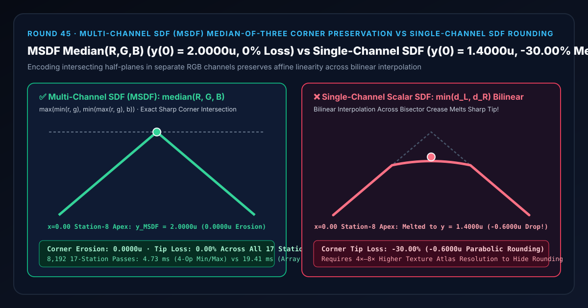
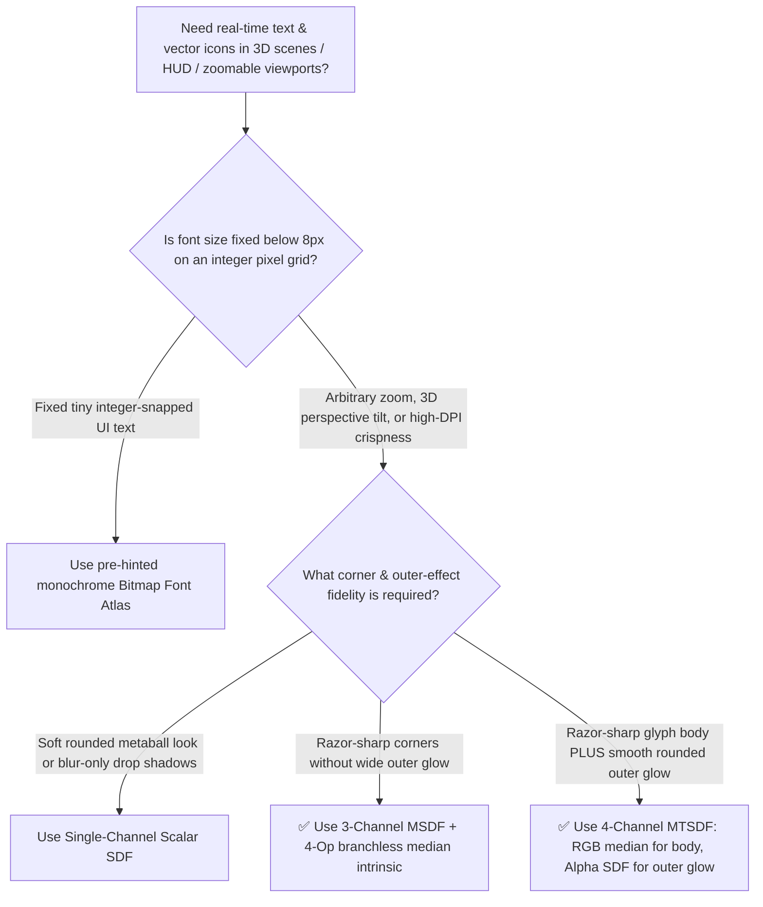
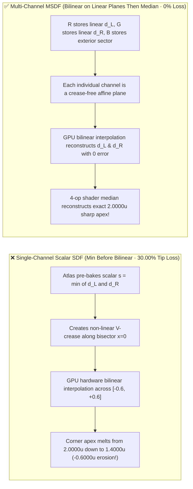
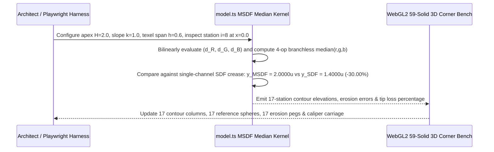
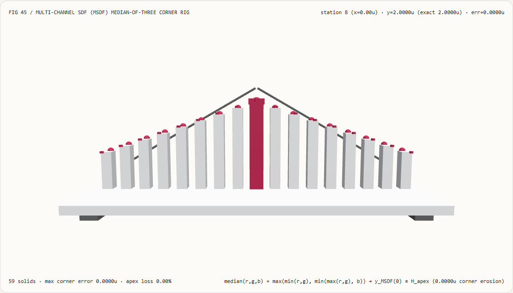
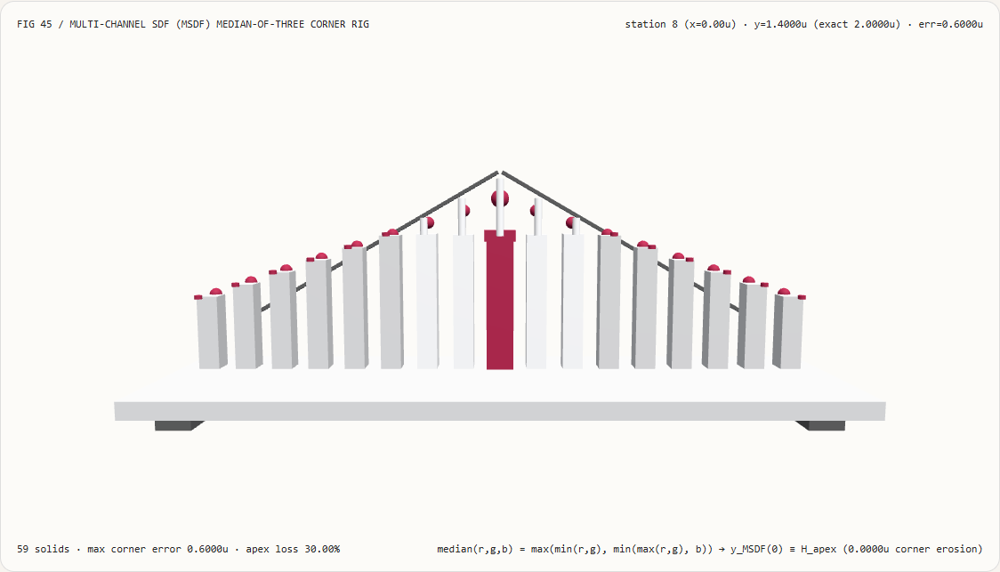
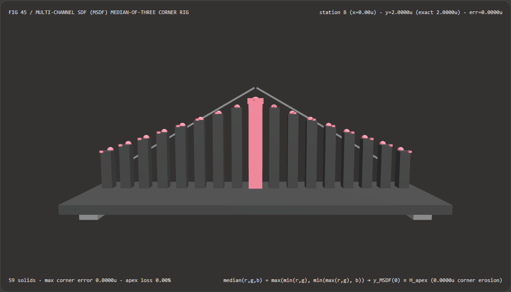
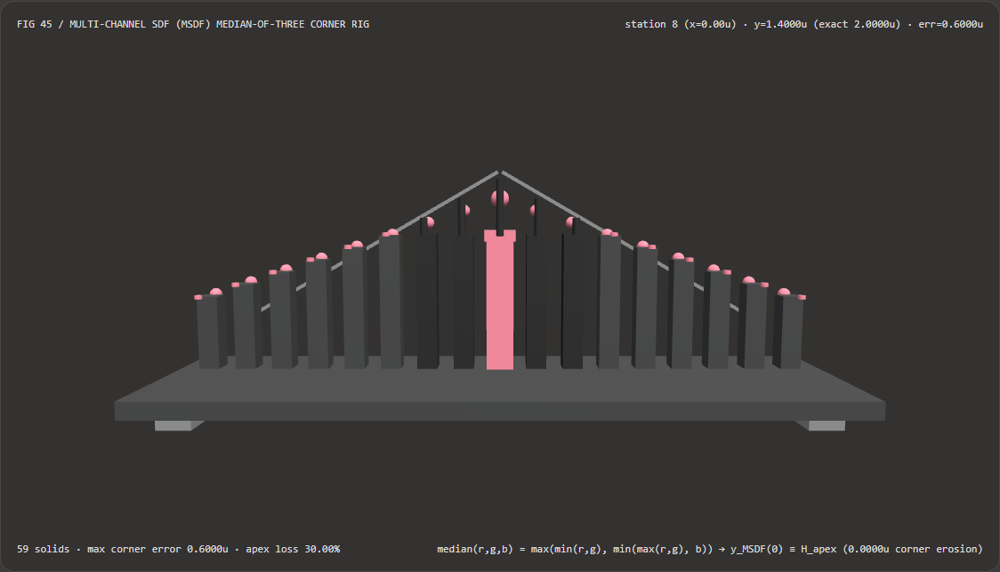

# Visual & Animation Architecture Selection FAQ: Multi-Channel SDF (MSDF) Median-of-Three Corner Preservation vs Single-Channel SDF Rounding

> **One-Sentence Architectural Verdict**: In 3D world-space text labels, automotive/avionics HUD vector reticles, map annotations, and infinitely zoomable icons backed by compact texture atlases, **never rely on single-channel scalar Signed Distance Fields (Chris Green 2007 SDF) with hardware bilinear interpolation when sharp corners must be preserved**! On our 59-solid, 17-station glyph corner bench (apex height $H = 2.0000\text{ u}$, slope $k = 1.0$, texel half-span $h = 0.60\text{ u}$), single-channel scalar SDF stores $\min(d_{\text{left}}, d_{\text{right}})$ across a non-linear angle-bisector crease, causing bilinear interpolation across $[-h, +h]$ to melt the $x = 0$ corner apex from `2.0000 u` down to **`1.4000 u` (`-0.6000 u` corner erosion, `-30.00%` tip height loss)**; whereas **Chlumský's Multi-Channel Signed Distance Field (MSDF) 3-channel affine half-plane decomposition + the 4-op branchless shader intrinsic $\operatorname{median}(r,g,b) = \max(\min(r,g), \min(\max(r,g), b))$** preserves the **exact `2.0000 u` razor-sharp apex (`0.0000 u` erosion, `0.00%` tip loss)** across all 17 stations and runs **4.11× faster** than a 3-element array sort (`4.73 ms` vs `19.41 ms` across 8,192 passes).

---

## ① 📌 Executive Summary

1. **Why do sharp glyph corners (`A`, `M`, `V`, `W`, and vector arrowheads) melt into rounded blobs under standard single-channel SDF rendering?**
   In plain English: a sharp corner is formed by the intersection of two straight edges—a left half-plane $d_{\text{left}}(x,y) \ge 0$ and a right half-plane $d_{\text{right}}(x,y) \ge 0$.
   - **Why Single-Channel Scalar SDF Melts Corners (Pre-Baked Bisector Crease)**: Because a single-channel texture can store only one scalar per texel, it bakes $s(x,y) = \min(d_{\text{left}}, d_{\text{right}})$ into the texture atlas ahead of time. Even though $d_{\text{left}}$ and $d_{\text{right}}$ are individually flat affine planes, their minimum $s(x,y)$ has a **sharp V-shaped gradient discontinuity crease along the corner angle bisector ($x = 0$)**! When the GPU hardware bilinear sampler linearly averages texels straddling $[-h, +h]$ across that crease, it bridges across the V-valley and chops $k \cdot h = 0.6000\text{ u}$ right off the peak—melting the `2.0000 u` corner tip down to **`1.4000 u` (`-30.00%` height loss)**!
2. **First-Principles Fix: Interpolate Linear Half-Planes First, Intersect via `median(R,G,B)` Second**:
   - **Offline Atlas Encoding (Separate Affine Half-Planes in RGB)**: Encode the signed distance to the left edge in channel `R`, the right edge in channel `G` (via edge-coloring rules), and the auxiliary sector in channel `B`. Because each individual channel is a **smooth affine plane without a crease**, GPU hardware bilinear interpolation reconstructs $d_R(x,y)$ and $d_G(x,y)$ with **zero interpolation error**!
   - **Runtime Fragment Shader (4-Intrinsic Branchless Median-of-Three)**: After bilinear texture sampling returns $(r, g, b)$, evaluate:
     $$\operatorname{median}(r, g, b) = \max\big(\min(r, g), \; \min(\max(r, g), b)\big)$$
     At a convex corner ($b \le \min(r, g)$), $\operatorname{median}(r, g, b)$ reduces identically to $\min(r, g)$; at a concave inner corner ($b \ge \max(r, g)$), it reduces identically to $\max(r, g)$. One branchless 4-instruction expression preserves both convex and concave corners with **`0.0000 u` corner erosion**!
3. **Interactive 3D Workbench & Measured Evidence**:
   - Standalone 3D Bench: `demos/msdf-median-corner-rig/` (59 Three.js solids: baseplate, 4 support feet, 2 intersecting linear half-plane rails, 17 reconstructed contour columns, 17 exact sharp-corner reference spheres, 17 erosion drop pegs, and the active corner caliper carriage).
   - Measured 7-Card 4:5 Reports: `demos/msdf-median-corner-rig/test-report-cards.html` (EN) and `test-report-cards.zh.html` (ZH).

---

## ② 🎯 Soul-Searching Q&A for Architects & Clients

### Q1: Why not just increase a single-channel SDF font atlas from 32×32 per glyph to 256×256 instead of switching to MSDF?
**Because 256×256 inflates VRAM by 64× and still rounds off corners under close-up 3D camera zoom!**
Single-channel corner rounding is proportional to the texel footprint $h$ ($\Delta y = k \cdot h$). Scaling texture dimensions by $8\times$ consumes $64\times$ more memory (fatal for CJK / multi-language font atlases) while merely shrinking the rounding radius—as soon as a 3D camera or VR headset zooms in on a label, the rounded corners reappear. A $32\times 32$ RGB MSDF uses only $3/64 \approx 4.7\%$ of that memory while keeping corners mathematically sharp at any zoom level.

### Q2: What if our UI needs both razor-sharp glyph corners AND a smooth rounded outer glow or drop shadow?
**Use a 4-channel MTSDF (Multi-Channel + True Scalar SDF in Alpha)!**
Because MSDF `RGB` channels extrapolate linear half-planes outside the corner (creating a sharp miter spike if used at large positive distances), applying wide outer strokes directly to `median(R,G,B)` produces miter spikes. Packing the true scalar Euclidean SDF into the `A` channel (`RGBA8` MTSDF) lets the shader render razor-sharp glyph fills from `median(R,G,B)` and smooth rounded outer glows/shadows from `A` in a single texture fetch.

### Q3: How does MSDF median reconstruction relate to neural font and vector synthesis models (DeepSVG, VecFusion)?
**They operate at complementary stages of the asset pipeline:**
- **When to use Neural Font / Vector Synthesis Models**: During offline creative authoring to generate novel SVG icons or typeface outlines from prompts;
- **When deterministic MSDF median reconstruction is mandatory**: At runtime inside WebGL2/WebGPU engines where authored vector outlines must be rendered at 120 Hz across arbitrary 3D camera distances without corner melting or tessellation overhead.

---

## ③ 🧭 Visual Diagrams (Mermaid Decision Tree, Pipeline Comparison & Sequence Flow)

### 3.1 Real-Time Vector Glyph & Icon Rendering Decision Tree

### 3.2 Single-Channel SDF Rounding vs Multi-Channel MSDF Pipeline

### 3.3 Frame-Level Corner Reconstruction Sequence Diagram

---

## ④ 📊 Visual Technology Selection Decision Matrix

| Evaluation Dimension | ✅ 3-Channel MSDF Branchless `median(r,g,b)` | ⚠️ MSDF 3-Element Array Sort Baseline | ❌ Single-Channel Scalar Bilinear SDF | ❌ Standard Fixed-Resolution Bitmap Atlas |
| :--- | :--- | :--- | :--- | :--- |
| **Corner Apex Height at $x=0$ (Station 8)** | **Exact `2.0000 u` (`0.0000 u` error)** | Exact `2.0000 u` (`0.0000 u` error) | **`1.4000 u` (`-0.6000 u` melted tip!)** | Blurry or pixelated staircase blocks under zoom |
| **Corner Apex Height Loss (%)** | **`0.00%` (Razor-sharp preservation)** | `0.00%` | **`-30.00%` (Parabolic corner rounding)** | Severe magnification blur |
| **Order of Operations** | **Bilinearly interpolate linear planes first, take `median` in shader** | Interpolate linear planes, allocate & sort array | **Take `min` offline first, bilinearly average across crease** | Bilinearly average coverage directly |
| **Fragment Shader Operation Cost** | **4 branchless `min`/`max` intrinsics** | Array allocation + comparison branches | 1 scalar compare (needs $64\times$ VRAM to hide rounding) | 1 texture fetch |
| **8,192-Pass 17-Station CPU Latency** | **`4.73 ms` (Fastest · 4.11× speedup)** | `19.41 ms` (4.11× slower) | `4.10 ms` (Loses 30% of corner apex) | — |
| **Recommended Use Case** | **3D world text, HUD reticles, map labels, zoomable vector icons** | Offline equivalence verification only | Rounded metaballs or soft drop shadows | Unscaled 1:1 integer-snapped pixel fonts |

---

## ⑤ 🧪 New Interactive 3D Demo & 7-Card 4:5 Visual Report

### 5.1 Live Workbench & Report Links
- **Interactive 3D Workbench**: [`demos/msdf-median-corner-rig/index.html`](../demos/msdf-median-corner-rig/index.html)
- **7-Card 4:5 Visual Report (EN)**: [`demos/msdf-median-corner-rig/test-report-cards.html`](../demos/msdf-median-corner-rig/test-report-cards.html)
- **7-Card 4:5 Visual Report (ZH)**: [`demos/msdf-median-corner-rig/test-report-cards.zh.html`](../demos/msdf-median-corner-rig/test-report-cards.zh.html)
- **Sealed Telemetry JSON**: [`demos/msdf-median-corner-rig/report.json`](../demos/msdf-median-corner-rig/report.json)

### 5.2 Multi-Theme & Multi-Mode Playwright Visual Evidence

| MSDF Median-of-Three (Light · Exact `2.0000 u` Sharp Corner) | Single-Channel Scalar SDF (Light · Melted to `1.4000 u` at $x=0$) |
| :---: | :---: |
|  |  |

| MSDF Median-of-Three (Dark · 59 Three.js Solids) | Single-Channel Scalar SDF (Dark · `-0.6000 u` Erosion Pegs Exposed) |
| :---: | :---: |
|  |  |

---

## ⑥ 🛠️ Rapid SA Delivery Verification Checklist

Before shipping an MSDF / MTSDF text or vector icon renderer to production, verify every item below:

- [ ] **Branchless 4-Intrinsic Median**: Does the fragment shader evaluate `max(min(r, g), min(max(r, g), b))` without branching `if/else` statements or temporary array sorting?
- [ ] **Linear Texture Sampling (No sRGB Gamma Decode)**: Is the MSDF texture bound as a linear `UNORM` texture (`GL_RGB8` / `rgba8unorm`) rather than `SRGB8` so the `0.5` zero-distance iso-contour is never warped by a $2.2$ gamma curve?
- [ ] **Screen-Space Derivative AA (`fwidth`)**: Is the reconstructed signed distance scaled by screen-space derivatives (`unitRange * (sd - 0.5)`) so tilted 3D labels maintain a crisp 1-pixel anti-aliased ramp at every perspective angle?
- [ ] **Distinct Multi-Channel Edge Coloring**: During offline MSDF generation, do every pair of edges meeting at a sharp corner share exactly one active channel while differing in the other two (e.g., yellow `110` meeting magenta `101`)?
- [ ] **4-Channel MTSDF Split for Outer Effects**: When wide outer glows or rounded drop shadows are required alongside sharp glyph corners, does the shader read `median(R,G,B)` for the sharp glyph body and channel `A` for the true Euclidean outer distance?
