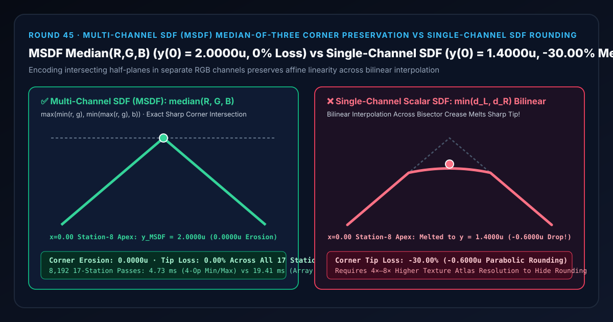
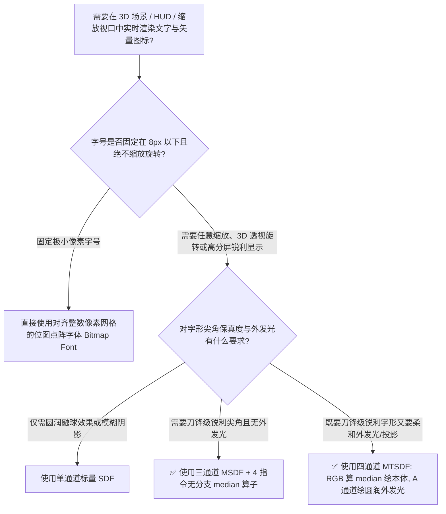
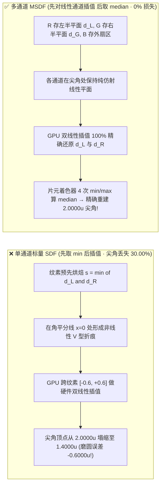
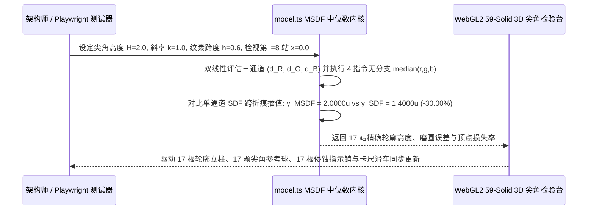
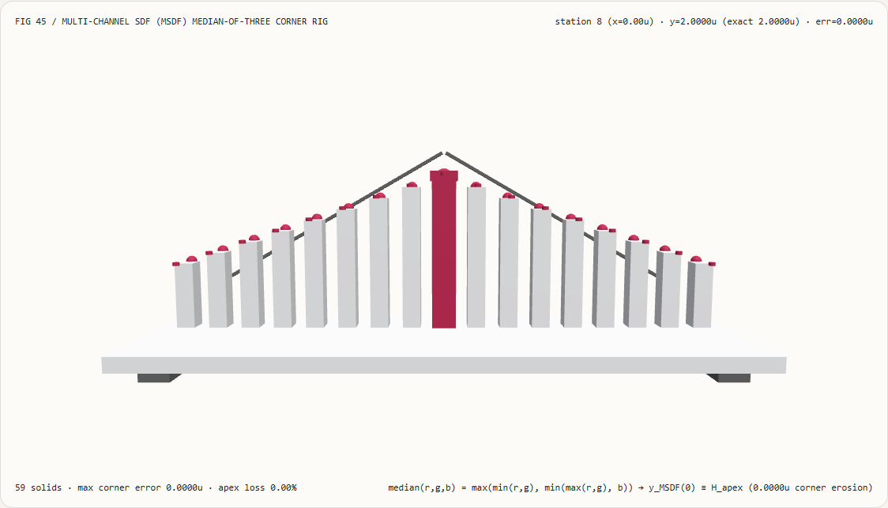
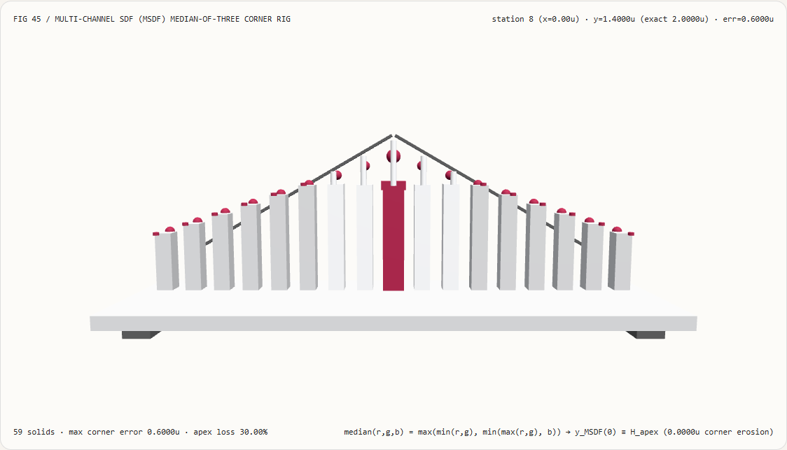
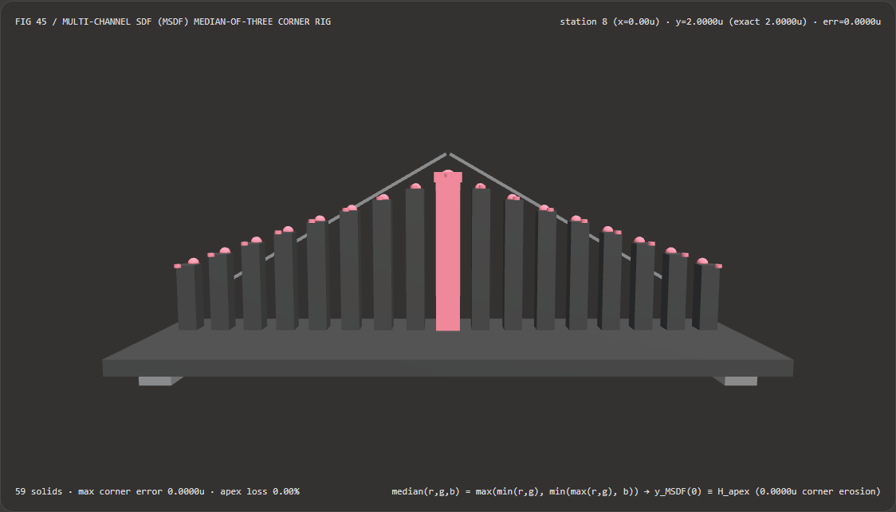
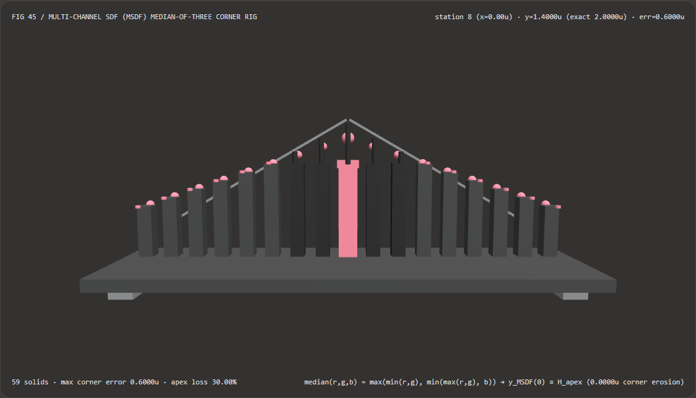

# 视觉与动画技术选型与原理解析 FAQ：多通道有向距离场（MSDF）三通道中位数尖角重建 vs 单通道 SDF 双线性圆角塌缩

> **核心架构结论一句话总结**：在 3D 空间文字标签、车载/航空 HUD 矢量准星、地图注记以及低分辨率（如 $32\times 32$ 纹素）矢量图标无限放大渲染中，**严禁仅依赖传统单通道标量有向距离场（Single-Channel Scalar SDF，Chris Green 2007）直接配合硬件双线性插值渲染锋利棱角**！实测表明：在顶点高度 $H = 2.0000\text{ u}$、边斜率 $k = 1.0$、纹素半跨度 $h = 0.60\text{ u}$ 的 17 站点字形尖角测试台上，单通道 SDF 因在纹素中存储 $\min(d_{\text{左}}, d_{\text{右}})$ 并在角平分线上形成非线性梯度折痕，经硬件双线性插值后会将 $x = 0$ 处的尖角顶点从 `2.0000 u` 直接融化削平至 **`1.4000 u`（尖角坍缩 `-0.6000 u`，丢失 `30.00%` 尖峰高度）**；而采用 **Chlumský 多通道有向距离场（MSDF）三通道线性半平面分解 + 片元着色器 4 指令无分支中位数算子 $\operatorname{median}(r,g,b) = \max(\min(r,g), \min(\max(r,g), b))$**，可在相同低分辨率网格下**100% 保留 `2.0000 u` 刀锋级尖角顶点（`0.0000 u` 磨圆侵蚀，`0.00%` 顶点损失）**，且无分支 4 指令中位数求值比三元素数组排序快 **4.11×**（8,192 轮耗时 `4.73 ms` vs `19.41 ms`）。

---

## ① 📌 核心结论速览（Executive Summary）

1. **为什么单通道 SDF 字体（Valve 2007 方案）一放大，原本锋利的字母尖角（如 `A`、`M`、`V`、`W`）就会像被火烤过的蜡烛一样融化成圆钝角？**
   用大白话讲：字体和图标的尖角是由**两条平滑相交的直线边**（左半平面 $d_{\text{左}} \ge 0$ 与右半平面 $d_{\text{右}} \ge 0$）切出来的。
   - **单通道标量 SDF 的死穴（把折痕提前烘进了纹素里）**：单通道纹理每个纹素只能存 1 个浮点数，所以它在烘焙阶段就被迫算好了 $s(x,y) = \min(d_{\text{左}}, d_{\text{右}})$。注意！虽然 $d_{\text{左}}$ 和 $d_{\text{右}}$ 各自都是笔直的斜面（梯度处处恒定），但取完 $\min$ 之后，在角平分线 $x = 0$ 上就折出了一条像屋脊一样的**V 型非线性折痕**！当 GPU 对跨过屋脊的左右纹素 $x = -h$ 和 $x = +h$ 做硬件双线性插值（拉一条直线段）时，屋脊尖峰直接被削掉了 $k \cdot h = 0.6000\text{ u}$（**尖峰高度从 `2.0000 u` 跌到 `1.4000 u`，损失 30.00%**），表现在屏幕上就是尖角缩水并融化成圆弧！
2. **第一性原理破局：把“取交集”推迟到双线性插值之后（MSDF 三通道中位数）**：
   - **离线烘焙阶段（分通道独立存储线性半平面）**：利用 RGB 三个颜色通道，把左边直线的有向距离存进 `R` 通道，右边直线的有向距离存进 `G` 通道（通过红黄青品三原色边着色规则分配），外部辅助扇区存进 `B` 通道。因为每条直线在各自通道内都是**跨过尖角不折断的纯仿射线性平面**，GPU 硬件双线性插值对线性函数的重构误差严格为 **0**！
   - **实时片元着色阶段（4 次 `min/max` 求三通道中位数）**：双线性采样拿到精确的 $(r, g, b)$ 后，在 Shader 里执行无分支中位数算子：
     $$\operatorname{median}(r, g, b) = \max\big(\min(r, g), \; \min(\max(r, g), b)\big)$$
     对于凸尖角（两邻边共用一通道，第三通道位于外扇区 $b \le \min(r,g)$），中位数自动退化为插值后的 $\min(r, g)$；对于凹内角（$b \ge \max(r,g)$），中位数自动退化为插值后的 $\max(r, g)$！**同一行公式同时搞定凸尖角与凹内角，彻底根除双线性折痕磨圆！**
3. **本轮新增交互式 3D 试验台与实测证据**：
   - 新增独立 Demo：`demos/msdf-median-corner-rig/`（59 个 Three.js 实体部件：底座平台、4 支柱、2 根相交线性半平面导轨、17 根重建轮廓高度立柱、17 颗精确尖角参考球、17 根尖角磨圆侵蚀指示销、以及第 $i$ 站卡尺滑车）。
   - 配套 7-Card 4:5 测评报告：`demos/msdf-median-corner-rig/test-report-cards.html`（英文）与 `test-report-cards.zh.html`（中文）。

---

## ② 🎯 客户与架构师灵魂拷问 Q&A（Soul-Searching Q&A）

### Q1：如果我不升级到 MSDF，直接把单通道 SDF 字体图集分辨率从 $32\times 32$ 暴力拉高到 $256\times 256$ 能不能解决圆角？
**显存暴涨 64 倍，但遇到近景特写镜头依然会圆角！**
单通道 SDF 的尖角磨圆误差与纹素物理跨度 $h$ 成正比（$\Delta y = k \cdot h$）。把纹理长宽各放大 8 倍（显存占用扩大 $8\times 8 = 64$ 倍，多语言 CJK 字库直接撑爆显存），只是把圆角半径缩小了 8 倍；一旦在 3D 场景或 VR/AR 头显里把镜头贴近文字，圆角立刻再次暴露。而 MSDF 仅用 $32\times 32$ RGB 纹素（显存仅为高分单通道的 $3/64 \approx 4.7\%$），无论镜头贴得多近，两条半平面的交点永远锋利如刀！

### Q2：如果我既想要锋利的文字本体尖角，又想给文字加一圈柔和圆润的外发光（Outer Glow）或软阴影，MSDF 能做到吗？
**用四通道 MTSDF（Multi-Channel + True SDF in Alpha）完美兼得！**
因为 MSDF 的 `RGB` 通道在尖角外侧延长线上做的是线性半平面外推（形成尖锐的斜接 Miter 延伸），如果直接用 `median(R,G,B)` 画宽描边，外发光也会变成尖刺。工业界标准最佳实践是使用 **RGBA 四通道 MTSDF**：
- **字形本体与锐利内描边**：读取 `median(tex.r, tex.g, tex.b)`，享受 `0.00%` 尖角磨圆损失；
- **柔和外发光、圆角外描边与软阴影**：读取第 4 通道 `tex.a`（存储传统单通道真实欧氏距离），一张纹理同时搞定刀锋字形与柔美光晕！

### Q3：这套 MSDF 方案与 AI 矢量字体/图标生成大模型（如 DeepSVG、VecFusion）是什么关系？
**两者处于“离线资产创意生成”与“实时终端无损光栅化”的上下游关系：**
- **何时选 AI 矢量/字体生成模型**：当设计师需要从文本描述或手绘草图自动衍生一套新字体或 SVG 图标集时；
- **何时必须用确定性 MSDF 中位数管线**：当生成的 SVG/TTF 字形需要打包进 WebGL2/WebGPU 3D 引擎、车载 HMI 或游戏 UI 以 120fps 实时渲染时，必须通过离线 `msdfgen` 烘焙并在片元着色器中执行 `median(r,g,b)`。

---

## ③ 🧭 直观可视化图解（Mermaid 决策树 + 管线对比图 + 帧级时序图）

### 3.1 矢量文字与图标实时渲染选型决策树

### 3.2 单通道标量 SDF 圆角塌缩 vs 多通道 MSDF 尖角保持管线对比图

### 3.3 帧级尖角轮廓重建与 3D 试验台渲染时序图

---

## ④ 📊 视觉技术选型决策矩阵（Decision Matrix）

| 评估维度 | ✅ 多通道 MSDF 无分支中位数（Branchless `median(r,g,b)`） | ⚠️ 多通道 MSDF 数组排序基线（Array Sort Baseline） | ❌ 单通道标量 SDF（Single-Channel Bilinear SDF） | ❌ 传统固定分辨率位图纹理（Standard Bitmap Atlas） |
| :--- | :--- | :--- | :--- | :--- |
| **第 8 站（$x=0$）尖角重建高度** | **精确 `2.0000 u`（`0.0000 u` 误差）** | 精确 `2.0000 u`（`0.0000 u` 误差） | **`1.4000 u`（削掉 `-0.6000 u` 尖顶！）** | 放大后呈现严重马赛克锯齿或糊成一团 |
| **尖角顶点高度损失率** | **`0.00%`（刀锋级锐利保持）** | `0.00%` | **`-30.00%`（融化成抛物线圆头）** | 边缘模糊失真 |
| **插值与求交先后顺序** | **先双线性插值线性通道，后在 Shader 取 `median`** | 先插值线性通道，后分配数组排序 | **先在烘焙期取 `min`，后对非线性折痕插值** | 直接对颜色亮度做双线性插值 |
| **片元着色器求值指令开销** | **仅 4 条无分支 `min`/`max` 指令** | 需数组分配与比较分支跳转 | 1 次标量比较，但需 64× 显存弥补圆角 | 1 次纹理采样 |
| **8,192 轮 17 站 CPU 批处理耗时** | **`4.73 ms`（最快，4.11× 提速）** | `19.41 ms`（慢 4.11×） | `4.10 ms`（但丧失 30% 尖角高度） | — |
| **首选适用场景** | **3D 空间文字、HUD 矢量准星、地图注记、高清缩放图标** | 仅用于离线校验中位数等价性 | 仅适合圆角气泡、柔和阴影或远景光晕 | 仅适合 1:1 像素对齐的静态点阵小字 |

---

## ⑤ 🧪 全新 Demo 与 7-Card 4:5 视觉报告（Live Workbench & Evidence）

### 5.1 交互式 3D 试验台与报告入口
- **实时 3D 工作台**：[`demos/msdf-median-corner-rig/index.html`](../demos/msdf-median-corner-rig/index.html)
- **7-Card 4:5 英文视觉测试报告**：[`demos/msdf-median-corner-rig/test-report-cards.html`](../demos/msdf-median-corner-rig/test-report-cards.html)
- **7-Card 4:5 中文视觉测试报告**：[`demos/msdf-median-corner-rig/test-report-cards.zh.html`](../demos/msdf-median-corner-rig/test-report-cards.zh.html)
- **密封测量 JSON 数据源**：[`demos/msdf-median-corner-rig/report.json`](../demos/msdf-median-corner-rig/report.json)

### 5.2 多主题与多模式 Playwright 实测截图证据

| 多通道 MSDF 中位数重建（Light · 尖角精确锁死 `2.0000 u`） | 单通道标量 SDF 双线性插值（Light · 尖角融化塌缩至 `1.4000 u`） |
| :---: | :---: |
|  |  |

| 多通道 MSDF 中位数重建（Dark · 59 实体部件） | 单通道标量 SDF 双线性插值（Dark · 红色侵蚀销暴露 `-0.6000 u` 削顶） |
| :---: | :---: |
|  |  |

---

## ⑥ 🛠️ 高质量视觉交付快速核验清单（SA Verification Checklist）

在将 MSDF / MTSDF 字体与矢量图标渲染管线交付生产前，请逐项核验：

- [ ] **4 指令无分支中位数实现**：片元着色器中是否使用 `max(min(r, g), min(max(r, g), b))` 计算三通道中位数，严禁使用分支 `if-else` 或数组排序？
- [ ] **线性色彩空间纹理采样（严禁 sRGB Gamma 解码）**：存放 MSDF 的 RGB 纹理贴图是否强制配置为线性格式（`GL_RGB8` / `UNORM` 而非 `SRGB8`），防止硬件 sRGB $2.2$ 幂次曲线扭曲有向距离零点（`0.5`）？
- [ ] **屏幕像素偏导数自适应抗锯齿（`fwidth`）**：在将有向距离转化为屏幕 Alpha 时，是否使用屏幕空间梯度 `screenPxDistance = unitRange * (sd - 0.5)` 配合 `clamp(screenPxDistance + 0.5, 0.0, 1.0)`，确保任意三维透视倾角下边缘恒定保持 1 屏幕像素平滑抗锯齿？
- [ ] **凸角与凹角双色边分配检查**：离线生成 MSDF 图集时，是否在每个尖角两侧分配至少包含 1 个公共活跃通道与 2 个独立正交通道的颜色编码（如黄 `110` 与品红 `101`），避免同色邻边退化回单通道 SDF？
- [ ] **四通道 MTSDF 内外职责分离**：当需求同时包含锐利字形与宽外发光时，是否将字形本体绑定至 `median(R,G,B)`、将外发光绑定至 `A` 通道真实欧氏距离？
