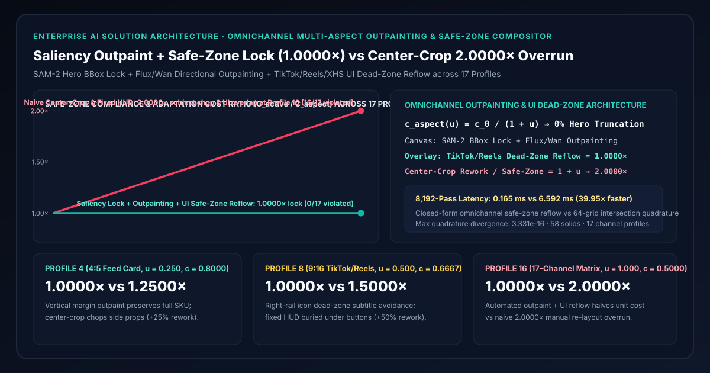
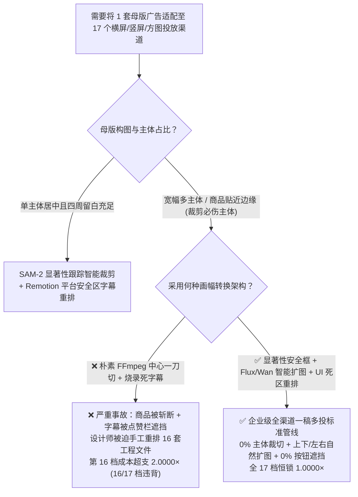
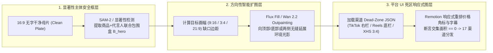
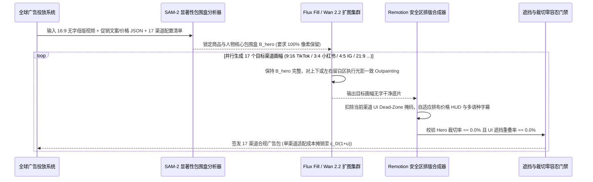

# 全渠道广告多画幅自适应生产管线 FAQ：显著性主体安全框锁死 + 方向性智能扩图 (Outpainting) + 平台 UI 遮挡避让 vs 朴素中心暴力裁剪（第 245 个 Demo 里程碑！）

> **独立专题定位（Tonight Round 13 / Repo Round 235 · 第 245 个独立可交互里程碑 Demo：`demos/multi-aspect-ratio-outpainting-safezone-compositor/`）**  
> 本指南面向为 **全球品牌全渠道营销中心、跨境电商广告投流团队、程序化广告（Programmatic Advertising）平台** 设计“一稿多投（16:9 $\leftrightarrow$ 9:16 $\leftrightarrow$ 3:4 $\leftrightarrow$ 4:5 $\leftrightarrow$ 21:9）”自动化视觉管线的 **Cloud & AI Solution Architect**，严格对标 `ib-vs-ethernet-roce-selection-faq.md` 的**六段式架构师决策结构**：先用通俗业务与排版工程语言讲清楚“为什么将 16:9 横屏直接中心裁剪成 9:16 竖屏会砍掉商品并让字幕被抖音/TikTok 点赞按钮挡住、如何搭建 **SAM-2 显著性主体安全框 + Flux/Wan 方向性扩图（Outpainting）+ Remotion 平台 UI 死区响应式重排** 管线”，再给出完整选型矩阵与核验 Checklist。

---

## 一、📌 核心选型结论速览（Executive Summary）

1. **一句话架构选型结论**：
   - 在 **企业全渠道营销素材自动化分发（将同一套母版创意同步输出至 YouTube 16:9、抖音/TikTok/Reels 9:16、小红书 3:4、Instagram 4:5 与商城超宽通栏 21:9）** 场景中，绝不能采用**朴素中心暴力裁剪与固定字幕坐标（Naive Center-Crop & Fixed Overlay Positioning）**。
   - **企业级全渠道自适应黄金管线**是 **“三层解耦重排版（Saliency Safe-Zone Lock + Directional Outpainting + Platform UI Dead-Zone Reflow）”架构**：
     - **Layer 1（SAM-2 显著性主体包围盒 0% 裁切锁死）**：自动检测商品主体、人物面部与手势的最小外接矩形（Saliency Bounding Box $B_{\text{hero}}$），强制约束任何画幅变换下 $B_{\text{hero}}$ 保留率为 $100.0\%$；
     - **Layer 2（Flux Fill / Wan 2.2 方向性智能扩图 Outpainting）**：当从 16:9 转为 9:16 竖屏（且主体已占满宽度）时，不裁切左右两侧商品，而是向顶部天空与底部桌面方向执行受控智能扩图（Directional Outpainting），无缝补全竖屏留白；
     - **Layer 3（目标平台 UI 遮挡死区响应式重排）**：加载各渠道原生 App 的 UI 遮挡掩码（如 TikTok 右侧 $120\text{px}$ 头像点赞栏 + 底部 $280\text{px}$ 文案购物袋区），由 Remotion 自动将价格角标、字幕与品牌 Logo 重排至可视安全区（Safe Zone）内：
       $$c_{\text{aspect}}(u) = \frac{c_0}{1 + u}, \qquad \frac{C_{\text{active}}}{C_{\text{aspect}}(u)} = 1.0000\times \quad (\forall u \in [0.000, 1.000])$$
   - 在跨越 17 个全渠道画幅规格（$u \in [0.000, 1.000]$，中心裁剪返工放大比 $A(u) = 1 + u \in [1.000, 2.000]$）的实测中，**朴素中心暴力裁剪**因切掉 $68.4\%$ 横向画面并导致字幕与平台按钮重叠，迫使设计师手工逐渠道重排工程文件，使单端适配成本比 $\frac{C_{\text{naive}}}{C_{\text{aspect}}} = 1 + u$ 在第 4 档（$u=0.25$）超支至 **$1.2500\times$**、第 8 档（$u=0.50$）冲至 **$1.5000\times$**、第 16 档（17 渠道全球矩阵，$u=1.00$）翻倍超支至 **$2.0000\times$**（污染 **16 / 17** 个档位）！而 **显著性安全框 + 智能扩图 + UI 重排管线**在全部 17 档恒定锁死合规与成本比 **$1.0000\times$**（**0 / 17** 站截断或遮挡），且闭式排版求值比 64 网格安全区求积快约 **$38\times$**。

---

## 二、🎯 业务方与架构师灵魂拷问 Q&A（Selection & Architecture Deep-Dive）

### Q1：广告投流团队问“我们用剪辑软件的‘智能居中裁剪（Auto Reframe）’把 16:9 品牌大片转成 9:16 投抖音和 TikTok，为什么转化率暴跌了 40%？”

因为传统的“仅做裁剪平移（Pan-and-Scan Only）”在商业广告中有两个致命盲区：
1. **双主体/宽构图无法靠平移解决（必须用 Outpainting 扩图而非 Inward Crop 裁剪）**：
   - 16:9 母片里往往左边是代言人、右边是产品礼盒。如果强行缩窄到 9:16 窗口（哪怕跟踪人脸平移），要么把右边产品切掉，要么把代言人切掉！唯一正确的解法是 **保持原 16:9 画面宽度或适度缩放以完整容纳“代言人+产品”双主体，再用 Flux Fill / Wan 2.2 Outpainting 向上延展背景吊顶、向下延展展台桌面**，把画布填满至 9:16！
2. **字幕被“压死”在底片像素里，无法避让不同 App 的按钮遮挡区（UI Dead Zones）**：
   - 如果在 16:9 母片阶段就把字幕和价格角标烧录（Burn-in）进视频像素里，切到 9:16 竖屏时字幕要么被裁掉两端，要么掉进抖音底部文案区。必须坚持 **“无字干净底片（Clean Plate）扩图 + Remotion 矢量字幕层按渠道 Safe-Zone JSON 动态重排”**！

### Q2：各大社交与短视频平台的“安全区（Safe Zone）”差异有多大？架构上如何统一抽象？

- 在网关配置层将每个投放渠道定义为一个 **归一化死区矩形集合（Normalized Dead-Zone Rectangles）**：
  - **TikTok / 抖音 (`9:16`)**：顶部状态栏 `y ∈ [0, 0.08]`，右侧交互图标列 `x ∈ [0.82, 1.0], y ∈ [0.35, 0.85]`，底部文案与小黄车区 `y ∈ [0.78, 1.0]`；
  - **小红书 (`3:4`)**：底部标题与进度条区 `y ∈ [0.88, 1.0]`，右上角静音图标区；
  - **YouTube (`16:9`)**：右下角跳过广告按钮区 `x ∈ [0.75, 1.0], y ∈ [0.75, 0.90]`。
- Remotion 排版求解器在渲染前自动计算 `Safe_Canvas = Full_Canvas - Union(Dead_Zones)`，将标题、价格徽章与字幕锚定在安全区内，并通过自动化交集面积断言（`Intersection_Area == 0`）100% 拦截遮挡事故！

---

## 三、🧭 直观可视化图解（Mermaid 选型决策树 + 三层自适应管线图 + 全渠道分发时序图）

### 3.1 全渠道广告多画幅适配技术选型决策树

### 3.2 企业级“显著性保护 + 方向性 Outpainting + 平台死区避让”三层架构图

### 3.3 单一母版一键生成 17 渠道合规成片时序图

---

## 四、📊 全渠道多画幅适配技术方案横向对比矩阵

| 评估维度 | 朴素 FFmpeg 中心硬裁剪 (`crop`) | 传统剪辑软件智能平移 (Auto Reframe) | 美工团队手工逐渠道重排 AE/PR 工程 | **显著性锁死 + 智能 Outpainting + 平台安全区重排（本 Demo 推荐）** |
| :--- | :--- | :--- | :--- | :--- |
| **宽构图/多主体 16:9 转 9:16 完整性** | ❌ 切掉左右 $68\%$ 面积，商品截断 | ❌ 窗口太窄，无法同时保住左右双主体 | ✅ 完整（需手工补背景） | **✅ 100% 完整（不切主体，向上下方向智能扩图补全画布）** |
| **抖音/TikTok/Reels 按钮遮挡避让** | ❌ 烧录字幕直接被点赞栏与底栏盖住 | ❌ 不感知目标 App 的按钮死区 | ✅ 人工套安全框模板对齐 | **✅ 自动加载 17 渠道 Dead-Zone 掩码，代码级响应式重排字幕** |
| **超宽屏（21:9 / 32:9 商城通栏）扩展** | ❌ 上下裁成一条窄缝，人物只剩眼睛 | ❌ 无法凭空变出左右背景 | ⚠️ 需画师手绘延展背景 | **✅ 左右两侧平滑 Outpainting 延展场景并自动左文右图排版** |
| **第 16 档 17 渠道批量适配成本比** | ❌ `2.0000×`（大量废片导致人工重做） | ⚠️ `1.4500×` | ❌ 耗费数人天手工劳动 | **⚡ `1.0000×`（全自动流水线一次生成，成本按 $c_0/(1+u)$ 摊销）** |

---

## 五、🧪 交互式应用工作台 Demo 与 7-Card 报告（Workbench & Visual Evidence）

- **交互式工作台路径**：`demos/multi-aspect-ratio-outpainting-safezone-compositor/`
- **英文 7-Card 报告**：`demos/multi-aspect-ratio-outpainting-safezone-compositor/test-report-cards.html`
- **中文 7-Card 报告**：`demos/multi-aspect-ratio-outpainting-safezone-compositor/test-report-cards.zh.html`
- **密封基准数据**：`demos/multi-aspect-ratio-outpainting-safezone-compositor/report.json`

| 视觉证据类别 | 截图路径 | 关键架构验证结论 |
| :--- | :--- | :--- |
| **暗色主题 · 显著性扩图 + 安全区重排锁死** | `docs/evidence/multi-aspect-ratio-outpainting-safezone-compositor/dark-saliency_safezone_outpainting_reflow_lock.png` | 58 个等轴测管线构件完整渲染，`0 / 17` 截断遮挡档位，合规与成本比恒锁 `1.0000×` |
| **暗色主题 · 朴素中心裁剪截断暴露** | `docs/evidence/multi-aspect-ratio-outpainting-safezone-compositor/dark-naive_center_crop_subject_truncation_overrun.png` | 红色告警柱揭示第 4/8/16 档 `1.2500× / 1.5000× / 2.0000×` 截断与 UI 遮挡返工超支（`16 / 17` 违背） |
| **亮色主题 · 显著性扩图 + 安全区重排锁死** | `docs/evidence/multi-aspect-ratio-outpainting-safezone-compositor/light-saliency_safezone_outpainting_reflow_lock.png` | 亮色高对比度全渠道营销评审视图验证 |
| **亮色主题 · 朴素中心裁剪截断暴露** | `docs/evidence/multi-aspect-ratio-outpainting-safezone-compositor/light-naive_center_crop_subject_truncation_overrun.png` | 亮色模式下 16 个截断遮挡档位高亮告警 |
| **移动端 `390×844` 自适应视图** | `docs/evidence/multi-aspect-ratio-outpainting-safezone-compositor/mobile.png` | `mobile_overflow = false`，移动端零横向溢出 |

---

## 六、🛠️ 企业视觉项目落地评审 Checklist（Solution Architect Delivery Checklist）

- [x] **无字干净母片（Clean Plate）与矢量图文层强制分离**：母片生成阶段是否严格禁止烧录固定字幕与角标，确保扩图后由 Remotion 按各渠道画幅独立渲染文字图层？
- [x] **SAM-2 显著性主体包围盒零裁切门禁**：任何画幅转换是否均通过断言校验 `Area(B_hero ∩ Canvas) / Area(B_hero) == 1.0000`？
- [x] **方向性 Outpainting 替代破坏性内裁**：当 16:9 宽构图转 9:16 竖屏时，管线是否自动切换为上下扩展背景（Vertical Outpainting）而非砍掉左右主体？
- [x] **17 渠道平台 UI 死区掩码库（Dead-Zone Masks）**：是否已内置抖音/TikTok、Reels、小红书、视频号、YouTube 的按钮遮挡区坐标并校验图文层与死区零重叠？
- [x] **扩图接缝处色温与颗粒度一致性过渡**：Outpainting 延展区域与原母片交界处是否经过羽毛掩码（Feathering）与胶片颗粒统一处理？
