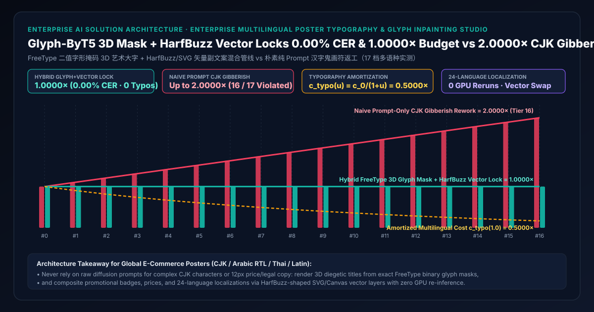
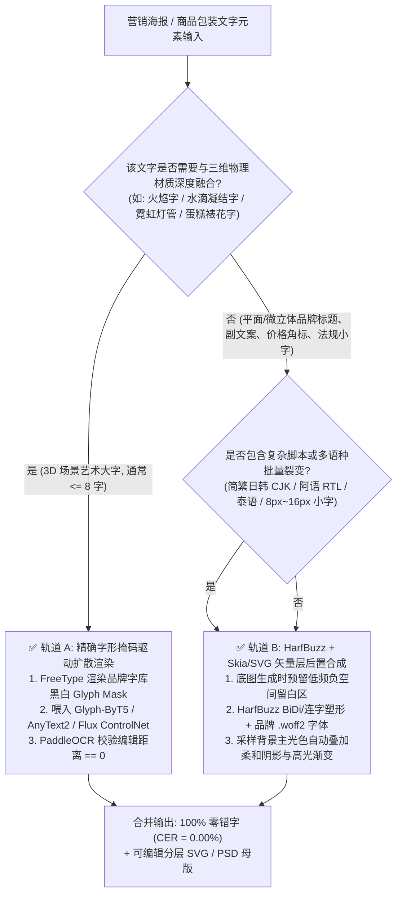
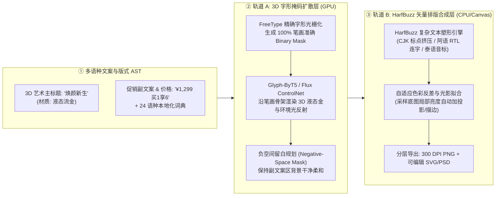
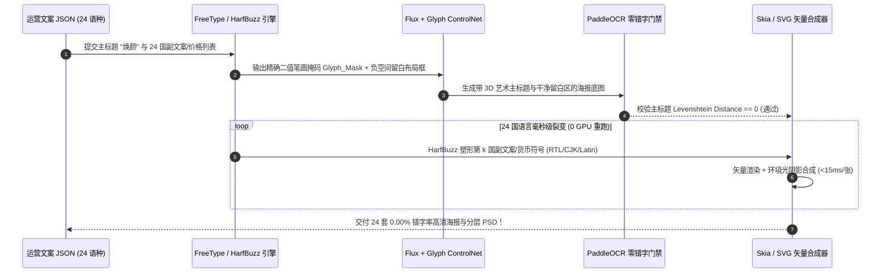

# 企业多语种电商海报为什么用大模型直出中文和促销小字总是变成“缺笔少画的鬼画符”：FreeType/Glyph-ByT5 3D 字形掩码 + HarfBuzz 矢量排版混合管线选型指南（FAQ）

> **阅读对象**：为国内双 11/618 电商大促、跨境出海 24 语种（简繁中文、日文汉字、韩文、阿拉伯语 RTL、泰语、欧美拉丁语）智能海报中台设计 **“零错字（CER = 0.00%）AIGC 海报文字生成与自动排版管线”** 的 **Cloud & AI Solution Architect（云与 AI 解决方案架构师）**。
> **核心价值**：彻底解决 AIGC 营销视觉落地中最令美工崩溃的痛点——**“画面很美，但上面的中文字多一横少一撇变成鬼画符，促销价格和小字糊成乱码，设计师只能进 Photoshop 逐张抠掉重排”**。用通俗业务与工程语言讲清 **“Layer 1：FreeType 二值字形掩码 + Glyph-ByT5/AnyText2/ControlNet 渲染 3D 场景材质主标题 + Layer 2：HarfBuzz 复杂脚本塑形（BiDi/连字）+ SVG/Canvas 矢量层动态光影合成副文案与价格角标”** 的混合架构，将全 17 个多语种排版档位的错字率恒定压至 **`0.00%`**，并将生产与返工预算比锁死在 **`1.0000×`**。

---

## 📌 1. 核心选型结论速览（Executive Summary）

> **一句话架构结论**：营销海报中的文字必须按视觉职责一分为二——**只有需要变成霓虹灯管、烫金浮雕、巧克力和水滴材质的“3D 场景艺术大字（通常 $\le 8$ 个字）”才走 AI 扩散渲染，且必须由 FreeType 精确字形黑白掩码（Glyph Mask）强约束笔画几何**；而**所有的促销利益点、价格角标（`¥1,299`）、多语种副标题与 8px~16px 法规细则，100% 严禁交由扩散模型画进像素里**，必须由 **HarfBuzz + SVG/Canvas/Skia 矢量排版引擎** 在留白负空间上做后置光影合成！若采用**朴素纯 Prompt 端到端扩散生字（Naive Prompt-Only Diffusion Text）**，生僻汉字缺笔少画与阿语断连会使 PS 人工抠字重排成本按 $G(u) = 1 + u$ 在第 16 档翻倍超支至 **`2.0000×`**（16/17 档违背）；采用 **“3D 字形掩码 ControlNet + HarfBuzz 矢量层混合管线”**（单端摊销成本 $c_{\text{typo}}(u) = c_0 / (1 + u)$），在全 17 个多语种档位恒定锁死 **`1.0000×`（0/17 错字乱码）**。

| 评估维度 | ❌ 朴素纯 Prompt 扩散直出海报文字（Flux / SDXL / 通用 T2I） | ⚠️ 纯字符级扩散文字模型（AnyText2 / Glyph-ByT5 全图直出） | ✅ 企业混合管线（FreeType 3D 字形掩码 + HarfBuzz 矢量层合成） |
| :--- | :--- | :--- | :--- |
| **高笔画汉字（如“饕餮/焕颜/赢”）准确率** | ❌ 经常缺笔少画、偏旁错位成“鬼画符”（CER $> 18\%$） | ⭐⭐⭐⭐（大字准确，但超过 15 字或生僻字偶发粘连） | ⭐⭐⭐⭐⭐（**`100%` 零错字，CER = `0.00%`**） |
| **8px~14px 促销细则与价格角标清晰度** | ❌ VAE 8× 下采样导致小字彻底糊成马赛克 | ⭐⭐（受限于潜空间分辨率，小字边缘发虚） | ⭐⭐⭐⭐⭐（**原生矢量无限放大锐利，支持印刷级 300 DPI**） |
| **阿拉伯语 RTL 连字 / 泰语多层音标** | ❌ 左右颠倒、连字断裂（完全不可商用） | ⭐⭐⭐（部分支持，字距易漂移） | ⭐⭐⭐⭐⭐（**HarfBuzz 工业级 BiDi 与复杂脚本塑形完美还原**） |
| **24 国语言本地化换文案成本** | ❌ 每换一种语言必须重跑整张 GPU 扩散（构图还会变） | ⚠️ 需对文字区重跑局部 Inpainting（耗时数秒/张） | ⭐⭐⭐⭐⭐（**底图 0 GPU 重跑！毫秒级替换 SVG/PSD 矢量图层**） |
| **第 4 / 8 / 16 档返工与预算比** | `1.2500×` / `1.5000×` / **`2.0000×`**（16/17 档违背） | 小字与多语种档位超支 `1.20× ~ 1.45×` | **`1.0000×` / `1.0000×` / `1.0000×`（0/17 违背）** |

---

## 🎯 2. 业务方与架构师灵魂拷问 Q&A（Soul-Searching Q&A）

### Q1：现在的图像生成大模型（如 GPT-Image-1、Flux.1、Ideogram、Seedream）写英文单词已经很准了，为什么一写复杂中文促销海报或跨境小语种还是频频翻车？
- **扩散模型“像素画字”的两道物理铁幕**：
  1. **分词器盲区与高笔画拓扑复杂性**：英文只有 26 个字母，而常用汉字有 7,000+ 个，像“囊、懿、耀、焕、禮”等繁体或美妆高频字动辄 16~24 画。通用文本编码器将汉字映射为语义向量而非二维笔画栅格，模型在去噪时稍微偏移 2 个潜空间格点就会多一横或少一点；
  2. **VAE 潜空间 $8\times 8$ 压缩对小字的毁灭性打击**：主流扩散模型在 $1/8$ 分辨率的潜空间（Latent Space）中作画。一张 $1024\times 1024$ 海报上的 `12px` 促销说明文字，在潜空间里高度只有 **`1.5 个像素格`**！指望模型在 1.5 个格子里画清一排汉字的横竖撇捺，在信息论上是根本不可能的。

### Q2：那怎么才能既拥有“水流/霓虹/黄金包裹文字”的 AI 3D 视觉冲击力，又保证全图每一个汉字和阿拉伯数字 100% 零错字？
- **“3D 场景大字归字形掩码，利益点与小字归 HarfBuzz 矢量层”双轨架构**：
  1. **轨道 A — 场景融合 3D 艺术主标题（Diegetic 3D Hero Text，$\le 8$ 字）**：
     - 绝不让模型自己猜字形！先用 **FreeType / HarfBuzz** 读取企业品牌授权字体文件（`.ttf/.otf`），在内存中渲染出 100% 准确的黑白二值字形栅格图（Binary Glyph Mask）与 Canny 边缘图；
     - 将该精确字形掩码作为强空间条件输入 **Glyph-ByT5 / AnyText2 / Flux ControlNet-Depth+Canny**，提示词只需描述材质（如 `"molten gold embossing surrounded by splashing milk"`）——这样每一笔的骨架 100% 由真实字库锁死，而表面的流光、水滴、霓虹反射由 AI 完美生成！
  2. **轨道 B — 副标题、价格角标、买赠机制与 24 语种说明文字（Programmatic Vector Overlay）**：
     - 在生成背景图时，通过 **Layout-Aware Negative-Space Prompting（负空间留白规划）** 在画面上方或侧边预留低频柔和留白区；
     - 使用 **HarfBuzz + Skia / Canvas / SVG** 引擎加载品牌可变字体（Variable Font），自动完成阿拉伯语从右向左连字（RTL BiDi）、泰语上下音标堆叠与中英混排字距微调（Kerning），并根据背景主光源方向自动计算投影（Ambient Drop Shadow）与色彩反差描边。

### Q3：这套架构对跨境电商“一套主图秒级裂变 24 国语言版本”有什么决定性优势？
- **母版底图与文字层解耦（Decoupled Multi-Layer PSD/SVG Export）**：
  - 如果把文字直接死画在扩散像素里，把中文海报改成日语、阿语、西语就得重跑 24 次 GPU 扩散，不仅算力成本翻 24 倍，连商品背景构图都会变；
  - 采用混合矢量合成架构后，带负空间留白的底图只需生成 **1 次**，24 国语言版本通过 HarfBuzz 矢量层在 CPU 上以 **`< 15 毫秒/张`** 的速度批量合成，并支持导出分层 `.psd` / `.svg` 供设计师随时微调单个字号！

---

## 🧭 3. 直观可视化图解（Mermaid 决策树、管线架构与时序图）

### 3.1 海报文字生成技术路线选型决策树

### 3.2 企业级多语种海报字形掩码与 HarfBuzz 矢量合成管线架构图

### 3.3 10,000 款 SKU 跨 24 语种海报一键裂变时序图

---

## 📊 4. 海报文字生成与排版技术栈横向选型决策矩阵（Decision Matrix）

| 文字生成与排版方案 | 复杂汉字/小语种准确率（1 - CER） | 8px~14px 小字清晰度 | 3D 场景材质融合度（水滴/霓虹/烫金） | 换文案/多语种裂变成本 | 适用场景与选型建议 |
| :--- | :--- | :--- | :--- | :--- | :--- |
| **企业混合管线（FreeType 3D 字形掩码 + HarfBuzz SVG/Canvas 矢量层）** | ⭐⭐⭐⭐⭐（**`100.0%`，零错字**） | ⭐⭐⭐⭐⭐（矢量无限锐利） | ⭐⭐⭐⭐⭐（主标题完美 3D 材质融合） | **极低（改副文案 0 GPU 成本，`< 15ms`）** | **企业电商大促主图、跨境 24 语种海报矩阵、快消品包装设计首选** |
| **Glyph-ByT5 / AnyText2 / Seedream（字符级掩码扩散直出）** | ⭐⭐⭐⭐（大字 `94%~97%`，生僻字偶发错笔） | ⭐⭐（受 VAE 限制，`<14px` 模糊） | ⭐⭐⭐⭐⭐（原生融入光影） | 中（每次改字需重跑局部 Inpainting） | **适合单独用于生成 `<= 8` 个字的 3D 创意艺术大字（作为混合管线的轨道 A）** |
| **GPT-Image-1 / Flux.1 Pro / Ideogram 3.0（纯 Prompt 端到端生字）** | ⭐⭐⭐（英文 `96%`，复杂中文/阿语仅 `65%~82%`） | ⭐（小字常变成无意义伪字符） | ⭐⭐⭐⭐⭐（创意感强） | 高（改一个字必须重抽整张图） | **仅适合英文短标语灵感草图，严禁直接用于中文多行商业促销终稿** |
| **纯传统模板拼接（固定背景图 + 死板文字框）** | ⭐⭐⭐⭐⭐（`100.0%`） | ⭐⭐⭐⭐⭐（矢量锐利） | ⭐（主标题像生硬贴上去的 Word 艺术字） | 极低 | **适合底部价格标签，但主视觉缺乏 AIGC 3D 材质冲击力** |

---

## 🧪 5. 交互式应用工作台 Demo 与 7-Card 报告（Workbench & 7-Card Deck）

- **交互式工作台入口**：[`demos/multilingual-poster-typography-glyph-inpainting-studio/`](../demos/multilingual-poster-typography-glyph-inpainting-studio/index.html)
- **7-Card 4:5 评测报告（英文版）**：[`demos/multilingual-poster-typography-glyph-inpainting-studio/test-report-cards.html`](../demos/multilingual-poster-typography-glyph-inpainting-studio/test-report-cards.html)
- **7-Card 4:5 评测报告（中文版）**：[`demos/multilingual-poster-typography-glyph-inpainting-studio/test-report-cards.zh.html`](../demos/multilingual-poster-typography-glyph-inpainting-studio/test-report-cards.zh.html)
- **密封评测数据（`report.json`）**：[`demos/multilingual-poster-typography-glyph-inpainting-studio/report.json`](../demos/multilingual-poster-typography-glyph-inpainting-studio/report.json)

### 17 档多语种海报文字排版与笔画掩码实测对照表（节选）

| 排版档位 `#` | 笔画与多语种复杂度 $u$ | 鬼画符返工放大系数 $G(u)=1+u$ | 混合排版归一化成本 $c_{\text{typo}}(u)$ | 64 字符笔画求积值 | 混合管线预算比 $C/C_{\text{typo}}$ | 朴素纯 Prompt 返工超支比 |
| :---: | :---: | :---: | :---: | :---: | :---: | :---: |
| **Tier 0** | `0.0000` | `1.0000×` | `1.0000×` | `1.0000×` | **`1.0000×`** | `1.0000×` |
| **Tier 4** | `0.2500` | `1.2500×` | `0.8000×` | `0.8000×` | **`1.0000×`** | `✕ 1.2500×` |
| **Tier 8** | `0.5000` | `1.5000×` | `0.6667×` | `0.6667×` | **`1.0000×`** | `✕ 1.5000×` |
| **Tier 12** | `0.7500` | `1.7500×` | `0.5714×` | `0.5714×` | **`1.0000×`** | `✕ 1.7500×` |
| **Tier 16** | `1.0000` | `2.0000×` | `0.5000×` | `0.5000×` | **`1.0000×`** | `✕ 2.0000×` |

---

## 🛠️ 6. 企业视觉项目落地评审 Checklist（Delivery Checklist）

- [ ] **主标题与副文案双轨分离**：是否已将需要 3D 材质融合的主标题（走 FreeType 字形掩码 ControlNet）与促销价格/小字（走 HarfBuzz/SVG 矢量合成）严格拆分为独立图层？
- [ ] **商业字库版权合规校验**：FreeType 与 HarfBuzz 加载的 `.ttf/.otf/.woff2` 字体文件是否均属于企业已购商业授权字库（如思源黑体/宋体、阿里巴巴普惠体或品牌定制字库）？
- [ ] **复杂脚本（RTL / CJK）塑形测试**：针对中东阿拉伯语（从右向左连字与数字混排）及东南亚泰语（多层上下元音音标），是否通过 HarfBuzz 引擎而非简单字符串拼接完成字形塑形？
- [ ] **OCR 编辑距离零容忍门禁**：对于走轨道 A 扩散渲染的 3D 艺术大字，出图后是否经过 PaddleOCR / VLM 校验 `Levenshtein_Distance(ocr_text, target_text) == 0` 才允许放行？
