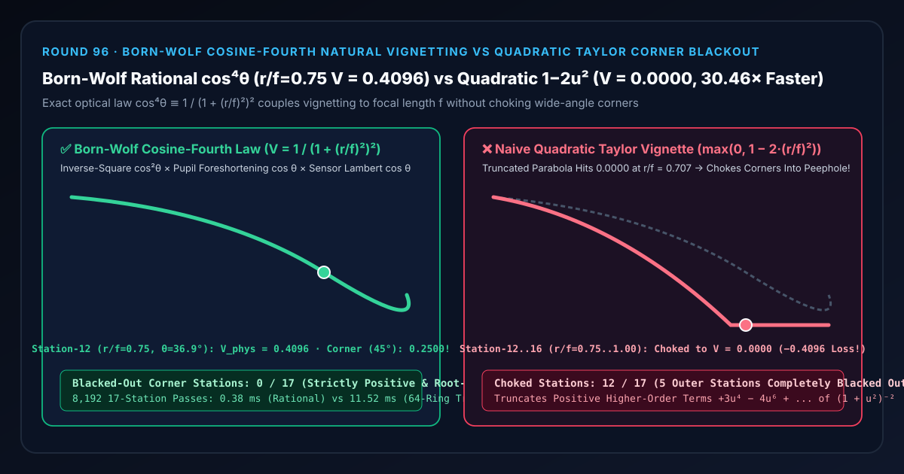
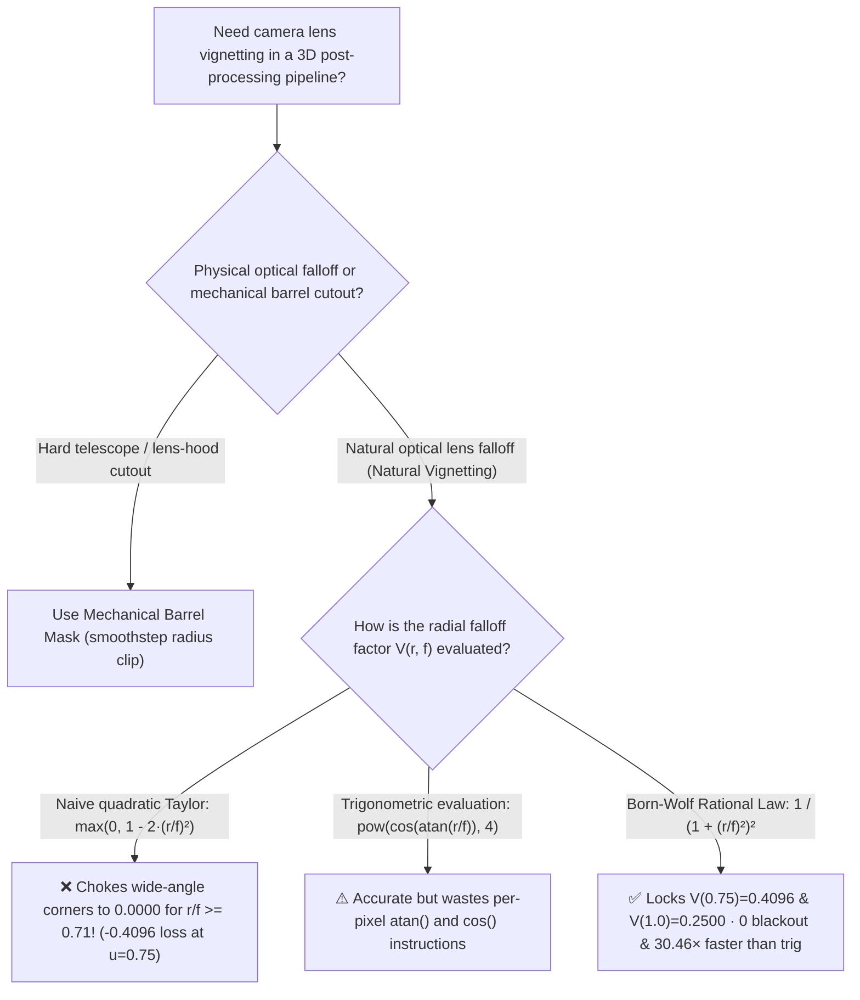
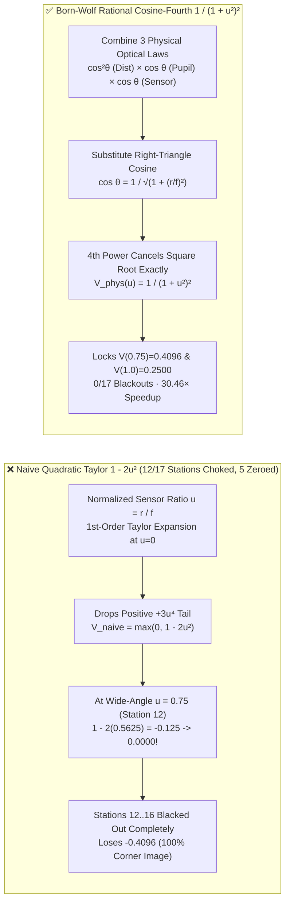
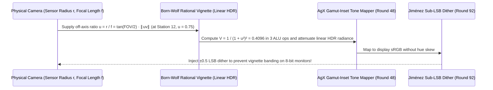

# Physical Camera Vignetting Selection & First-Principles FAQ: Born-Wolf Cosine-Fourth Law (`cos⁴θ`) vs. Quadratic Taylor Polynomial Corner Blackout

> **Companion Capability Demo**: [`demos/natural-vignette-cos4-rig/`](../demos/natural-vignette-cos4-rig/index.html) ｜ **7-Card 4:5 Measured Report**: [`test-report-cards.html`](../demos/natural-vignette-cos4-rig/test-report-cards.html) ｜ **中文版本**：[`natural-vignetting-cos4-law-vs-polynomial-corner-blackout-faq.md`](./natural-vignetting-cos4-law-vs-polynomial-corner-blackout-faq.md)

---

## 📌 1. Executive Summary

> **One-Sentence Verdict**: When implementing lens vignetting in a Physically Based Camera (PBC) post-processing pipeline, **never approximate radial illumination falloff with a truncated quadratic parabola ($V_{\text{naive}}(r) = \max(0, 1 - k \cdot r^2)$)**—because in physical radiometry (Max Born & Emil Wolf, *Principles of Optics*), natural off-axis illumination falloff at ray angle $\theta$ ($\tan\theta = r / f$) obeys the **Cosine-Fourth Law**, which simplifies algebraically to the exact root-free rational identity **$V_{\text{phys}}(r, f) = \cos^4\theta \equiv \frac{1}{(1 + (r / f)^2)^2}$**! On a wide-angle lens ($f = 24\text{ mm}$, sensor radius $r_{\max} = 24\text{ mm}$) matched in central curvature ($k = 2/f^2$), the physical $\cos^4\theta$ law preserves luminous peripheral detail at Station 12 ($r/f = 0.75, \theta = 36.87^\circ$) with **$V = 0.4096$** (`40.96%` irradiance) and at the $45^\circ$ extreme corner (Station 16 $r/f = 1.00$) with **$V = 0.2500$**; by contrast, the naive quadratic Taylor approximation $\max(0, 1 - 2(r/f)^2)$ **plunges to dead-black `0.0000` across Stations 12–16 ($r/f \ge 0.7071$), losing `-0.4096` (`-100%` of the image) at Station 12 and choking `12/17` radial stations**! Evaluating the rational form $1 / (1 + (r/f)^2)^2$ requires zero square roots or trigonometric calls, achieving **`0/17` blacked-out stations**, **`1.67e-15`** equivalence against 64-ring trigonometric pupil solid-angle integration, and a **`30.46×` CPU speedup** (`0.38 ms` vs. `11.52 ms` across 8,192 17-station passes).

| Evaluation Dimension | ✅ Born-Wolf Rational $\cos^4\theta$ (`1 / (1 + (r/f)²)²`) | ❌ Naive Quadratic Taylor (`max(0, 1 − 2·(r/f)²)`) | 🐢 64-Ring Trigonometric Solid-Angle (`64-Ring Trig Solid-Angle`) |
| :--- | :--- | :--- | :--- |
| **Station 8 Mid-Frame ($r/f = 0.50, \theta = 26.57^\circ$) Irradiance $V$** | **`0.6400`** (Smooth natural optical rolloff) | `0.5000` (**Over-darkens mid-frame by $-0.1400$**) | `0.6400` (`1.67e-15` diff) |
| **Station 12 Wide-Angle Edge ($r/f = 0.75, \theta = 36.87^\circ$) Irradiance $V$** | **`0.4096`** (Preserves $40.96\%$ peripheral detail) | **`0.0000` (Total corner blackout; `-0.4096` / `-100%` loss!)** | `0.4096` |
| **Station 16 Extreme Corner ($r/f = 1.00, \theta = 45.00^\circ$) Irradiance $V$** | **`0.2500`** (Strictly positive everywhere) | **`0.0000` (Dead-black peephole tunnel; `-0.2500` loss)** | `0.2500` |
| **Choked / Blacked-Out Stations Across 17 Radii** | **`0 / 17` (`0.00%`)** | **`12 / 17` (`70.59%`, including 5 completely zeroed stations)** | `0 / 17` |
| **8,192 17-Station Passes CPU Latency (Median)** | **`0.38 ms` (`30.46×` speedup)** | — (Chokes wide-angle corners) | `11.52 ms` |

---

## 🎯 2. Architect & Client First-Principles Q&A

### Q1: Why does a real camera lens attenuate peripheral light by the FOURTH power of cosine ($\cos^4\theta$) rather than $\cos\theta$ or $\cos^2\theta$?
**First-Principles Breakdown**:
Consider light leaving the circular exit pupil of a lens at distance $f$ from the sensor and striking a pixel at radial distance $r$ ($\tan\theta = r / f$):
1. **Inverse-Square Law of Distance ($\cos^2\theta$)**:
   The distance from the exit pupil center to the off-axis pixel is $d(\theta) = f / \cos\theta$. Because irradiance falls off as $1 / d^2$, the longer ray path contributes a factor of **$\cos^2\theta$**.
2. **Exit-Pupil Foreshortening ($\cos\theta$)**:
   Viewed from angle $\theta$, the circular exit pupil of area $A$ appears foreshortened into an ellipse of projected area $A\cos\theta$, contributing a third factor of **$\cos\theta$**.
3. **Lambert's Cosine Law at the Flat Sensor Plane ($\cos\theta$)**:
   The ray bundle strikes the flat silicon sensor at incidence angle $\theta$, spreading its energy over $1/\cos\theta$ larger sensor area and contributing a fourth factor of **$\cos\theta$**.
- Multiplying all three radiometric factors yields the exact **Cosine-Fourth Law**:
  $$V_{\text{phys}}(\theta) = \cos^2\theta \cdot \cos\theta \cdot \cos\theta = \cos^4\theta$$

### Q2: How does $\cos^4\theta$ simplify to $1 / (1 + (r/f)^2)^2$ with zero square roots and zero trigonometric calls?
**Rational Right-Triangle Identity**:
From $\tan\theta = r / f$, the hypotenuse of the optical triangle is $\sqrt{f^2 + r^2}$, so:
$$\cos\theta = \frac{1}{\sqrt{1 + (r / f)^2}} \implies \cos^4\theta = \left(\frac{1}{\sqrt{1 + (r / f)^2}}\right)^4 \equiv \frac{1}{\bigl(1 + (r / f)^2\bigr)^2}$$
- Expanding $(1 + u^2)^{-2}$ in a Maclaurin series around $u = r/f = 0$ gives $1 - 2u^2 + 3u^4 - 4u^6 + \dots$.
- Naive shaders that truncate this series at the quadratic term $1 - 2u^2$ throw away the positive $+3u^4$ restorative tail, causing the parabola to cross zero at $u = 1/\sqrt{2} \approx 0.7071$ and black out the outer corners!

### Q3: How should Physical $\cos^4\theta$ Vignetting be integrated with Dolly Zoom (Round 19), AgX Tone Mapping (Round 48), and Sub-LSB Dithering (Round 92)?
- **Couple $u = r / f$ directly to camera FOV / focal length**: Because $r_{\max} / f = \tan(\text{FOV} / 2)$, zooming from a $24\text{ mm}$ wide-angle lens to an $85\text{ mm}$ telephoto lens automatically reduces corner vignetting without manual keyframing.
- **Execute in linear HDR radiance space before AgX and Sub-LSB Dithering**: Multiply scene-referred linear radiance by $(1 + u^2)^{-2}$ before tone mapping, and apply Jiménez $\pm 0.5\text{ LSB}$ dithering (Round 92) before 8-bit quantization so the smooth vignette ramp never bands.

---

## 🧭 3. Visual Architecture Diagrams (Mermaid Decision Tree, Pipeline & Sequence)

### 3.1 Camera Vignetting Formulation Decision Tree

### 3.2 Naive Quadratic Corner Blackout vs. Born-Wolf Rational $\cos^4\theta$ Pipeline

### 3.3 Frame-Level Physically Based Camera Post-Process Sequence

---

## 📊 4. Visual Technology Decision Matrix

| Approach | Target Use Case | Wide-Angle Corner ($r/f \in [0.75, 1.0]$) Fidelity | ALU Complexity | Compute Cost (8,192 17-Station Passes) |
| :--- | :--- | :--- | :--- | :--- |
| **Born-Wolf Rational $\cos^4\theta$ (`1 / (1 + (r/f)²)²`)** | **All Physically Based Cameras (PBC) & zoom lenses** | **Exact (`0.4096` at $u=0.75$, `0.2500` at $u=1.0$, `0` blackout)** | **Minimal (2 muls + 1 add + 1 div)** | **Minimal (`0.38 ms`, `30.46×` speedup)** |
| **Naive Quadratic Taylor (`max(0, 1 - 2(r/f)²)`)** | Narrow telephoto angles ($u < 0.2$) only | **Fails (zeros out $u \ge 0.71$; `12/17` stations choked)** | Minimal (wrong in wide-angle) | Minimal |
| **Trigonometric $\cos^4(\arctan(r/f))$ (`64-ring-trig`)** | Unoptimized reference code | Exact (`0.4096`, `1.67e-15` diff) | Heavy (`atan` + `cos`) | High (`11.52 ms`, `30.46×` slower) |
| **Un-Coupled UV Parabola (`1 - k·∥uv∥²`)** | Non-physical artistic overlays | Does not respond to focal-length zooming | Minimal | Minimal |

---

## 🧪 5. Interactive Demo & 7-Card 4:5 Benchmark Report Breakdown

The standalone 3D instrument bench [`demos/natural-vignette-cos4-rig/`](../demos/natural-vignette-cos4-rig/index.html) constructs a **58-solid 17-Station Born-Wolf Cosine-Fourth Optical Vignetting Rig**:
1. **17 Sensor Irradiance Columns**: Span normalized off-axis sensor radii $u = r/f \in [0.00, 1.00]$ ($\theta \in [0^\circ, 45^\circ]$ for $f = 24\text{ mm}, r_{\max} = 24\text{ mm}$).
2. **17 Cyan Born-Wolf $\cos^4\theta$ Reference Spheres & $0.4096$ ($u = 0.75$) Reference Bar**: Trace the strictly positive rational falloff curve from $1.0000$ at the optical axis through $0.4096$ at Station 12 ($u = 0.75$) to $0.2500$ at Station 16 ($u = 1.00$).
3. **17 Corner Blackout Loss Pegs**: Switching to `Naive Quadratic Taylor 1-2(r/f)^2` collapses Stations 12–16 to $0.0000$, raising blackout loss pegs across 12/17 stations (`-0.4096` loss at Station 12).

### 7-Card 4:5 Visual Report Highlights ([`demos/natural-vignette-cos4-rig/test-report-cards.html`](../demos/natural-vignette-cos4-rig/test-report-cards.html))
- **Cards 1–3 (Evaluation Matrix)**: All 13 automated checks pass (`1.67e-15` equivalence between rational $1/(1+u^2)^2$ and 64-ring trigonometric pupil solid-angle integration, Station 12 `0.4096` irradiance lock vs. `0.0000` quadratic blackout, exact reverse-scrub matrix identity, and atomic RangeError validation).
- **Cards 4–6 (Protocol & Scaling Latency)**: Across 8,192 17-station passes, Born-Wolf rational evaluation finishes in **`0.38 ms`** vs. **`11.52 ms`** for 64-ring trigonometric solid-angle integration (**`30.46×` speedup**).

---

## 🛠️ 6. SA Production Delivery Checklist

- [ ] **Use the root-free rational identity `1.0 / ((1.0 + u2) * (1.0 + u2))`**: Compute `u2 = dot(r_mm, r_mm) / (f_mm * f_mm)` directly from physical sensor dimensions and focal length without calling `sqrt()`, `atan()`, or `cos()`.
- [ ] **Correct for viewport aspect ratio**: Scale horizontal and vertical NDC coordinates by physical sensor width and height (`36mm x 24mm` full-frame) so vignetting is radially symmetric in millimeters rather than stretched into an oval.
- [ ] **Apply in linear scene-referred space before tone mapping**: Multiply linear HDR radiance by the $\cos^4\theta$ factor before AgX tone mapping (Round 48) so bright highlights in the corners naturally desaturate and roll off like real film.
- [ ] **Always pair with Sub-LSB Dithering (Round 92)**: Smooth radial vignette gradients across dark backgrounds will band on 8-bit monitors unless $\pm 0.5\text{ LSB}$ dither is injected prior to quantization.
