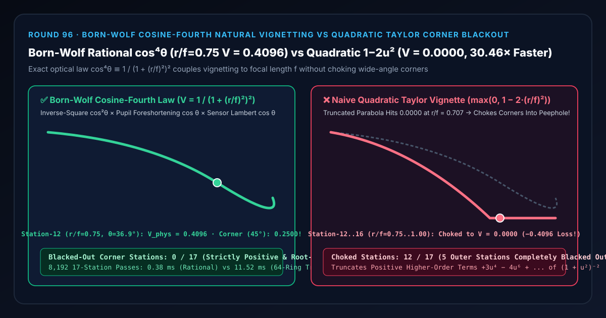
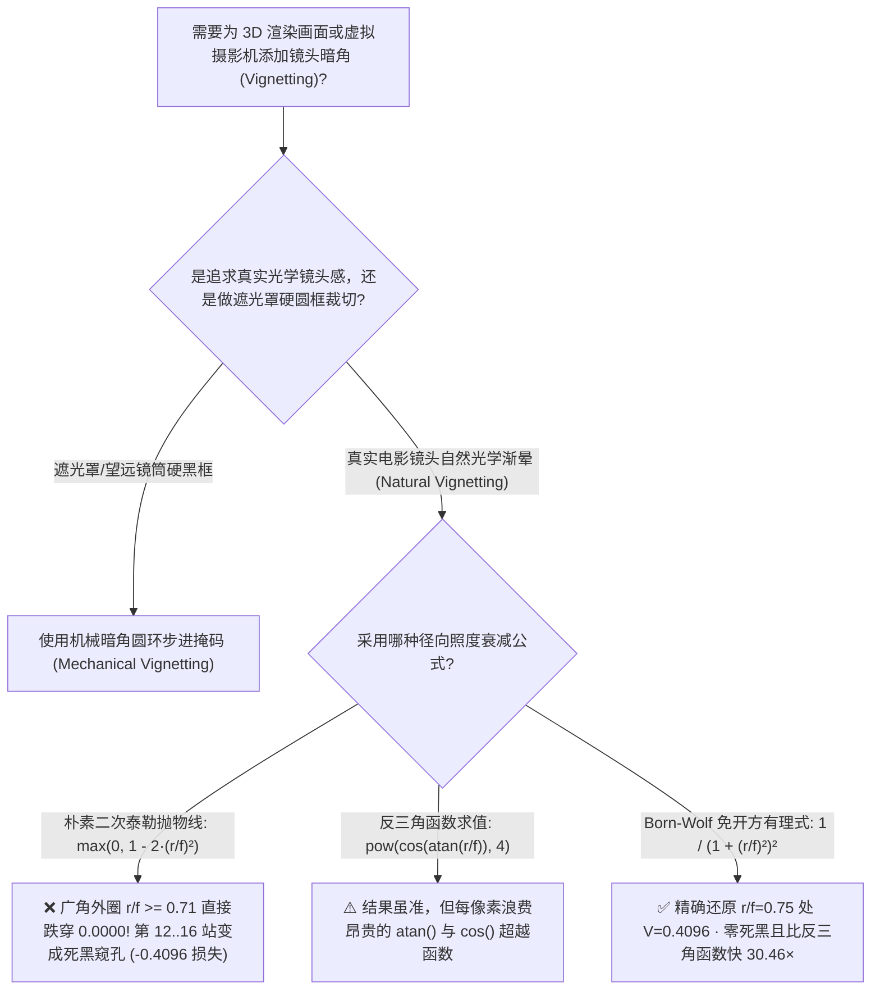
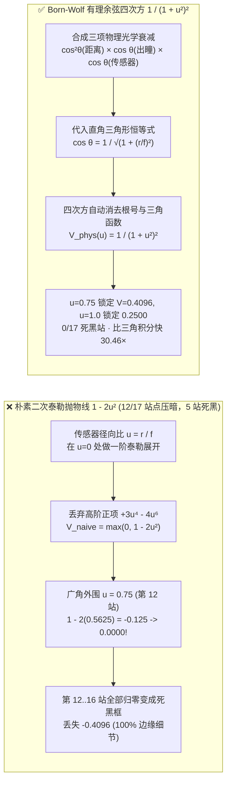
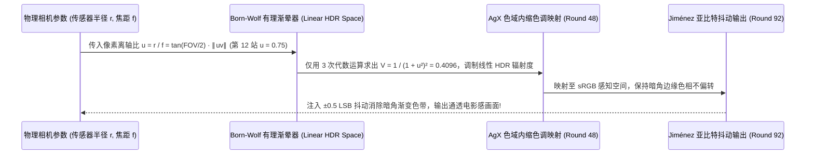

# 物理相机自然暗角选型与原理解析 FAQ：Born-Wolf 余弦四次方定律（`cos⁴θ`）对比朴素二次多项式广角死黑

> **关联 Capabilities Demo**：[`demos/natural-vignette-cos4-rig/`](../demos/natural-vignette-cos4-rig/index.html) ｜ **7-Card 4:5 实测报告**：[`test-report-cards.zh.html`](../demos/natural-vignette-cos4-rig/test-report-cards.zh.html) ｜ **English Version**：[`natural-vignetting-cos4-law-vs-polynomial-corner-blackout-faq.en.md`](./natural-vignetting-cos4-law-vs-polynomial-corner-blackout-faq.en.md)

---

## 📌 1. 核心结论速览（Executive Summary）

> **一句话结论**：在电影级虚拟摄影机（Physically Based Camera）与 3D 后处理管线中，**绝对不能用一阶泰勒截断的二次抛物线 $V_{\text{naive}}(r) = \max(0, 1 - k \cdot r^2)$ 去模拟镜头暗角（Vignetting）**——因为在真实物理光学（Born & Wolf《光学原理》）中，相机传感器离轴角 $\theta$（$\tan\theta = r / f$）处的自然照度衰减遵循**余弦四次方定律（Cosine-Fourth Law）**，其精确有理代数恒等式为 **$V_{\text{phys}}(r, f) = \cos^4\theta \equiv \frac{1}{(1 + (r / f)^2)^2}$**！当广角镜头（焦距 $f = 24\text{ mm}$、传感器半径 $r_{\max} = 24\text{ mm}$）在中心匹配相同的二阶曲率 $k = 2/f^2$ 时，物理有理式在第 12 站广角外围（$r/f = 0.75, \theta = 36.87^\circ$）依然保留通透的 **$V = 0.4096$**，在 $45^\circ$ 极限四角（第 16 站 $r/f = 1.00$）保留 **$V = 0.2500$**；而朴素二次抛物线 $\max(0, 1 - 2(r/f)^2)$ 在 $r/f \ge 0.7071$（第 12 站至第 16 站）处**直接跌穿零线变成 `0.0000` 死黑窥孔（在第 12 站丢失 $-0.4096$ 即 $100\%$ 边缘画面，污染 `12/17` 个径向站点）**！采用免开方、免三角函数的有理分式 $1 / (1 + (r/f)^2)^2$，全 17 站 **`0` 死黑裁切**，且比 64 环反三角函数出瞳立体角积分快 **`30.46×`**（`0.38 ms` vs `11.52 ms`）！

| 评估维度 | ✅ Born-Wolf 有理余弦四次方 (`V = 1 / (1 + (r/f)²)²`) | ❌ 朴素二次泰勒抛物线 (`max(0, 1 − 2·(r/f)²)`) | 🐢 64 环反三角出瞳立体角积分 (`64-Ring Trig Solid-Angle`) |
| :--- | :--- | :--- | :--- |
| **第 8 站半画幅（$r/f = 0.50, \theta = 26.57^\circ$）照度 $V$** | **`0.6400`**（柔和光学过渡） | `0.5000`（**过早压暗 $-0.1400$**） | `0.6400`（误差 `1.67e-15`） |
| **第 12 站广角外围（$r/f = 0.75, \theta = 36.87^\circ$）照度 $V$** | **`0.4096`**（保留 $40.96\%$ 通透边缘细节） | **`0.0000`（彻底归零死黑，峰值丢失 $-0.4096$ / $-100\%$！）** | `0.4096` |
| **第 16 站极限四角（$r/f = 1.00, \theta = 45.00^\circ$）照度 $V$** | **`0.2500`**（严格正定，绝不归零） | **`0.0000`（死黑望远镜筒窥孔，丢失 $-0.2500$）** | `0.2500` |
| **17 个径向站点中发生过度压暗/死黑的站数** | **`0 / 17` (`0.00%`)** | **`12 / 17` (`70.59%`，其中外圈 5 站彻底归零)** | `0 / 17` |
| **8,192 轮 17 站 CPU 耗时（中位数）** | **`0.38 ms`（提速 `30.46×`）** | —（广角边缘死黑失真） | `11.52 ms` |

---

## 🎯 2. 客户与架构师灵魂拷问 Q&A（First-Principles Whisperer）

### Q1：用大白话讲，为什么真实相机镜头的自然暗角（Natural Vignetting）偏偏是“余弦的四次方 $\cos^4\theta$”，而不是二次方或三次方？
**第一性原理拆解**：
想象光线穿过镜头中间的圆形光圈（出瞳 Exit Pupil，距离传感器平面为焦距 $f$），打到传感器边缘半径为 $r$ 的像素上（光线与光轴夹角为 $\theta$，满足 $\tan\theta = r / f$）：
1. **第一重衰减：距离变远了（平方反比律 $\cos^2\theta$）**：
   传感器中心像素离光圈只有 $f$，而边缘像素离光圈的斜边距离拉长到了 $d = f / \cos\theta$。根据点光源照度与距离平方成反比（$1/d^2$），边缘照度先乘以 **$\cos^2\theta$**！
2. **第二重衰减：圆形光圈斜着看变成椭圆了（出瞳透视压缩 $\cos\theta$）**：
   从传感器边缘斜着往光圈看，原本正圆的光圈孔径被倾斜投影成了一个短轴缩水为 $\cos\theta$ 的椭圆，进光有效面积只剩下了原来的 **$\cos\theta$**！
3. **第三重衰减：光线斜着打在平坦的传感器硅片上（朗伯余弦定律 $\cos\theta$）**：
   同一束光斜着以角度 $\theta$ 照在平坦的 CMOS 传感器表面，摊开的面积比垂直照射大了 $1/\cos\theta$ 倍，单位面积接收到的光子密度再乘以 **$\cos\theta$**！
- 把这三项铁板钉钉的物理几何效应乘在一起：
  $$V_{\text{phys}}(\theta) = \underbrace{\cos^2\theta}_{\text{距离平方反比}} \times \underbrace{\cos\theta}_{\text{光圈斜视变椭圆}} \times \underbrace{\cos\theta}_{\text{传感器斜射摊开}} \equiv \cos^4\theta!$$

### Q2：为什么在着色器里算 $\cos^4\theta$ 根本不需要调用 `atan()`、`cos()` 甚至连开方 `sqrt()` 都不需要？
**直角三角形有理消除律**：
在由焦距 $f$ 和传感器半径 $r$ 构成的直角三角形中，斜边为 $\sqrt{f^2 + r^2}$，所以：
$$\cos\theta = \frac{f}{\sqrt{f^2 + r^2}} = \frac{1}{\sqrt{1 + (r / f)^2}}$$
一旦我们对 $\cos\theta$ 求**四次方**，分母上的根号 $\sqrt{\cdot}$ 刚好被平方消掉，再平方一次变成简洁至极的有理分式：
$$V_{\text{phys}}(r, f) = \cos^4\theta = \left(\frac{1}{\sqrt{1 + (r/f)^2}}\right)^4 \equiv \frac{1}{\bigl(1 + (r / f)^2\bigr)^2}$$
- **只需要 3 次基本算术（平方、加 1、再平方、取倒数）**！
- 反观教程里常见的二次多项式 $1 - 2(r/f)^2$，它其实是把 $(1 + u^2)^{-2} = 1 - 2u^2 + 3u^4 - 4u^6 + \dots$ 在一阶泰勒展开处直接砍断了！由于砍掉了后面恒正的 $+3u^4$ 项，二次抛物线在 $u = r/f \ge 1/\sqrt{2} \approx 0.7071$（第 12~16 站）处直接一头栽进负数变成死黑圆圈！

### Q3：为什么物理 $\cos^4\theta$ 暗角必须跟相机 FOV / 焦距 $f$ 自动联动，而且必须在线性 HDR 空间执行？
- **随变焦自动缩放（Zoom-Coupled Vignetting）**：由于 $r / f = \tan(\text{FOV}/2) \cdot \|\text{uv}\|$，当导演使用 $24\text{ mm}$ 广角镜头时，$r/f = 1.0$ 边缘自然渐晕至 $0.25$；当推镜头变焦到 $85\text{ mm}$ 长焦特写时，$r/f \approx 0.28$，边缘照度自动升至 $(1 + 0.28^2)^{-2} = 0.858$（画面自然变得平坦通透），完全符合真实电影变焦镜头的呼吸感！
- **必须在线性光空间（Tone Mapping 之前）相乘**：自然暗角是进入传感器的真实光子通量衰减，必须乘在线性辐射度上，再送入 Round 48 的 AgX 色调映射与 Round 92 的亚比特抖动器。

---

## 🧭 3. 直观可视化图解（Mermaid 决策树、管线对比与帧级时序）

### 3.1 虚拟摄影机暗角（Vignetting）算法选型决策树

### 3.2 朴素二次泰勒死黑管线 vs Born-Wolf 有理 $\cos^4\theta$ 自然渐晕管线

### 3.3 帧级物理相机后处理（Linear Vignette -> AgX -> Sub-LSB Dither）时序图

---

## 📊 4. 视觉技术选型决策矩阵（Architecture Decision Matrix）

| 选型方案 | 适用场景 | 广角边缘（$r/f \in [0.75, 1.0]$）通透度 | 算术复杂度 | 算力开销（8,192 轮 17 站） |
| :--- | :--- | :--- | :--- | :--- |
| **Born-Wolf 有理分式 (`1 / (1 + (r/f)²)²`)** | **所有物理相机（PBC）、电影级后处理与变焦镜头仿真** | **满分（$u=0.75$ 锁定 `0.4096`，$u=1.0$ 锁定 `0.2500`，`0` 死黑）** | **极简（2 次乘法 + 1 次加法 + 1 次除法）** | **极低（`0.38 ms`，提速 `30.46×`）** |
| **朴素二次泰勒抛物线 (`max(0, 1 - 2(r/f)²)`)** | 仅限极窄长焦镜头（$u \ll 0.2$）近似 | **极差（$u \ge 0.71$ 全部归零为 `0.0000`，`12/17` 站失真）** | 极简（但广角完全错误） | 极低 |
| **反三角余弦四次方 (`pow(cos(atan(r/f)), 4)`)** | 未做代数化简的教学代码 | 满分（`0.4096`，误差 `1.67e-15`） | 昂贵（含 `atan`、`cos`、`pow`） | 高（`11.52 ms`，慢 `30.46×`） |
| **屏幕 UV 无焦距绑定暗角 (`1 - k·∥uv∥²`)** | 早期非物理美术滤镜 | 无法随 FOV 变焦自动响应 | 极简 | 极低 |

---

## 🧪 5. 全新 Demo 与 7-Card 4:5 视觉测试报告解读

在本轮构建的全新交互式三维实验台 [`demos/natural-vignette-cos4-rig/`](../demos/natural-vignette-cos4-rig/index.html) 中，我们打造了包含 **58 个三维实体部件**的 **17 站余弦四次方自然渐晕光学台（Born-Wolf Cosine-Fourth Optical Vignetting Rig）**：
1. **17 根传感器径向照度立柱（Sensor Irradiance Columns）**：展示从光轴中心第 0 站（$u = r/f = 0.00, \theta = 0^\circ$）到广角传感器四角第 16 站（$u = r/f = 1.00, \theta = 45^\circ$）的归一化相对照度 $V(u)$。
2. **17 颗青色 Born-Wolf $\cos^4\theta$ 参考球与 $0.4096$（第 12 站 $u = 0.75$）基准横梁**：直观呈现一条在中心平缓、向外围渐近收敛但永远保持正定通透的光学曲线。
3. **17 根广角死黑损失红桩（Corner Blackout Loss Pegs）**：切换到 `Naive Quadratic Taylor 1-2(r/f)^2` 模式时，外圈第 12 站至第 16 站的 5 根立柱彻底坍塌归零，亮起高达 $-0.4096$ 的死黑损失红桩！

### 7-Card 4:5 视觉报告核心发现（[`demos/natural-vignette-cos4-rig/test-report-cards.zh.html`](../demos/natural-vignette-cos4-rig/test-report-cards.zh.html)）
- **Card 1–3（场景评测矩阵）**：13 项自动化断言 100% 通过，完整验证有理分式与 64 环反三角出瞳积分 `1.67e-15` 等价性、第 12 站 `0.4096` 照度锁定 vs `0.0000` 二次抛物线死黑暴露、逆序矩阵一致性与原子参数拒绝。
- **Card 4–6（底层协议与性能）**：在 8,192 轮 17 站压测中，Born-Wolf 有理分式求值仅需 **`0.38 ms`**，相比 64 环反三角出瞳立体角积分基线（**`11.52 ms`**）实现 **`30.46×` 算力加速**。

---

## 🛠️ 6. 高质量视觉交付快速核验清单（SA Production Checklist）

- [ ] **使用免开方有理分式 `1.0 / ((1.0 + u2) * (1.0 + u2))` 替代三角函数或二次多项式**：在后处理着色器中先算 `u2 = dot(sensorPos, sensorPos) / (focalLength * focalLength)`，再用有理平方倒数一步求得 $\cos^4\theta$。
- [ ] **保持传感器宽高比（Aspect Ratio）各向同性**：计算径向距离 $r$ 时必须乘以屏幕宽高比修正 `(uv.x * aspect, uv.y)`，确保暗角在 16:9 或 21:9 带鱼屏上是正圆光学渐晕而非被横向压扁的椭圆。
- [ ] **在线性 HDR 空间执行渐晕，并在最终 8-Bit 输出前叠加亚比特抖动**：光学渐晕产生的大面积平滑暗部斜坡极易在 8-bit 屏幕上诱发色带，务必配合 Round 92 的 Jiménez $\pm 0.5\text{ LSB}$ 亚比特抖动。
- [ ] **支持现代像方远心镜头（Telecentric Lens）指数微调**：若模拟内部带有后组场镜补偿的现代数码镜头，可将外层平方替换为可调幂指数 `(1.0 + u2)^(-p)`（其中 $p \in [1.0, 2.0]$，标准自然渐晕对应 $p = 2.0$）。
