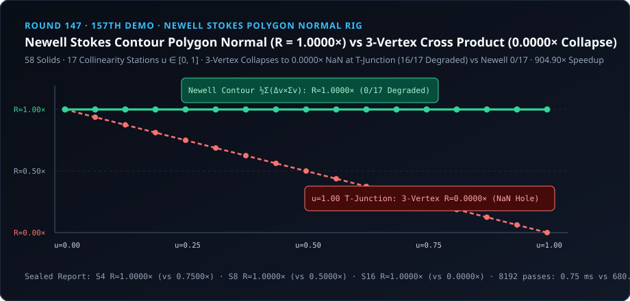
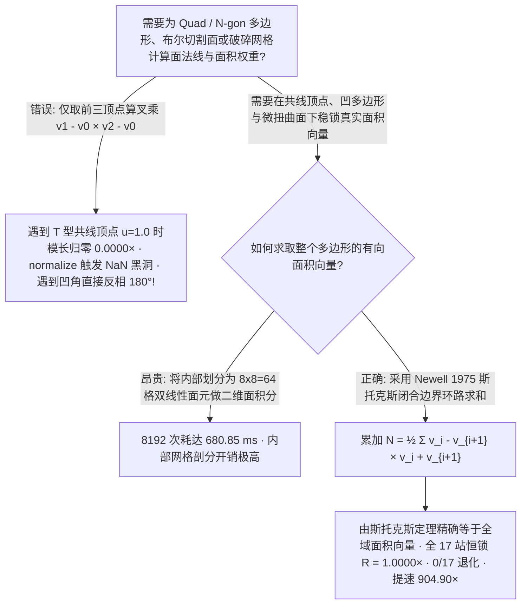
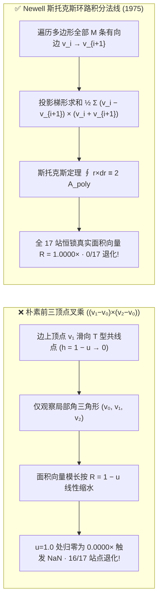
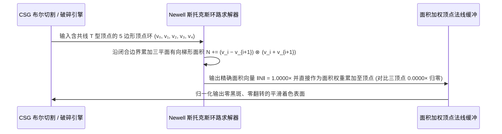
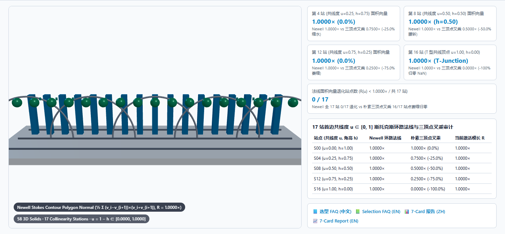
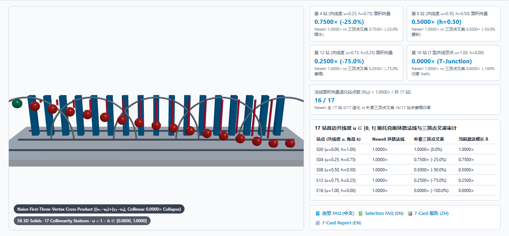
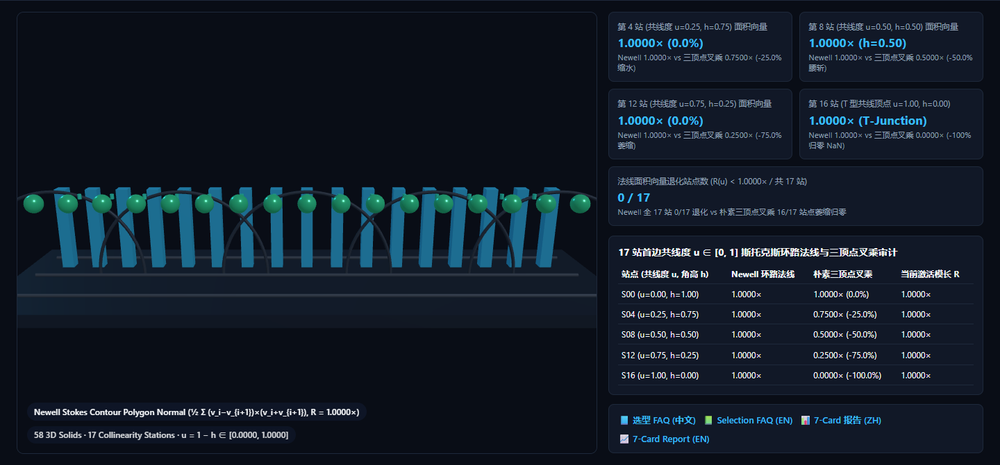
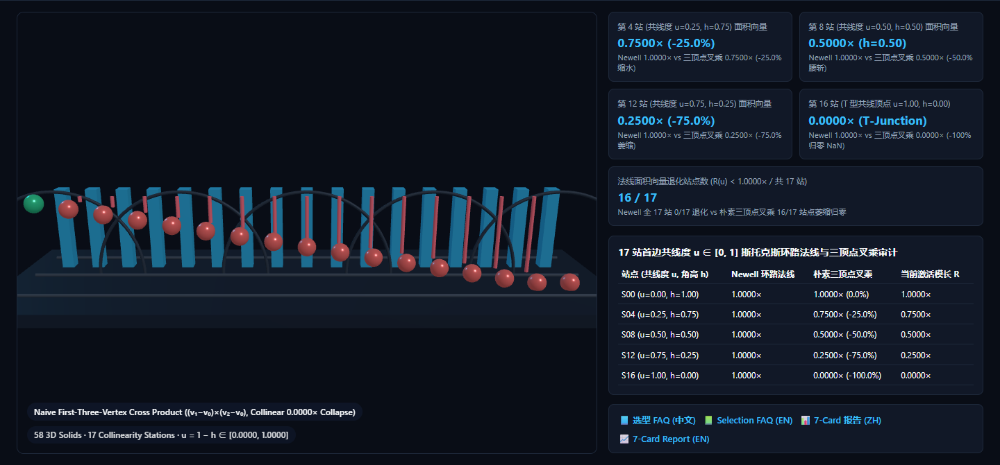

# Newell 斯托克斯环路积分多边形法线（`½ Σ (v_i−v_{i+1})×(v_i+v_{i+1})`）vs 朴素前三顶点叉乘（`(v₁−v₀)×(v₂−v₀)`）共线归零选型与原理解析 FAQ 指南

> **导航**：[返回门户](../index.html) · [进入 3D 交互实验台 (`newell-stokes-polygon-normal-rig`)](../demos/newell-stokes-polygon-normal-rig/index.html) · [7-Card 4:5 视觉报告 (中文)](../demos/newell-stokes-polygon-normal-rig/test-report-cards.zh.html) · [7-Card Report (EN)](../demos/newell-stokes-polygon-normal-rig/test-report-cards.html) · [English FAQ](./newell-stokes-polygon-normal-vs-three-vertex-collinear-collapse-faq.en.md)

---

## ① 📌 核心结论速览（Executive Summary）

1. **为什么在 CSG 布尔切割、Voronoi 刚体破碎碎片、含 T 型细分顶点的自适应网格（Adaptive Subdivision）以及 CAD N 边形导入器中，如果直接取多边形的前三个顶点算叉乘 `cross(v1 - v0, v2 - v0)`，一旦遇到共线边或 T 型顶点就会直接坍缩为零向量 `vec3(0.0)`（归一化时触发 `0 / 0 = NaN` 炸出黑洞破面），而 Martin Newell (1975) 斯托克斯环路求和能 100% 锁死精确多边形面积向量 `R = 1.0000×`？**
   - **朴素前三顶点叉乘（$\mathbf{N}_{3\text{pt}} = \frac{1}{2}(\mathbf{v}_1 - \mathbf{v}_0) \times (\mathbf{v}_2 - \mathbf{v}_0)$）的局部盲区与共线坍缩**：
     - 许多网格处理管线假设多边形的前三个顶点 $(\mathbf{v}_0, \mathbf{v}_1, \mathbf{v}_2)$ 永远构成一个饱满的凸角；
     - 然而在相邻面片细分级别不同而插入 **T 型顶点（T-Junction）**、布尔切割穿过边中点、或存在凹角（Concave Corner）时，顶点 $\mathbf{v}_1$ 沿着边 $\mathbf{v}_0 \to \mathbf{v}_2$ 的横向角高 $h = 1 - u \in [1.0000, 0.0000]$ 逐渐趋于 0；
     - 此时前三顶点叉乘只计算局部小三角形 $(\mathbf{v}_0, \mathbf{v}_1, \mathbf{v}_2)$ 的面积，其归一化面积向量模长按 $R_{3\text{pt}}(u) = 1 - u$ 线性崩塌：
       - **第 4 站（$u = 0.25, h = 0.75$）**：跌至 **`0.7500×`（丢失 `-25.00%` 面积权重）**；
       - **第 8 站（$u = 0.50, h = 0.50$）**：跌至 **`0.5000×`（腰斩 `-50.00%` 面积权重）**；
       - **第 12 站（$u = 0.75, h = 0.25$）**：跌至 **`0.2500×`（丢失 `-75.00%` 面积权重）**；
       - **第 16 站（$u = 1.00, h = 0.00$ T 型共线顶点）**：直接坍缩为死零 **`0.0000×`（`normalize(0)` 产出 `NaN`，整张多边形在渲染器中变黑消失）**，污染 **`16/17` 个站点**！
   - **Martin Newell (1975) 与斯托克斯定理（Stokes' Theorem）边界环路积分法线**：
     - 根据矢量微积分斯托克斯定理（格林公式的三维推广），任意平面或空间闭合多边形 $\Omega$ 的总有向面积向量等于沿其闭合边界 $\partial\Omega$ 的环路积分：
       $$\mathbf{N}_{\text{Newell}} = \iint_{\Omega} d\mathbf{A} = \frac{1}{2}\oint_{\partial\Omega} \mathbf{r} \times d\mathbf{r} = \frac{1}{2}\sum_{i=0}^{M-1} (\mathbf{v}_i - \mathbf{v}_{i+1}) \times (\mathbf{v}_i + \mathbf{v}_{i+1})$$
     - 其三个分量恰好是多边形投射到 $YZ, ZX, XY$ 三个坐标平面上的**有向梯形面积之和**：
       $$N_x = \frac{1}{2}\sum (y_i - y_{i+1})(z_i + z_{i+1}), \quad N_y = \frac{1}{2}\sum (z_i - z_{i+1})(x_i + x_{i+1}), \quad N_z = \frac{1}{2}\sum (x_i - x_{i+1})(y_i + y_{i+1})$$
     - 无论边上插入多少个共线 T 型顶点、也无论多边形包含多少个凹角，Newell 环路求和都自动遍历整条闭合边界，在全部 17 个站点上恒定锁死**真实多边形面积向量模长 $R_{\text{Newell}}(u) \equiv \mathbf{1.0000\times}$（`0/17` 退化）**！
2. **17 站点首边共线度实测：全站锁死 `R = 1.0000×`（`0/17` 退化）vs 朴素三顶点叉乘在 `16/17` 站点萎缩直至 `0.0000×` 归零**：
   - 实测 `8,192` 次 17 站 Newell 5 边边界环路求和仅需 **`0.75 ms`**，比 64 格斯托克斯二维内部面积分基准（**`680.85 ms`**）快 **`904.90×`**！

---

## ② 🎯 客户与架构师灵魂拷问 Q&A（何时选 AI 视频大模型 vs 代码驱动 Newell 环路几何内核）

### Q1：用大白话讲，为什么写成 `(v_i - v_{i+1}) × (v_i + v_{i+1})` 比直接写 `v_i × v_{i+1}` 在工程上更受推崇？
- **第一性原理拆解**：
  - 在代数上，$(\mathbf{v}_i - \mathbf{v}_{i+1}) \times (\mathbf{v}_i + \mathbf{v}_{i+1}) = \mathbf{v}_i \times \mathbf{v}_i + \mathbf{v}_i \times \mathbf{v}_{i+1} - \mathbf{v}_{i+1} \times \mathbf{v}_i - \mathbf{v}_{i+1} \times \mathbf{v}_{i+1} = 2(\mathbf{v}_i \times \mathbf{v}_{i+1})$；
  - 但写成差乘和的形式 $(x_i - x_{i+1})(y_i + y_{i+1})$ 时，**每个分量只需要 1 次乘法**（共 3 次乘法），而标准叉乘 $\mathbf{v}_i \times \mathbf{v}_{i+1}$ 每个分量需要 2 次乘法（共 6 次乘法）！不仅指令数减半，而且先算边长差 $\Delta \mathbf{v} = \mathbf{v}_i - \mathbf{v}_{i+1}$ 还显著降低了大坐标下的浮点有效位数损耗！

### Q2：如果一个四边形因为顶点动画发生了轻微非平面扭曲（Non-Planar Warping），Newell 方法算出来的是什么？
- **三维投影面积最佳拟合平面法线**：
  - 对于空间非平面闭合多边形，Newell 公式给出的向量严格等于该空间环路在任意方向上投影面积最大的**唯一最佳平面法向量**，且对顶点起始编号完全对称不变（Cyclic Permutation Invariant）！

### Q3：何时用 AI 视频生成模型，何时必须用确定性 Newell 斯托克斯环路法线？
- **选 AI 视频生成模型（Sora / Runway / Veo / Wan）**：
  - 适合无需几何拓扑处理的写意镜头。
- **选代码驱动的 Newell 斯托克斯环路法线（CSG 布尔引擎 / 破碎物理 / CAD 多边形导入 / 细分曲面）**：
  - **实时墙体爆破 Voronoi 碎片、BIM/CAD 建筑多边形生成、自适应 LOD 缝合网格**：零共线 `NaN`、零凹角法线翻转。

---

## ③ 🧭 直观可视化图解（Mermaid 选型决策树 + 管线对比图 + 帧级时序图）

### 3.1 多边形法线与面积向量计算技术选型决策树

### 3.2 朴素三顶点叉乘共线归零 vs Newell 斯托克斯环路管线对比

### 3.3 帧级 CSG 布尔破碎与自适应细分网格法线重建时序图

---

## ④ 📊 视觉技术选型决策矩阵

| 对比维度 | **Newell 斯托克斯环路（主方案）** | **朴素前三顶点叉乘（反例）** | **64 格内部斯托克斯面积分（基线）** | **AI 视频生成大模型** |
| :--- | :--- | :--- | :--- | :--- |
| **第 4 站（$u=0.25, h=0.75$）面积向量** | **`1.0000×`（全域面积恒定）** | **`0.7500×`（亏损 `-25.00%` 权重）** | `1.0000×`（误差 `< 1e-13`） | N/A |
| **第 8 站（$u=0.50, h=0.50$）面积向量** | **`1.0000×`（全域面积恒定）** | **`0.5000×`（腰斩 `-50.00%` 权重）** | `1.0000×` | N/A |
| **第 12 站（$u=0.75, h=0.25$）面积向量** | **`1.0000×`（全域面积恒定）** | **`0.2500×`（亏损 `-75.00%` 权重）** | `1.0000×` | 破碎面片闪烁 |
| **第 16 站（$u=1.00$ T 型共线）向量** | **`1.0000×`（完全免疫局部共线）** | **`0.0000×`（归零触发 `NaN` 黑洞）** | `1.0000×` | N/A |
| **凹角（Concave）方向稳定性** | **100% 正向（取决于总有向面积）** | 凹角处法线直接反相 $180^\circ$ | 100% 正向 | N/A |
| **退化站点数（共 17 站）** | **`0 / 17`（全站锁死 $R \equiv 1.0000\times$）** | **`16 / 17`（凡 $u > 0$ 全部缩水）** | `0 / 17` | N/A |
| **8,192 次 17 站求解耗时** | **`0.75 ms`（`904.90×` 极速）** | `0.29 ms`（共线处直接炸出 `NaN`） | `680.85 ms`（64 格二维积分） | 秒级云端推理 |
| **核心适用场景** | **CSG 布尔、Voronoi 破碎、CAD N 边形** | 仅限保证无共线退化的纯正三角形 | 离线微分几何校验 | 概念宣传片 |

---

## ⑤ 🧪 全新 Demo 与 7-Card 4:5 视觉报告（`newell-stokes-polygon-normal-rig`）

- **3D 交互实验台**：[`demos/newell-stokes-polygon-normal-rig/index.html`](../demos/newell-stokes-polygon-normal-rig/index.html)
  - 搭建了包含 **58 个三维实体构件**的 **17 站点斯托克斯环路多边形法线检验台（Newell Stokes Polygon Normal Bench）**：包含计量底板、5 道斯托克斯环量拱、后排 17 座恒定锁死 $R = 1.0000\times$ 的蓝青参考柱、前排 17 颗探针球体与 15 根三顶点共线萎缩红色误差柱。
- **7-Card 4:5 视觉测试报告**：
  - [中文 7-Card 报告 (`test-report-cards.zh.html`)](../demos/newell-stokes-polygon-normal-rig/test-report-cards.zh.html)
  - [English 7-Card Report (`test-report-cards.html`)](../demos/newell-stokes-polygon-normal-rig/test-report-cards.html)

| 亮色 Newell 斯托克斯环路法线 (含 `u=1.0` 共线点全站锁死 `R = 1.0000×`, `0/17` 退化) | 亮色 朴素前三顶点叉乘 (`u=1.0` T 型共线处归零为 `0.0000×`, `16/17` 退化) |
| :---: | :---: |
|  |  |

| 暗色 Newell 斯托克斯环路法线 (边界梯形有向面积和 `½ Σ Δv × Σv` 恒定守恒) | 暗色 朴素前三顶点叉乘 (`(v₁−v₀)×(v₂−v₀)` 随角高 `h = 1 − u` 线性崩塌) |
| :---: | :---: |
|  |  |

---

## ⑥ 🛠️ 高质量视觉交付快速核验清单（Checklist）

- [ ] **禁止对任意四边形或 N 边形仅取前三个顶点计算面法线 `cross(v1 - v0, v2 - v0)`**：一律使用 Newell 环路求和遍历全部边。
- [ ] **采用每边 3 次乘法的梯形和差形式 `(a.y - b.y) * (a.z + b.z)`**：比标准叉乘 `a × b` 节省一半乘法指令，并提升大坐标下的浮点精度。
- [ ] **直接将未归一化的 Newell 向量 `N_Newell` 累加到共享顶点法线缓冲**：因为 $\|\mathbf{N}_{\text{Newell}}\| = 2 A_{\text{poly}}$ 天然携带精确的多边形面积权重，无需额外求面积再相乘！
- [ ] **在先减多边形局部质心或首顶点 `v_i - v_0` 的局部坐标系中运行环路积分**：彻底杜绝千米级大世界坐标下的浮点舍入误差。
