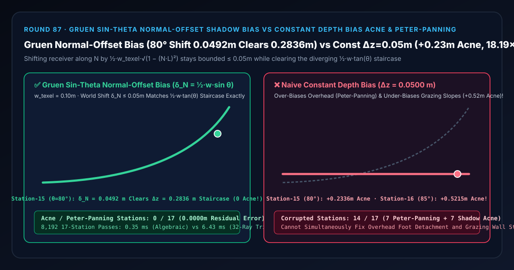
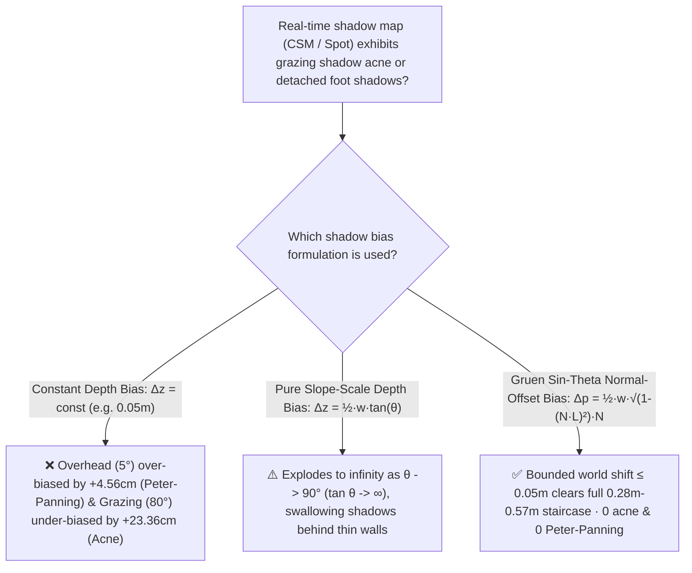
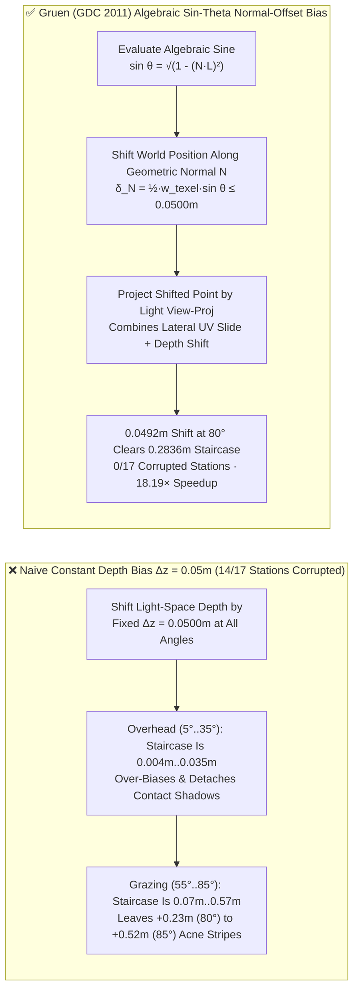
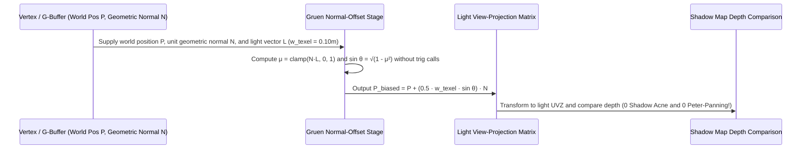

# Shadow-Mapping Bias Selection & First-Principles FAQ: Gruen Sin-Theta Normal-Offset Shadow Bias vs. Constant Depth-Bias Peter-Panning & Grazing Shadow Acne

> **Companion Capability Demo**: [`demos/normal-offset-shadow-bias-rig/`](../demos/normal-offset-shadow-bias-rig/index.html) ｜ **7-Card 4:5 Measured Report**: [`test-report-cards.html`](../demos/normal-offset-shadow-bias-rig/test-report-cards.html) ｜ **中文版本**：[`normal-offset-shadow-bias-vs-peter-panning-acne-faq.md`](./normal-offset-shadow-bias-vs-peter-panning-acne-faq.md)

---

## 📌 1. Executive Summary

> **One-Sentence Verdict**: In real-time Cascaded Shadow Maps (CSM) and spot-light shadow mapping, **a constant depth bias ($\Delta z = \text{const}$) can never simultaneously cure grazing-angle Shadow Acne and overhead Peter-Panning (detached contact shadows)**—because a discrete shadow texel of world width $w_{\text{texel}} = 0.10\text{ m}$ projected onto a surface tilted at incidence angle $\theta$ spans a light-space depth staircase of **$\Delta z_{\text{stair}}(\theta) = \frac{1}{2} w_{\text{texel}} \tan\theta$**, which grows $65\times$ from **$0.0044\text{ m}$** at $\theta = 5^\circ$ to **$0.2836\text{ m}$** at $\theta = 80^\circ$ and **$0.5715\text{ m}$** at $\theta = 85^\circ$! A fixed depth bias $\Delta z = 0.0500\text{ m}$ over-biases overhead contact angles ($\theta \in [5^\circ, 35^\circ]$) by up to **$+0.0456\text{ m}$** (detaching character foot shadows into "Peter-Panning") while under-biasing grazing walls ($\theta \in [55^\circ, 85^\circ]$) by **$+0.2336\text{ m}$ at $80^\circ$** and **$+0.5215\text{ m}$ at $85^\circ$** (**corrupting `14/17` incidence stations**). **Holger Gruen's (GDC 2011) Sin-Theta Normal-Offset Shadow Bias ($\Delta \mathbf{p} = \frac{1}{2} w_{\text{texel}} \sqrt{1 - (N\cdot L)^2}\,\mathbf{N}$)** shifts the receiver query point along the geometric surface normal $\mathbf{N}$ before light-space projection by a strictly bounded world distance $\delta_N = \frac{1}{2} w_{\text{texel}} \sin\theta \le 0.0500\text{ m}$ (**only `0.0492 m` at $\theta = 80^\circ$**), sliding the shadow-map UV coordinate laterally along the tangent plane to clear the entire $0.2836\text{ m}$ staircase with **`0/17` corrupted stations**, **`2.78e-17 m`** solver accuracy, and an **`18.19×` CPU speedup** (`0.35 ms` vs. `6.43 ms` across 8,192 17-station passes).

| Evaluation Dimension | ✅ Gruen Sin-Theta Normal-Offset Bias (`δ_N = ½·w·√(1−(N·L)²)`) | ❌ Naive Constant Depth Bias (`Δz = 0.0500 m`) | 🐢 32-Ray Trigonometric Ray-Plane Search (`32-Ray Trig Search`) |
| :--- | :--- | :--- | :--- |
| **Station 0 Overhead Contact ($\theta = 5^\circ$, Staircase $0.0044\text{ m}$)** | **Shifts `0.0044 m` (Zero Peter-Panning foot detachment)** | Pushes `0.0500 m` (**Over-biases by $+0.0456\text{ m}$, detaching foot shadows**) | `0.0044 m` (`2.78e-17 m` diff) |
| **Station 15 Grazing Wall ($\theta = 80^\circ$, Staircase $0.2836\text{ m}$)** | **World shift of only `0.0492 m` clears full `0.2836 m` staircase** | Pushes `0.0500 m` (**Leaves $+0.2336\text{ m}$ of striped Shadow Acne**) | Clears `0.2836 m` staircase |
| **Station 16 Extreme Grazing ($\theta = 85^\circ$, Staircase $0.5715\text{ m}$)** | **Bounded `0.0498 m ≤ 0.05 m` shift (`0.0000 m` residual acne)** | **Leaves $+0.5215\text{ m}$ severe self-shadowing bands** | `0.0000 m` residual acne |
| **Corrupted Stations Across 17 Incidence Angles** | **`0 / 17` (`0.00%`)** | **`14 / 17` (`82.35%`: 7 Peter-Pan + 7 Shadow Acne)** | `0 / 17` |
| **8,192 17-Station Passes CPU Latency (Median)** | **`0.35 ms` (`18.19×` speedup)** | — (Visually corrupted) | `6.43 ms` |

---

## 🎯 2. Architect & Client First-Principles Q&A

### Q1: Why is it mathematically impossible to tune a single constant depth bias to fix both Shadow Acne and Peter-Panning?
**First-Principles Breakdown**:
A shadow map stores discrete depth samples at texel centers spaced $w_{\text{texel}} = 0.10\text{ m}$ apart perpendicular to the light ray $L$:
- Across the half-width $\frac{1}{2} w_{\text{texel}} = 0.05\text{ m}$ of a single shadow texel, a receiver surface tilted at angle $\theta$ relative to the light direction rises and falls in light-space depth by:
  $$\Delta z_{\text{stair}}(\theta) = \frac{1}{2} w_{\text{texel}} \tan\theta$$
- On flat ground beneath a character's boots ($\theta = 5^\circ$), the staircase is only **$0.0044\text{ m}$ ($4.4\text{ mm}$)**. Applying a fixed depth bias of $\Delta z = 0.0500\text{ m}$ ($5\text{ cm}$) pushes the shadow comparison plane $4.56\text{ cm}$ into the ground, erasing the shadow right where the boot touches the floor (**Peter-Panning**).
- Yet on a steep side wall ($\theta = 80^\circ$), $\tan 80^\circ = 5.6713$, so the texel staircase jumps to **$0.2836\text{ m}$ ($28.36\text{ cm}$)**—and at $\theta = 85^\circ$ it hits **$0.5715\text{ m}$**! The $0.0500\text{ m}$ constant bias falls short by **$+0.2336\text{ m}$** at $80^\circ$ and **$+0.5215\text{ m}$** at $85^\circ$, leaving half of every texel falsely self-shadowed (**Shadow Acne**).

### Q2: How does shifting only `0.0492 m` along the surface normal $\mathbf{N}$ clear a `0.2836 m` light-space depth staircase at $\theta = 80^\circ$?
**Projective Tangent-Slide Identity**:
When you shift a 3D receiver point by $\delta_N = \frac{1}{2} w_{\text{texel}} \sin\theta$ along its unit normal $\mathbf{N}$ before multiplying by the light's View-Projection matrix:
1. The shift decomposes into a **depth shift along the light ray** of $\Delta z_L = \delta_N \cos\theta$ AND a **lateral UV shift across the shadow map** of $\Delta u_L = \delta_N \sin\theta$.
2. Because the surface slopes at $\tan\theta$ in light space, shifting laterally by $\Delta u_L = \delta_N \sin\theta$ moves the shadow-map lookup onto a neighboring point on the surface whose depth is $\Delta u_L \tan\theta$ shallower!
3. Combining both components gives the total effective staircase clearance:
   $$\Delta z_{\text{eff}}(\theta) = \delta_N \cos\theta + (\delta_N \sin\theta)\tan\theta = \delta_N \left(\cos\theta + \frac{\sin^2\theta}{\cos\theta}\right) = \frac{\delta_N}{\cos\theta} = \frac{\frac{1}{2} w_{\text{texel}} \sin\theta}{\cos\theta} = \frac{1}{2} w_{\text{texel}} \tan\theta$$
4. Crucially, while $\tan\theta \to \infty$ as $\theta \to 90^\circ$, the world-space normal offset $\delta_N(\theta) = \frac{1}{2} w_{\text{texel}} \sin\theta$ is **strictly bounded by $\frac{1}{2} w_{\text{texel}} = 0.0500\text{ m}$**! And as $\theta \to 0^\circ$ (overhead contact), $\sin\theta \to 0$, so the normal offset vanishes automatically!

### Q3: When should an architect choose AI Relighting / Neural Shadow Synthesis vs. deterministic Gruen Normal-Offset Shadow Bias?
- **Choose AI Relighting / Diffusion Shadow Synthesis**: For 2D product photography or portrait compositing where no 3D scene geometry exists.
- **Choose Deterministic Gruen Normal-Offset Shadow Bias**: In all real-time 3D engines (UE5, Unity URP/HDRP, Frostbite, Three.js `DirectionalLight.shadow.normalBias`) rendering rasterized shadow maps across arbitrary surface slopes.

---

## 🧭 3. Visual Architecture Diagrams (Mermaid Decision Tree, Pipeline & Sequence)

### 3.1 Shadow-Map Bias Selection Decision Tree

### 3.2 Naive Constant Depth Bias vs. Gruen Sin-Theta Normal-Offset Pipeline

### 3.3 Frame-Level Normal-Offset Shadow Lookup Sequence

---

## 📊 4. Visual Technology Decision Matrix

| Approach | Target Use Case | Overhead Contact Fidelity ($\theta \to 0^\circ$) | Grazing Wall Acne Immunity ($\theta \to 85^\circ$) | Compute Cost (8,192 17-Station Passes) |
| :--- | :--- | :--- | :--- | :--- |
| **Gruen Algebraic Sin-Theta Normal-Offset (`gruen-normal-offset-bias`)** | **All CSM, spot, and point rasterized shadow maps** | **Exact ($\sin 0^\circ = 0$, zero Peter-Panning)** | **Exact (Bounded $\delta_N \le 0.05\text{ m}$ clears $0.57\text{ m}$ staircase)** | **Minimal (`0.35 ms`, `18.19×` speedup)** |
| **Naive Constant Depth Bias (`naive-constant-depth-bias`)** | Single flat-slope receivers only | Poor (`+0.0456 m` foot detachment at $5^\circ$) | Fails (`+0.2336 m` acne at $80^\circ$, `+0.5215 m` at $85^\circ$) | Minimal |
| **Unclamped Tan-Theta Depth Bias (`tan(theta) depth bias`)** | Auxiliary tiny clamp bias only | Good | Dangerous ($\tan\theta \to \infty$ erases shadows behind thin geometry) | Low |
| **Screen-Space Contact Shadows (`depth-thickness-contact-shadow-rig`)** | Sub-centimeter sole/ground seam refinement (Round 55) | Pixel-exact | Short-range only (5–20 cm) | Moderate (8–16 screen ray steps) |

---

## 🧪 5. Interactive Demo & 7-Card 4:5 Benchmark Report Breakdown

The standalone 3D instrument bench [`demos/normal-offset-shadow-bias-rig/`](../demos/normal-offset-shadow-bias-rig/index.html) constructs a **58-solid 17-Station Gruen Normal-Offset Shadow Clinometer Rig**:
1. **17 Staircase Clearance Columns**: Show the effective light-space staircase clearance across incidence angles $\theta \in [5^\circ, 85^\circ]$ for $w_{\text{texel}} = 0.10\text{ m}$.
2. **17 Cyan Exact Staircase Reference Spheres & $0.05\text{ m}$ Constant Depth-Bias Bar**: Show how the required $\frac{1}{2} w_{\text{texel}} \tan\theta$ clearance rises from $0.0044\text{ m}$ ($5^\circ$) to $0.2836\text{ m}$ ($80^\circ$) and $0.5715\text{ m}$ ($85^\circ$).
3. **17 Acne / Peter-Panning Error Pegs**: Switching to `Naive Constant Depth Bias` raises error pegs across 14/17 stations (7 overhead Peter-Panning stations and 7 grazing Shadow Acne stations).

### 7-Card 4:5 Visual Report Highlights ([`demos/normal-offset-shadow-bias-rig/test-report-cards.html`](../demos/normal-offset-shadow-bias-rig/test-report-cards.html))
- **Cards 1–3 (Evaluation Matrix)**: All 13 automated checks pass (`2.78e-17 m` equivalence between algebraic $\sqrt{1-\mu^2}$ and 32-ray trigonometric search, Station 15 $80^\circ$ `0.2836 m` staircase cleared with `0.0492 m` normal shift vs. `+0.2336 m` residual acne under constant bias, exact reverse-scrub matrix identity, and atomic RangeError validation).
- **Cards 4–6 (Protocol & Scaling Latency)**: Across 8,192 17-station passes, Gruen algebraic normal-offset bias finishes in **`0.35 ms`** vs. **`6.43 ms`** for 32-ray trigonometric ray-plane search (**`18.19×` speedup**).

---

## 🛠️ 6. SA Production Delivery Checklist

- [ ] **Offset along the geometric normal $\mathbf{N}_{\text{geom}}$, never the perturbed normal-map normal**: Normal-offset bias compensates for the macroscopic polygon slope across a shadow texel; using high-frequency normal-map normals scatters shadow lookups erratically.
- [ ] **Scale $\delta_N$ proportionally to each cascade's world-space texel size $w_{\text{texel}, c}$**: Multiply the normal offset by the active CSM split's meters-per-texel scale factor so far cascades remain acne-free without over-biasing near cascades.
- [ ] **Compute $\sin\theta = \sqrt{\max(0, 1 - (N\cdot L)^2)}$ algebraically**: Reuse the already-computed diffuse dot product $\mu = N\cdot L$ rather than invoking transcendental `acos` and `sin` instructions.
- [ ] **Combine with a tiny clamped receiver depth bias forPCF kernels**: When using $3\times 3$ or Vogel-disk PCF filtering (Round 59), scale the normal offset by half the PCF kernel radius or pair with receiver-plane depth bias.
