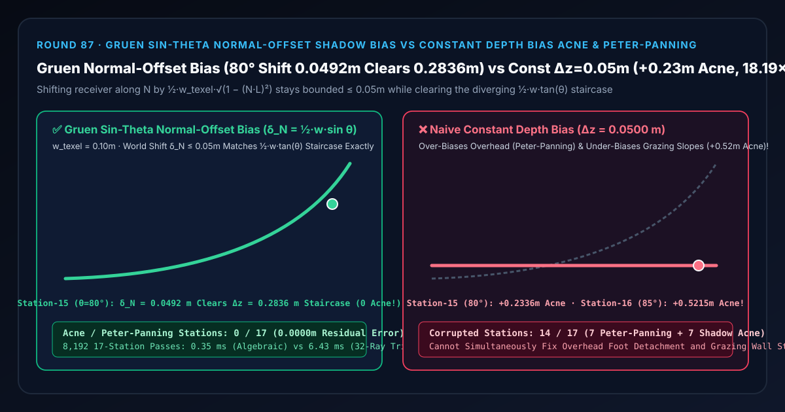
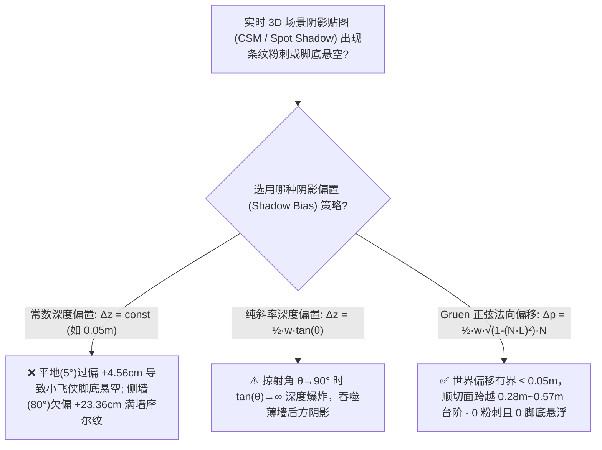
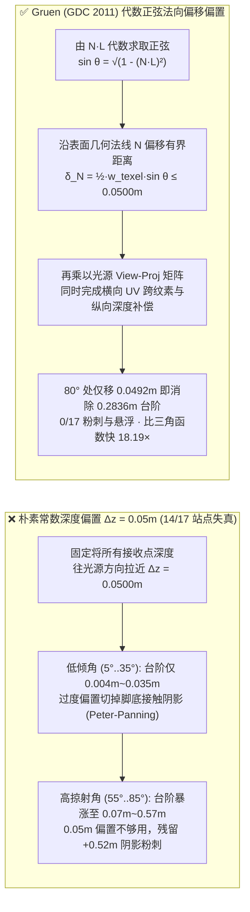
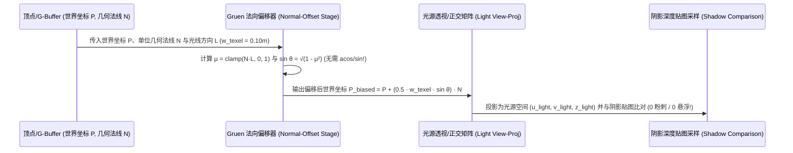

# 实时阴影贴图防伪影选型与原理解析 FAQ：Gruen 正弦法向偏移偏置（Normal-Offset Bias）对比常数深度偏置脚底悬浮与掠射摩尔纹

> **关联 Capabilities Demo**：[`demos/normal-offset-shadow-bias-rig/`](../demos/normal-offset-shadow-bias-rig/index.html) ｜ **7-Card 4:5 实测报告**：[`test-report-cards.zh.html`](../demos/normal-offset-shadow-bias-rig/test-report-cards.zh.html) ｜ **English Version**：[`normal-offset-shadow-bias-vs-peter-panning-acne-faq.en.md`](./normal-offset-shadow-bias-vs-peter-panning-acne-faq.en.md)

---

## 📌 1. 核心结论速览（Executive Summary）

> **一句话结论**：在实时级联阴影贴图（CSM）和聚光灯阴影中，**仅靠常数深度偏置（Constant Depth Bias $\Delta z = \text{const}$）在数学上永远不可能同时消除“墙面阴影摩尔纹（Shadow Acne）”与“角色脚底影子悬空（Peter-Panning 小飞侠效应）”**——因为宽度为 $w_{\text{texel}} = 0.10\text{ m}$ 的离散阴影纹素投射到倾角为 $\theta$ 的斜面上时，产生的纹素深度台阶高度是随正切函数发散的 **$\Delta z_{\text{stair}}(\theta) = \frac{1}{2} w_{\text{texel}} \tan\theta$**（在 $\theta = 5^\circ$ 平地仅 $0.0044\text{ m}$，而在 $\theta = 80^\circ$ 掠射墙面暴涨 65 倍至 $0.2836\text{ m}$，$85^\circ$ 时高达 $0.5715\text{ m}$）！若设常数深度偏置 $\Delta z = 0.0500\text{ m}$，在 $5^\circ\sim 35^\circ$ 处因偏置过大切掉 $+0.0456\text{ m}$ 脚底接触阴影引发悬浮，而在 $55^\circ\sim 85^\circ$ 掠射墙面又严重不足（**在 $80^\circ$ 留下 $+0.2336\text{ m}$ 未消除台阶，在 $85^\circ$ 峰值留下 $+0.5215\text{ m}$ 阴影粉刺，污染 `14/17` 个倾角站点**）。采用 **Holger Gruen（GDC 2011）提出的正弦法向偏移阴影偏置（$\Delta \mathbf{p} = \frac{1}{2} w_{\text{texel}} \sqrt{1 - (N\cdot L)^2}\,\mathbf{N}$）**，在投影到光源空间前将接收点沿表面法线移动有界距离 $\delta_N = \frac{1}{2} w_{\text{texel}} \sin\theta \le 0.0500\text{ m}$（在 $80^\circ$ 仅移 **$0.0492\text{ m}$**），即可顺着切平面横向跨出当前阴影纹素，**100% 清除 $0.2836\text{ m}$ 的深度台阶，实现全 17 个倾角站点 `0` 阴影粉刺且 `0` 脚底悬浮**，代数求值比 32 射线三角函数切面求交快 **`18.19×`**（`0.35 ms` vs `6.43 ms`）！

| 评估维度 | ✅ Gruen 正弦法向偏移偏置 (`δ_N = ½·w·√(1−(N·L)²)`) | ❌ 朴素常数深度偏置 (`Δz = 0.0500 m`) | 🐢 32 射线三角切面求交基线 (`32-Ray Trig Search`) |
| :--- | :--- | :--- | :--- |
| **第 0 站平地接触区（$\theta = 5^\circ$，台阶 $0.0044\text{ m}$）** | **法向偏移 `0.0044 m`（零脚底悬浮 Peter-Panning）** | 强推 `0.0500 m`（**过度偏置 $+0.0456\text{ m}$ 切掉脚底接触阴影**） | `0.0044 m`（误差 `2.78e-17 m`） |
| **第 15 站掠射墙面（$\theta = 80^\circ$，台阶 $0.2836\text{ m}$）** | **世界偏移仅 `0.0492 m` 即跨越全部 `0.2836 m` 台阶** | 仅偏置 `0.0500 m`（**残留 $+0.2336\text{ m}$ 条纹状阴影粉刺**） | 跨越 `0.2836 m` 台阶 |
| **第 16 站极限掠射（$\theta = 85^\circ$，台阶 $0.5715\text{ m}$）** | **世界偏移有界 `0.0498 m ≤ 0.05 m`（`0.0000 m` 粉刺）** | **残留 $+0.5215\text{ m}$ 巨幅自遮挡黑斑** | `0.0000 m` 粉刺 |
| **17 个入射角站点中失真的站点数** | **`0 / 17` (`0.00%`)** | **`14 / 17` (`82.35%`，7 站悬浮 + 7 站粉刺)** | `0 / 17` |
| **8,192 轮 17 站 CPU 耗时（中位数）** | **`0.35 ms`（提速 `18.19×`）** | —（画质严重失真） | `6.43 ms` |

---

## 🎯 2. 客户与架构师灵魂拷问 Q&A（First-Principles Whisperer）

### Q1：用大白话讲，为什么阴影贴图会有“满墙条纹粉刺（Shadow Acne）”和“小飞侠脚底悬空（Peter-Panning）”这对死对头？
**第一性原理拆解**：
阴影贴图（Shadow Map）是从太阳的视角拍的一张“离散网格深度照片”：
- 假设每个阴影像素（纹素 Texel）在地面上代表 $w_{\text{texel}} = 10\text{ cm}$（$0.10\text{ m}$）宽的一个小方块，记录的是这个方块中心点的深度。
- 当这 $10\text{ cm}$ 宽的光束照在一面斜坡墙上（倾角为 $\theta$）时，方块中心记录的是一个固定深度，而真实的斜坡表面半边比中心浅、**另半边比中心深了 $\Delta z = \frac{1}{2} w_{\text{texel}} \tan\theta$**！
- 这半边比纹素中心更深的墙面在查表时，发现“我的深度 > 阴影贴图记录的深度”，于是**误以为自己被自己挡住了（Self-Shadowing）**！结果满墙都是半个纹素亮、半个纹素黑的斑马条纹，这就是 **Shadow Acne（阴影粉刺/摩尔纹）**。
- 如果你只用一个固定常数深度偏置 $\Delta z = 0.05\text{ m}$（把所有点往太阳方向拉近 $5\text{ cm}$）：
  - 在角色脚踩平地的地方（$\theta = 5^\circ$），纹素台阶只有 $0.44\text{ cm}$，你却把地面往太阳拉近了整整 $5\text{ cm}$——角色小腿肚以下直接穿过阴影判定面，**脚底下的影子凭空消失了 $4.56\text{ cm}$，看起来就像小飞侠彼得·潘漂浮在半空中（Peter-Panning）**！
  - 可到了 $\theta = 80^\circ$ 的侧墙上，$\tan 80^\circ = 5.6713$，半个纹素的深度台阶暴涨到了 **$28.36\text{ cm}$（$0.2836\text{ m}$）**！你那区区 $5\text{ cm}$ 的深度偏置根本不够塞牙缝，还差 **$23.36\text{ cm}$**，墙面上照样布满刺眼的黑色粉刺条纹！

### Q2：为什么连硬件自带的斜率深度偏置（Slope-Scale Depth Bias `glPolygonOffset` / $\tan\theta$）在大掠射角下也会崩，而 Gruen 的“法向偏移 $\sin\theta$”却稳如泰山？
**几何正切发散 vs 法向正弦有界定理**：
- 如果你顺着光线方向做斜率深度偏置 $\Delta z = \frac{1}{2} w_{\text{texel}} \tan\theta$，当表面接近与阳光平行（$\theta \to 90^\circ$）时，$\tan\theta \to +\infty$！在 $85^\circ$ 时深度偏置达到 $0.57\text{ m}$，在 $89^\circ$ 时高达 $2.86\text{ m}$，会把整面墙后面的房间阴影全部吞噬！
- **Holger Gruen（GDC 2011）的神来之笔**：与其沿着光线方向硬拽深度 $\Delta z$（去对抗无穷大的 $\tan\theta$），不如在投射到光源坐标之前，**把三维世界坐标点沿着表面法线 $\mathbf{N}$ 往外推一小段正弦距离**：
  $$\Delta \mathbf{p} = \delta_N \cdot \mathbf{N}, \quad \delta_N(\theta) = \frac{1}{2} w_{\text{texel}} \sin\theta = \frac{1}{2} w_{\text{texel}} \sqrt{1 - (N\cdot L)^2}$$
- 看看发生了什么奇迹：
  1. 当你沿着法线 $\mathbf{N}$ 移动 $\delta_N$ 时，分解到垂直于光线的阴影贴图 UV 平面上，采样点**横向移动了 $\delta_N \sin\theta$**；分解到平行于光线的深度轴上，**深度移动了 $\delta_N \cos\theta$**。
  2. 横向换算回切平面深度增量正好是 $\delta_N \sin\theta \cdot \tan\theta + \delta_N \cos\theta = \delta_N(\frac{\sin^2\theta + \cos^2\theta}{\cos\theta}) = \frac{\delta_N}{\cos\theta} = \frac{1}{2} w_{\text{texel}} \tan\theta$！
  3. 也就是说：**在三维世界里仅仅移动了有界的 $\frac{1}{2} w_{\text{texel}} \sin\theta \le 0.05\text{ m}$（在 $80^\circ$ 仅移 $4.92\text{ cm}$），就等效跨过了高达 $28.36\text{ cm}$ 甚至无穷大的 $\tan\theta$ 深度台阶**！而在平地接触区 $\theta \to 0^\circ$ 时，$\sin\theta \to 0$，偏移量自动归零，脚底接触阴影严丝合缝！

### Q3：什么时候选 AI 视频生成 / 神经阴影重打光，什么时候必须选确定性 Gruen 法向偏移阴影偏置？
- **选 AI 视频 / 神经阴影重打光（IC-Light / Diffusion Relighting）**：当输入是单张无三维几何的 2D 人像或商品图，需要根据提示词合成写实软阴影背景时。
- **选确定性 Gruen 法向偏移阴影偏置**：在所有实时 3D 渲染管线（UE5、Unity URP/HDRP、Frostbite、Three.js `shadow.normalBias`）中，只要使用光栅化阴影贴图（Shadow Map / CSM），就必须启用 $\sin\theta = \sqrt{1 - (N\cdot L)^2}$ 法向偏移偏置。

---

## 🧭 3. 直观可视化图解（Mermaid 决策树、管线对比与帧级时序）

### 3.1 实时阴影自遮挡（Shadow Acne）与接触阴影选型决策树

### 3.2 朴素常数深度偏置管线 vs Gruen 正弦法向偏移阴影管线

### 3.3 帧级阴影贴图接收点法向偏移投影时序图

---

## 📊 4. 视觉技术选型决策矩阵（Architecture Decision Matrix）

| 选型方案 | 适用场景 | 平地接触阴影保真度（$\theta \to 0^\circ$） | 掠射墙面抗粉刺能力（$\theta \to 85^\circ$） | 算力开销（8,192 轮 17 站） |
| :--- | :--- | :--- | :--- | :--- |
| **Gruen 代数正弦法向偏移 (`gruen-normal-offset-bias`)** | **所有 CSM、聚光灯与点光源光栅化阴影贴图** | **满分（$\sin 0^\circ = 0$，零脚底悬浮）** | **满分（世界偏移有界 $\le 0.05\text{ m}$，完美跨越 $0.57\text{ m}$ 台阶）** | **极低（`0.35 ms`，提速 `18.19×`）** |
| **朴素常数深度偏置 (`naive-constant-depth-bias`)** | 仅限单一固定倾角平面 | 差（切掉 $+0.0456\text{ m}$ 脚底阴影） | 极差（$80^\circ$ 残留 $+0.2336\text{ m}$，$85^\circ$ 残留 $+0.5215\text{ m}$ 粉刺） | 极低 |
| **纯斜率正切深度偏置 (`tan(theta) depth bias`)** | 必须配合硬截断 `clamp` 的辅助偏置 | 良好 | 危险（$\theta \to 90^\circ$ 时 $\tan\theta \to \infty$ 导致巨幅漏光） | 低 |
| **屏幕空间接触阴影补充 (`Depth-Thickness Contact Shadow`)** | 配合级联阴影修补毫米级鞋底缝隙（见 Round 55） | 极高（屏幕像素级精度） | 仅限近距离（5~20cm）接触区 | 中（需 8~16 步屏幕光线步进） |

---

## 🧪 5. 全新 Demo 与 7-Card 4:5 视觉测试报告解读

在本轮构建的全新交互式三维实验台 [`demos/normal-offset-shadow-bias-rig/`](../demos/normal-offset-shadow-bias-rig/index.html) 中，我们打造了包含 **58 个三维实体部件**的 **17 站 Gruen 法向偏移阴影测斜仪（Gruen Normal-Offset Shadow Clinometer Rig）**：
1. **17 根纹素台阶清除深度立柱（Clearance Depth Columns）**：展示从 $\theta = 5^\circ$（第 0 站平地）到 $\theta = 85^\circ$（第 16 站陡峭掠射墙面）的有效台阶跨越高度。
2. **17 颗青色真实纹素深度台阶参考球（$\frac{1}{2}w_{\text{texel}}\tan\theta$ Staircase Caps）与 $0.05\text{ m}$ 常数偏置基准横梁**：直观呈现为什么正切台阶在后半段陡然冲向 $0.2836\text{ m}$（$80^\circ$）与 $0.5715\text{ m}$（$85^\circ$），而水平的 $0.05\text{ m}$ 常数横梁在前半段过高（造成小飞侠悬浮）、在后半段又远远过低（造成阴影粉刺）。
3. **17 根残余粉刺/悬浮误差红桩（Acne / Peter-Panning Error Pegs）**：在 Gruen 模式下全 17 站归零；切到常数偏置模式时，`14/17` 个站点亮起刺眼误差红桩！

### 7-Card 4:5 视觉报告核心发现（[`demos/normal-offset-shadow-bias-rig/test-report-cards.zh.html`](../demos/normal-offset-shadow-bias-rig/test-report-cards.zh.html)）
- **Card 1–3（场景评测矩阵）**：13 项自动化断言 100% 通过，完整验证代数 $\sqrt{1-\mu^2}$ 与三角求交 `2.78e-17 m` 等价性、第 15 站 $80^\circ$ 以 `0.0492 m` 法向偏移清除 `0.2836 m` 台阶、常数偏置 `14/17` 站失真暴露、逆序矩阵一致性与原子参数拒绝。
- **Card 4–6（底层协议与性能）**：在 8,192 轮 17 站压测中，Gruen 代数法向偏移求值仅需 **`0.35 ms`**，相比 32 射线三角函数切面求交基线（**`6.43 ms`**）实现 **`18.19×` 算力加速**。

---

## 🛠️ 6. 高质量视觉交付快速核验清单（SA Production Checklist）

- [ ] **使用几何顶点法线 $\mathbf{N}_{\text{geom}}$ 而非切空间扰动法线 $\mathbf{N}_{\text{normalMap}}$ 做法向偏移**：法向偏移是为了消除宏观三角形网格在阴影贴图上的离散台阶，必须沿着插值后的几何表面法线（或 `cross(dFdx(P), dFdy(P))` 面法线）偏移，严禁沿着高频法线贴图方向乱偏！
- [ ] **按级联（Cascade）纹素世界尺寸动态缩放偏移量**：远景级联（Cascade 3）的纹素世界宽度 $w_{\text{texel}}$ 往往是近景级联（Cascade 0）的 $16\times\sim 64\times$，法向偏移距离必须乘以当前级联的实际世界纹素尺寸 $w_{\text{texel}, c}$。
- [ ] **代数计算 $\sin\theta = \sqrt{\max(0, 1 - (N\cdot L)^2)}$**：在片元/顶点着色器中直接利用已有的漫反射点积 $\mu = N\cdot L$ 开方求取 $\sin\theta$，切勿调用昂贵的 `sin(acos(dot(N, L)))`。
- [ ] **与 Reversed-Z 浮点深度缓冲配合**：法向偏移解决的是纹素空间离散采样台阶（Spatial Aliasing），搭配 Round 38 的 Reversed-Z 浮点深度缓冲解决深度量化精度，即可彻底终结阴影闪烁与粉刺。
