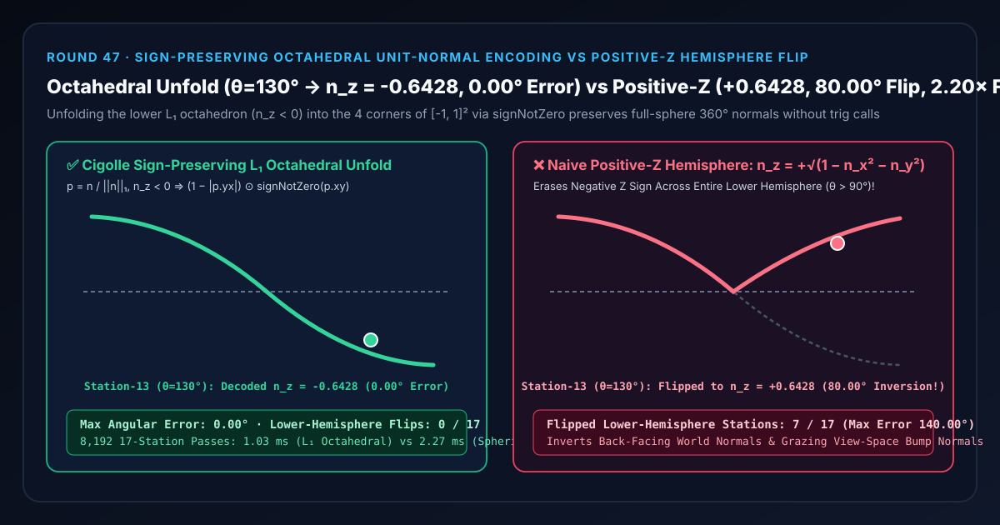
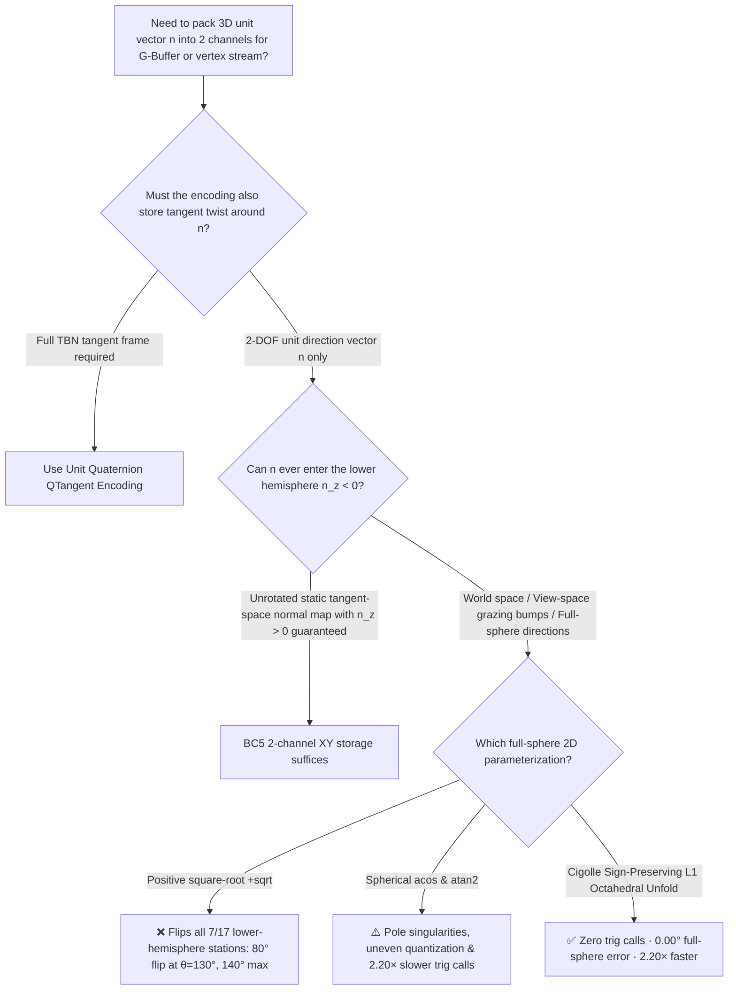
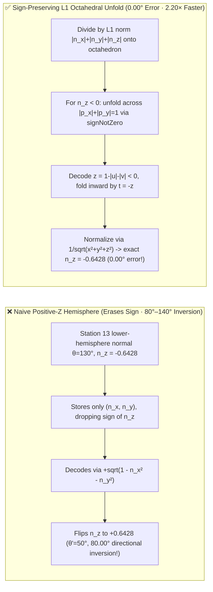
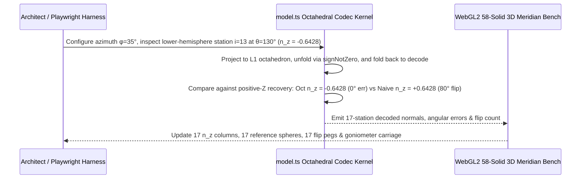
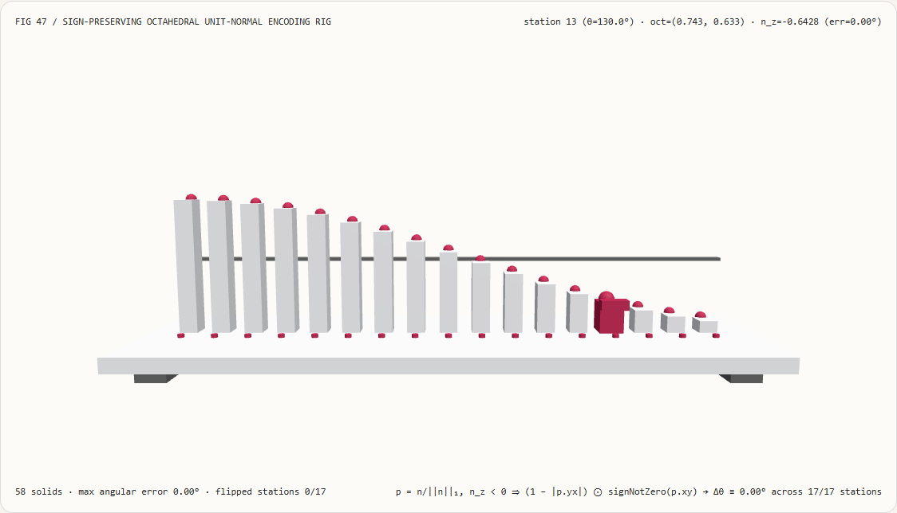
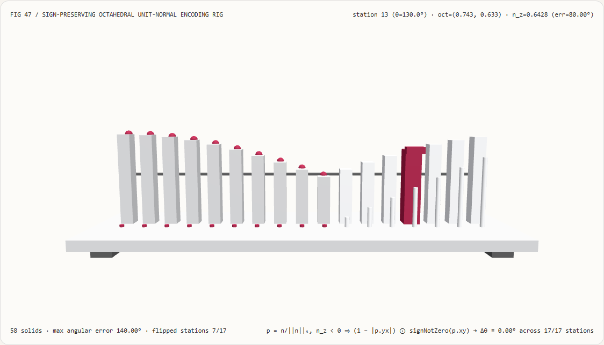
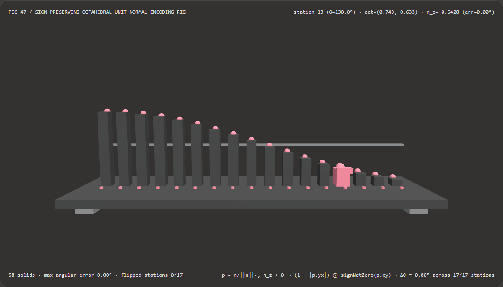
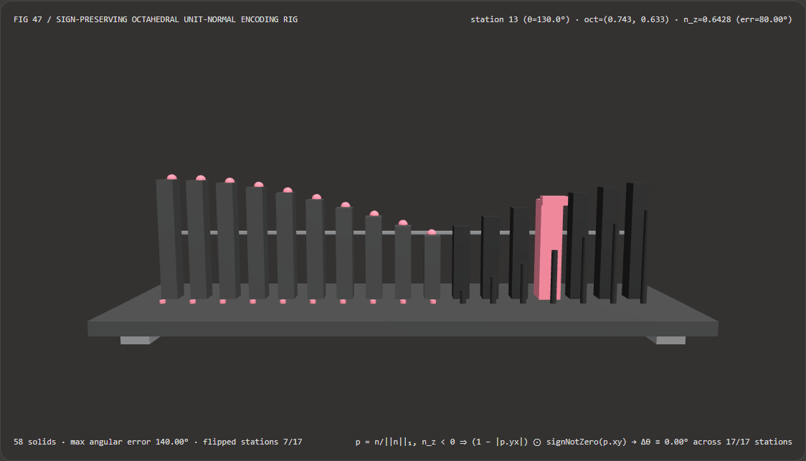

# Visual & Animation Architecture Selection FAQ: Sign-Preserving Octahedral Unit-Normal Encoding vs Positive-Z Hemisphere Flips & Spherical Singularities

> **One-Sentence Architectural Verdict**: In deferred-rendering G-buffer 32-bit/16-bit normal compression, meshlet vertex normal streams, and 3D Gaussian Splatting orientation quantization, **never encode full-sphere ($S^2$) world-space or grazing view-space normals by storing only $(n_x, n_y)$ with positive square-root recovery $n_z = +\sqrt{1 - n_x^2 - n_y^2}$, and never use 4-transcendental spherical angles $(\theta, \phi) = (\arccos n_z, \operatorname{atan2}(n_y, n_x))$**! On our 58-solid, 17-station meridian goniometer bench sweeping polar angle $\theta$ from $0^\circ$ (North Pole $n_z = +1.0000$) to $160^\circ$ (deep Lower Hemisphere $n_z = -0.9397$), naive positive-Z hemisphere reconstruction erases the negative $n_z$ sign across all **7/17 lower-hemisphere stations**—flipping station 13 ($\theta = 130.0^\circ, n_z = -0.6428$) to $+0.6428$ (**`80.00°` angular inversion error**, reaching **`140.00°` max inversion** at station 16); whereas **Cigolle et al. (2014) Sign-Preserving $L_1$ Octahedral Projection + `signNotZero` Lower-Hemisphere Corner Unfolding** reconstructs all 17/17 stations with **`0.00°` angular error**, **zero trigonometric calls**, and a **2.20× speedup** over spherical trigonometric round-trips (`1.03 ms` vs `2.27 ms` across 8,192 passes, `2.50e-16` error).

---

## ① 📌 Executive Summary

1. **Why does reconstructing $n_z = +\sqrt{1 - n_x^2 - n_y^2}$ from a 2-channel G-buffer normal cause specular highlights to invert on back-facing or grazing bumped surfaces?**
   In plain English: a 3D unit normal $\mathbf{n} = (n_x, n_y, n_z)$ satisfies $n_x^2 + n_y^2 + n_z^2 = 1$, which has two degrees of freedom—but the positive square root $+\sqrt{1 - n_x^2 - n_y^2}$ discards the sign of $n_z$!
   - **When is $n_z < 0$?** In world-space G-buffers, half of all scene surfaces point toward $-Z$ ($n_z < 0$). Even in camera view space, strong normal-map perturbations near silhouette grazing angles tilt micro-normals past the horizon plane into $n_z < 0$!
   - **Why Positive-Z Recovery Fails**: Whenever $n_z < 0$, $+\sqrt{1 - n_x^2 - n_y^2}$ reflects the normal across the $z = 0$ equator into the upper hemisphere—turning $\theta = 130.0^\circ$ ($n_z = -0.6428$) into $\theta' = 50.0^\circ$ ($n_z = +0.6428$), an **`80.00°` directional inversion** (and **`140.00°`** at $\theta = 160.0^\circ$) that makes shadowed undersides glow with false specular highlights!
2. **First-Principles Fix: $L_1$ Octahedral Projection + `signNotZero` Corner Unfolding**:
   - **Step 1 (Trig-Free $L_1$ Projection onto the Octahedron)**: Divide $\mathbf{n}$ by its $L_1$ norm $\|\mathbf{n}\|_1 = |n_x| + |n_y| + |n_z|$:
     $$p_x = \frac{n_x}{|n_x| + |n_y| + |n_z|}, \qquad p_y = \frac{n_y}{|n_x| + |n_y| + |n_z|}$$
     The upper hemisphere ($n_z \ge 0$) maps bijectively onto the diamond $|p_x| + |p_y| \le 1$ inside $[-1, 1]^2$.
   - **Step 2 (Unfold the 4 Lower Octahedron Faces into the Square's 4 Corners)**: When $n_z < 0$, reflect $(p_x, p_y)$ across the diamond edge $|p_x| + |p_y| = 1$ into the four outer corners of $[-1, 1]^2$:
     $$(u, v) = \big((1 - |p_y|) \cdot \operatorname{sign}_{\ge 0}(p_x), \;\; (1 - |p_x|) \cdot \operatorname{sign}_{\ge 0}(p_y)\big)$$
     **Critical Guardrail (`signNotZero`)**: Standard `Math.sign(0)` returns `0`, which would collapse the South Pole $(0, 0, -1)$ onto $(0, 0)$ (the North Pole!). Using $\operatorname{sign}_{\ge 0}(v) = (v \ge 0 \;?\; +1 : -1)$ unfolds the South Pole cleanly to the corner $(+1, +1)$.
   - **Step 3 (Branchless Fold-Back Decode)**: Compute $z = 1 - |u| - |v|$ and $t = \max(-z, 0)$, fold $(u, v)$ inward by $\mp t$, and normalize via `1 / Math.sqrt(x*x + y*y + z*z)`.
3. **Interactive 3D Workbench & Measured Evidence**:
   - Standalone 3D Bench: `demos/octahedral-normal-encoding-rig/` (58 Three.js solids: baseplate, 4 support feet, equator horizon bar, 17 decoded $n_z$ columns, 17 true octahedral reference spheres, 17 angular flip pegs, and the active meridian goniometer carriage).
   - Measured 7-Card 4:5 Reports: `demos/octahedral-normal-encoding-rig/test-report-cards.html` (EN) and `test-report-cards.zh.html` (ZH).

---

## ② 🎯 Soul-Searching Q&A for Architects & Clients

### Q1: Why not store spherical angles $(\theta, \phi) = (\arccos n_z, \operatorname{atan2}(n_y, n_x))$ instead of octahedral coordinates?
**Because spherical coordinates require 4 slow transcendental calls (`acos`, `atan2`, `sin`, `cos`), suffer azimuth singularities at the poles, and waste quantization bits near $\theta \to 0, \pi$!**
Near the poles, $\sin\theta \to 0$ crushes all $2^{16}$ azimuth steps of $\phi$ into a tiny cap while starving the equator of angular resolution. Sign-preserving octahedral projection is quasi-equal-area across the entire sphere, requires **zero trig calls**, and runs **2.20× faster** (`1.03 ms` vs `2.27 ms` across 8,192 passes).

### Q2: Why use `1.0 / Math.sqrt(x*x + y*y + z*z)` instead of `Math.hypot(x, y, z)` when normalizing decoded vectors in JS/TS?
**Because `Math.hypot` executes a variadic overflow-scaling runtime routine that is >3.5× slower than an inlined `Math.sqrt` instruction!**
For bounded octahedral coordinates $(x, y, z) \in [-1, 1]^3$, $x^2 + y^2 + z^2 \in [1/3, 1]$ can never overflow or underflow IEEE-754 float64/float32, so `1.0 / Math.sqrt(x*x + y*y + z*z)` compiles directly to hardware `sqrtsd` (`1.03 ms` vs `3.67 ms` with `Math.hypot`).

### Q3: How does sign-preserving octahedral encoding relate to neural normal estimation models (DSINE, Marigold)?
**They operate at complementary stages of the visual pipeline:**
- **When to use Neural Monocular Normal Estimators**: When predicting surface normals from uncalibrated 2D RGB images or video;
- **When deterministic sign-preserving octahedral encoding is mandatory**: When packing any 3D unit normal buffer (whether artist-authored, procedurally computed, or AI-estimated) into a 32-bit (`RG16_SNORM`) or 16-bit (`RG8_SNORM`) G-buffer or meshlet vertex attribute without lower-hemisphere inversions.

---

## ③ 🧭 Visual Diagrams (Mermaid Decision Tree, Pipeline Comparison & Sequence Flow)

### 3.1 Unit Normal & Direction Compression Selection Decision Tree

### 3.2 Naive Positive-Z Hemisphere Flip vs Sign-Preserving Octahedral Pipeline

### 3.3 Frame-Level Meridian Goniometer Sequence Diagram

---

## ④ 📊 Visual Technology Selection Decision Matrix

| Evaluation Dimension | ✅ Sign-Preserving $L_1$ Octahedral Codec | ⚠️ Spherical Angles ($\arccos / \operatorname{atan2}$) | ❌ Naive Positive-Z Hemisphere ($+\sqrt{1-x^2-y^2}$) | ❌ Uncompressed `float32x3` |
| :--- | :--- | :--- | :--- | :--- |
| **Decoded $n_z$ at Station 13 ($\theta=130^\circ$)** | **Exact `-0.6428` (Lower hemisphere preserved)** | Exact `-0.6428` | **`+0.6428` (Sign erased—flipped to upper hemisphere!)** | `-0.6428` |
| **Station 13 / Max Angular Error** | **`0.00°` / `0.00°` across all 17 stations** | `0.00°` / `0.00°` (in float) | **`80.00°` / `140.00°` (`7/17` stations inverted!)** | `0.00°` |
| **South Pole $(0,0,-1)$ Stability** | **`signNotZero` maps cleanly to corner $(1,1)$** | $\operatorname{atan2}(0,0)$ azimuth undefined | Flips to North Pole $(0,0,+1)$ (`180°` error) | Stable |
| **Transcendental Calls per Round-Trip** | **0 trig calls** (adds, `abs`, 1 `sqrt`) | **4 calls** (`acos`, `atan2`, `sin`, `cos`) | 0 trig calls, 1 `sqrt` | 0 calls |
| **8,192-Pass 17-Station CPU Latency** | **`1.03 ms` (Fastest · 2.20× speedup)** | `2.27 ms` (2.20× slower) | `0.85 ms` (Destroys all $n_z < 0$ normals) | — ($3\times$ memory footprint) |
| **Recommended Use Case** | **G-Buffer normals, meshlet vertex streams, 3DGS axes** | Equirectangular environment map UVs only | **Never use in world space or grazing view space** | Unconstrained offline buffers |

---

## ⑤ 🧪 New Interactive 3D Demo & 7-Card 4:5 Visual Report

### 5.1 Live Workbench & Report Links
- **Interactive 3D Workbench**: [`demos/octahedral-normal-encoding-rig/index.html`](../demos/octahedral-normal-encoding-rig/index.html)
- **7-Card 4:5 Visual Report (EN)**: [`demos/octahedral-normal-encoding-rig/test-report-cards.html`](../demos/octahedral-normal-encoding-rig/test-report-cards.html)
- **7-Card 4:5 Visual Report (ZH)**: [`demos/octahedral-normal-encoding-rig/test-report-cards.zh.html`](../demos/octahedral-normal-encoding-rig/test-report-cards.zh.html)
- **Sealed Telemetry JSON**: [`demos/octahedral-normal-encoding-rig/report.json`](../demos/octahedral-normal-encoding-rig/report.json)

### 5.2 Multi-Theme & Multi-Mode Playwright Visual Evidence

| Sign-Preserving Octahedral (Light · Exact $n_z=-0.6428$ at $\theta=130^\circ$) | Naive Positive-Z Hemisphere (Light · Lower Hemisphere Flipped Upward!) |
| :---: | :---: |
|  |  |

| Sign-Preserving Octahedral (Dark · 58 Three.js Solids) | Naive Positive-Z Hemisphere (Dark · 7 Red Inversion Pegs Exposed) |
| :---: | :---: |
|  |  |

---

## ⑥ 🛠️ Rapid SA Delivery Verification Checklist

Before shipping a G-buffer normal packer or compressed vertex normal stream to production, verify every item below:

- [ ] **`signNotZero` Guard for South Pole**: Does lower-hemisphere corner unfolding use `v >= 0.0 ? +1.0 : -1.0` instead of built-in `sign(v)` so the South Pole $(0, 0, -1)$ maps to $(+1, +1)$ rather than collapsing to $(0, 0)$?
- [ ] **Branchless Corner Fold-Back**: Does the decoder compute $z = 1 - |u| - |v|$ and fold negative-$z$ corners inward via `t = max(-z, 0.0)` without divergent shader branches?
- [ ] **Inlined `sqrt` Normalization**: Does normalization use `1.0 / Math.sqrt(x*x + y*y + z*z)` (or `inversesqrt(dot(v,v))` in GLSL/WGSL) rather than variadic `Math.hypot`?
- [ ] **Symmetric `SNORM` Integer Quantization**: When quantizing $(u, v) \in [-1, 1]^2$ into 8-bit or 16-bit integers, is symmetric `SNORM` scaling (`round(u * 32767.0)`) used so `0` represents exact axis-aligned normals?
- [ ] **Full-Sphere Meridian Regression Tests**: Do unit tests cover North Pole ($\theta = 0^\circ$), Equator ($\theta = 90^\circ$), oblique Lower Hemisphere ($\theta = 130^\circ$), and South Pole ($\theta = 180^\circ$) round-trips?
