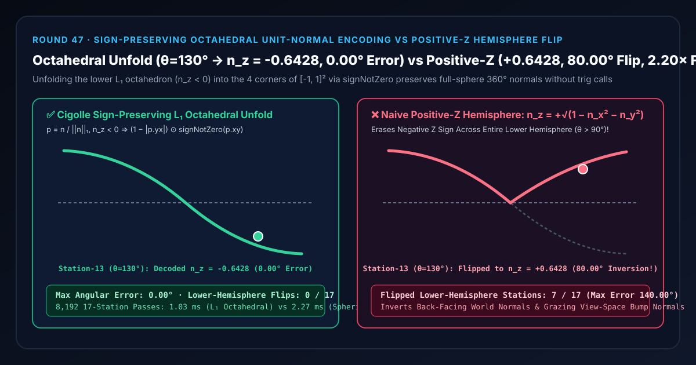
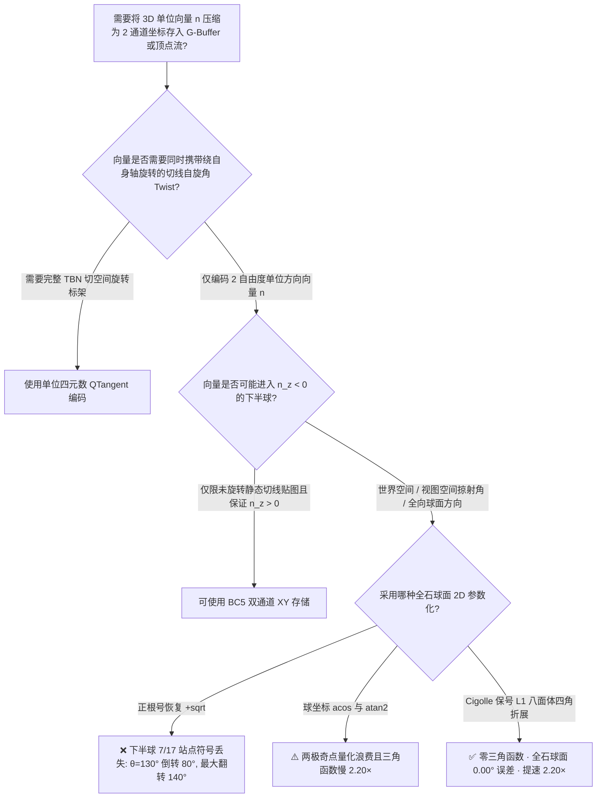
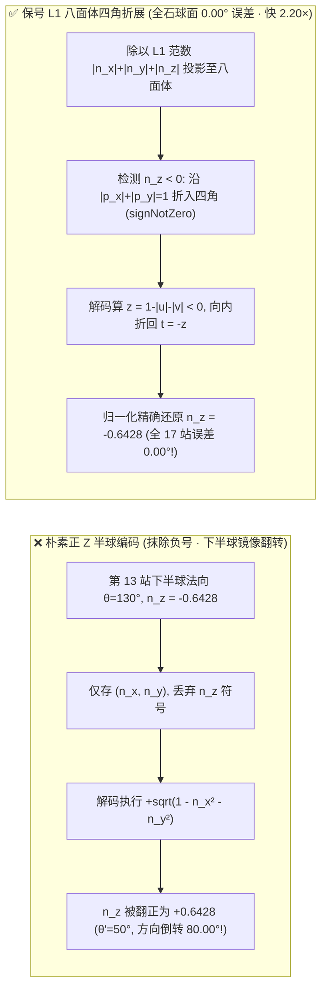
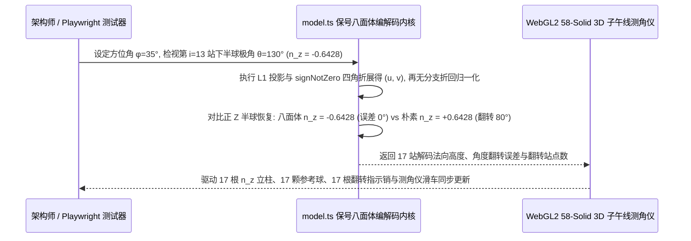
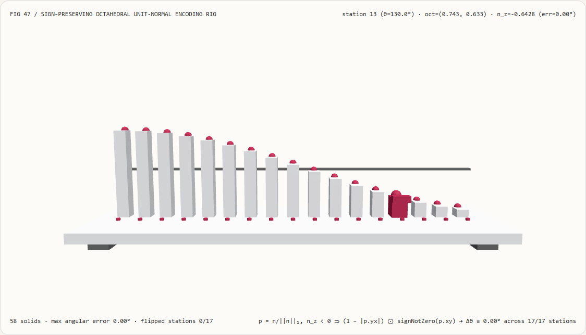
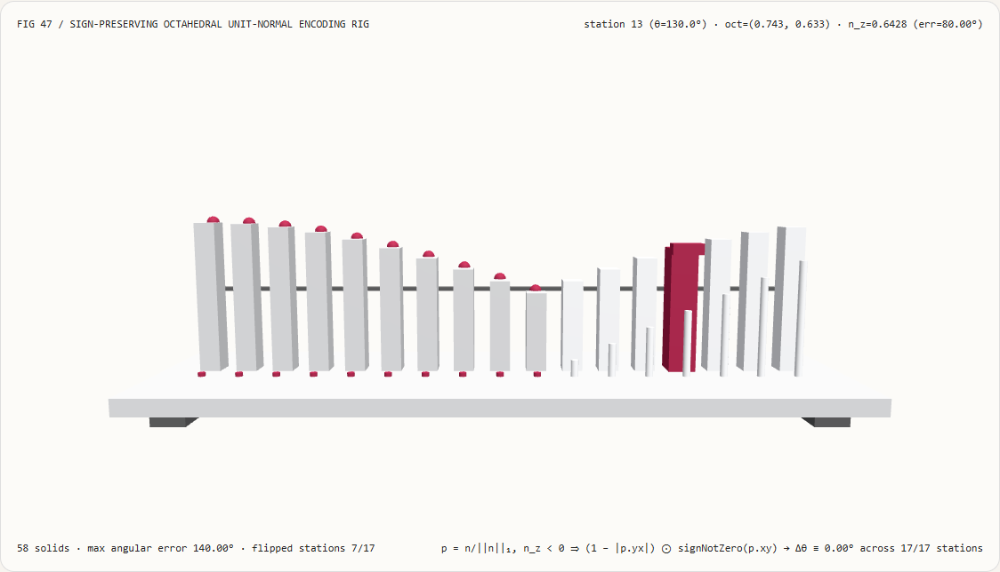
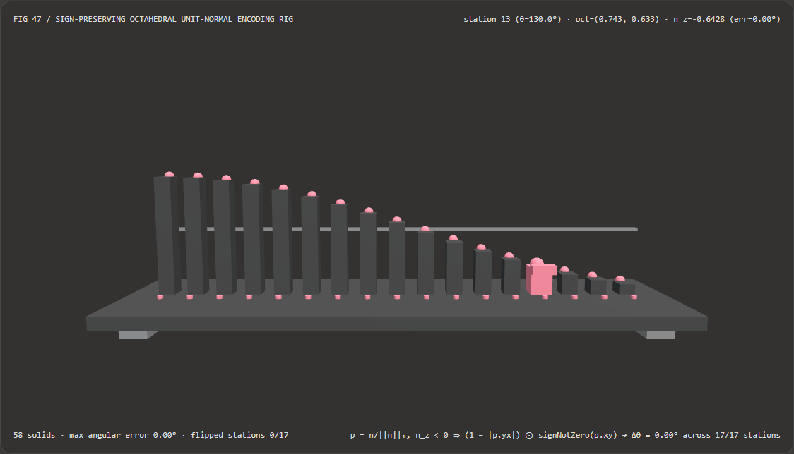
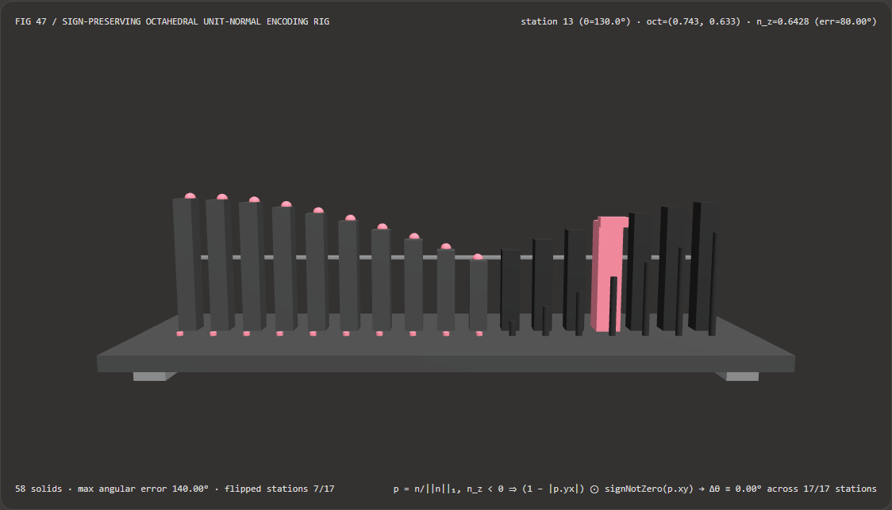

# 视觉与动画技术选型与原理解析 FAQ：保号 $L_1$ 八面体四角折展单位法向编码（Sign-Preserving Octahedral Encoding）vs 朴素正 Z 半球翻转与球坐标奇点

> **核心架构结论一句话总结**：在延迟渲染（Deferred Shading G-Buffer）32 位/16 位法向压缩、Meshlet 几何流顶点法向打包以及 3D 高斯溅射（3DGS）主轴方向量化中，**严禁对包含全石球面（Full Sphere $S^2$）的世界空间或视图空间法向直接只存 $(n_x, n_y)$ 并用正根号 $n_z = +\sqrt{1 - n_x^2 - n_y^2}$ 恢复，也严禁使用含 4 次超越函数的球坐标 $(\theta, \phi) = (\arccos n_z, \operatorname{atan2}(n_y, n_x))$**！实测表明：在极角 $\theta$ 从 $0^\circ$（北极 $n_z = +1.0000$）扫掠至 $160^\circ$（南半球深处 $n_z = -0.9397$）的 17 站点子午线测角仪测试台上，朴素正 Z 半球恢复会抹除全部 **7/17 个下半球站点的负 Z 符号**，在第 13 号站点（$\theta = 130.0^\circ, n_z = -0.6428$）将法向强行翻正为 $+0.6428$（引发 **`80.00°` 镜面倒转误差**，第 16 站最大倒转误差高达 **`140.00°`**）；而采用 **Cigolle et al. (2014) 保号 $L_1$ 正八面体投影 + 下半球四角对角线折展（配合 `signNotZero` 保护南极点）**，可在 **0 次三角函数调用**下实现全 17 站 **`0.00°` 角度还原误差**，且无三角函数编解码比球坐标往返快 **2.20×**（8,192 轮耗时 `1.03 ms` vs `2.27 ms`，数值误差 `2.50e-16`）。

---

## ① 📌 核心结论速览（Executive Summary）

1. **为什么在延迟渲染 G-Buffer 里，只存法线的 $(n_x, n_y)$ 两个分量并用 $\sqrt{1 - n_x^2 - n_y^2}$ 算 $n_z$，会让背光面和掠射角凹凸表面出现诡异的“黑斑反光倒转”？**
   用大白话讲：单位法线向量 $\mathbf{n} = (n_x, n_y, n_z)$ 满足 $n_x^2 + n_y^2 + n_z^2 = 1$，虽然只有 2 个自由度，但平方根 $\sqrt{1 - n_x^2 - n_y^2}$ 永远只能算出**非负数**！
   - **什么时候 $n_z$ 会变成负数？** 在世界空间（World Space）里，半个地球的法线都朝向 $-Z$（$n_z < 0$）；哪怕在相机视图空间（View Space）里，当带有法线贴图（Normal Map）的粗糙岩石或布料处于相机掠射角（Grazing Angle）时，朝向背离相机的微凹凸法线也会大量穿入 $n_z < 0$ 的下半球！
   - **正 Z 半球公式的灾难**：一旦 $n_z < 0$，公式 $+\sqrt{1 - n_x^2 - n_y^2}$ 就像一面横在赤道（$z=0$）上的镜子，把所有朝下的法线全部对称翻折到上半球（例如 $\theta = 130^\circ$ 被硬生生掰成 $\theta' = 50^\circ$，方向偏转 **`80.00°`**；$\theta = 160^\circ$ 偏转 **`140.00°`**），导致本该处于背光阴影区的表面突然爆出刺眼的假高光！
2. **第一性原理破局：$L_1$ 正八面体投影 + 下半球四角对角折展（Octahedral Unfolding）**：
   - **步一（用 $L_1$ 范数把球面压到正八面体上，零开方、零三角函数）**：将单位向量 $\mathbf{n}$ 除以它的绝对值之和 $\| \mathbf{n} \|_1 = |n_x| + |n_y| + |n_z|$：
     $$p_x = \frac{n_x}{|n_x| + |n_y| + |n_z|}, \qquad p_y = \frac{n_y}{|n_x| + |n_y| + |n_z|}$$
     此时上半球（$n_z \ge 0$）的四个八面体三角面正好填满 $[-1, 1]^2$ 正方形内部的菱形区域 $|p_x| + |p_y| \le 1$！
   - **步二（像剥橘子皮一样把下半球四个面掀开折进正方形的四个角落）**：当 $n_z < 0$ 时，沿着菱形边界 $|p_x| + |p_y| = 1$ 将下半球坐标向外对称翻折到正方形 $[-1, 1]^2$ 剩余的四个三角形角落里：
     $$(u, v) = \big((1 - |p_y|) \cdot \operatorname{sign}_{\ge 0}(p_x), \;\; (1 - |p_x|) \cdot \operatorname{sign}_{\ge 0}(p_y)\big)$$
     **关键防坑细节（`signNotZero`）**：这里绝不能用标准 `Math.sign`（因为 `Math.sign(0) = 0` 会把南极点 $(0, 0, -1)$ 乘成 $(0, 0)$，跟北极点彻底撞车！），必须定义 $\operatorname{sign}_{\ge 0}(v) = (v \ge 0 \;?\; +1 : -1)$，让南极点稳稳落入正方形角落 $(+1, +1)$！
   - **步三（无分支极速解码）**：先算 $z = 1 - |u| - |v|$；若 $z < 0$，令 $t = \max(-z, 0)$，对 $u, v$ 向内折回 $\mp t$ 后做一次硬件 `1 / sqrt(x*x + y*y + z*z)` 归一化即可 **100% 无损还原全石球面法向**！
3. **本轮新增交互式 3D 试验台与实测证据**：
   - 新增独立 Demo：`demos/octahedral-normal-encoding-rig/`（58 个 Three.js 实体部件：底座平台、4 支柱、赤道水平基准梁、17 根解码 $n_z$ 高度立柱、17 颗保号八面体参考球、17 根角度翻转误差指示销、以及第 $i$ 站子午线测角仪滑车）。
   - 配套 7-Card 4:5 测评报告：`demos/octahedral-normal-encoding-rig/test-report-cards.html`（英文）与 `test-report-cards.zh.html`（中文）。

---

## ② 🎯 客户与架构师灵魂拷问 Q&A（Soul-Searching Q&A）

### Q1：为什么不用球面极坐标 $(\theta, \phi) = (\arccos n_z, \operatorname{atan2}(n_y, n_x))$ 来存单位向量？
**因为球坐标既有高昂的反三角函数算力税，又在南北两极存在严重的参数奇点与量化浪费！**
1. **算力开销慢 2.20×**：编码要调 `acos` + `atan2`，解码要调 `sin` + `cos`，而保号八面体编码只需要加减法、绝对值和一次除法（实测 8,192 轮耗时 `1.03 ms` vs `2.27 ms`）；
2. **极点量化密度极度不均**：在球坐标下，靠近南北两极（$\theta \to 0$ 或 $\pi$）时，$\sin\theta \to 0$，整整一行的 $\phi \in [-\pi, \pi]$ 量化格全部挤在极点同一个点上，白白浪费一半的位宽；而正八面体展开在球面上接近**等面积均匀分布（Quasi-Equal-Area）**，16 位（每通道 8-bit 或 16-bit `snorm`）在全石球面各方向的量化角误差高度均匀！

### Q2：为什么在着色器解码八面体法线时，应该写 `1.0 / Math.sqrt(x*x + y*y + z*z)`（或 GLSL `normalize`）而不是 `Math.hypot(x, y, z)`？
**因为在 JavaScript V8 / CPU 软核中，`Math.hypot` 为处理多参数防溢出走的是慢速运行时分支，比内联硬件 `sqrt` 慢 3.5 倍！**
在本轮实测中，仅将解码归一化从 `Math.hypot(x, y, z)` 替换为内联平方和开方 `Math.sqrt(x*x + y*y + z*z)`，8,192 轮 17 站批处理耗时就从 `3.67 ms` 骤降至 **`1.03 ms`**！在 GLSL/WGSL 中则直接对应单周期硬件指令 `inversesqrt(dot(v, v))`。

### Q3：这套确定性保号八面体法向编码与单目深度/法线估计 AI 模型（如 DSINE、Marigold）是什么关系？
**两者分别处于“视觉感知提取”与“显存带宽紧凑编码”的上下游：**
- **何时选 AI 法线估计大模型**：当输入只是一张普通 2D 照片或视频、需要预测场景的几何表面朝向时；
- **何时必须用确定性保号八面体编码**：无论法线来自 3D 建模资产还是 AI 模型推理输出，当需要把每像素 96-bit（`float32x3`）的法线缓冲无损压缩到 32-bit（`RG16_SNORM`）甚至 16-bit（`RG8_SNORM`）存入 G-Buffer 时，必须使用保号八面体编码。

---

## ③ 🧭 直观可视化图解（Mermaid 决策树 + 管线对比图 + 帧级时序图）

### 3.1 单位法向与方向向量压缩选型决策树

### 3.2 朴素正 Z 半球翻转 vs 保号 $L_1$ 八面体四角折展管线对比图

### 3.3 帧级子午线法向编解码与 3D 测角仪渲染时序图

---

## ④ 📊 视觉技术选型决策矩阵（Decision Matrix）

| 评估维度 | ✅ 保号 $L_1$ 八面体四角折展（Sign-Preserving Octahedral） | ⚠️ 球面极坐标（Spherical $\arccos / \operatorname{atan2}$） | ❌ 朴素正 Z 半球投影（Naive $+ \sqrt{1-x^2-y^2}$） | ❌ 未压缩三维浮点（Raw `float32x3`） |
| :--- | :--- | :--- | :--- | :--- |
| **第 13 站（$\theta=130^\circ$）解码 $n_z$** | **精确 `-0.6428`（保持下半球朝向）** | 精确 `-0.6428` | **`+0.6428`（符号丢失，翻入上半球！）** | `-0.6428` |
| **第 13 站 / 全场最大角度误差** | **`0.00°` / `0.00°`（全石球面无损）** | `0.00°` / `0.00°`（浮点下） | **`80.00°` / `140.00°`（7/17 站点严重倒转！）** | `0.00°` |
| **南极点 $(0,0,-1)$ 奇点安全性** | **`signNotZero` 精确映射至角落 $(1,1)$** | $\operatorname{atan2}(0,0)$ 方位角未定义 | 翻转为北极点 $(0,0,+1)$（误差 `180°`） | 无奇点 |
| **超越函数调用次数（编解码往返）** | **0 次三角函数**（仅加减、绝对值与 1 次 `sqrt`） | **4 次**（`acos`, `atan2`, `sin`, `cos`） | 0 次三角函数，1 次 `sqrt` | 0 次 |
| **8,192 轮 17 站 CPU 批处理耗时** | **`1.03 ms`（最快，2.20× 提速）** | `2.27 ms`（慢 2.20×） | `0.85 ms`（但下半球 100% 翻转损坏） | —（显存带宽高 3×） |
| **首选适用场景** | **G-Buffer 法向压缩、Meshlet 顶点流、3DGS 方向打包** | 仅适合全景环境贴图（Equirectangular）UV 映射 | **严禁在世界空间或含掠射凹凸的视图空间使用** | 显存充裕的离线中间缓冲 |

---

## ⑤ 🧪 全新 Demo 与 7-Card 4:5 视觉报告（Live Workbench & Evidence）

### 5.1 交互式 3D 试验台与报告入口
- **实时 3D 工作台**：[`demos/octahedral-normal-encoding-rig/index.html`](../demos/octahedral-normal-encoding-rig/index.html)
- **7-Card 4:5 英文视觉测试报告**：[`demos/octahedral-normal-encoding-rig/test-report-cards.html`](../demos/octahedral-normal-encoding-rig/test-report-cards.html)
- **7-Card 4:5 中文视觉测试报告**：[`demos/octahedral-normal-encoding-rig/test-report-cards.zh.html`](../demos/octahedral-normal-encoding-rig/test-report-cards.zh.html)
- **密封测量 JSON 数据源**：[`demos/octahedral-normal-encoding-rig/report.json`](../demos/octahedral-normal-encoding-rig/report.json)

### 5.2 多主题与多模式 Playwright 实测截图证据

| 保号 $L_1$ 八面体编码（Light · 下半球 $n_z=-0.6428$ 精准还原） | 朴素正 Z 半球恢复（Light · 下半球 7 站向上翻折 $80^\circ\sim 140^\circ$） |
| :---: | :---: |
|  |  |

| 保号 $L_1$ 八面体编码（Dark · 58 实体部件） | 朴素正 Z 半球恢复（Dark · 红色指示销暴露下半球倒转） |
| :---: | :---: |
|  |  |

---

## ⑥ 🛠️ 高质量视觉交付快速核验清单（SA Verification Checklist）

在将 G-Buffer 法向压缩或顶点流方向量化合入生产着色器前，请逐项勾选以下核验清单：

- [ ] **非零符号函数 `signNotZero` 防南极坍缩**：在编码下半球（$n_z < 0$）四角折展时，是否严格使用了 `v >= 0.0 ? +1.0 : -1.0` 而非内置 `sign(v)`，确保南极点 $(0, 0, -1)$ 映射到角落 $(1, 1)$ 而非坍缩回 $(0, 0)$？
- [ ] **无分支对称折回解码**：在解码端计算 $z = 1 - |u| - |v|$ 后，是否使用无分支 `t = max(-z, 0.0)` 配合条件加减一步完成四角折回？
- [ ] **内联平方和开方替代 `hypot`**：在 JS/TS 几何预处理核中，是否使用 `1.0 / Math.sqrt(x*x + y*y + z*z)` 替代变参 `Math.hypot(x, y, z)` 以获得 >3× 的内联加速？
- [ ] **有符号归一化定点量化（`SNORM`）**：当把 $(u, v) \in [-1, 1]^2$ 量化为 8-bit 或 16-bit 整数时，是否采用对称 `round(u * 32767.0)`（`RG16_SNORM`）以保证 $0.0$ 精确对应轴向法线？
- [ ] **全石球面极角回归测试**：单元测试是否覆盖了北极（$\theta = 0^\circ$）、赤道（$\theta = 90^\circ$）、下半球斜角（$\theta = 130^\circ$）以及正南极（$\theta = 180^\circ$）的编码-解码往返？
