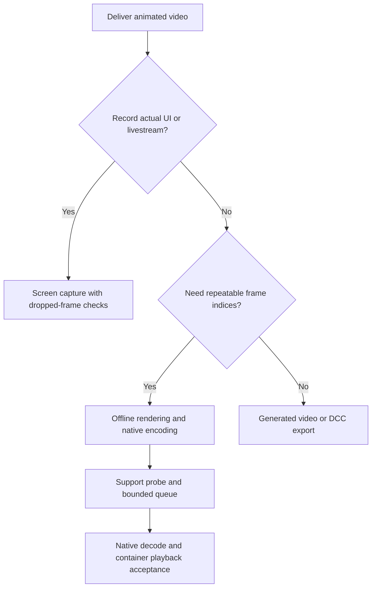
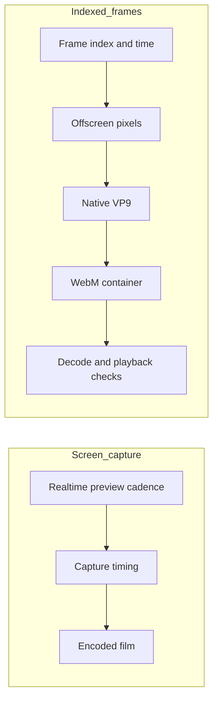
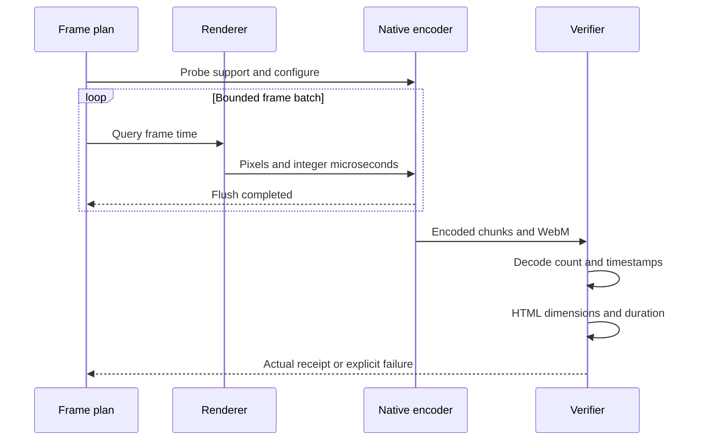

# Animation export should not depend on screen-capture luck: native offline video FAQ

**Three minutes for three clocks; ten minutes to export playable video.**

[中文](offline-frame-video-export-faq.md) · [Interactive demo](https://turbo998.github.io/animation/demos/offline-video-workbench/) · [Measured 1080p WebM](../demos/offline-video-workbench/measured-1080p.webm) · [Measured cards](../demos/offline-video-workbench/test-report-cards.html)

## ① 📌 Executive Summary

- **Smooth preview is not reliable export.** Decide scene time by frame index, render it, then encode—rather than relying on when screen capture samples a display. Browser support still requires an actual probe.
- **A real video was produced, not merely screenshots.** Local VP9 encoding, native decoding and HTML playback ran: 1920×1080, 60 frames, two seconds and 383,787 bytes.
- **Separate three clocks.** Preview playback, integer-microsecond codec timestamps and millisecond WebM timecodes are distinct. Container precision must not be portrayed as codec precision.
- **Bounded batching and explicit errors.** Flush every 12 frames versus every frame; seven repeats at each tier retain all 24 decoded frames. Unsupported configuration or conformance failures cannot become a successful new export.
- **Original 59-solid turntable, ten checks.** Scene: `synthetic`; local video/elapsed: `measured`; models, isolated GPU stages and quality scores: `not_measured`.

**Verified daily direction:** NVIDIA's July 20, 2026 SIGGRAPH material describes MCP-connected creative tools preparing export variants, playblasts for dailies and pipeline-rule validation. Retrieved November 9, 2026. This is an independent inspectable-export prototype—not NVIDIA/MCP/model execution, a claim that WebCodecs was invented in 2026 or a measured daily popularity ranking.

## ② 🎯 Customer and architect Q&A

### Q1 When should I choose AI video versus code-driven animation?

Performances, materials and atmosphere can favor generated video. Equipment mechanisms, fixed timestamps, repeatable edits and offline acceptance favor explicit code scenes.

A model can supply content, but delivery still needs encoding, packaging and checks. **“Generation succeeded” is not “the file plays with the correct frame count.”** This tests an original code scene's delivery pipeline, not model quality.

### Q2 Which requirements give deterministic code a strict advantage?

A contract specifying scene time per frame, preservation of inspected preview state and explicit failure can be directly exposed and verified. Screen recording remains appropriate for actual UI interaction or livestreams—not everything should be offline-rendered.

Useful for technical playblasts, equipment-training clips, review materials and publishing prototypes. Long films, audio synchronization, multitrack editing and wide-gamut/HDR production need mature film toolchains.

### Q3 How does native offline export work?

Number pages before binding the book: determine each frame's scene time, render pixels, compress them, then package them into a playable file.

`VideoEncoder` is a native compression interface, not a generative model. `flush()` waits for submitted work to produce output; it is not a display refresh. Waiting every 12 frames bounds pending work; waiting every frame can reduce throughput, but names alone do not prove it.

The prototype renders the same original turntable offscreen, calculates independent integer-microsecond timestamps, compresses VP9 chunks and packages a constrained WebM. Native decoding checks frames/timestamps; HTML playback separately checks container dimensions/duration.

Codec timestamps are microseconds; the container uses rounded milliseconds, adding at most about half a millisecond of quantization. Sixty frames at 30 fps yield two seconds. The last starts at 59/30 seconds; an extra frame at 2 seconds would change the contract.

**Offline is not free.** Rendering, compression, memory and waiting remain. `prefer-software` is a hint, not a hardware-path audit. Lossy VP9 does not establish pixel equality.

### Q4 How can I reproduce it in ten minutes?

1. Run `npm run dev`, open `/demos/offline-video-workbench/` and inspect 4.5 seconds.
2. Select 1920×1080 and encode 60 frames; wait for explicit encode/decode evidence, not merely a button.
3. Play/download `FRAME_INDEXED_CLIP.webm`. Preview time and export frame zero are independent.
4. Compare 60 frames, 30 fps, two seconds and actual bytes. File size is not a quality score.
5. An unsupported browser must explicitly fail, not return an empty video.
6. Run `npx vitest run tests\offline-video.test.ts`; after build/preview at 4335 run `node scripts\benchmark-offline-video.mjs`.

## ③ 🧭 Visual explanations

## ④ 📊 Architect Decision Matrix

| Acceptance requirement | Screen recording | Native offline rendering | Mature DCC export | Encoded chunks only |
| --- | --- | --- | --- | --- |
| Actual UI interaction | Strong fit | Not this prototype's goal | Tool-dependent | No container |
| Fixed frame-time plan | Capture cadence matters | Explicit index and checks | Suitable with project | Still verify timestamps |
| Playable delivery file | Verify it | Decode/container checked separately | Verify publication | Bytes alone cannot prove it |
| Long film, audio, tracks | Recording tool-dependent | Not implemented here | Better mature workflow | Not implemented |
| Lossless/HDR quality | Configuration-dependent | VP9 not certified here | Explicit color/codec strategy | Codec is not quality assurance |

**Time example:** 24 frames / 30 fps means 0.8 seconds of film. A 342.9 ms production measurement is not per-frame display latency. Media duration and production elapsed are different coordinates.

## ⑤ 🧪 New demo and measured findings, including seven cards

The [sealed report](../demos/offline-video-workbench/report.json) records actual native encoding and decoding. Each tier/path has seven alternating warmed runs of 24 frames; native timestamps match all submissions.

| Resolution / 24 frames | Flush-every-12 median | Flush-every-frame median |
| --- | --- | --- |
| 640×360 | 64.3 ms | 94.1 ms |
| 1280×720 | 136.4 ms | 184.3 ms |
| 1920×1080 | 342.9 ms | 398.9 ms |

Elapsed begins at codec configuration and includes rendering, native encoding and muxing; it excludes scene setup, decoding and display. It is not isolated CPU/GPU time or inference. Raw samples retain slower observations, including 181.6 ms at the 640 tier.

Both paths use the same input-frame plan and codec configuration. Flush policy can affect internal scheduling and compressed output. Equal delivered frame counts/timestamps do not establish equal compressed bytes, pixel quality or reference-frame arrangement.

A separate [1080p WebM](../demos/offline-video-workbench/measured-1080p.webm) delivery has 60 natively decoded frames; HTML reads 1920×1080 / two seconds and the file has 383,787 bytes. **This is not a model benchmark or pixel-quality score.**

[English cards](../demos/offline-video-workbench/test-report-cards.html) · [中文七卡](../demos/offline-video-workbench/test-report-cards.zh.html). Synthetic appearance and measured local encoding remain separate. Unmeasured stages/models/color quality are not zeroed.

## ⑥ 🛠️ Architect Checklist

- [ ] Define preview clocks, frame timestamps and container timecodes.
- [ ] Start at frame zero; distinguish last-frame start and duration.
- [ ] Probe the actual native codec configuration.
- [ ] Bound pending work and close frames/codecs/owned offscreen resources.
- [ ] Decode count/timestamps match the submitted plan.
- [ ] Actual playback reads correct dimensions/duration.
- [ ] Export preserves the inspected preview state.
- [ ] Failure does not return empty files or a success receipt.
- [ ] Evaluate lossy quality, audio, HDR and hardware paths separately.
- [ ] Retain live video links, provenance and measured byte evidence.

**Sources:** [NVIDIA SIGGRAPH 2026 official material](https://blogs.nvidia.com/blog/siggraph-news-2026/), July 20, 2026 creative playblast workflows; [VideoEncoder](https://developer.mozilla.org/en-US/docs/Web/API/VideoEncoder); [WebM guidelines](https://www.webmproject.org/docs/container/) labeled May 7, 2026 update. Verified November 9, 2026; no vendor agent/model was executed.
