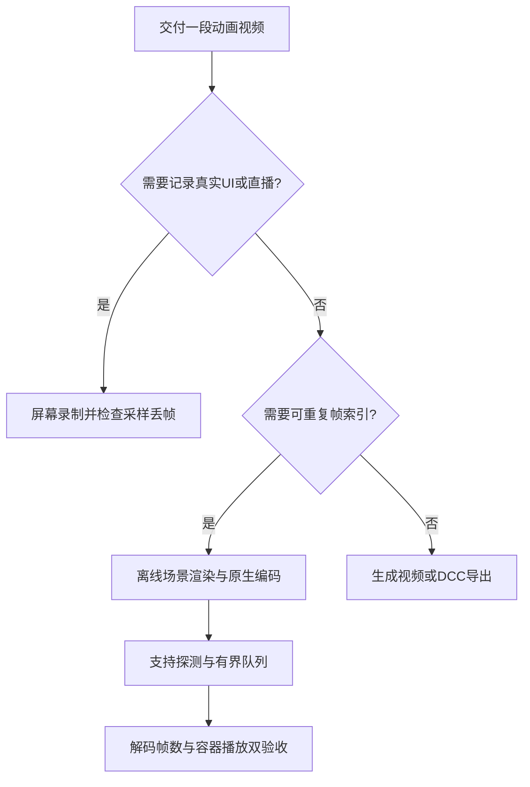
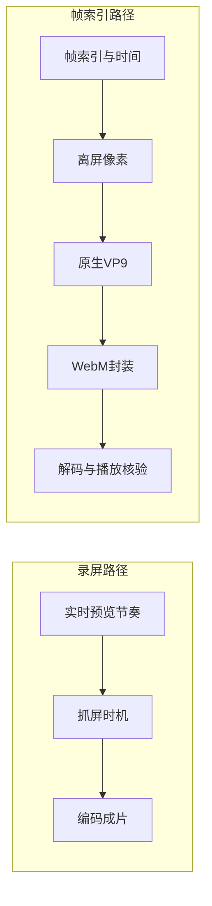
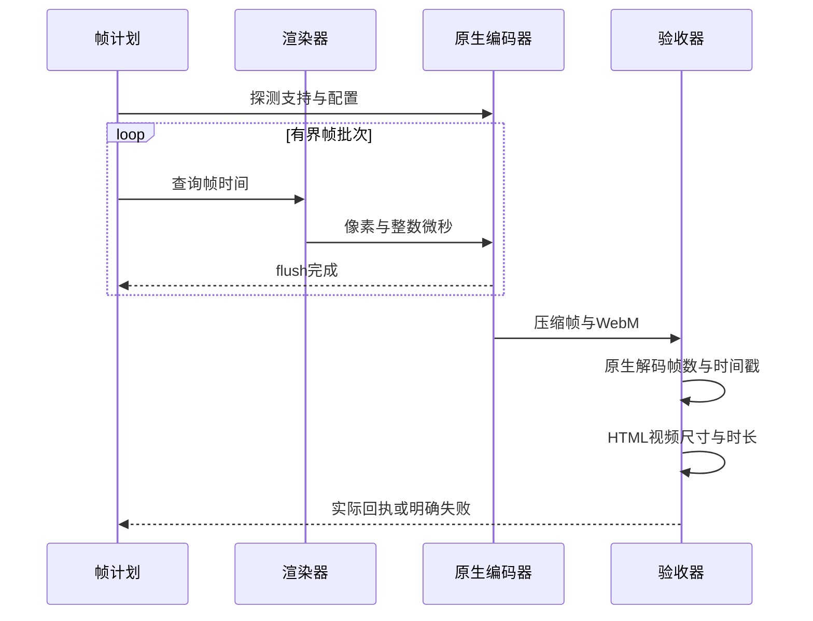

# 动画导出不能靠录屏运气：按帧索引的原生视频编码选型 FAQ

**3 分钟看懂三个时钟，10 分钟导出可播放的视频。**

[English](offline-frame-video-export-faq.en.md) · [交互 Demo](https://turbo998.github.io/animation/demos/offline-video-workbench/) · [实测 1080p WebM](../demos/offline-video-workbench/measured-1080p.webm) · [中文七卡](../demos/offline-video-workbench/test-report-cards.zh.html)

## ① 📌 核心结论速览

- **预览流畅不等于导出可靠。** 按帧索引决定场景时间，再原生编码，比赌屏幕录制何时抓到一帧更可检查。浏览器支持情况仍要先探测。
- **真的产出了视频，不只是截图。** 本机 VP9 编码、原生解码与 HTML 视频播放均已运行：1920×1080、60 帧、2 秒、383,787 字节。
- **三个时钟分开。** 预览播放时钟、编码帧的整数微秒时间戳、WebM 容器的毫秒时间码不是同一个量。容器精度不能假装和编码器一样。
- **批量有界，错误明确。** 对比每 12 帧 flush 与每帧 flush；三档各七次重复均保留 24 个解码帧。未支持、帧数不符或时间戳不符时不宣称新导出成功。
- **原创 59 实体转台，10 项验收。** 场景为 `synthetic`，本机视频与耗时为 `measured`；生成模型、GPU 分阶段时间与画质评分为 `not_measured`。

**每日能力方向核验：** NVIDIA 在 2026-07-20 SIGGRAPH 官方材料中说明创作工具通过 MCP 连接，使智能体能够准备导出变体、制作供审片的预览片、核验制作管线规则。2026-11-09 检索。本 Demo 把“可核验导出”做成独立原型；没有连接 NVIDIA 服务、MCP 工具或视频模型，也不声称 WebCodecs 是 2026 年新发明或今天榜首。

## ② 🎯 客户与架构师灵魂拷问 Q&A

### Q1 何时选 AI 视频大模型，何时选代码驱动动画？

人物、材质、氛围与自然表演适合评估生成视频。设备机制、固定时间点、可重复改帧、自动验收与离线交付适合显式的代码场景。

模型可以生产内容，但交付仍需要编码、封装与验收。**“生成成功”不等于“视频文件可播放且帧数正确”。** 本例测的是原创代码场景的交付链路，没有测模型质量。

### Q2 哪些验收要求使代码驱动严格更优？

若合同要求某帧对应某个场景时间、导出不改变当前检查状态、失败不留下成功假象，代码能暴露契约并逐项核验。屏幕录制更适合记录真实 UI 操作或直播，不是所有场景都要离线渲染。

SA 可用于技术方案预览片、设备培训短片、自动化审片素材和发布管线原型。长片、音频同步、多轨编辑、广色域/HDR 与复杂容器索引需要成熟影视工具链。

### Q3 原生离线视频管线如何工作？

像给每一页编号后装订成书：先决定第几帧对应哪个场景时间，渲染那一帧，再让编码器压缩，最后让容器组织为可播放文件。

`VideoEncoder` 是浏览器原生的压缩接口，不是生成模型；`flush()` 等待已提交工作输出，不是屏幕刷新。每 12 帧等待一次限制在途工作；每帧等待更保守，吞吐可能较低，但不能只凭名称推断。

本例离屏渲染同一个原创转台，帧索引独立计算整数微秒。VP9 压缩数据再放入一个受限的 WebM 容器；原生解码核验所有帧及其时间戳，HTML 视频另外核验容器尺寸与时长。

编码器的时间戳为微秒，容器用毫秒时间码，四舍五入带来最多约半毫秒的时间量化。60 帧、30 fps 形成 2 秒片段，最后一帧开始于 `59/30` 秒，不是在 2 秒处再多塞一帧。

**离线不等于无成本。** 仍需渲染、压缩、内存与等待；`prefer-software` 只是驱动提示，不能据此宣称已审计硬件路径。VP9 有损压缩，不保证像素无损相同。

### Q4 十分钟如何复刻？

1. `npm run dev` 后打开 `/demos/offline-video-workbench/`，拖到 4.5 秒核验转台。
2. 选 1920×1080 并编码 60 帧；等待明确的编解码回执，而不是只看到一个下载按钮。
3. 播放实际输出并下载 `FRAME_INDEXED_CLIP.webm`；预览时间与导出帧零分别管理。
4. 对照 60 帧、30 fps、2 秒与实际文件字节。不要拿文件大小当画质分。
5. 在不支持 WebCodecs 的浏览器中应看到明确失败，不能静默返回空视频。
6. 运行 `npx vitest run tests\offline-video.test.ts`；构建并在 4335 预览后执行 `node scripts\benchmark-offline-video.mjs`。

## ③ 🧭 直观可视化图解

## ④ 📊 Architect Decision Matrix

| 验收条件 | 屏幕录制 | 原生离线渲染编码 | 成熟 DCC 导出 | 只交编码帧 |
| --- | --- | --- | --- | --- |
| 实际 UI 操作 | 很适合 | 不是本例目标 | 依工具 | 不包含容器 |
| 固定帧时间计划 | 受捕获节奏影响 | 显式索引与核验 | 适合保留项目 | 仍需验证时间 |
| 文件可播放 | 需验收 | 解码与容器分别验收 | 仍需发布核验 | 不能仅凭字节宣称 |
| 长片、音频、多轨 | 依录制工具 | 本例未实现 | 成熟工具链更优 | 未实现 |
| 无损画质与 HDR | 依配置 | 本例 VP9 未证明 | 需色彩与编码方案 | 编码器不是画质保证 |

**时间算例：** 24 帧 / 30 fps 是 0.8 秒影片，但 342.9 ms 的生成耗时不是每帧屏幕延迟。媒体时长与制作耗时是两条不同坐标。

## ⑤ 🧪 全新 Demo 与 Benchmark 核心发现（含 7-Card）

[封存数据](../demos/offline-video-workbench/report.json)记录真实编码与解码。三档各路径预热后交替七次，每次 24 帧；所有提交帧的原生解码时间戳一致。

| 分辨率 / 24 帧 | 每 12 帧 flush 中位数 | 每帧 flush 中位数 |
| --- | --- | --- |
| 640×360 | 64.3 ms | 94.1 ms |
| 1280×720 | 136.4 ms | 184.3 ms |
| 1920×1080 | 342.9 ms | 398.9 ms |

耗时从编码配置开始，包含渲染、原生编码与封装，排除场景构建、解码和显示；不是纯 CPU、GPU 单阶段或模型推理。原始重复保留，包括 640 档 181.6 ms 的较慢样本。

两条路径使用同一输入帧计划和编码配置；flush 策略可能影响内部调度与压缩输出。这里只证明帧数/时间戳交付相同，没有证明两条路径的压缩字节、像素质量或参考帧安排相同。

另一个交付样本实际产生 [1080p WebM](../demos/offline-video-workbench/measured-1080p.webm)：60 帧全部原生解码，HTML 视频读到 2 秒与 1920×1080，文件 383,787 字节。**这不是模型 benchmark 或像素质量分。**

[中文七卡](../demos/offline-video-workbench/test-report-cards.zh.html) · [English](../demos/offline-video-workbench/test-report-cards.html)。合成画面与实际本机编码测量分层；未测 GPU 阶段、模型与色彩质量不补零。

## ⑥ 🛠️ Architect Checklist

- [ ] 定义预览时钟、帧时间戳和容器时间码。
- [ ] 首帧从零开始，末帧时间与总时长不混淆。
- [ ] 编码前探测实际 codec 配置支持。
- [ ] 控制在途批量，关闭 VideoFrame、编码器和自有离屏资源。
- [ ] 原生解码帧数及时间戳与提交计划一致。
- [ ] 容器能被实际播放器读取尺寸和时长。
- [ ] 导出不改变正在核验的预览状态。
- [ ] 编码失败不返回空文件或成功回执。
- [ ] 有损画质、音频、HDR、硬件路径另做验收。
- [ ] 线上视频直达链接、来源与实测字节都留证据。

**来源：** [NVIDIA SIGGRAPH 2026 官方材料](https://blogs.nvidia.com/blog/siggraph-news-2026/)，2026-07-20 创作工作流与预览片方向；[VideoEncoder](https://developer.mozilla.org/en-US/docs/Web/API/VideoEncoder) 接口；[WebM 容器指南](https://www.webmproject.org/docs/container/) 页面标注更新 2026-05-07。均于 2026-11-09 核验；未执行厂商智能体或模型。
