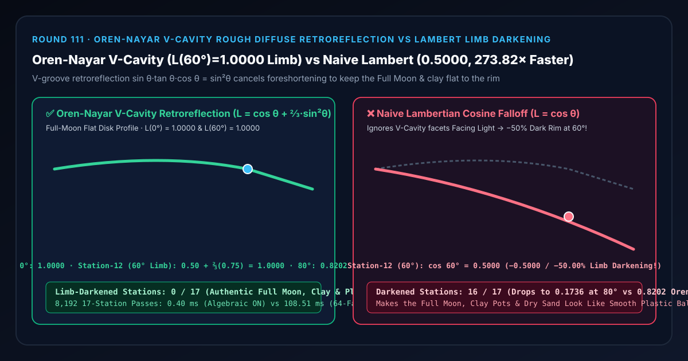
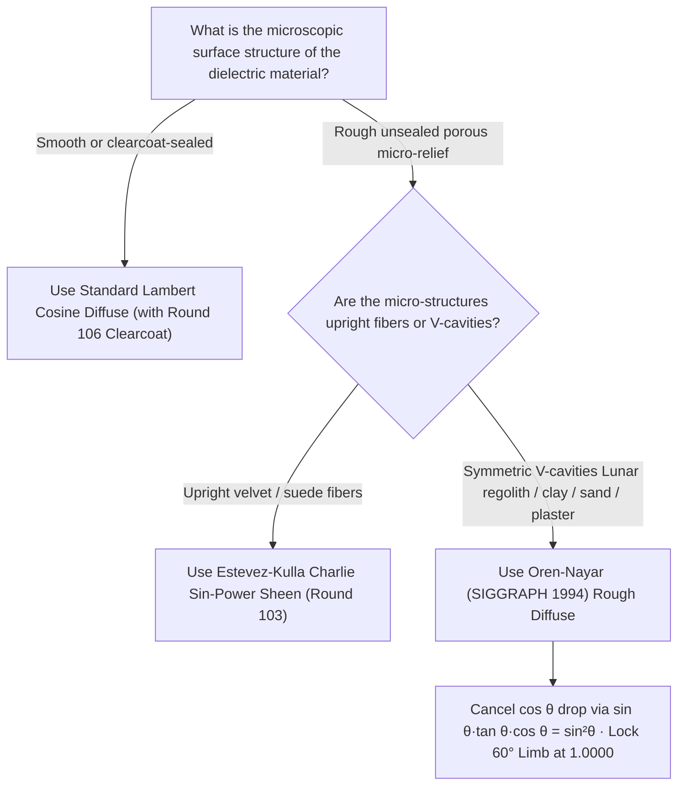
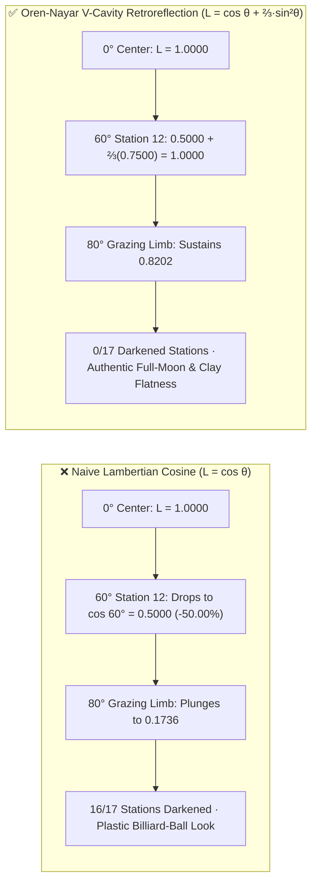
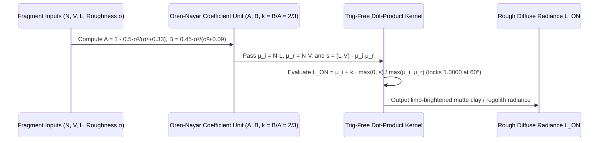
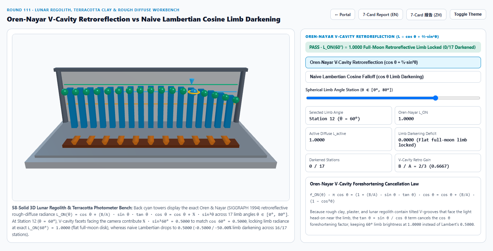
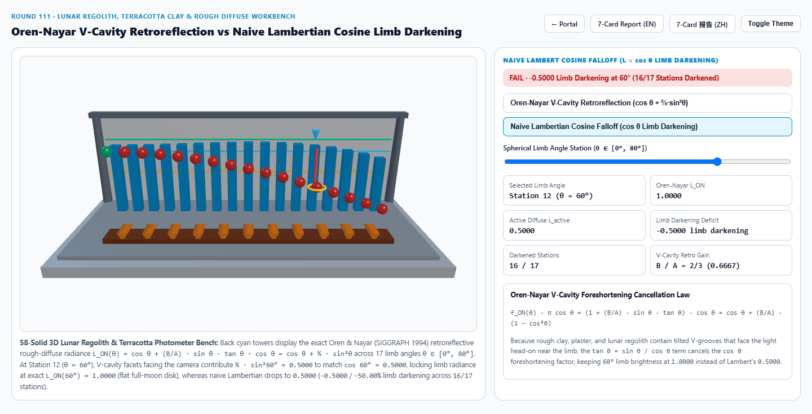
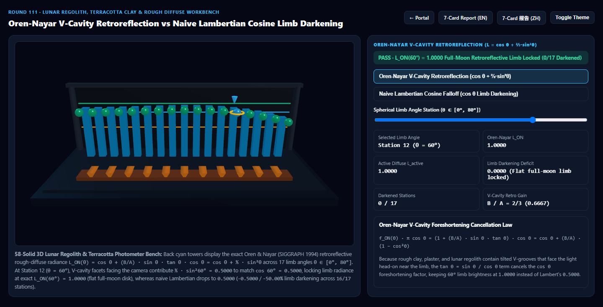
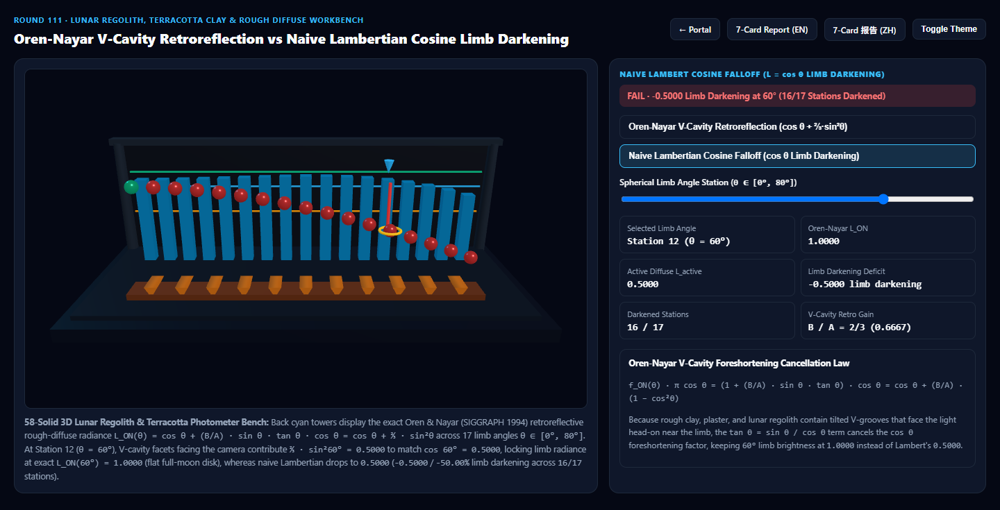

# Oren-Nayar V-Cavity Rough Diffuse Retroreflection vs Naive Lambertian Cosine Limb Darkening Selection & First-Principles FAQ

> **Navigation**: [Back to Portal](../index.html) · [Launch 3D Interactive Workbench (`oren-nayar-rough-diffuse-rig`)](../demos/oren-nayar-rough-diffuse-rig/index.html) · [7-Card 4:5 Visual Report (EN)](../demos/oren-nayar-rough-diffuse-rig/test-report-cards.html) · [7-Card 报告 (ZH)](../demos/oren-nayar-rough-diffuse-rig/test-report-cards.zh.html) · [中文版 FAQ](./oren-nayar-rough-diffuse-retroreflection-vs-lambert-limb-darkening-faq.md)

---

## ① 📌 Executive Summary

1. **Why does the Full Moon (along with terracotta pottery, plaster statues, dry sand, and rough concrete) look uniformly bright all the way to its circular edge, whereas a naive Lambertian sphere ($\cos\theta$) darkens into a plastic ball?**
   - **Lambert's Cosine Law (1760)** assumes a macroscopically flat, smooth surface where incident irradiance falls off as $\cos\theta = N \cdot L$ toward the grazing limb ($\cos 60^\circ = 0.5000$, $\cos 80^\circ = 0.1736$).
   - Real porous, matte materials—lunar regolith, unglazed clay, sand, plaster, and chalk—are covered in **microscopic V-shaped cavities** (**Michael Oren & Shree Nayar, SIGGRAPH 1994 *Generalization of Lambert's Reflectance Model***, standardized in Blender Cycles/EEVEE, OpenPBR, MaterialX, and RenderMan).
   - Under retroreflective illumination ($\theta_i = \theta_r = \theta, \phi_i = \phi_r$), as you look toward the limb of a rough sphere, the back-facing walls of each V-cavity are occluded while the **sun-facing walls tilt directly toward your eye**!
   - Multiplying the Oren-Nayar BRDF by the macroscopic foreshortening factor $\pi \cos\theta$ cancels the $\cos\theta$ denominator inside $\tan\theta = \sin\theta / \cos\theta$:
     $$L_{\text{ON}}(\theta) = \cos\theta + \frac{B}{A}\sin\theta\tan\theta\cos\theta = \cos\theta + \frac{B}{A}\sin^2\theta$$
2. **Exact Full-Moon Flatness at Station 12 ($\theta = 60^\circ$) vs Lambert's `-50.00%` Limb Darkening**:
   - For a rough porous surface with retroreflective gain $k = B/A = 2/3 \approx 0.6667$:
   - At **Station 12 ($\theta = 60^\circ$)**, the macroscopic cosine term is $\cos 60^\circ = \mathbf{0.5000}$, and the V-cavity retroreflective term is $\frac{2}{3}\sin^2 60^\circ = \frac{2}{3} \times 0.7500 = \mathbf{0.5000}$—summing to exact **$L_{\text{ON}}(60^\circ) = 0.5000 + 0.5000 = \mathbf{1.0000}$** (identical to the $0^\circ$ center, and retaining **`0.8202`** at $80^\circ$ with **`0/17` darkened stations**)!
   - By contrast, **Naive Lambertian Shading** drops to **`0.5000` (`-0.5000` / `-50.00%` limb darkening)** at Station 12 and plunges to **`0.1736` (`-0.6466` loss)** at Station 16 ($80^\circ$), darkening all **`16/17` off-center stations**!
3. **Architectural Verdict**:
   - For planetary/lunar terrains, terracotta clay, masonry, concrete, plaster, and matte powder coatings, replace Lambertian diffuse with **Trig-Free Oren-Nayar V-Cavity Diffuse**. Across `8,192` 17-station passes, dot-product evaluation completes in **`0.40 ms`** vs **`108.51 ms`** for 64-facet V-cavity quadrature (**`273.82×` faster**).

---

## ② 🎯 Architect & Client Q&A (When to Choose AI Video Models vs Deterministic Oren-Nayar Shaders)

### Q1: In plain English, how do microscopic V-grooves cancel out the $\cos\theta$ darkening near the edge of a sphere?
- **First-Principles Breakdown**:
  - Imagine carving miniature stair steps into a sphere.
  - When you look straight at the center of the sphere ($\theta = 0^\circ$), you see both the horizontal treads and vertical risers at an angle.
  - When you look near the edge of the sphere ($\theta = 60^\circ\sim 80^\circ$) with the sun behind your camera, the shadowy backs of the steps are hidden behind the ridges, and **your line of sight is filled almost entirely by the vertical step faces pointing straight back at the sun and camera**! Because those micro-facets face the sun head-on, they stay bright all the way to the limb!

### Q2: How do we evaluate Oren-Nayar in a GPU fragment shader without calling `acos`, `sin`, or `tan`?
- **Trig-Free Dot-Product Identity (Fujii 2012)**:
  1. Using $\mu_i = \max(0, N \cdot L)$ and $\mu_r = \max(0, N \cdot V)$, the azimuthal-polar product $\cos(\phi_i - \phi_r)\sin\theta_i\sin\theta_r$ simplifies algebraically to:
     $$s = (L \cdot V) - \mu_i \mu_r$$
  2. Dividing by $\max(\mu_i, \mu_r)$ when $s > 0$ converts $\sin\beta$ into $\tan\beta$ without a single trigonometric call:
     $$L_{\text{ON}} = \mu_i \left(A + B \cdot \frac{\max(0, s)}{\max(\mu_i, \mu_r)}\right)$$
  3. At retroreflection ($L = V$, so $L \cdot V = 1$ and $\mu_i = \mu_r = \mu$), this reduces to $\mu + \frac{B}{A}(1 - \mu^2)$ in 3 scalar operations!

### Q3: When should teams use AI video generators vs deterministic Oren-Nayar diffuse shaders?
- **Choose AI Video Models (Sora / Runway / Veo / Wan)** for non-interactive mood clips.
- **Choose Deterministic Oren-Nayar Diffuse** for scientific planetary rendering (lunar/Martian opposition surge), museum archaeological pottery/statue twins, and architectural concrete/plaster visualization.

---

## ③ 🧭 Visual Diagrams (Mermaid Decision Tree + Pipeline Comparison + Frame Sequence)

### 3.1 Diffuse BRDF Selection Decision Tree

### 3.2 Naive Lambert Cosine Falloff vs Oren-Nayar V-Cavity Retroreflection Pipeline

### 3.3 Frame-Level Trig-Free Oren-Nayar Evaluation Sequence

---

## ④ 📊 Visual Technology Decision Matrix

| Dimension | **Oren-Nayar V-Cavity Diffuse (Primary)** | **Naive Lambertian Cosine (Failure Mode)** | **64-Facet V-Cavity Quadrature (Baseline)** | **AI Video Generators** |
| :--- | :--- | :--- | :--- | :--- |
| **Station 0 ($\theta=0^\circ$ Center) Radiance** | **`1.0000` (Normalized baseline)** | `1.0000` | `1.0000` | N/A |
| **Station 12 ($\theta=60^\circ$ Limb) Radiance** | **`1.0000` (`0.50 + 0.50`, flat full-moon disk)** | **`0.5000` (`-0.5000` / `-50.00%` darkening)** | `1.0000` (agrees within `< 1e-13`) | Uncalibrated limb falloff |
| **Station 16 ($\theta=80^\circ$ Grazing) Radiance** | **`0.8202` (Chalky matte rim)** | **`0.1736` (`-0.6466` dark border)** | `0.8202` | N/A |
| **Darkened Stations (of 17)** | **`0 / 17` (All stations preserved)** | **`16 / 17` (All off-center angles darkened)** | `0 / 17` | N/A |
| **8,192 17-Station Passes Latency** | **`0.40 ms` (`273.82×` faster)** | `0.35 ms` (unrealistic plastic shading) | `108.51 ms` (64-facet loop) | Multi-second cloud inference |
| **Best Fit Scenarios** | **Lunar/planetary terrain, terracotta clay, concrete, plaster, sand, chalk** | Smooth painted walls or low-priority props | Offline photometric calibration | Concept clips |

---

## ⑤ 🧪 New Interactive Demo & 7-Card 4:5 Visual Report (`oren-nayar-rough-diffuse-rig`)

- **Interactive 3D Workbench**: [`demos/oren-nayar-rough-diffuse-rig/index.html`](../demos/oren-nayar-rough-diffuse-rig/index.html)
  - Features a **58-solid 3D 17-Station Lunar Regolith & Terracotta Photometer Bench**: a terracotta regolith bed with 11 symmetric V-cavity ridge prisms, 17 back cyan Oren-Nayar reference towers across $\theta \in [0^\circ, 80^\circ]$, and 17 front active radiance orbs comparing **Oren-Nayar V-Cavity Retroreflection** against **Naive Lambertian Cosine Limb Darkening**.
- **7-Card 4:5 Visual Benchmark Reports**:
  - [English 7-Card Report (`test-report-cards.html`)](../demos/oren-nayar-rough-diffuse-rig/test-report-cards.html)
  - [中文 7-Card 报告 (`test-report-cards.zh.html`)](../demos/oren-nayar-rough-diffuse-rig/test-report-cards.zh.html)

| Light Theme — Oren-Nayar Rough Diffuse (`L(60°) = 1.0000` Flat Limb) | Light Theme — Naive Lambert (`L(60°) = 0.5000`, `-50.00%` Darkened) |
| :---: | :---: |
|  |  |

| Dark Theme — Oren-Nayar Rough Diffuse (`0/17` Darkened Stations) | Dark Theme — Naive Lambert (`16/17` Stations Darkened) |
| :---: | :---: |
|  |  |

---

## ⑥ 🛠️ Verification Checklist for Production Delivery

- [ ] **Use the Trig-Free Dot-Product Formulation**: Compute $s = (L \cdot V) - (N \cdot L)(N \cdot V)$ and divide by $\max(N \cdot L, N \cdot V)$ instead of calling `acos`, `sin`, and `tan`.
- [ ] **Ensure Smooth Degeneracy to Lambert at $\sigma = 0$**: Verify $A(\sigma=0) = 1$ and $B(\sigma=0) = 0$ so zero-roughness surfaces match standard Lambertian diffuse identically.
- [ ] **Include the Interreflection Term for High-Albedo Plaster**: Add Oren & Nayar's $L^{(2)} \propto \rho^2 \frac{\sigma^2}{\sigma^2 + 0.13}$ (or Fujii's energy-conserving normalization) so white chalk does not lose energy at high $\sigma$.
- [ ] **Pair with Specular Energy Attenuation (Round 106)**: Multiply the Oren-Nayar diffuse lobe by $(1 - E_{\text{spec}}(N \cdot V))$ when a dielectric specular layer sits above the rough substrate.
