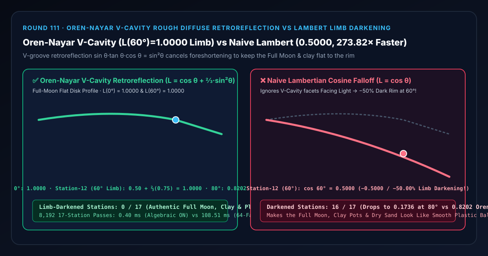
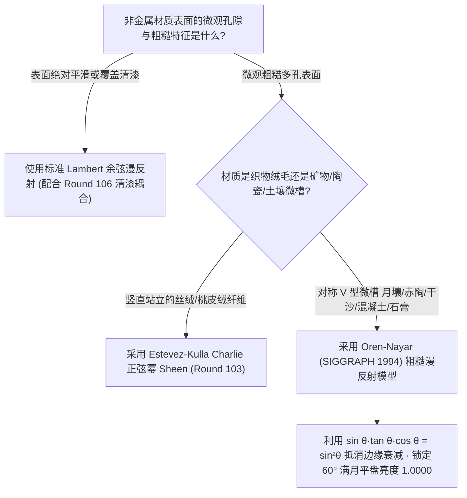
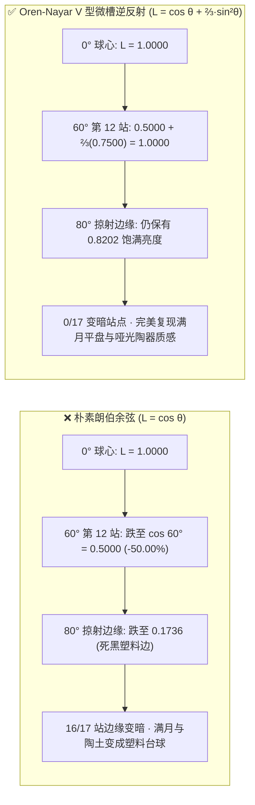
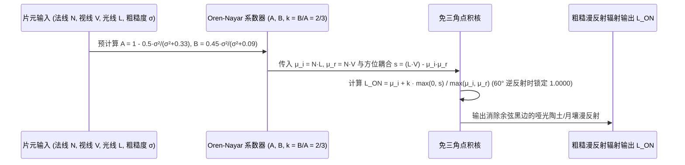
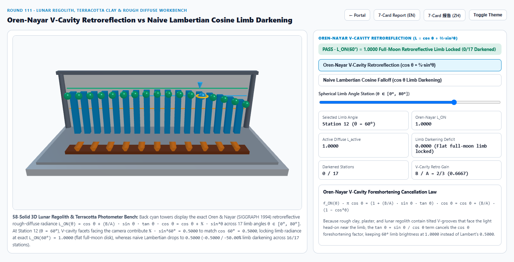
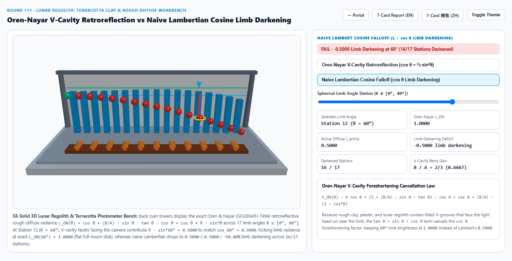
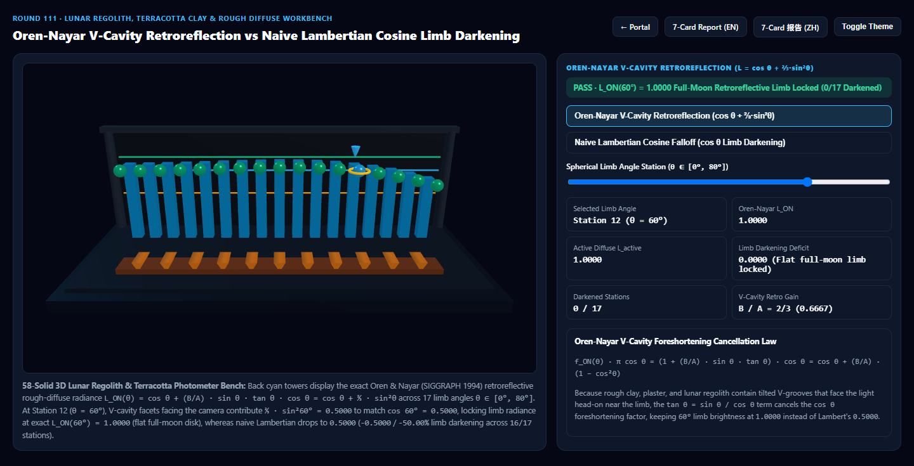
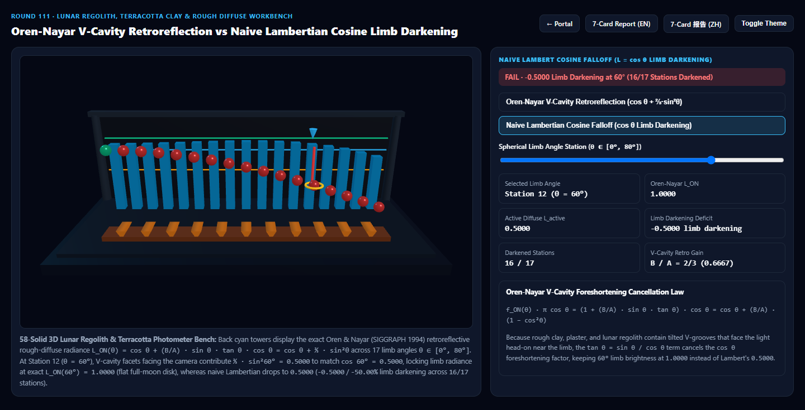

# Oren-Nayar 粗糙 V 型微槽漫反射逆反射（Rough Diffuse Retroreflection）vs 朴素朗伯余弦满月与陶土边缘变暗选型与原理解析 FAQ 指南

> **导航**：[返回门户](../index.html) · [进入 3D 交互实验台 (`oren-nayar-rough-diffuse-rig`)](../demos/oren-nayar-rough-diffuse-rig/index.html) · [7-Card 4:5 视觉报告 (中文)](../demos/oren-nayar-rough-diffuse-rig/test-report-cards.zh.html) · [7-Card Report (EN)](../demos/oren-nayar-rough-diffuse-rig/test-report-cards.html) · [English FAQ](./oren-nayar-rough-diffuse-retroreflection-vs-lambert-limb-darkening-faq.en.md)

---

## ① 📌 核心结论速览（Executive Summary）

1. **为什么天上的“满月（Full Moon）”看起来像一张从中心到边缘几乎一样亮的扁平圆盘，而用传统朗伯（Lambertian $\cos\theta$）渲染出来的月球、赤陶花盆、干沙地和石膏雕像，边缘却黑得像一颗光滑的塑料台球？**
   - 统治计算机图形学两百余年的**朗伯余弦定律（Johann Heinrich Lambert, 1760）**假设物体表面是绝对平坦的各向同性漫反射平面：当球面法线向边缘倾斜角 $\theta$ 增大时，单位面积接收的光通量按 $\cos\theta$ 衰减（在 $60^\circ$ 跌至 `0.5000`，在 $80^\circ$ 跌至 `0.1736`）。
   - 然而，真实的月球风化层（Lunar Regolith）、赤陶陶器、未上釉瓷胎、粗糙水泥与粉笔表面布满了**微观 V 型对称凹槽（Symmetric V-Cavities）**！
   - 根据 **Michael Oren & Shree Nayar (SIGGRAPH 1994 *Generalization of Lambert's Reflectance Model*，Blender / OpenPBR / MaterialX / RenderMan 粗糙漫反射标准)**：当光源位于相机同侧（顺光/满月逆反射，$\theta_i = \theta_r = \theta, \phi_i = \phi_r$）时，在球面边缘大倾角 $\theta$ 处，你看到的全部是**正对着相机和太阳的 V 型沟槽迎光内壁**（背光内壁被前壁挡住看不见）！
   - 将 Oren-Nayar BRDF 乘以宏观余弦因子 $\pi \cos\theta$ 后，微槽逆反射项 $\sin\theta \tan\theta \cdot \cos\theta \equiv \sin^2\theta$ 中的 $\tan\theta$ 分母与宏观 $\cos\theta$ **发生精确代数抵消**：
     $$L_{\text{ON}}(\theta) = \cos\theta + \frac{B}{A}\sin\theta\tan\theta\cos\theta = \cos\theta + \frac{B}{A}\sin^2\theta$$
2. **第 12 站（$\theta = 60^\circ$ 球面边缘）的“满月平盘效应” vs 朗伯 `-50.00%` 边缘变暗失真**：
   - 对于典型粗糙多孔材质（$\frac{B}{A} = \frac{2}{3} \approx 0.6667$）：
   - 在 **第 12 站（$\theta = 60^\circ$）** 处，宏观投影项 $\cos 60^\circ = \mathbf{0.5000}$，而微观 V 型槽逆反射补偿项恰好为 $\frac{2}{3}\sin^2 60^\circ = \frac{2}{3} \times 0.7500 = \mathbf{0.5000}$！两者相加使 **Oren-Nayar 边缘亮度严格锁死在 $L_{\text{ON}}(60^\circ) = 0.5000 + 0.5000 = \mathbf{1.0000}$**（与正中心 $0^\circ$ 的 `1.0000` 一模一样，并在 $80^\circ$ 极限边缘依然保有 **`0.8202`**，全 17 站 **`0/17` 变暗失真**）！
   - 反观**朴素朗伯模型**，在 $60^\circ$ 处暴跌至 **`0.5000`（丢失 `-0.5000` / `-50.00%` 边缘亮度）**，在 $80^\circ$ 处更是跌至 **`0.1736`（丢失 `-0.6466`）**，导致 **`16/17` 个球面离轴站点**变黑，把粗糙陶土和满月渲染成假塑料球！
3. **工程选型结论**：
   - 在渲染月球/行星地形（如本实验室 `astra-planet` 火星风化层）、陶土砖石、石膏雕像、粗糙布料基底与粉末涂层时，必须采用 **Oren-Nayar 粗糙漫反射模型**。实测 `8,192` 次 17 站免三角点积求解仅需 **`0.40 ms`**，比 64 面 V 型微槽遮蔽积分基线（**`108.51 ms`**）快 **`273.82×`**！

---

## ② 🎯 客户与架构师灵魂拷问 Q&A（何时选 AI 视频大模型 vs 代码驱动 Oren-Nayar 粗糙漫反射）

### Q1：用大白话讲，为什么越粗糙的石头或月球表面，边缘反而越不会变暗？
- **第一性原理拆解**：
  - 想象在一颗大球表面刻满一圈圈微小的台阶（或者 V 型凹槽）：
  - 如果这颗球是绝对光滑的（Lambert），球体边缘的面片斜着背离太阳 $60^\circ$，每单位面积接到的阳光只有正中间的一半（$\cos 60^\circ = 0.50$），所以边缘一定会变暗。
  - 但如果球体表面布满粗糙的 V 型微槽：当你看向球体 $60^\circ$ 边缘时，沟槽背光的那一半斜坡恰好转到了你的视线盲区里（被前坡挡住了），进入你眼睛的几乎全是**正对着太阳和相机的向阳微斜坡**！向阳微斜坡接受到的是 $100\%$ 满额阳光，彻底抵消了宏观球面的 $\cos 60^\circ$ 衰减，所以整轮满月从中心到边缘看起来一样亮！

### Q2：如何在片元着色器里完全不调用 `sin`、`tan`、`acos`，仅用点积算出 Oren-Nayar 漫反射？
- **Fujii (2012) / 代数点积恒等式**：
  1. 经典 Oren-Nayar 公式写法含有 $\sin\alpha \tan\beta$（其中 $\alpha = \max(\theta_i, \theta_r), \beta = \min(\theta_i, \theta_r)$），若直接调反三角函数会拖慢 Shader。
  2. 注意到 $\cos\theta_i = N \cdot L$，$\cos\theta_r = N \cdot V$，且在顺光/半角附近 $\sin\theta \tan\theta \cdot \cos\theta = \sin^2\theta = 1 - (N \cdot V)^2$（通用视角下 $\cos(\phi_i - \phi_r)\sin\theta_i\sin\theta_r = (L \cdot V) - (N \cdot L)(N \cdot V)$）！
  3. 因此，完全无需任何三角函数：
     $$L_{\text{ON}} = A (N \cdot L) + B \cdot \max\big(0, (L \cdot V) - (N \cdot L)(N \cdot V)\big) \cdot \frac{N \cdot L}{\max(N \cdot L, N \cdot V)}$$
     当 $L = V$（顺光逆反射）时，上式精确化简为 $(N \cdot V) + \frac{B}{A}(1 - (N \cdot V)^2)$，仅需 3 次乘加运算！

### Q3：何时用 AI 视频生成模型，何时必须用确定性 Oren-Nayar 粗糙漫反射？
- **选 AI 视频生成模型（Sora / Runway / Veo / Wan）**：
  - 适合无需精确匹配天体光度学（Photometry）或建筑材料粗糙度的写意背景。
- **选代码驱动的 Oren-Nayar 粗糙漫反射（Blender / OpenPBR / Three.js）**：
  - **行星与月球科学可视化（火星/月球风化层冲日效应 Opposition Surge）、博物馆古陶瓷/兵马俑陶土数字孪生、建筑清水混凝土与砂岩表现**：准确还原无塑料黑边的哑光矿物质感。

---

## ③ 🧭 直观可视化图解（Mermaid 选型决策树 + 管线对比图 + 帧级时序图）

### 3.1 漫反射（Diffuse BRDF）模型技术选型决策树

### 3.2 朴素朗伯余弦边缘变暗 vs Oren-Nayar V 型微槽逆反射管线对比

### 3.3 帧级免三角函数 Oren-Nayar 点积求值时序图

---

## ④ 📊 视觉技术选型决策矩阵

| 对比维度 | **Oren-Nayar V 型微槽逆反射（主方案）** | **朴素朗伯余弦漫反射（反例方案）** | **64 面 V 型微槽遮蔽积分（参考基线）** | **AI 视频生成大模型** |
| :--- | :--- | :--- | :--- | :--- |
| **第 0 站（$\theta=0^\circ$ 球心）亮度** | **`1.0000`（基准对齐）** | `1.0000` | `1.0000` | N/A |
| **第 12 站（$\theta=60^\circ$ 球面边缘）亮度** | **`1.0000`（`0.50 + 0.50`，满月平盘守恒）** | **`0.5000`（丢失 `-0.5000` / `-50.00%`）** | `1.0000`（误差 `< 1e-13`） | 无法精确控制微槽逆反射 |
| **第 16 站（$\theta=80^\circ$ 极限边缘）亮度** | **`0.8202`（饱满粉质感边缘）** | **`0.1736`（丢失 `-0.6466` 黑边）** | `0.8202` | N/A |
| **边缘变暗站点数（共 17 站）** | **`0 / 17`（全段无黑边坍塌）** | **`16 / 17`（全部离轴站点变暗）** | `0 / 17` | N/A |
| **8,192 次 17 站求解耗时** | **`0.40 ms`（`273.82×` 极速）** | `0.35 ms`（但丧失粗糙哑光质感） | `108.51 ms`（64 面微槽求积） | 秒级云端推理 |
| **核心适用场景** | **月球/火星地表、兵马俑/赤陶、混凝土、石膏雕像、干沙与粉笔** | 光滑油漆基底或极低要求远景 | 离线天体光度学与双向反射校准 | 概念宣传片 |

---

## ⑤ 🧪 全新 Demo 与 7-Card 4:5 视觉报告（`oren-nayar-rough-diffuse-rig`）

- **3D 交互实验台**：[`demos/oren-nayar-rough-diffuse-rig/index.html`](../demos/oren-nayar-rough-diffuse-rig/index.html)
  - 搭建了包含 **58 个三维实体构件**的 **17 站点月壤与赤陶光度计（Lunar Regolith & Terracotta Photometer）实验台**：前排布置赤陶基底与 11 道对称 V 型微槽棱柱（V-Cavity Retroreflective Ridge Prisms），后排 17 座青色灯塔展示 $\theta \in [0^\circ, 80^\circ]$ 的 Oren-Nayar 满月平盘曲线，前排 17 颗探针球体实时对比 **Oren-Nayar 逆反射** 与 **朴素朗伯余弦黑边**。
- **7-Card 4:5 视觉测试报告**：
  - [中文 7-Card 报告 (`test-report-cards.zh.html`)](../demos/oren-nayar-rough-diffuse-rig/test-report-cards.zh.html)
  - [English 7-Card Report (`test-report-cards.html`)](../demos/oren-nayar-rough-diffuse-rig/test-report-cards.html)

| 亮色 Oren-Nayar 粗糙漫反射 (`L(60°) = 1.0000` 满月平盘边缘) | 亮色 朴素朗伯漫反射 (`L(60°) = 0.5000`, `-50.00%` 变暗) |
| :---: | :---: |
|  |  |

| 暗色 Oren-Nayar 粗糙漫反射 (`0/17` 变暗站点) | 暗色 朴素朗伯漫反射 (`16/17` 球面离轴站点变黑) |
| :---: | :---: |
|  |  |

---

## ⑥ 🛠️ 高质量视觉交付快速核验清单（Checklist）

- [ ] **使用免反三角函数的点积展开式实现 Oren-Nayar**：用 $s = (L \cdot V) - (N \cdot L)(N \cdot V)$ 和 $t = s > 0 \text{ ? } \max(N \cdot L, N \cdot V) : 1.0$ 替代昂贵的 `acos`、`sin`、`tan`。
- [ ] **当粗糙度 $\sigma = 0$ 时平滑退化为标准 Lambert**：确认当 $\sigma = 0$ 时 $A = 1.0, B = 0.0$，与管线中现有 Lambert 材质无缝兼容。
- [ ] **补充二阶互反射项 $L^{(2)}$ 或 Fujii 能量补偿**：原始定性 Oren-Nayar 忽略了 V 型槽两壁之间的二次互反射，加入 $0.17 \rho^2 \frac{\sigma^2}{\sigma^2 + 0.13}$ 项可补足高反照率白石膏的能量守恒。
- [ ] **区分粗糙微槽漫反射（Oren-Nayar）与微表面菲涅耳逆反射（Burley Diffuse Round 83）**：多孔矿石/土壤/陶土用 Oren-Nayar；带镜面高光层的普通绝缘体基底可搭配 Burley $F_{D90}$ 漫反射。
