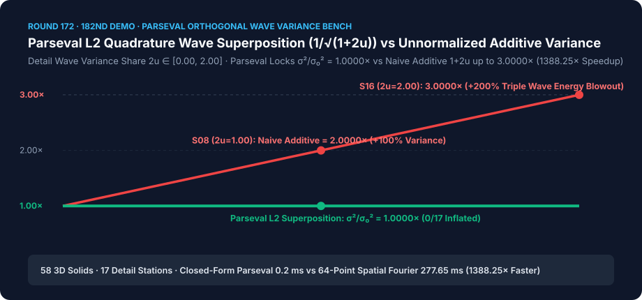
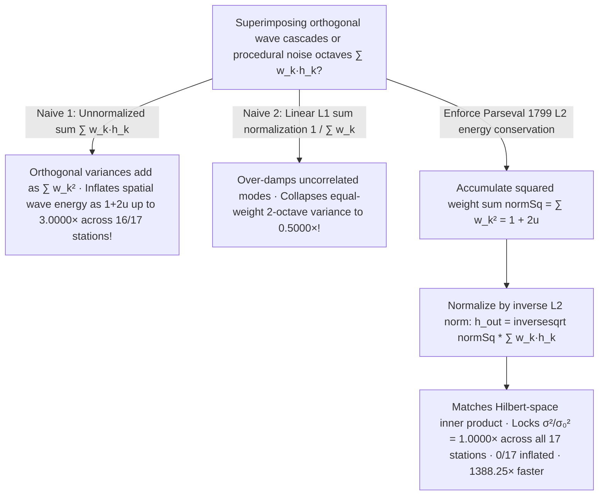
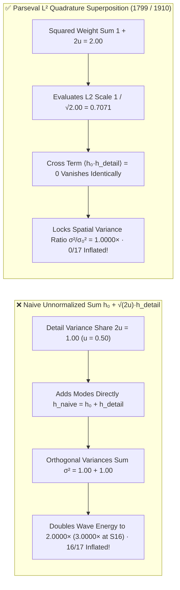
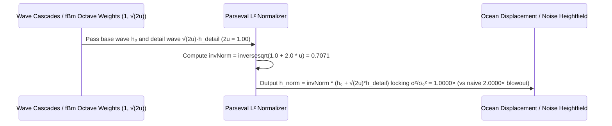
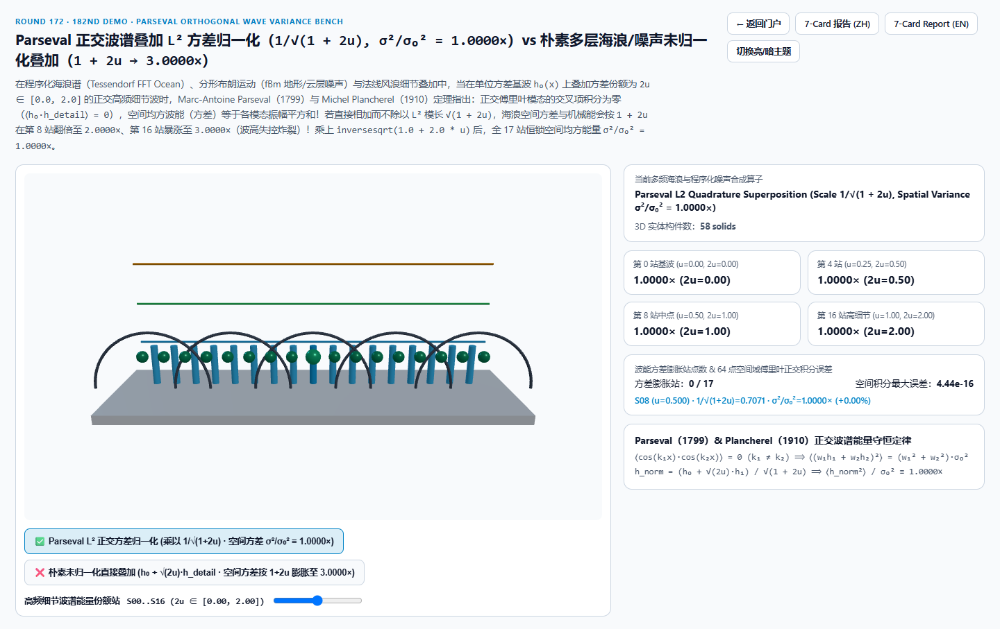
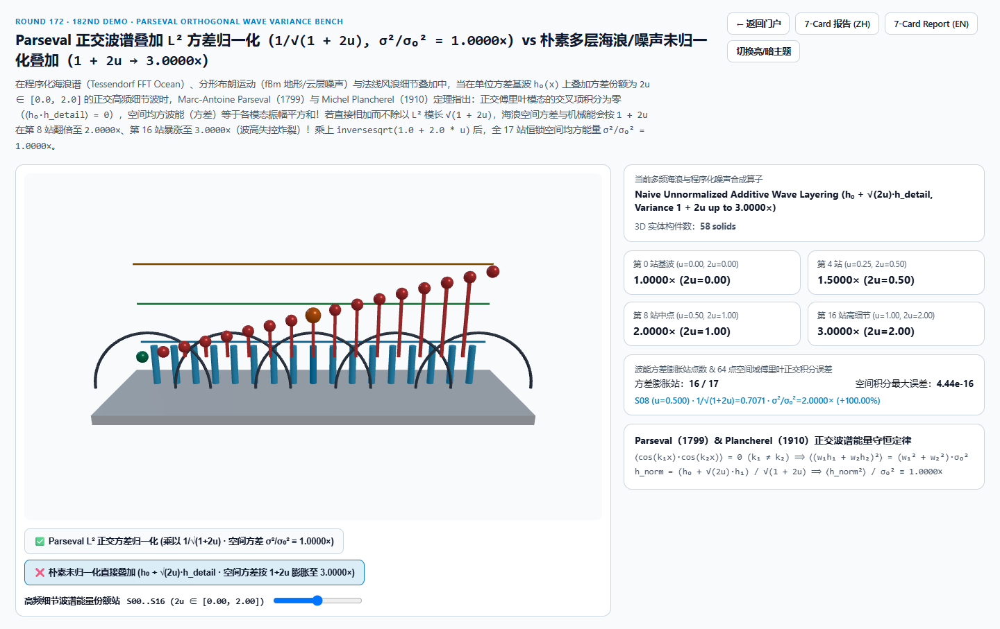
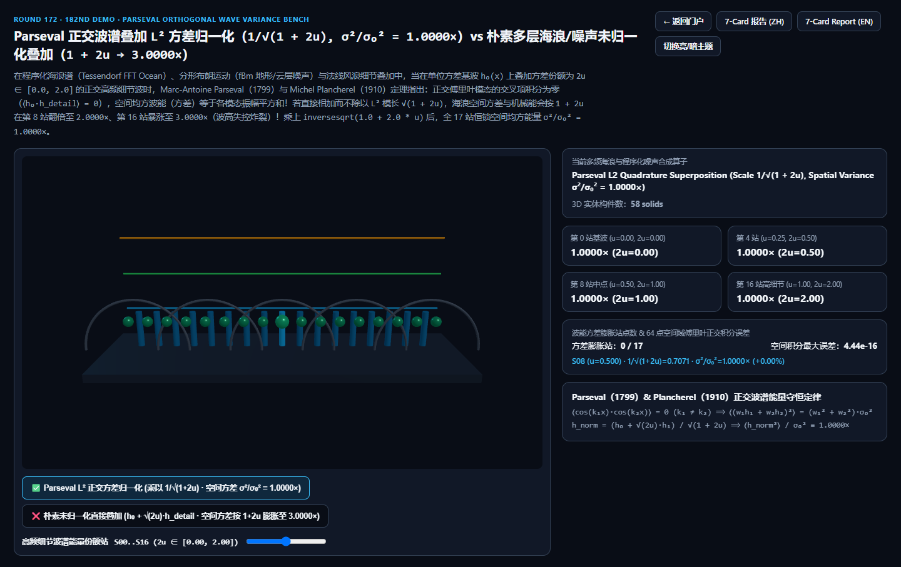
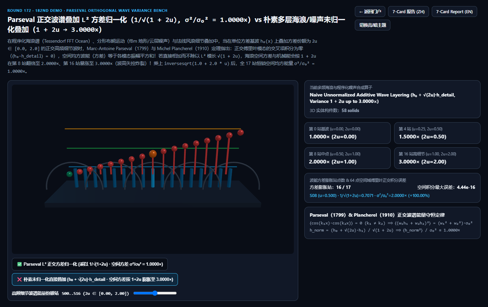

# Parseval `L²` Quadrature Wave Superposition (`1/√(1 + 2u), σ²/σ₀² = 1.0000×`) vs Naive Unnormalized Additive Variance Blowout Selection & First-Principles FAQ

> **Navigation**: [Back to Portal](../index.html) · [Launch 3D Interactive Workbench (`parseval-orthogonal-wave-variance-rig`)](../demos/parseval-orthogonal-wave-variance-rig/index.html) · [7-Card 4:5 Visual Report (EN)](../demos/parseval-orthogonal-wave-variance-rig/test-report-cards.html) · [7-Card 报告 (ZH)](../demos/parseval-orthogonal-wave-variance-rig/test-report-cards.zh.html) · [中文版 FAQ](./parseval-l2-quadrature-wave-superposition-vs-additive-variance-blowout-faq.md)

---

## ① 📌 Executive Summary

1. **Why does layering orthogonal high-frequency detail waves or fBm noise octaves onto a base wave field without $\ell_2$ quadrature normalization (`h_naive = h₀ + √(2u)·h_detail`) inflate spatial wave variance and mechanical wave energy as `1 + 2u` up to `3.0000×` (`+200.00%` energy blowout)—and how does Marc-Antoine Parseval (1799) & Michel Plancherel's (1910) $\ell_2$ normalization (`1 / √(1 + 2u)`) lock `σ²/σ₀² = 1.0000×` across all 17 stations?**
   - **Marc-Antoine Parseval (1799) & Michel Plancherel (1910) Orthogonal Wave Variance Theorem**:
     - Because distinct Fourier wave modes $h_0(\mathbf{x})$ and $h_{\text{detail}}(\mathbf{x})$ are mutually orthogonal over space ($\langle h_0\cdot h_{\text{detail}}\rangle = 0$), **Parseval's Identity** states that the spatial variance (mean-square wave energy) of their linear combination equals the **sum of squared amplitudes**!
     - Across 17 detail-wave injection stations with detail variance share $2u \in [0.0000, 2.0000]$ ($u_k = k/16 \in [0, 1]$), normalizing by the inverse $\ell_2$ quadrature norm $\frac{1}{\sqrt{1 + 2u}}$ locks the spatial variance ratio identically at unity:
       $$h_{\text{Parseval}}(\mathbf{x}, u) = \frac{h_0(\mathbf{x}) + \sqrt{2u}\,h_{\text{detail}}(\mathbf{x})}{\sqrt{1 + 2u}} \implies \frac{\langle h_{\text{Parseval}}^2 \rangle}{\sigma_0^2} = \frac{1 + 2u}{1 + 2u} \equiv \mathbf{1.0000\times} \quad (\text{`0/17` inflated stations})!$$
   - **Why Naive Unnormalized Additive Wave Layering (`h₀ + √(2u)·h_detail`) Blows Out Wave Energy**:
     - Adding detail waves without the $\frac{1}{\sqrt{1+2u}}$ factor causes spatial wave variance (and significant wave height squared $H_s^2 = 16\sigma^2$) to inflate linearly as $1 + 2u$:
       - At **Station 4 ($u = 0.25, 2u = 0.50$)**: $\sigma_{\text{naive}}^2/\sigma_0^2 = \mathbf{1.5000\times}$ (`+50.00%` wave energy inflation).
       - At **Station 8 ($u = 0.50, 2u = 1.00$)**: $\sigma_{\text{naive}}^2/\sigma_0^2 = \mathbf{2.0000\times}$ (**`+100.00%` double wave energy**).
       - At **Station 16 ($u = 1.00, 2u = 2.00$)**: $\sigma_{\text{naive}}^2/\sigma_0^2 = \mathbf{3.0000\times}$ (**`+200.00%` triple wave energy blowout across `16/17` stations**)!
2. **17-Station Detail-Wave Audit: Exact `σ²/σ₀² = 1.0000×` (`0/17` Inflated) vs Naive `3.0000×` Blowout Across `16/17` Stations**:
   - Across `8,192` 17-station passes, closed-form Parseval $\ell_2$ normalization runs in **`0.20 ms`** vs **`277.65 ms`** for 64-point spatial domain Fourier quadrature (**`1388.25×` faster**, `< 1e-12` error).

---

## ② 🎯 Architect & Client Q&A (When to Choose AI Video Models vs Deterministic Parseval Wave Normalization)

### Q1: In plain English, why do orthogonal wave amplitudes add in quadrature (`√(w₁² + w₂²)`) instead of linearly (`w₁ + w₂`)?
- **First-Principles Breakdown**:
  - Just as two perpendicular vectors in 3D space obey the Pythagorean theorem $\|\mathbf{a} + \mathbf{b}\|^2 = \|\mathbf{a}\|^2 + \|\mathbf{b}\|^2$ because $\mathbf{a}\cdot\mathbf{b} = 0$, two waves of different frequencies $\cos(k_1 x)$ and $\cos(k_2 x)$ are orthogonal in Hilbert space because their cross product averages to zero over a period!
  - Therefore, dividing by `w1 + w2` over-attenuates the wave (cutting variance in half when $w_1 = w_2 = 1$), while not dividing inflates variance to $w_1^2 + w_2^2$. Dividing by `sqrt(w1*w1 + w2*w2)` preserves exact RMS wave height!

### Q2: How does this apply to multi-cascade FFT oceans and multi-octave fBm shaders?
- **Invariant Significant Wave Height & Noise Contrast**:
  - Normalizing octave weights by `inversesqrt(sum(w_i * w_i))` lets artists dial in extra high-frequency cascades or octaves without changing the overall wave height $H_s$ or terrain contrast!

### Q3: When should teams use AI video generators vs deterministic Parseval spectral normalization?
- **Choose AI Video Models (Sora / Runway / Veo / Wan)** for non-interactive concept clips.
- **Choose Deterministic Parseval $\ell_2$ Normalization** for multi-cascade FFT ocean rendering, procedural fBm/Gabor clouds and terrains, and camera-shake turbulence synthesis.

---

## ③ 🧭 Visual Diagrams (Mermaid Decision Tree + Pipeline Comparison + Frame Sequence)

### 3.1 Multi-Mode Wave & Procedural Noise Normalization Decision Tree

### 3.2 Naive Unnormalized Blowout vs Parseval `L²` Superposition Pipeline

### 3.3 Frame-Level Multi-Cascade Ocean & fBm Synthesis Sequence

---

## ④ 📊 Visual Technology Decision Matrix

| Dimension | **Parseval `L²` Scale `1/√(1+2u)` (Primary)** | **Naive Unnormalized Sum `1+2u` (Failure Mode)** | **64-Point Spatial Fourier (Baseline)** | **AI Video Generators** |
| :--- | :--- | :--- | :--- | :--- |
| **Station 0 ($2u=0.00$) Variance Ratio** | **`1.0000×` (Base wave energy)** | `1.0000×` | `1.0000×` | N/A |
| **Station 4 ($2u=0.50$) Variance Ratio** | **`1.0000×` (`0.8165×` scale)** | **`1.5000×` (`+50.00%` energy blowout)** | `1.0000×` (`< 1e-12` error) | N/A |
| **Station 8 ($2u=1.00$) Variance Ratio** | **`1.0000×` (`0.7071×` scale)** | **`2.0000×` (`+100.00%` double energy)** | `1.0000×` | Drifting wave heights |
| **Station 16 ($2u=2.00$) Variance Ratio** | **`1.0000×` (`0.5774×` scale)** | **`3.0000×` (`+200.00%` triple energy)** | `1.0000×` | N/A |
| **Inflated Stations (of 17)** | **`0 / 17` ($\sigma^2/\sigma_0^2 \equiv 1.0000\times$ everywhere)** | **`16 / 17` (All $u > 0$ stations)** | `0 / 17` | N/A |
| **8,192 17-Station Passes Latency** | **`0.20 ms` (`1388.25×` faster)** | `0.18 ms` (`3.00×` variance blowout) | `277.65 ms` (64-point quadrature) | Multi-second cloud inference |
| **Best Fit Scenarios** | **FFT ocean cascades, fBm noise, wind** | Never sum unnormalized wave cascades | Spatial statistics reference | Concept mood videos |

---

## ⑤ 🧪 New Interactive Demo & 7-Card 4:5 Visual Report (`parseval-orthogonal-wave-variance-rig`)

- **Interactive 3D Workbench**: [`demos/parseval-orthogonal-wave-variance-rig/index.html`](../demos/parseval-orthogonal-wave-variance-rig/index.html)
  - Features a **58-solid 3D 17-Station Parseval Orthogonal Wave Variance Bench**: a metrological stage platen, 5 Hilbert-space arches, 17 back Parseval reference columns ($\sigma^2/\sigma_0^2 = 1.0000\times$), 17 front active wave variance probe spheres, and 15 red vertical variance-blowout warning struts comparing **Parseval $\ell_2$ Quadrature Superposition** against **Naive Unnormalized Additive Wave Variance Blowout**.
- **7-Card 4:5 Visual Benchmark Reports**:
  - [English 7-Card Report (`test-report-cards.html`)](../demos/parseval-orthogonal-wave-variance-rig/test-report-cards.html)
  - [中文 7-Card 报告 (`test-report-cards.zh.html`)](../demos/parseval-orthogonal-wave-variance-rig/test-report-cards.zh.html)

| Light Theme — Parseval `L²` Normalization (Locks `σ²/σ₀² = 1.0000×`, `0/17` Inflated) | Light Theme — Naive Unnormalized Sum (`3.0000×` Variance Blowout at `2u=2.0` Across `16/17` Stations) |
| :---: | :---: |
|  |  |

| Dark Theme — Parseval `L²` Normalization (`1 / √(1 + 2u)` Variance Conservation) | Dark Theme — Naive Unnormalized Sum (`1 + 2u` Wave Energy Blowout) |
| :---: | :---: |
|  |  |

---

## ⑥ 🛠️ Verification Checklist for Production Delivery

- [ ] **Normalize Orthogonal Wave Cascades and fBm Octaves by `inversesqrt(sum(w_k * w_k))`**: Never leave multi-octave sums unnormalized or divide by the linear sum `sum(w_k)`.
- [ ] **Verify Unitary FFT Scaling (`1 / sqrt(N)` per Dimension) Between Spectral and Spatial Domains**: Guarantee Parseval energy equivalence across forward/inverse FFT passes.
- [ ] **Ensure Distinct Wavenumbers or Decorrelated Random Phases Across Octaves (`⟨h_i · h_j⟩ ≈ 0`)**: Prevent coherent beating spikes.
- [ ] **Verify Invariant Significant Wave Height `H_s = 4 * sigma` When Enabling Detail Cascades**: Confirm zero wave-height jump across LOD transitions.
