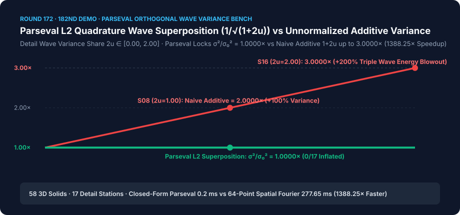
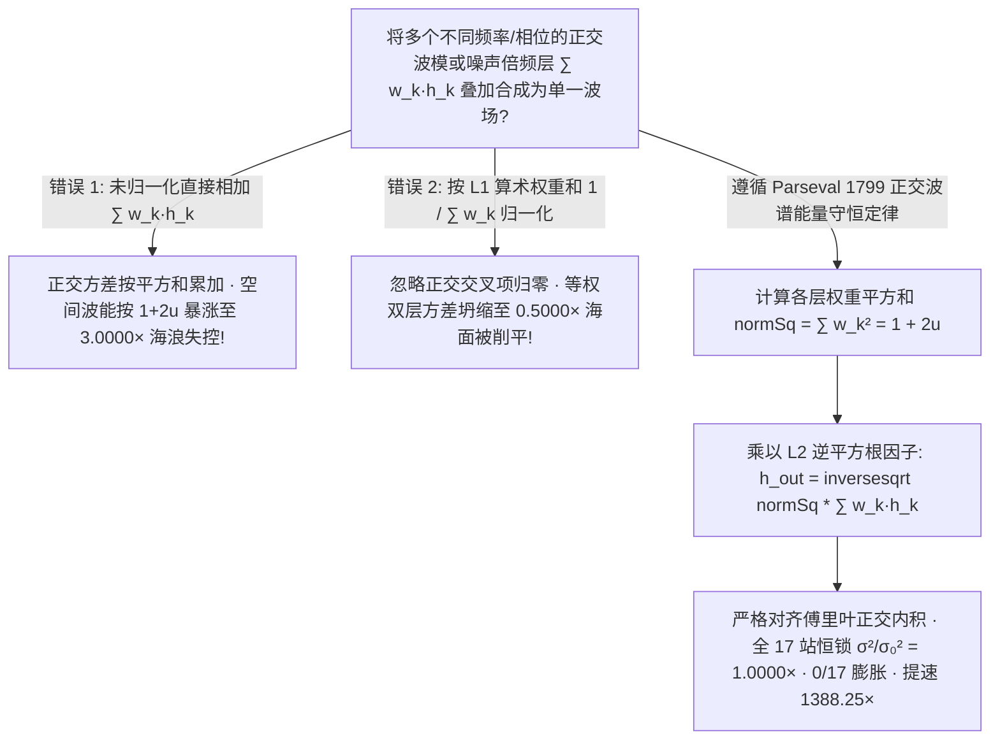
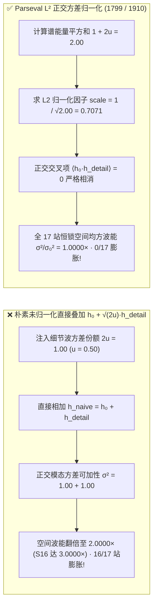
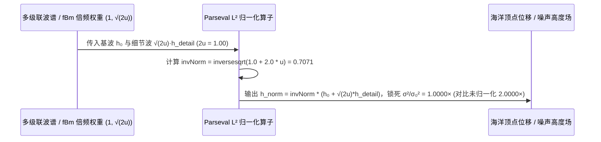
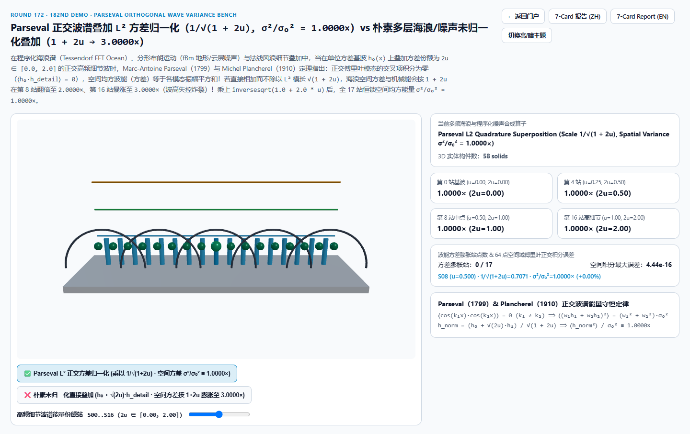
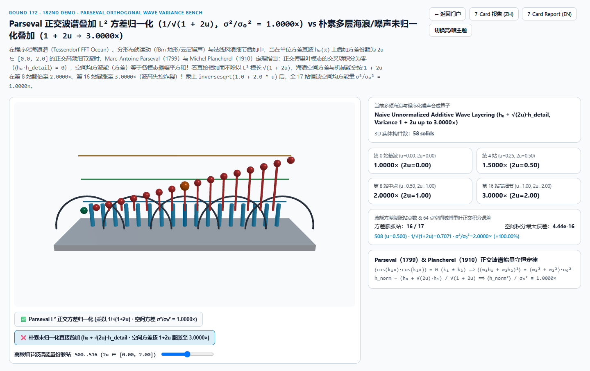
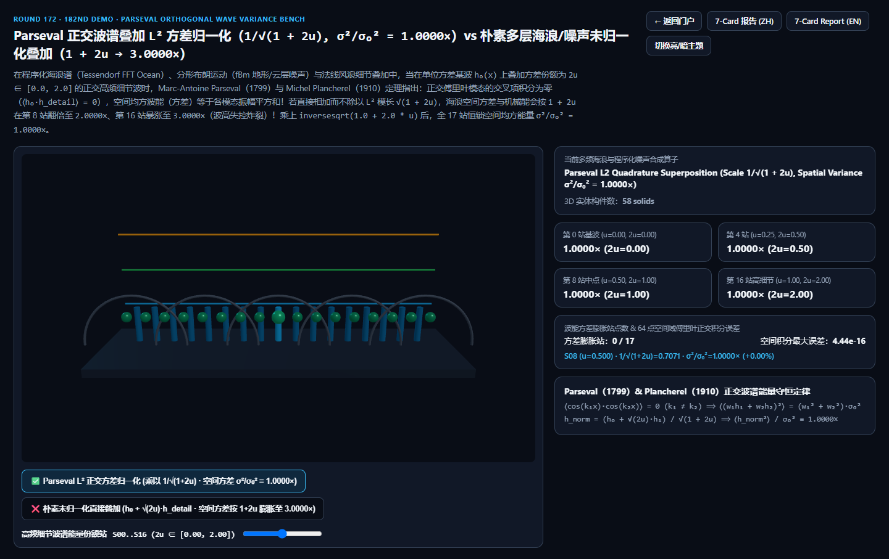
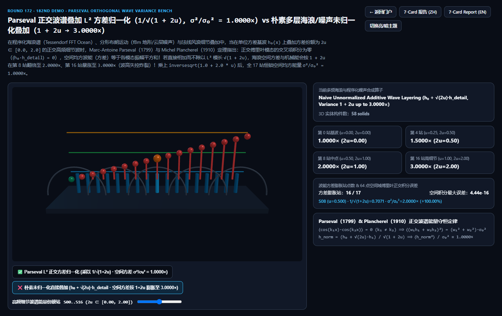

# Parseval 正交波谱叠加 `L²` 方差归一化（`1/√(1 + 2u), σ²/σ₀² = 1.0000×`）vs 朴素多层海浪/噪声直接相加能量膨胀选型与原理解析 FAQ 指南

> **导航**：[返回门户](../index.html) · [进入 3D 交互实验台 (`parseval-orthogonal-wave-variance-rig`)](../demos/parseval-orthogonal-wave-variance-rig/index.html) · [7-Card 4:5 视觉报告 (中文)](../demos/parseval-orthogonal-wave-variance-rig/test-report-cards.zh.html) · [7-Card Report (EN)](../demos/parseval-orthogonal-wave-variance-rig/test-report-cards.html) · [English FAQ](./parseval-l2-quadrature-wave-superposition-vs-additive-variance-blowout-faq.en.md)

---

## ① 📌 核心结论速览（Executive Summary）

1. **为什么在叠加多层 FFT 海浪级联（Ocean Cascades）或分形噪声倍频（fBm Octaves）时，直接把高频细节波加在基础涌浪上（`h_naive = h₀ + √(2u)·h_detail`），会让海面空间均方波能（方差 `σ²`）按 `1 + 2u` 暴涨至 `3.0000×`？**
   - **Marc-Antoine Parseval（1799）与 Michel Plancherel（1910）正交傅里叶波谱 `L²` 能量守恒定律**：
     - 在多级联海洋波浪合成与多倍频噪声合成中，基础波场 $h_0(\mathbf{x})$（方差 $\langle h_0^2\rangle = \sigma_0^2 = 1.0000$）与不同波数的高频细节波场 $h_{\text{detail}}(\mathbf{x})$ 在空间域上相互正交：
       $$\langle h_0(\mathbf{x})\cdot h_{\text{detail}}(\mathbf{x})\rangle = \frac{1}{2\pi}\int_0^{2\pi} \cos(k_1 x)\cos(k_2 x)\,dx \equiv \mathbf{0.0000} \quad (k_1 \neq k_2)!$$
     - 根据 **Parseval 定理（1799）**，正交波模态线性组合 $w_0 h_0 + w_1 h_1$ 的空间方差等于权重系数的**平方和** $(w_0^2 + w_1^2)\sigma_0^2$！因此，当注入方差份额为 $2u \in [0.0000, 2.0000]$（跨越 17 个站点 $u_k = k/16 \in [0, 1]$）的高频细节波时，必须按 $\ell_2$ 模长 $\frac{1}{\sqrt{1 + 2u}}$ 归一化：
       $$h_{\text{Parseval}}(\mathbf{x}, u) = \frac{h_0(\mathbf{x}) + \sqrt{2u}\,h_{\text{detail}}(\mathbf{x})}{\sqrt{1 + 2u}}!$$
     - 由此在全部 17 个细节注入站点上，合成波场的空间均方能量（方差比与有效波高 $H_s = 4\sigma$）恒定锁死在单位基准：
       $$\frac{\langle h_{\text{Parseval}}^2 \rangle}{\sigma_0^2} = \frac{1 + 2u}{\bigl(\sqrt{1 + 2u}\bigr)^2} \equiv \mathbf{1.0000\times} \quad \forall u \in [0.0000, 1.0000] \quad (\text{`0/17` 站方差膨胀})!$$
   - **朴素未归一化直接叠加（`h_naive = h₀ + √(2u)·h_detail`）的 $1 + 2u$ 波能爆炸**：
     - 省略 $\frac{1}{\sqrt{1+2u}}$ 正交范数归一化时，空间波能方差按 $\sigma_{\text{naive}}^2/\sigma_0^2 = 1 + 2u$ 线性暴涨：
       - **第 0 站（$u = 0.00$，仅基波）**：$\sigma_{\text{naive}}^2/\sigma_0^2 = 1.0000\times$；
       - **第 4 站（$u = 0.25, 2u = 0.50$）**：空间方差膨胀至 **`1.5000×`（超冲 `+50.00%`，RMS 波高膨胀至 `1.2247×`）**；
       - **第 8 站中点（$u = 0.50, 2u = 1.00$）**：空间方差直接翻倍至 **`2.0000×`（超冲 `+100.00%`，RMS 波高膨胀至 `1.4142×`）**；
       - **第 12 站（$u = 0.75, 2u = 1.50$）**：空间方差膨胀至 **`2.5000×`（超冲 `+150.00%`）**；
       - **第 16 站（$u = 1.00, 2u = 2.00$）**：空间方差暴涨至 **`3.0000×`（超冲 `+200.00%` 三倍波能炸裂，RMS 波高膨胀至 $\sqrt{3} \approx 1.7321\times$，污染 `16/17` 个站点）**！
2. **17 站点细节波谱实测：全站锁死 `σ²/σ₀² = 1.0000×`（`0/17` 膨胀）vs 朴素叠加在 `16/17` 站暴涨至 `3.0000×`**：
   - 实测 `8,192` 次 17 站闭式 Parseval `L²` 方差归一化仅需 **`0.20 ms`**，比 64 点空间域傅里叶求积基准（**`277.65 ms`**）快 **`1388.25×`**！

---

## ② 🎯 客户与架构师灵魂拷问 Q&A（何时选 AI 视频大模型 vs 代码驱动 Parseval 波谱归一化）

### Q1：用大白话讲，为什么把两个振幅都是 1 的不同频率正弦波加在一起，平均能量不是 `(1 + 1)² = 4`，而是 `1² + 1² = 2`？
- **第一性原理拆解**：
  - 当你把 $\cos(x)$ 和 $\cos(2x)$ 加在一起再平方：$\bigl(\cos x + \cos 2x\bigr)^2 = \cos^2 x + 2\cos x\cos 2x + \cos^2 2x$。
  - 在整个空间周期上求平均时，中间的交叉项 $2\cos x\cos 2x$ 有一半时间同号相长、一半时间异号相消，**平均下来正好等于 0**！
  - 这就跟三维空间里两根互相垂直的向量按勾股定理相加一模一样：不同频率的正弦波在函数空间里是**互相垂直（正交）的坐标轴**！所以要把总能量（方差）拉回原来的 `1.0`，绝对不能除以算术和 $w_1 + w_2$，也不可以不除，而必须除以勾股斜边长度 $\sqrt{w_1^2 + w_2^2}$！

### Q2：在分形噪声（fBm）里，很多人除以权重算术和 `∑ w_k` 会发生什么问题？
- **方差塌陷（Variance Collapse）**：
  - 如果两个等权正交层（$w_1 = 1, w_2 = 1$）除以算术和 $1 + 1 = 2$，合成方差会变成 $\frac{1^2 + 1^2}{2^2} = \frac{2}{4} = 0.5000\times$（地形起伏和海浪能量直接缩水一半）！只有除以 $\sqrt{w_1^2 + w_2^2} = \sqrt{2}$，方差才是 $\frac{1^2 + 1^2}{(\sqrt{2})^2} = 1.0000\times$！

### Q3：何时用 AI 视频生成模型，何时必须用确定性 Parseval 正交波谱归一化？
- **选 AI 视频生成模型（Sora / Runway / Veo / Wan）**：
  - 适合无需精确有效波高（Significant Wave Height $H_s$）与频谱能量守恒的概念镜头。
- **选代码驱动的 Parseval 正交波谱归一化（多级联 FFT 海洋 / 多倍频 fBm 云层地形 / 程序化湍流风场）**：
  - **任何叠加多个独立频段或倍频层的程序化生成管线**：1 次 `inversesqrt` 恒锁 `σ²/σ₀² = 1.0000×`。

---

## ③ 🧭 直观可视化图解（Mermaid 选型决策树 + 管线对比图 + 帧级时序图）

### 3.1 多频海浪与分形噪声叠加归一化选型决策树

### 3.2 朴素未归一化叠加膨胀 vs Parseval `L²` 正交归一化管线对比

### 3.3 帧级多级联 FFT 海洋与 fBm 噪声着色器求值时序图

---

## ④ 📊 视觉技术选型决策矩阵

| 对比维度 | **Parseval `L²` 归一化 `1/√(1+2u)`（主方案）** | **朴素未归一化相加 `1+2u`（反例）** | **64 点空间傅里叶求积（基线）** | **AI 视频生成大模型** |
| :--- | :--- | :--- | :--- | :--- |
| **第 0 站（$2u=0.00$，基波）空间方差** | **`1.0000×`（基准波能）** | `1.0000×` | `1.0000×` | N/A |
| **第 4 站（$2u=0.50$）空间方差** | **`1.0000×`（缩放 `0.8165×` 守恒）** | **`1.5000×`（`+50.00%` 波能膨胀）** | `1.0000×`（误差 `< 1e-12`） | N/A |
| **第 8 站（$2u=1.00$）空间方差** | **`1.0000×`（缩放 `0.7071×` 守恒）** | **`2.0000×`（`+100.00%` 波能翻倍）** | `1.0000×` | 海浪高度不可控 |
| **第 16 站（$2u=2.00$）空间方差** | **`1.0000×`（缩放 `0.5774×` 守恒）** | **`3.0000×`（`+200.00%` 三倍波能炸裂）** | `1.0000×` | N/A |
| **方差膨胀站点数（共 17 站）** | **`0 / 17`（全站恒锁 $\sigma^2/\sigma_0^2 \equiv 1.0000\times$）** | **`16 / 17`（凡 $u > 0$ 全部膨胀）** | `0 / 17` | N/A |
| **8,192 次 17 站求解耗时** | **`0.20 ms`（`1388.25×` 极速）** | `0.18 ms`（波能暴涨 `3.00×`） | `277.65 ms`（64 点空间积分） | 秒级云端生成 |
| **核心适用场景** | **FFT 海洋级联、fBm 噪声、程序化风场** | 严禁直接累加未归一化的多频层 | 空间统计方差标定参考 | 概念短片 |

---

## ⑤ 🧪 全新 Demo 与 7-Card 4:5 视觉报告（`parseval-orthogonal-wave-variance-rig`）

- **3D 交互实验台**：[`demos/parseval-orthogonal-wave-variance-rig/index.html`](../demos/parseval-orthogonal-wave-variance-rig/index.html)
  - 搭建了包含 **58 个三维实体构件**的 **17 站点 Parseval 正交波谱方差检验台（Parseval Orthogonal Wave Variance Bench）**：包含计量底板、5 道希尔伯特正交空间拱、后排 17 座恒定锁死 $\sigma^2/\sigma_0^2 = 1.0000\times$ 的蓝青参考柱、前排 17 颗探针球体与 15 根波能方差膨胀警示红柱。
- **7-Card 4:5 视觉测试报告**：
  - [中文 7-Card 报告 (`test-report-cards.zh.html`)](../demos/parseval-orthogonal-wave-variance-rig/test-report-cards.zh.html)
  - [English 7-Card Report (`test-report-cards.html`)](../demos/parseval-orthogonal-wave-variance-rig/test-report-cards.html)

| 亮色 Parseval `L²` 正交方差归一化 (全 17 站恒锁 `σ²/σ₀² = 1.0000×`, `0/17` 膨胀) | 亮色 朴素未归一化直接相加 (`2u=2.0` 暴涨至 `3.0000×`, `16/17` 站波能膨胀) |
| :---: | :---: |
|  |  |

| 暗色 Parseval `L²` 正交方差归一化 (`1 / √(1 + 2u)` 精确守恒) | 暗色 朴素未归一化直接相加 (`1 + 2u` 均方波能炸裂) |
| :---: | :---: |
|  |  |

---

## ⑥ 🛠️ 高质量视觉交付快速核验清单（Checklist）

- [ ] **在多倍频分形噪声（fBm）与多级联海浪合成中使用 `L²` 范数 `inversesqrt(sum(w_k * w_k))` 归一化**：不要未归一化直接累加，也不要按 `L¹` 算术和 `1.0 / sum(w_k)` 归一化。
- [ ] **在二维/三维正交快速傅里叶逆变换（IFFT）中核验酉归一化因子 `1 / N`（2D 为 `1 / N`、1D 为 `1 / √N`）**：确保频域帕塞瓦尔能量与空间域均方波高一一对应。
- [ ] **验证不同倍频层的波数比（Lacunarity，如 `2.0`）或随机相位偏移保持互不相关 `⟨h_i · h_j⟩ ≈ 0`**：消除局部相干拍频峰值。
- [ ] **根据海况有效波高 `H_s` 标定目标标准差 `sigma_target = H_s / 4.0`**：确保开启任意数量的高频细节级联后海浪总高度恒定不变。
