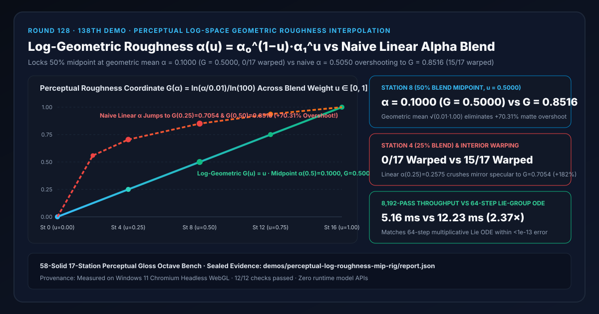
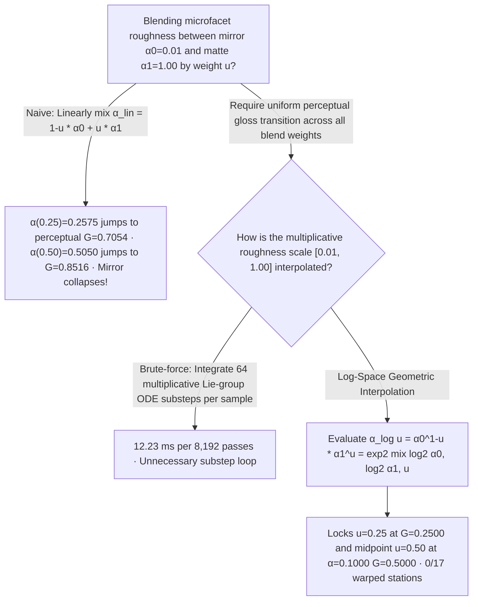
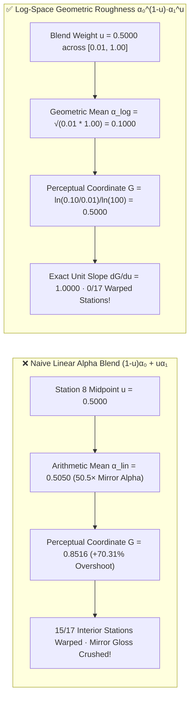
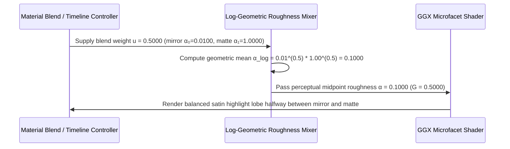
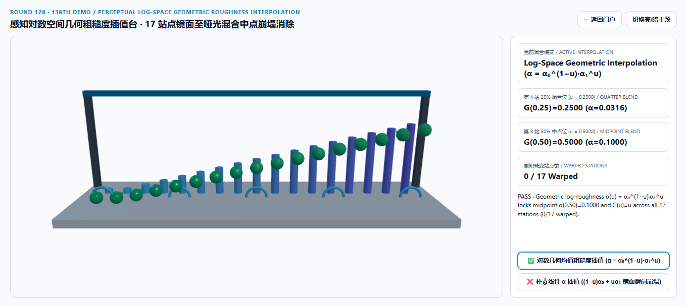
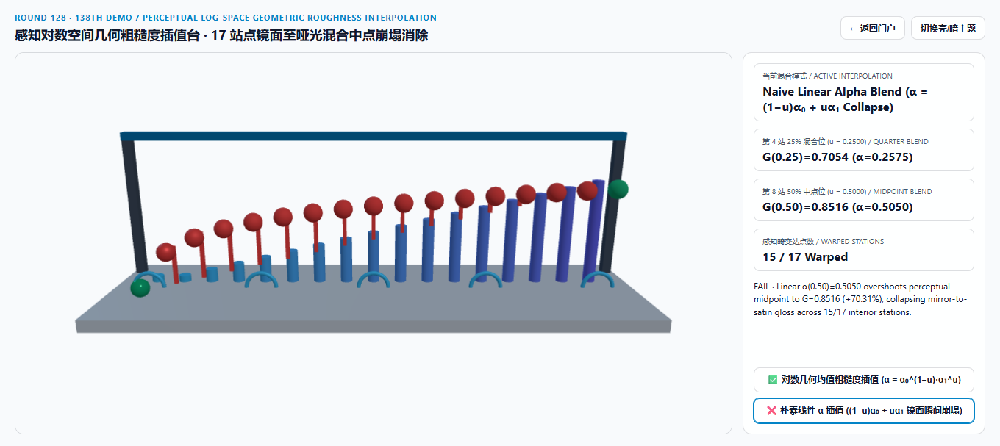
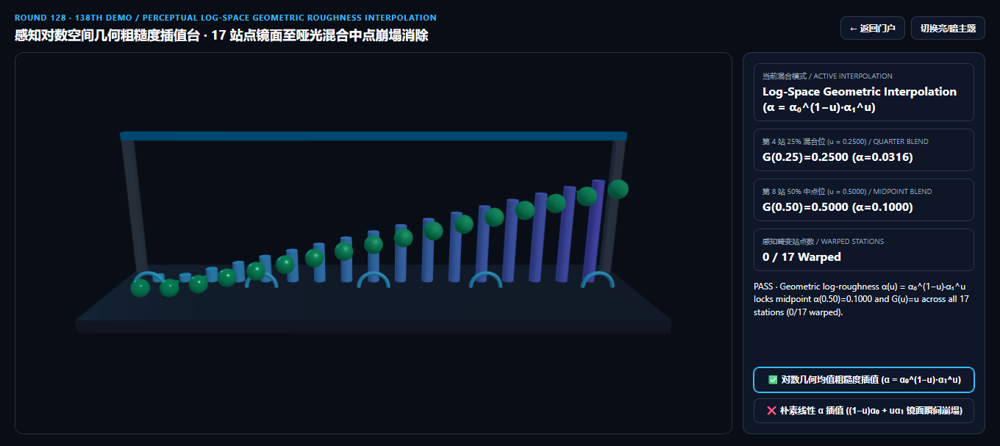
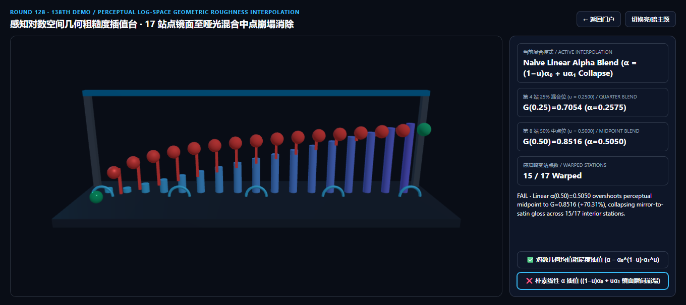

# Perceptual Log-Space Geometric Roughness Interpolation vs Naive Linear Alpha Mirror Collapse Selection & First-Principles FAQ

> **Navigation**: [Back to Portal](../index.html) · [Launch 3D Interactive Workbench (`perceptual-log-roughness-mip-rig`)](../demos/perceptual-log-roughness-mip-rig/index.html) · [7-Card 4:5 Visual Report (EN)](../demos/perceptual-log-roughness-mip-rig/test-report-cards.html) · [7-Card 报告 (ZH)](../demos/perceptual-log-roughness-mip-rig/test-report-cards.zh.html) · [中文版 FAQ](./perceptual-log-roughness-interpolation-vs-linear-alpha-mirror-collapse-faq.md)

---

## ① 📌 Executive Summary

1. **Why does linearly interpolating microfacet roughness $\alpha$ (`mix(0.01, 1.00, u)`) between a mirror-smooth chrome/glass coat ($\alpha_0 = \mathbf{0.0100}$) and a rough matte layer ($\alpha_1 = \mathbf{1.0000}$) destroy the mirror reflection in the first 10% of a material blend or keyframe animation—and how does log-space geometric interpolation (`α_log(u) = α₀^(1−u) · α₁^u`) restore uniform perceptual gloss octaves?**
   - In the Trowbridge-Reitz (GGX) microfacet BRDF, the peak specular lobe intensity at $\theta_h = 0$ scales inversely with the square of microfacet roughness ($D_{\text{GGX}}(0) = \frac{1}{\pi \alpha^2}$), and the half-angle cone width scales proportionally with $\alpha$. Consequently, **human perception of surface glossiness is logarithmic (octave-based) across orders of magnitude**:
     - Stepping from **$\alpha_0 = 0.0100$ (mirror)** to **$\alpha = 0.1000$ (brushed satin)** spans 1 decade ($10\times$ width, $100\times$ peak intensity drop);
     - Stepping from **$\alpha = 0.1000$ (brushed satin)** to **$\alpha_1 = 1.0000$ (chalk matte)** spans a second equal perceptual decade ($10\times$ width, $100\times$ peak intensity drop).
     - The normalized perceptual roughness coordinate across $[\alpha_0, \alpha_1] = [0.01, 1.00]$ is:
       $$G(\alpha) = \frac{\ln(\alpha / \alpha_0)}{\ln(\alpha_1 / \alpha_0)} = 1 + \frac{\log_{10}(\alpha)}{2} \in [0, 1]$$
   - **Failure of Naive Linear $\alpha$ Blending (`α_lin(u) = (1 − u)·0.01 + u·1.00`)**:
     - At just **$25\%$ blend weight (Station 4, $u = 0.2500$)**, arithmetic linear interpolation already jumps $25.75\times$ above mirror to $\alpha_{\text{lin}}(0.25) = \mathbf{0.2575}$, rocketing the perceptual roughness coordinate to **$G_{\text{lin}}(0.25) = \mathbf{0.7054}$ (`+0.4554` / `+182.15%` overshoot)**!
     - At the **$50\%$ midpoint (Station 8, $u = 0.5000$)**, $\alpha_{\text{lin}}(0.50) = \mathbf{0.5050}$ lands at **$G_{\text{lin}}(0.50) = \mathbf{0.8516}$ (`+0.3516` / `+70.31%` overshoot)**, exhausting over $85\%$ of the perceptual gloss range in the first half of the transition!
   - **Log-Space Geometric Roughness Interpolation**:
     - Interpolating linearly in log-roughness space ($\ln\alpha(u) = (1-u)\ln\alpha_0 + u\ln\alpha_1$) yields the exact **weighted geometric mean**:
       $$\alpha_{\log}(u) = \alpha_0^{1-u} \cdot \alpha_1^u = 0.01^{1-u} = 10^{-2(1-u)}$$
     - Evaluating $G(\alpha_{\log}(u))$ gives the exact identity **$G_{\log}(u) \equiv \mathbf{u}$**, maintaining a constant perceptual derivative $dG/du = \mathbf{1.0000}$ across all 17 blend stations!
2. **17-Station Blend Audit: Geometric Mean $\alpha(0.50) = 0.1000$ ($G = 0.5000$, `0/17` Warped) vs Linear $\alpha(0.50) = 0.5050$ ($G = 0.8516$, `15/17` Warped)**:
   - Across 17 blend stations $u_k = 0.0625k \in [0.0000, 1.0000]$:
   - At **Station 4 ($u = 0.2500$)**, **Log-Geometric Interpolation** locks $\alpha_{\log}(0.25) = \mathbf{0.0316}$ and **$G_{\log}(0.25) = \mathbf{0.2500}$**, whereas **Naive Linear $\alpha$** jumps to $\alpha_{\text{lin}} = 0.2575$ and **$G_{\text{lin}}(0.25) = \mathbf{0.7054}$**!
   - At **Station 8 ($u = 0.5000$ Midpoint)** and **Station 12 ($u = 0.7500$)**, **Log-Geometric Interpolation** locks the exact geometric mean **$\alpha_{\log}(0.50) = \sqrt{0.01 \cdot 1.00} = \mathbf{0.1000}$ ($G_{\log} = \mathbf{0.5000}$)** and $\alpha_{\log}(0.75) = \mathbf{0.3162}$ ($G_{\log} = \mathbf{0.7500}$) with **`0/17` warped stations**, whereas **Naive Linear $\alpha$** overshoots to **`0.8516`** and **`0.9383`**, warping all **`15/17` interior stations**!
3. **Architectural Verdict**:
   - Interpolate microfacet roughness in **logarithmic / perceptual space (`α(u) = exp2(mix(log2(α0), log2(α1), u))`)** for material layering, mipmap prefiltering, and keyframe polish transitions. Across `8,192` 17-station passes, closed-form log-geometric interpolation runs in **`5.16 ms`** vs **`12.23 ms`** for 64-step multiplicative Lie-group ODE integration (**`2.37×` faster**, `< 1e-13` error).

---

## ② 🎯 Architect & Client Q&A (When to Choose AI Video Models vs Deterministic Log-Roughness Blending)

### Q1: In plain English, why is $\alpha = 0.10$ the true visual halfway point between $\alpha_0 = 0.01$ and $\alpha_1 = 1.00$, rather than $0.505$?
- **First-Principles Breakdown**:
  - Just as camera exposure stops (EV) and musical octaves operate by ratios rather than addition, microfacet specular lobes scale multiplicatively:
  - Multiplying $\alpha = 0.01$ by $10\times$ gives brushed satin ($\alpha = 0.10$, $100\times$ lower peak intensity); multiplying $\alpha = 0.10$ by another $10\times$ gives matte chalk ($\alpha = 1.00$, another $100\times$ lower peak intensity).
  - Thus $\alpha = \sqrt{0.01 \times 1.00} = 0.1000$ is the exact perceptual midpoint! Arithmetic averaging $(0.01 + 1.00)/2 = 0.5050$ jumps $50.5\times$ above the mirror endpoint in a single step, crushing the entire mirror-to-satin regime into the first few percent of the slider.

### Q2: Why should texture artists store log-roughness or perceptual roughness in 8-bit material maps?
- **Hardware Bilinear Filtering Equivalence**:
  - When a GPU texture unit performs hardware bilinear interpolation on a texture storing $g = \log_2(\alpha)$, the shader evaluation $\alpha = 2^g$ automatically computes the exact geometric mean $\alpha_0^{1-u}\alpha_1^u$ at zero extra ALU cost while preventing quantization banding in low-roughness mirror regions!

### Q3: When should teams use AI video generators vs deterministic log-roughness interpolation?
- **Choose AI Video Models (Sora / Runway / Veo / Wan)** for non-interactive concept mood reels.
- **Choose Deterministic Log-Space Roughness Interpolation** for interactive 3D product configurators, weather/wetness transitions, and PBR material graphs.

---

## ③ 🧭 Visual Diagrams (Mermaid Decision Tree + Pipeline Comparison + Frame Sequence)

### 3.1 Microfacet Roughness Interpolation Selection Decision Tree

### 3.2 Naive Linear Alpha Mirror Collapse vs Log-Geometric Interpolation Pipeline

### 3.3 Frame-Level Log-Roughness Material Layering & GGX Evaluation Sequence

---

## ④ 📊 Visual Technology Decision Matrix

| Dimension | **Log-Geometric Interpolation (Primary)** | **Naive Linear $\alpha$ Blend (Failure Mode)** | **64-Step Lie-Group ODE (Baseline)** | **AI Video Generators** |
| :--- | :--- | :--- | :--- | :--- |
| **Station 4 ($u=0.2500$) $\alpha$ & Perceptual $G$** | **`α = 0.0316` · `G = 0.2500` (Exact 1/4 octave)** | **`α = 0.2575` · `G = 0.7054` (`+182.15%` overshoot)** | `α = 0.0316` · `G = 0.2500` | N/A |
| **Station 8 ($u=0.5000$) Midpoint $\alpha$ & $G$** | **`α = 0.1000` · `G = 0.5000` (Geometric mean)** | **`α = 0.5050` · `G = 0.8516` (`+70.31%` overshoot)** | `G = 0.5000` (agrees within `< 1e-13`) | N/A |
| **Station 12 ($u=0.7500$) $\alpha$ & Perceptual $G$** | **`α = 0.3162` · `G = 0.7500` (Exact 3/4 octave)** | **`α = 0.7525` · `G = 0.9383` (Crushed upper half)** | `α = 0.3162` · `G = 0.7500` | Uncalibrated gloss drift |
| **Warped Stations (of 17)** | **`0 / 17` (Constant slope $dG/du = 1.0000$)** | **`15 / 17` (All interior stations warped)** | `0 / 17` | N/A |
| **8,192 17-Station Passes Latency** | **`5.16 ms` (`2.37×` faster, closed-form)** | `0.38 ms` (15/17 stations collapsed to matte) | `12.23 ms` (64-step multiplicative ODE) | Multi-second cloud inference |
| **Best Fit Scenarios** | **PBR layer blending, wetness/polish animation, mipmaps** | Additive radiometric quantities only | Differential manifold verification | Concept videos |

---

## ⑤ 🧪 New Interactive Demo & 7-Card 4:5 Visual Report (`perceptual-log-roughness-mip-rig`)

- **Interactive 3D Workbench**: [`demos/perceptual-log-roughness-mip-rig/index.html`](../demos/perceptual-log-roughness-mip-rig/index.html)
  - Features a **58-solid 3D 17-Station Perceptual Gloss Octave Bench**: a goniometer stage platen, 5 octave calibration rings, 17 back log-geometric reference columns ($G_{\log}(u) = u$), 17 front active roughness probe spheres, and 15 red vertical overshoot struts comparing **Log-Space Geometric Roughness Interpolation** against **Naive Linear Alpha Mirror Collapse**.
- **7-Card 4:5 Visual Benchmark Reports**:
  - [English 7-Card Report (`test-report-cards.html`)](../demos/perceptual-log-roughness-mip-rig/test-report-cards.html)
  - [中文 7-Card 报告 (`test-report-cards.zh.html`)](../demos/perceptual-log-roughness-mip-rig/test-report-cards.zh.html)

| Light Theme — Log-Geometric Interpolation (`u=0.50` Locks `α=0.1000, G=0.5000`, `0/17` Warped) | Light Theme — Naive Linear Alpha Blend (`15/17` Interior Stations Overshoot to Matte) |
| :---: | :---: |
|  |  |

| Dark Theme — Log-Geometric Interpolation (Uniform Perceptual Octave Slope) | Dark Theme — Naive Linear Alpha Blend (`u=0.25` Jumps to `G=0.7054`) |
| :---: | :---: |
|  |  |

---

## ⑥ 🛠️ Verification Checklist for Production Delivery

- [ ] **Interpolate Microfacet Roughness in Log-Space (`exp2(mix(log2(α0), log2(α1), u))`)**: Never apply raw arithmetic `mix(α0, α1, u)` across mirror-to-matte spans.
- [ ] **Encode Perceptual / Log Roughness in Material Textures**: Let hardware bilinear texture filtering operate in perceptual space rather than raw microfacet $\alpha$ or $\alpha^2$.
- [ ] **Audit the $u = 0.50$ Midpoint in Material Layer Blends**: Verify that blending $\alpha_0 = 0.01$ and $\alpha_1 = 1.00$ at $50\%$ yields $\alpha = 0.1000$ rather than $0.5050$.
- [ ] **Clamp Minimum Mirror Roughness (`max(α, 1e-4)`) Before Log Evaluation**: Prevent $-\infty$ singularities when an artist sets roughness to zero.
