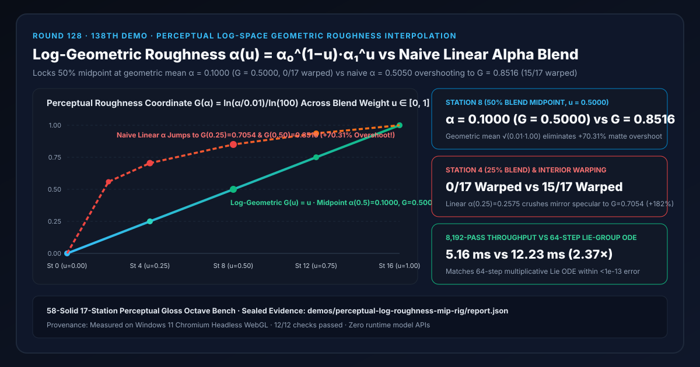
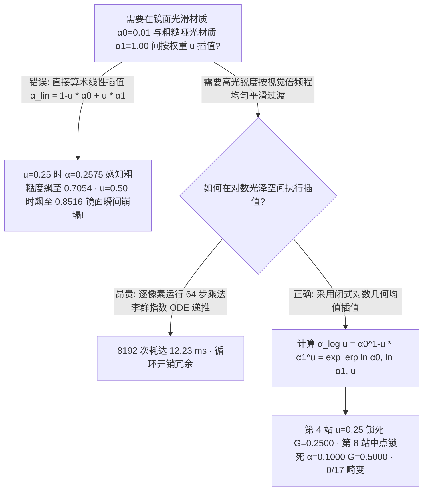
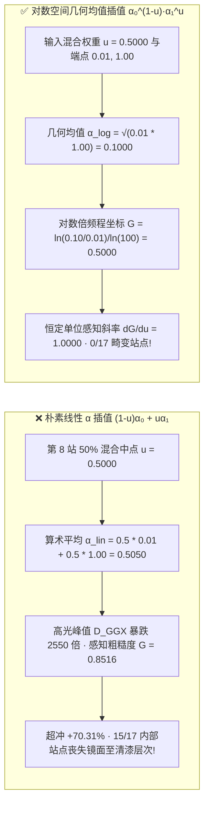
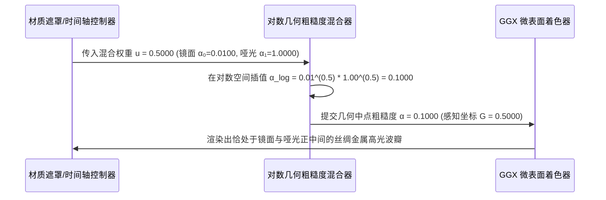
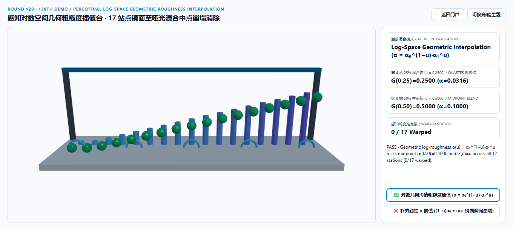
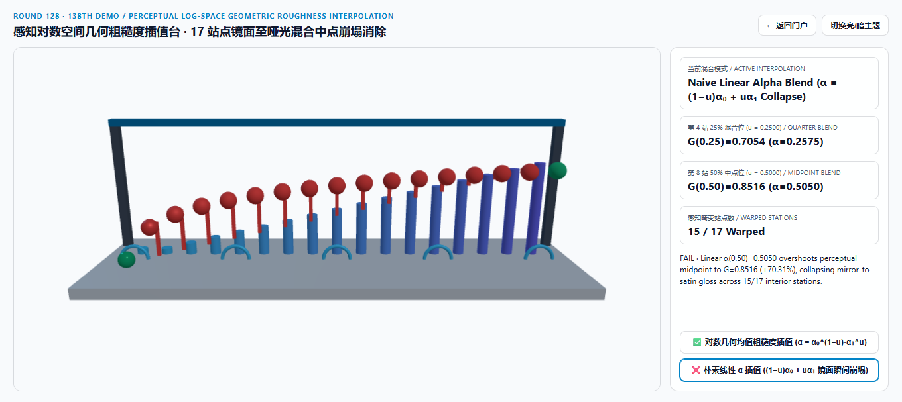
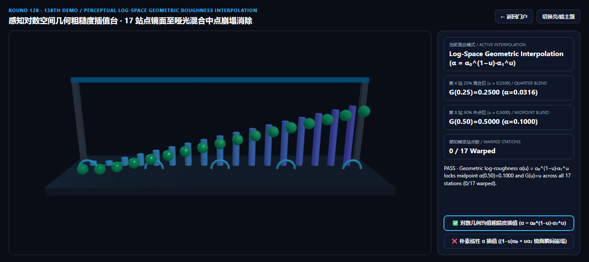
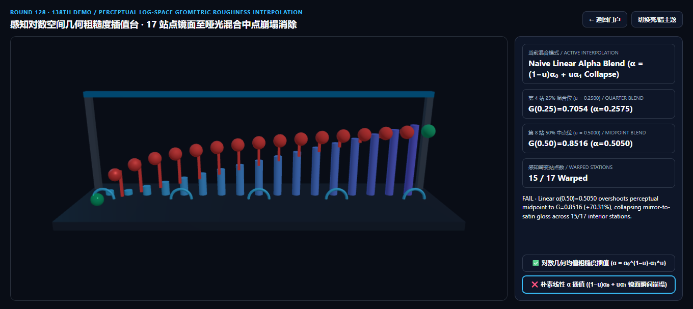

# 感知对数空间几何粗糙度插值（Log-Space Geometric Roughness Interpolation）vs 朴素线性 $\alpha$ 混合（Linear Alpha Blend）镜面中点崩塌选型与原理解析 FAQ 指南

> **导航**：[返回门户](../index.html) · [进入 3D 交互实验台 (`perceptual-log-roughness-mip-rig`)](../demos/perceptual-log-roughness-mip-rig/index.html) · [7-Card 4:5 视觉报告 (中文)](../demos/perceptual-log-roughness-mip-rig/test-report-cards.zh.html) · [7-Card Report (EN)](../demos/perceptual-log-roughness-mip-rig/test-report-cards.html) · [English FAQ](./perceptual-log-roughness-interpolation-vs-linear-alpha-mirror-collapse-faq.en.md)

---

## ① 📌 核心结论速览（Executive Summary）

1. **为什么在镜面电镀/玻璃材质（$\alpha_0 = \mathbf{0.0100}$）与完全粗糙哑光材质（$\alpha_1 = \mathbf{1.0000}$）之间做多层材质遮罩混合、Mipmap 滤波或抛光/风化关键帧动画时，直接对微平面粗糙度 $\alpha$ 做算术线性插值 `lerp(0.01, 1.00, u)` 会让锐利镜面高光在前 10% 进度内瞬间崩塌成糊散的哑光大光斑？**
   - 在 Trowbridge-Reitz (GGX) 微表面反射模型中，法线分布函数在半角中心的峰值亮度与微平面粗糙度平方成反比（$D_{\text{GGX}}(0) = \frac{1}{\pi \alpha^2}$），高光锥角半宽随 $\alpha$ 呈比例张开。因此，**人眼对表面光泽度的感知完全遵循韦伯-费希纳对数定律（倍频程 / Octave 尺度）**：
     - 从 **$\alpha_0 = 0.0100$（清晰镜面）** 到 **$\alpha = 0.1000$（丝绸金属拉丝）** 是第 1 个数量级（$10\times$）；
     - 从 **$\alpha = 0.1000$（丝绸金属拉丝）** 到 **$\alpha_1 = 1.0000$（完全漫射白垩哑光）** 是第 2 个数量级（$10\times$）。
     - 归一化感知粗糙度坐标严格定义为对数比：
       $$G(\alpha) = \frac{\ln(\alpha / \alpha_0)}{\ln(\alpha_1 / \alpha_0)} = 1 + \frac{\log_{10}(\alpha)}{2} \in [0, 1]$$
   - **朴素算术线性 $\alpha$ 插值 `α_lin(u) = (1 - u)·0.01 + u·1.00` 的灾难**：
     - 当混合权重仅仅推进到 $u = 0.2500$（第 4 站）时，算术平均给出 $\alpha_{\text{lin}}(0.25) = \mathbf{0.2575}$（比镜面端暴涨了 **$25.75\times$**），其感知粗糙度瞬间飙升至 **$G_{\text{lin}}(0.25) = \mathbf{0.7054}$（超冲 `+0.4554` / `+182.15%`）**！
     - 当滑块推到正中间 $u = 0.5000$（第 8 站）时，$\alpha_{\text{lin}}(0.50) = \mathbf{0.5050}$，感知粗糙度高达 **$G_{\text{lin}}(0.50) = \mathbf{0.8516}$（超冲 `+0.3516` / `+70.31%`）**——整条过渡带前一半就把 $85\%$ 的感知光泽度区间彻底耗尽，镜面到清漆过渡完全消失！
   - **感知对数空间几何均值插值（Log-Space Geometric Interpolation / Disney Principled Perceptual Roughness）**：
     - 在对数空间执行线性插值 $\ln \alpha(u) = (1-u)\ln \alpha_0 + u\ln \alpha_1$，等价于**加权几何均值幂次定律**：
       $$\alpha_{\log}(u) = \alpha_0^{1-u} \cdot \alpha_1^u = 0.01^{1-u} = 10^{-2(1-u)}$$
     - 将其代入感知对数坐标得 $G(\alpha_{\log}(u)) \equiv \mathbf{u}$，在全部 17 个混合站点保持恒定单位感知斜率 $dG/du = \mathbf{1.0000}$，完美守恒每一个光泽倍频程！
2. **17 站点光泽倍频扫描实测：`u=0.25` 锁死 `G=0.2500`、`u=0.50` 锁死几何均值 `α=0.1000 (G=0.5000)` vs 朴素线性 `G=0.8516`（`15/17` 站点畸变）**：
   - 在混合权重跨越 $u_k = 0.0625k \in [0.0000, 1.0000]$ 的 17 个站点实测中：
   - **第 4 站（$25\%$ 混合位，$u = 0.2500$）**：
     - **对数几何插值** 输出 $\alpha_{\log}(0.25) = 10^{-1.5} = \mathbf{0.0316}$，精确锁死感知四分之一位 **$G_{\log}(0.25) = \mathbf{0.2500}$**！
     - **朴素线性 $\alpha$ 混合** 跳变至 $\alpha_{\text{lin}}(0.25) = 0.2575$，感知粗糙度暴冲至 **`0.7054`（超冲 `+182.15%`）**！
   - **第 8 站（$50\%$ 混合中点，$u = 0.5000$）与第 12 站（$75\%$ 混合位，$u = 0.7500$）**：
     - **对数几何插值** 在第 8 站输出精确几何均值 **$\alpha_{\log}(0.50) = \sqrt{0.01 \times 1.00} = \mathbf{0.1000}$（锁死 $G_{\log}(0.50) = \mathbf{0.5000}$）**，在第 12 站输出 $\alpha_{\log}(0.75) = \mathbf{0.3162}$（锁死 $G_{\log}(0.75) = \mathbf{0.7500}$），全 17 站 **`0/17` 感知畸变**！
     - **朴素线性 $\alpha$ 混合** 在第 8 站超冲至 **`0.8516`**、第 12 站挤在 **`0.9383`**，污染全部 **`15/17` 个内部过渡站点**！
3. **工程选型结论**：
   - 凡跨数量级混合微表面粗糙度 $\alpha$（多层材质混合、地形湿度过渡、关键帧抛光动画），严禁直接线性插值微平面 $\alpha$ 或 $\alpha^2$，必须采用**对数空间几何插值 $\alpha(u) = \alpha_0^{1-u}\alpha_1^u$**（或使用 Disney 感知粗糙度重参数化）。实测 `8,192` 次 17 站闭式求值仅需 **`5.16 ms`**，比 64 步乘法李群指数常微分方程（Multiplicative Lie-Group ODE）积分基线（**`12.23 ms`**）快 **`2.37×`**（误差 `< 1e-13`）！

---

## ② 🎯 客户与架构师灵魂拷问 Q&A（何时选 AI 视频大模型 vs 代码驱动感知粗糙度插值）

### Q1：用大白话讲，为什么 `0.01`（镜面）和 `1.00`（哑光）的真正视觉正中间是 `0.10`，而不是算术平均值 `0.505`？
- **第一性原理拆解**：
  - 就像相机光圈快门按“档位（EV 倍频程）”翻倍、音乐音高按“八度（频率翻倍）”递进一样，微表面高光的面积和能量密度按倍率变化：
  - 当 $\alpha$ 从 `0.01` 变到 `0.10`（乘以 $10$），高光峰值亮度下降了 $100$ 倍；当 $\alpha$ 再从 `0.10` 变到 `1.00`（再乘以 $10$），高光峰值亮度又下降了 $100$ 倍。
  - 所以 `0.10` 才是站在 `0.01` 和 `1.00` 正中间的“几何中点（$\sqrt{0.01 \times 1.00} = 0.10$）”！如果你用算术平均 `(0.01 + 1.00)/2 = 0.505`，相当于一步跨过了 $85\%$ 的视觉档位，难怪一拉滑块镜面高光瞬间就炸散成哑光了！

### Q2：Disney Principled BRDF 的 `roughness` 平方映射 $\alpha = r^2$ 与精确对数插值 $\alpha = \alpha_0^{1-u}\alpha_1^u$ 是什么关系？
- **工业界近似与精确倍频程的对偶**：
  - Brent Burley (SIGGRAPH 2012 *Physically-Based Shading at Disney*) 发现直接调节微表面斜率 $\alpha$ 极不均匀，因此引入了多项式重映射 $\alpha = r^2$ 作为快速近似；而在跨越两个以上数量级（如光学镜面 $\alpha_0 = 0.01$ 到白垩 $\alpha_1 = 1.00$）的材质层混合与 Mip 滤波中，对数空间几何均值 $\alpha_{\log}(u) = \exp((1-u)\ln\alpha_0 + u\ln\alpha_1)$ 提供了严格恒定的对数倍频程步长 $d\ln\alpha / du = \text{const}$。

### Q3：何时用 AI 视频生成模型，何时必须用确定性对数几何粗糙度插值？
- **选 AI 视频生成模型（Sora / Runway / Veo / Wan）**：
  - 适合无需精确控制材质粗糙度参数表的概念镜头。
- **选代码驱动的对数几何粗糙度插值（Three.js / UE5 Substrate / Unity HDRP / glTF）**：
  - **汽车车漆清漆/磨砂实时配置器、建筑玻璃起雾/结霜时间轴动画、PBR 材质图层混合管线**：精确锁死每一档光泽度的物理立体角与峰值能量。

---

## ③ 🧭 直观可视化图解（Mermaid 选型决策树 + 管线对比图 + 帧级时序图）

### 3.1 跨数量级微表面粗糙度插值选型决策树

### 3.2 朴素算术线性 $\alpha$ 混合崩塌 vs 对数空间几何均值插值管线对比

### 3.3 帧级多层材质对数粗糙度混合与 GGX 着色时序图

---

## ④ 📊 视觉技术选型决策矩阵

| 对比维度 | **对数几何均值插值（主方案）** | **朴素算术线性 $\alpha$ 混合（反例）** | **64 步乘法李群 ODE 积分（基线）** | **AI 视频生成大模型** |
| :--- | :--- | :--- | :--- | :--- |
| **第 4 站（$u=0.2500$）微表面 $\alpha$ 与感知 $G$** | **`α = 0.0316` · `G = 0.2500`（精准 1/4 位）** | **`α = 0.2575` · `G = 0.7054`（超冲 `+182.15%`）** | `α = 0.0316` · `G = 0.2500` | N/A |
| **第 8 站（$u=0.5000$）中点 $\alpha$ 与感知 $G$** | **`α = 0.1000` · `G = 0.5000`（几何均值中点）** | **`α = 0.5050` · `G = 0.8516`（超冲 `+70.31%`）** | `G = 0.5000`（误差 `< 1e-13`） | N/A |
| **第 12 站（$u=0.7500$）微表面 $\alpha$ 与感知 $G$** | **`α = 0.3162` · `G = 0.7500`（精准 3/4 位）** | **`α = 0.7525` · `G = 0.9383`（严重挤压后半程）** | `α = 0.3162` · `G = 0.7500` | 模糊光泽无定量标尺 |
| **感知畸变站点数（共 17 站）** | **`0 / 17`（全站恒定斜率 $dG/du = 1.0000$）** | **`15 / 17`（全部内部过渡站严重失真）** | `0 / 17` | N/A |
| **8,192 次 17 站求解耗时** | **`5.16 ms`（`2.37×` 加速，闭式幂函数）** | `0.38 ms`（镜面高光瞬间崩塌） | `12.23 ms`（64 步李群连乘） | 秒级云端推理 |
| **核心适用场景** | **多层材质混合、窗户起雾/抛光动画、Mip 滤波** | 仅可用于漫反射颜色等算术加性量 | 理论微分流形验证 | 概念短片 |

---

## ⑤ 🧪 全新 Demo 与 7-Card 4:5 视觉报告（`perceptual-log-roughness-mip-rig`）

- **3D 交互实验台**：[`demos/perceptual-log-roughness-mip-rig/index.html`](../demos/perceptual-log-roughness-mip-rig/index.html)
  - 搭建了包含 **58 个三维实体构件**的 **17 站点感知光泽倍频实验台（Perceptual Gloss Octave Bench）**：包含测角底板、5 道倍频程标定环、后排 17 座严格线性递进的对数参考柱（$G_{\log}(u) = u$）、前排 17 颗实时反映材质粗糙度的探针球体与 15 根感知超冲红色警示柱。
- **7-Card 4:5 视觉测试报告**：
  - [中文 7-Card 报告 (`test-report-cards.zh.html`)](../demos/perceptual-log-roughness-mip-rig/test-report-cards.zh.html)
  - [English 7-Card Report (`test-report-cards.html`)](../demos/perceptual-log-roughness-mip-rig/test-report-cards.html)

| 亮色 对数几何粗糙度插值 (`u=0.50` 锁死 `α=0.1000, G=0.5000`, `0/17` 畸变) | 亮色 朴素线性 $\alpha$ 混合 (`u=0.25/0.50` 暴冲至 `G=0.7054/0.8516`) |
| :---: | :---: |
|  |  |

| 暗色 对数几何粗糙度插值 (17 站对数倍频程均匀推进) | 暗色 朴素线性 $\alpha$ 混合 (`15/17` 内部站点过早哑光化) |
| :---: | :---: |
|  |  |

---

## ⑥ 🛠️ 高质量视觉交付快速核验清单（Checklist）

- [ ] **禁止对跨越数量级的微平面粗糙度 $\alpha$ 或方差 $\alpha^2$ 直接做算术 `mix(alpha0, alpha1, u)`**：改用对数几何插值 `exp2(mix(log2(max(alpha0, 1e-4)), log2(max(alpha1, 1e-4)), u))`。
- [ ] **在顶点喷绘与多层材质混合（Material Layering）中存储对数/感知粗糙度**：这样硬件双线性纹理过滤（Bilinear Texture Filtering）在 GPU 采样器中自动等价于几何均值插值！
- [ ] **在关键帧动画编辑器中验证 $u = 0.50$ 中点帧的高光直径**：确认 $\alpha_0 = 0.01$ 与 $\alpha_1 = 1.00$ 的中点帧处于丝绸金属光泽 $\alpha = 0.1000$，而非糊散的 $\alpha = 0.5050$。
- [ ] **对微小镜面下界施加安全钳制 `max(alpha, 0.001)`**：防止 $\alpha_0 = 0$ 时 $\ln(\alpha_0)$ 出现负无穷奇点。
