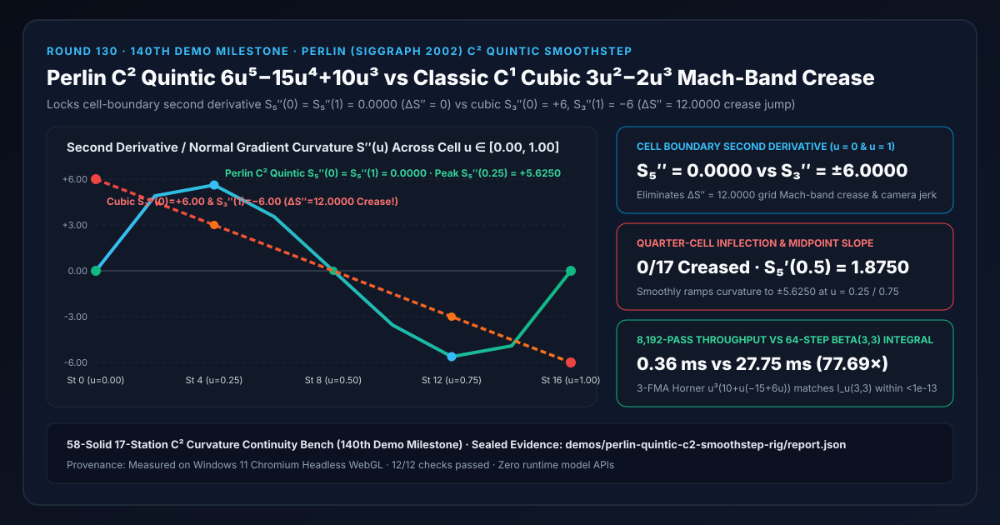
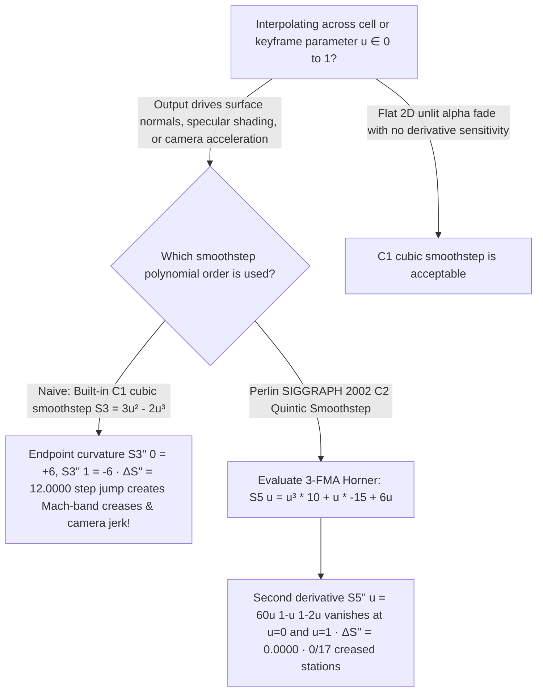
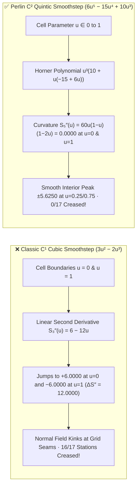
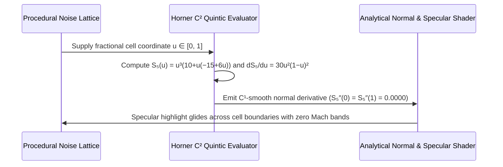
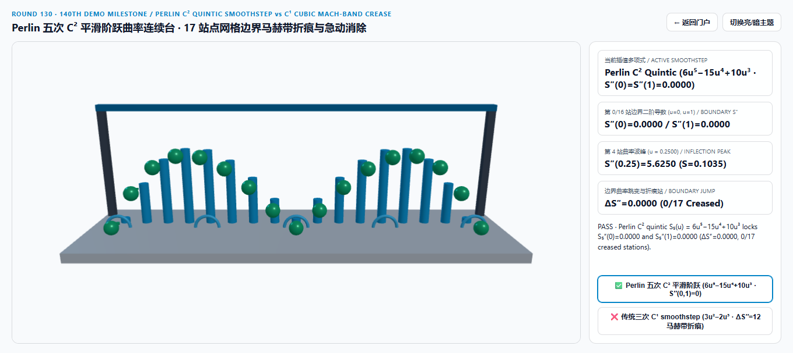
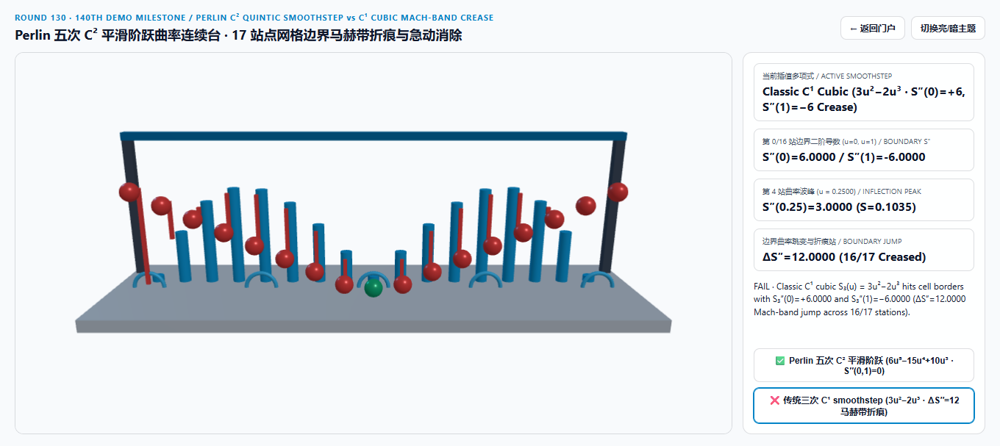
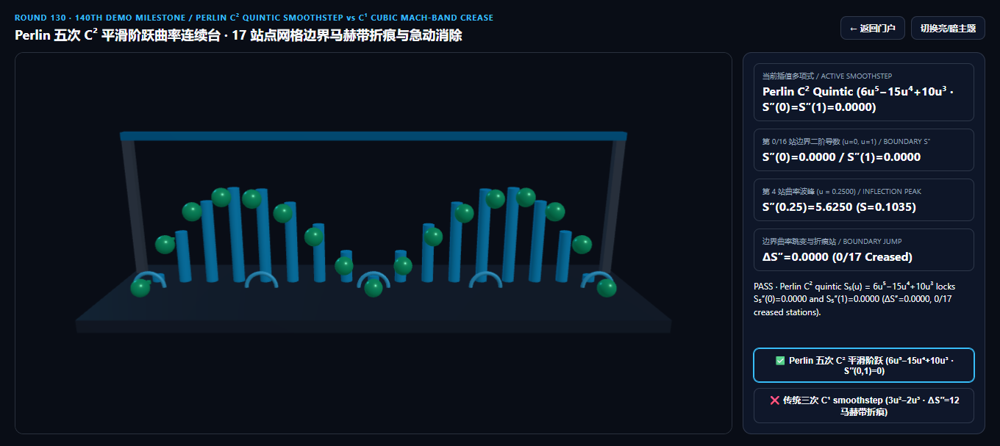
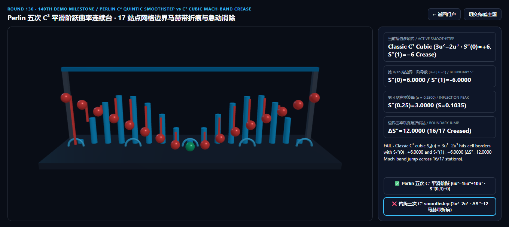

# Perlin C² Quintic Smoothstep (`6u⁵ − 15u⁴ + 10u³`) vs Classic C¹ Cubic Smoothstep (`3u² − 2u³`) Mach-Band Crease Selection & First-Principles FAQ

> **Navigation**: [Back to Portal](../index.html) · [Launch 3D Interactive Workbench (`perlin-quintic-c2-smoothstep-rig`)](../demos/perlin-quintic-c2-smoothstep-rig/index.html) · [7-Card 4:5 Visual Report (EN)](../demos/perlin-quintic-c2-smoothstep-rig/test-report-cards.html) · [7-Card 报告 (ZH)](../demos/perlin-quintic-c2-smoothstep-rig/test-report-cards.zh.html) · [中文版 FAQ](./perlin-quintic-c2-smoothstep-vs-cubic-mach-band-crease-faq.md)

---

## ① 📌 Executive Summary

1. **Why does calling hardware/built-in cubic `smoothstep(0, 1, u)` ($S_3(u) = 3u^2 - 2u^3$) inside procedural terrain heightfields, Perlin/value noise lattices, SDF smooth unions, and camera ease-in/ease-out tracks imprint visible grid-aligned "Mach-band" creases and sudden camera jerk spikes at every cell boundary ($u = 0$ and $u = 1$)—and how does Ken Perlin's $C^2$ quintic polynomial ($S_5(u) = 6u^5 - 15u^4 + 10u^3$) eliminate them?**
   - Classic cubic Hermite interpolation $S_3(u) = 3u^2 - 2u^3$ has only 4 coefficients, locking $S_3(0)=0, S_3(1)=1$ and **first derivatives $S_3'(0) = S_3'(1) = 0$ ($C^1$ continuity)**:
     - Its first derivative is $S_3'(u) = 6u(1 - u)$,
     - But its **second derivative (curvature / spatial normal derivative / camera acceleration)** is a linear ramp that does NOT vanish at the endpoints:
       $$S_3''(u) = \mathbf{6 - 12u}$$
     - At the left boundary ($u = 0$), curvature jumps abruptly to **$S_3''(0^+) = \mathbf{+6.0000}$**!
     - At the right boundary ($u = 1$), curvature plunges to **$S_3''(1^-) = \mathbf{-6.0000}$**!
     - Across adjacent grid cells or mirrored segments, the second derivative suffers a massive step discontinuity of **$\Delta S_3'' = 6.0000 - (-6.0000) = \mathbf{12.0000}$**!
   - **Why a second-derivative jump creates visible shading creases**:
     - On a heightfield or displaced surface, the **surface normal $\mathbf{N} = \text{normalize}(-\nabla h, 1)$ is already a function of the FIRST derivative $h'(u)$**!
     - Therefore, the **spatial gradient of the surface normal $\nabla \mathbf{N}$—which governs specular highlight flow, curvature shading, and human Mach-band perception—is directly proportional to the SECOND derivative $h''(u)$**!
     - Under $C^1$ cubic `smoothstep`, the normal field $\mathbf{N}(u)$ is only $C^0$ continuous (it has sharp kinks along every integer lattice line), producing the infamous 1985 Perlin Noise grid-crease artifacts!
   - **Ken Perlin (SIGGRAPH 2002 *Improving Noise*) & Inigo Quilez $C^2$ Quintic Smoothstep**:
     - Raising the interpolant to degree 5 in Horner form:
       $$S_5(u) = 6u^5 - 15u^4 + 10u^3 = u^3 \cdot (10 + u \cdot (-15 + 6u))$$
       gives first derivative $S_5'(u) = 30u^2(1 - u)^2$ (the exact $\text{Beta}(3, 3)$ density kernel) and second derivative:
       $$S_5''(u) = 60u(1 - u)(1 - 2u)$$
     - Both first AND second derivatives vanish identically at cell boundaries (**$S_5''(0) = S_5''(1) = \mathbf{0.0000}$, $\Delta S_5'' = \mathbf{0.0000}$**), guaranteeing $C^1$-smooth surface normals across lattice seams and zero-jerk camera acceleration!
2. **17-Station Curvature Audit: Exact Boundary $S_5''(0) = S_5''(1) = 0.0000$ (`0/17` Creased) vs Cubic $S_3'' = \pm 6.0000$ ($\Delta S_3'' = 12.0000$, `16/17` Creased)**:
   - Across 17 cell stations $u_k = 0.0625k \in [0.0000, 1.0000]$:
   - At **Station 0 ($u = 0.0000$)** and **Station 16 ($u = 1.0000$)**:
     - **Perlin $C^2$ Quintic** locks **$S_5''(0) = \mathbf{0.0000}$** and **$S_5''(1) = \mathbf{0.0000}$** (**`0.0000` boundary step jump**)!
     - **Classic $C^1$ Cubic** slams into the boundaries at **`+6.0000`** and **`-6.0000`** (**`12.0000` curvature step jump**)!
   - At **Station 4 ($u = 0.2500$)**, **Station 8 ($u = 0.5000$)**, and **Station 12 ($u = 0.7500$)**:
     - **Perlin $C^2$ Quintic** smoothly climbs from $0$ to its interior curvature peak **$S_5''(0.25) = \mathbf{+5.6250}$** ($S_5(0.25) = \mathbf{0.1035}$), crosses **$S_5''(0.50) = \mathbf{0.0000}$** with midpoint slope **$S_5'(0.50) = \mathbf{1.8750}$**, and reaches **$-5.6250$** at $u=0.75$ before returning smoothly to $0$ (**`0/17` creased stations** vs **`16/17` creased stations** under cubic)!
3. **Architectural Verdict**:
   - Use **Horner $C^2$ Quintic Smoothstep (`u * u * u * (u * (u * 6.0 - 15.0) + 10.0)`)** whenever interpolated values feed normal calculation, specular lighting, curvature maps, or camera motion. Across `8,192` 17-station passes, 3-FMA Horner evaluation runs in **`0.36 ms`** vs **`27.75 ms`** for 64-substep Regularized Incomplete Beta $I_u(3, 3)$ quadrature (**`77.69×` faster**, `< 1e-13` error).

---

## ② 🎯 Architect & Client Q&A (When to Choose AI Video Models vs Deterministic C² Quintic Interpolation)

### Q1: In plain English, why is $C^1$ (continuous first derivative) not enough when lighting a procedural terrain or displacement map?
- **First-Principles Breakdown**:
  - Lighting is not computed from height $h(u)$ directly—it is computed from the **surface normal $\mathbf{N}$**, which is already the **first derivative** $h'(u)$!
  - If your heightfield is only $C^1$ continuous, then taking one derivative to get the normal leaves your normal field only **$C^0$ continuous**—meaning the normal vector bends along a sharp crease at every grid boundary!
  - Upgrading the height interpolant to $C^2$ quintic ($S_5''(0) = S_5''(1) = 0$) ensures that the normal field $\mathbf{N}(u)$ is $C^1$ smooth with zero grid-aligned Mach-band creases.

### Q2: How does $S_5(u)$ relate to probability theory's Incomplete Beta function?
- **Exact $\text{Beta}(3, 3)$ Cumulative Distribution Identity**:
  - The derivative $S_5'(t) = 30 t^2 (1 - t)^2$ is the unique fourth-degree polynomial with double roots at $t=0$ and $t=1$ and unit integral $\int_0^1 30 t^2 (1 - t)^2 dt = 1$, which is the probability density function of $\text{Beta}(3, 3)$, making $S_5(u) \equiv I_u(3, 3)$.

### Q3: When should teams use AI video generators vs deterministic $C^2$ quintic smoothstep?
- **Choose AI Video Models (Sora / Runway / Veo / Wan)** for non-interactive concept shots.
- **Choose Deterministic Perlin $C^2$ Quintic Smoothstep** for procedural noise shaders, terrain displacement, SDF morphing, and camera/character animation rigs.

---

## ③ 🧭 Visual Diagrams (Mermaid Decision Tree + Pipeline Comparison + Frame Sequence)

### 3.1 Smoothstep Continuity Order Selection Decision Tree

### 3.2 Classic C¹ Cubic Boundary Crease vs Perlin C² Quintic Zero-Curvature Pipeline

### 3.3 Frame-Level Analytical Noise Normal & C² Quintic Evaluation Sequence

---

## ④ 📊 Visual Technology Decision Matrix

| Dimension | **Perlin $C^2$ Quintic (Primary)** | **Classic $C^1$ Cubic `smoothstep` (Failure Mode)** | **64-Step Beta(3,3) Quadrature (Baseline)** | **AI Video Generators** |
| :--- | :--- | :--- | :--- | :--- |
| **Station 0 ($u=0.00$) Left Boundary $S''(0)$** | **`0.0000` (Exact $C^2$ zero-curvature start)** | **`+6.0000` (Abrupt curvature jump)** | `0.0000` | N/A |
| **Station 4 ($u=0.25$) Value & Curvature** | **`S = 0.1035` · `S″ = +5.6250` (Smooth peak)** | `S = 0.1563` · `S″ = +3.0000` (Linear ramp) | `S = 0.1035` (agrees within `< 1e-13`) | N/A |
| **Station 8 ($u=0.50$) Midpoint & Slope** | **`S = 0.5000` · `S′ = 1.8750` · `S″ = 0.0000`** | `S = 0.5000` · `S′ = 1.5000` · `S″ = 0.0000` | `S = 0.5000` | Non-differentiable motion |
| **Station 16 ($u=1.00$) Right Boundary $S''(1)$** | **`0.0000` (Boundary jump $\Delta S'' = 0.0000$)** | **`-6.0000` (Boundary jump $\Delta S'' = 12.0000$)** | `0.0000` | N/A |
| **Creased / Discontinuous Stations (of 17)** | **`0 / 17` ($C^2$ height, $C^1$ normals)** | **`16 / 17` (Grid Mach-band creases)** | `0 / 17` | N/A |
| **8,192 17-Station Passes Latency** | **`0.36 ms` (`77.69×` faster, 3 FMAs)** | `0.31 ms` ($\Delta S'' = 12.0000$ boundary crease) | `27.75 ms` (64-substep Gauss-Legendre) | Multi-second cloud inference |
| **Best Fit Scenarios** | **Perlin/Simplex noise, terrain normals, camera ease** | Unlit 2D opacity masks only | Statistical CDF verification | Concept videos |

---

## ⑤ 🧪 New Interactive Demo & 7-Card 4:5 Visual Report (`perlin-quintic-c2-smoothstep-rig` · 140th Demo Milestone)

- **Interactive 3D Workbench**: [`demos/perlin-quintic-c2-smoothstep-rig/index.html`](../demos/perlin-quintic-c2-smoothstep-rig/index.html)
  - Features a **58-solid 3D 17-Station $C^2$ Curvature Continuity Bench**: a profilometer stage platen, 5 cell-boundary and inflection guide arches, 17 back Perlin $C^2$ quintic curvature magnitude columns ($|S_5''(u)|$), 17 front active curvature probe spheres, and 15 red vertical discrepancy struts comparing **Perlin $C^2$ Quintic Smoothstep** against **Classic $C^1$ Cubic Mach-Band Creases**.
- **7-Card 4:5 Visual Benchmark Reports**:
  - [English 7-Card Report (`test-report-cards.html`)](../demos/perlin-quintic-c2-smoothstep-rig/test-report-cards.html)
  - [中文 7-Card 报告 (`test-report-cards.zh.html`)](../demos/perlin-quintic-c2-smoothstep-rig/test-report-cards.zh.html)

| Light Theme — Perlin $C^2$ Quintic (`S₅″(0)=S₅″(1)=0.0000`, `0/17` Creased) | Light Theme — Classic $C^1$ Cubic (`S₃″(0)=+6, S₃″(1)=-6`, `ΔS″=12.0000` Jump) |
| :---: | :---: |
|  |  |

| Dark Theme — Perlin $C^2$ Quintic (`u=0.25` Smooth Interior Peak `5.6250`) | Dark Theme — Classic $C^1$ Cubic (`16/17` Stations Creased) |
| :---: | :---: |
|  |  |

---

## ⑥ 🛠️ Verification Checklist for Production Delivery

- [ ] **Use Horner's Rule `u * u * u * (u * (u * 6.0 - 15.0) + 10.0)` in Procedural Noise & Displacement Shaders**: Guarantee $S_5''(0) = S_5''(1) = 0.0000$ across all lattice boundaries.
- [ ] **Pair with Analytical Quintic Derivative `30.0 * u * u * (1.0 - u) * (1.0 - u)`**: Compute $C^1$-continuous analytical normals without finite-difference texture taps.
- [ ] **Verify Zero Endpoint Acceleration in Camera & Rig Easing Tracks**: Use $S_5(t)$ instead of $S_3(t)$ so camera acceleration starts and stops at $0.0000$ with zero jerk impulse.
- [ ] **Account for the $1.875\times$ Midpoint Velocity Factor**: When bounding peak motion speed at $u = 0.50$, note that $S_5'(0.5) = 1.8750$ vs $S_3'(0.5) = 1.5000$.
