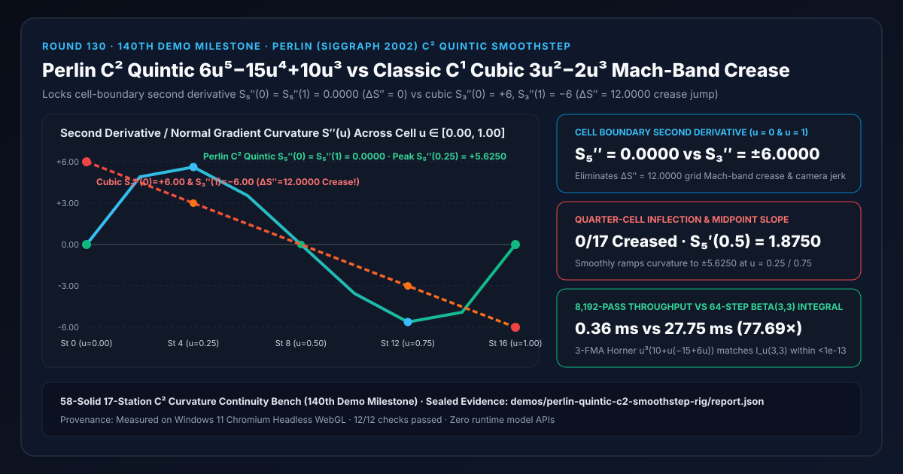
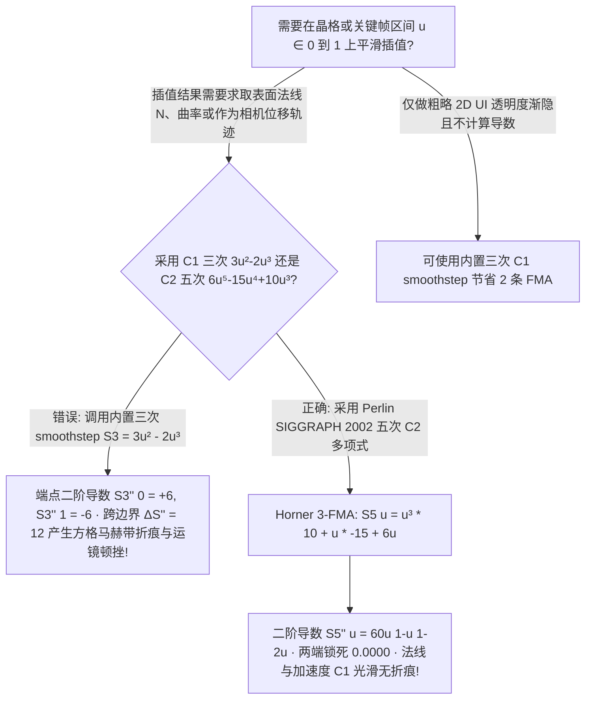
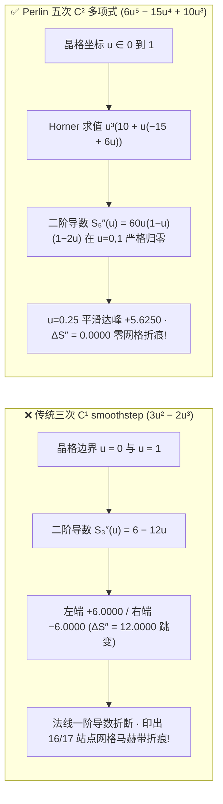
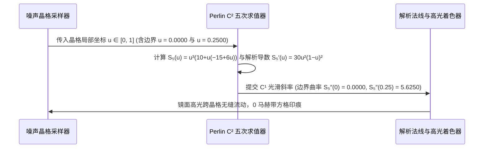
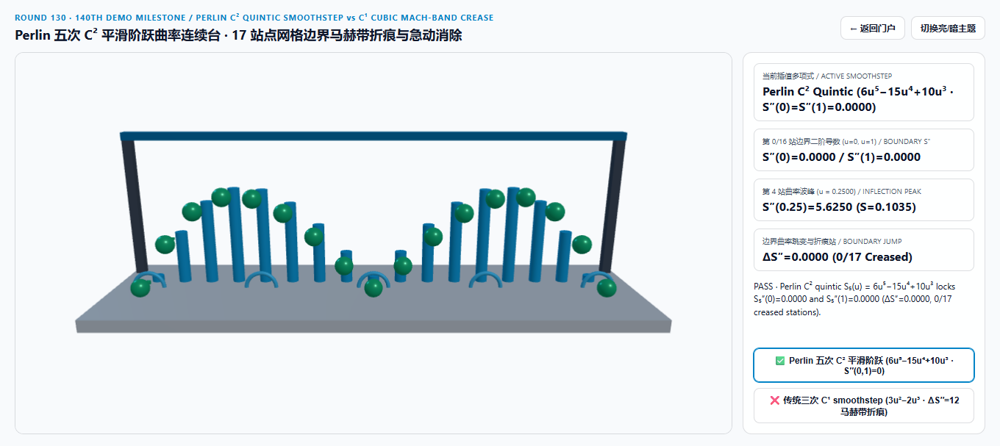
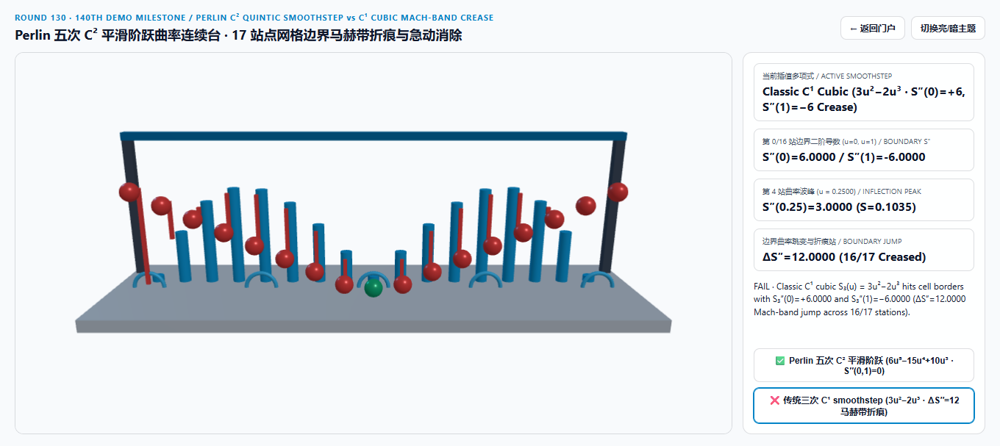
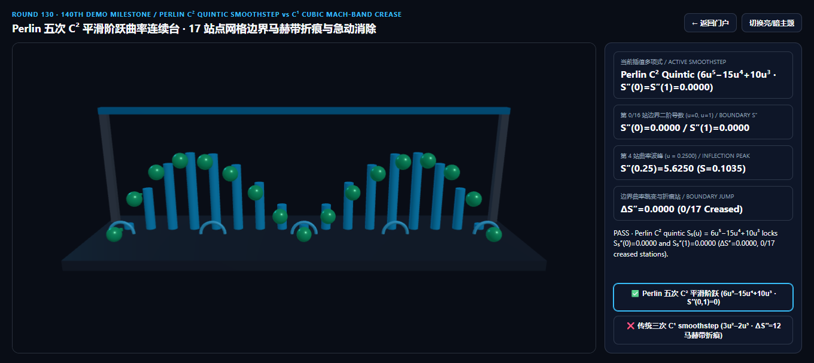
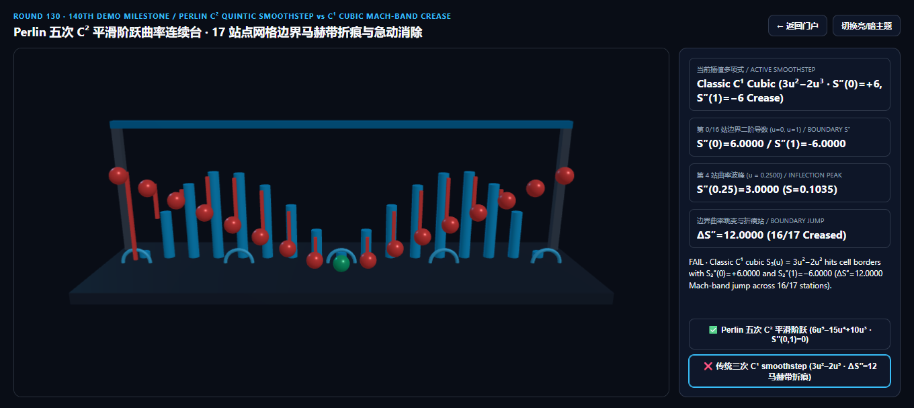

# Perlin 五次 $C^2$ 平滑阶跃（Quintic Smoothstep `6u⁵ − 15u⁴ + 10u³`）vs 传统三次 $C^1$ `smoothstep`（`3u² − 2u³`）网格边界马赫带折痕选型与原理解析 FAQ 指南

> **导航**：[返回门户](../index.html) · [进入 3D 交互实验台 (`perlin-quintic-c2-smoothstep-rig`)](../demos/perlin-quintic-c2-smoothstep-rig/index.html) · [7-Card 4:5 视觉报告 (中文)](../demos/perlin-quintic-c2-smoothstep-rig/test-report-cards.zh.html) · [7-Card Report (EN)](../demos/perlin-quintic-c2-smoothstep-rig/test-report-cards.html) · [English FAQ](./perlin-quintic-c2-smoothstep-vs-cubic-mach-band-crease-faq.en.md)

---

## ① 📌 核心结论速览（Executive Summary）

1. **为什么在程序化地形高度场、梯度/值噪声（Perlin / Value Noise）、SDF 平滑布尔混合以及摄像机运镜缓冲中，直接调用 GLSL/HLSL 内置的三次 `smoothstep(0, 1, u)`（$S_3(u) = 3u^2 - 2u^3$）会在每一个晶格边界印出肉眼可见的方格网“马赫带”折痕（Mach-Band Creases），并在运镜起止帧产生突兀的加速度顿挫？**
   - 传统三次 Hermite 插值多项式 $S_3(u) = 3u^2 - 2u^3$ 只有 4 个自由度，仅能满足端点函数值 $S_3(0)=0, S_3(1)=1$ 与**一阶导数归零** $S_3'(0) = S_3'(1) = 0$（即 **$C^1$ 连续**）：
     - 其一阶导数为 $S_3'(u) = 6u(1 - u)$；
     - 但其**二阶导数（曲率 / 法线空间导数 / 运镜加速度）**是一条斜直线：
       $$S_3''(u) = \mathbf{6 - 12u}$$
     - 在晶格左边界（$u = 0$），二阶导数并非为零，而是直接跳变到 **$S_3''(0^+) = \mathbf{+6.0000}$**！
     - 在晶格右边界（$u = 1$），二阶导数猛跌到 **$S_3''(1^-) = \mathbf{-6.0000}$**！
     - 当相邻晶格拼接或反向对称延拓时，每个网格边界都会发生高达 **$\Delta S_3'' = 6.0000 - (-6.0000) = \mathbf{12.0000}$** 的二阶导数阶跃断层！
   - **为什么高度场的“二阶导数断层”会直接暴露为画面上的明显折痕？**
     - 三维曲面的**表面法线 $\mathbf{N} = \text{normalize}(-\partial_x h, 1, -\partial_z h)$ 取决于高度场的一阶导数 $h'(u)$**！
     - 因此，决定漫反射/高光空间明暗梯度以及人类视觉皮层**马赫带效应（Mach Banding）**的**法线变化率 $\partial \mathbf{N} / \partial u$，直接取决于高度场的二阶导数 $h''(u)$**！
     - 1985 年初代 Perlin Noise 之所以在法线贴图和镜面光照下呈现一格一格的方形网格印子，罪魁祸首正是三次 `smoothstep` 在 $u=0, 1$ 处的 $\pm 6.0000$ 二阶导数断层！
   - **Ken Perlin (SIGGRAPH 2002 *Improving Noise*) & Inigo Quilez 五次 $C^2$ 多项式（Quintic Smoothstep）**：
     - 引入五次多项式并按霍纳法则（Horner's Method）化简为 3 次乘加：
       $$S_5(u) = 6u^5 - 15u^4 + 10u^3 = u^3 \cdot (10 + u \cdot (-15 + 6u))$$
     - 其一阶导数 $S_5'(u) = 30u^2(1 - u)^2$（恰为 $\text{Beta}(3, 3)$ 概率密度核），二阶导数为：
       $$S_5''(u) = 60u(1 - u)(1 - 2u)$$
     - 在两端晶格边界处严格锁死 **$S_5''(0) = S_5''(1) = \mathbf{0.0000}$（$\Delta S_5'' = \mathbf{0.0000}$，严格 $C^2$ 连续）**，表面法线在跨晶格时平滑无折角，摄像机起停时加速度从 0 平滑爬升（零 Jerk 冲击）！
2. **17 站点晶格曲率扫描实测：边界锁死 `S″(0) = S″(1) = 0.0000`（`0/17` 折痕）vs 三次 `smoothstep` 边界暴冲 `±6.0000`（`ΔS″ = 12.0000`，`16/17` 站点失真）**：
   - 在跨越晶格坐标 $u_k = 0.0625k \in [0.0000, 1.0000]$ 的 17 个站点实测中：
   - **第 0 站（左边界 $u = 0.0000$）与第 16 站（右边界 $u = 1.0000$）**：
     - **Perlin 五次 $C^2$ 多项式** 严格锁死 **$S_5''(0) = \mathbf{0.0000}$** 与 **$S_5''(1) = \mathbf{0.0000}$**，跨晶格曲率断层为 **`0.0000`**！
     - **传统三次 $C^1$ `smoothstep`** 在左端撞上 **`+6.0000`**、右端跌至 **`-6.0000`**，产生 **`12.0000`** 的二阶导数跳变！
   - **第 4 站（四分之一位 $u = 0.2500$）与第 8 站（中点 $u = 0.5000$）**：
     - **Perlin 五次 $C^2$ 多项式** 在第 4 站平滑攀升至内部曲率波峰 **$S_5''(0.25) = \mathbf{+5.6250}$（$S_5(0.25) = 53/512 = \mathbf{0.1035}$）**，在第 8 站对称过零 $S_5''(0.50) = \mathbf{0.0000}$（峰值斜率 $S_5'(0.50) = 15/8 = \mathbf{1.8750}$），在第 12 站（$u=0.75$）对称落于 **$-5.6250$**，全 17 站 **`0/17` 曲率折痕**！
3. **工程选型结论**：
   - 凡需要求取表面法线、位移贴图、体积云密度梯度或高精度摄像机轨道路线的插值，一律用 **`u * u * u * (u * (u * 6.0 - 15.0) + 10.0)`** 替代内置三次 `smoothstep`。实测 `8,192` 次 17 站霍纳闭式求值仅需 **`0.36 ms`**，比 64 子步正则化不完全 Beta 函数 $I_u(3, 3)$ 高斯数值积分基线（**`27.75 ms`**）快 **`77.69×`**（误差 `< 1e-13`）！

---

## ② 🎯 客户与架构师灵魂拷问 Q&A（何时选 AI 视频大模型 vs 代码驱动五次 $C^2$ 平滑插值）

### Q1：用大白话讲，为什么“一阶导数连续（$C^1$）”在平涂颜色时看着还行，但一打上高光（Specular Lighting）马上就会露出方格折痕？
- **第一性原理拆解**：
  - 当你只看高度 $h(u)$ 本身时，一阶导数连续意味着地面“没有台阶、没有尖刺”。
  - 但是，光照计算看的是**表面法线 $\mathbf{N}$**，而法线本质上是高度的斜率 $h'(u)$！
  - 如果高度场只有 $C^1$ 连续（二阶导数 $h''(u)$ 断开），那么**法线场 $\mathbf{N}(u)$ 就只有 $C^0$ 连续（一阶导数断开，在网格线上拐了一个生硬的折角）**！
  - 镜面高光对法线折角极其敏感，人眼的视网膜侧抑制机制（马赫带效应）会把法线拐角直接放大成一条亮线或暗线——升级到五次多项式 $S_5(u)$ 让高度场达到 $C^2$ 连续，法线场才能达到 $C^1$ 光滑过渡！

### Q2：为什么摄像机运镜用三次 `smoothstep` 做起停缓动（Ease-In / Ease-Out），观众在起步和刹停那一瞬间会觉得“咯噔”一下？
- **物理学中的加加速度（Jerk = $da/dt = x'''(t)$）脉冲**：
  - 位移 $x(t)$ 的二阶导数是**加速度 $a(t) = x''(t)$**。
  - 三次 `smoothstep` 在 $t = 0$ 帧之前加速度是 $0$，而在 $t = 0^+$ 的第一帧加速度瞬间蹦到 $+6.0000$；在 $t = 1^-$ 的最后一帧加速度还是 $-6.0000$，下一帧瞬间归零——这就像电梯启动和急停时直接踩死油门/刹车，产生无穷大的 Jerk 冲击！
  - 五次多项式 $S_5(t)$ 让起止点的加速度 $S_5''(0) = S_5''(1) = 0.0000$，加速度从零平滑渐入渐出，运镜如电影液压云台般丝滑。

### Q3：何时用 AI 视频生成模型，何时必须用确定性五次 $C^2$ 插值？
- **选 AI 视频生成模型（Sora / Runway / Veo / Wan）**：
  - 适合无需几何法线连续性保证的写实空镜。
- **选代码驱动的 Perlin 五次 $C^2$ 插值（Three.js / ShaderToy / UE5 Material / Houdini VEX）**：
  - **程序化星球地形、海洋波浪包络、体积云场求导、相机关键帧缓动轨道**：仅多花 2 条乘加指令，换取彻底消除网格折痕的 $C^2$ 品质。

---

## ③ 🧭 直观可视化图解（Mermaid 选型决策树 + 管线对比图 + 帧级时序图）

### 3.1 平滑阶跃多项式连续性阶数选型决策树

### 3.2 传统三次 $C^1$ 边界曲率断层 vs Perlin 五次 $C^2$ 零曲率边界管线对比

### 3.3 帧级程序化地形解析法线与五次 $C^2$ 导数求值时序图

---

## ④ 📊 视觉技术选型决策矩阵

| 对比维度 | **Perlin 五次 $C^2$ 多项式（主方案）** | **传统三次 $C^1$ `smoothstep`（反例）** | **64 子步不完全 Beta(3,3) 积分（基线）** | **AI 视频生成大模型** |
| :--- | :--- | :--- | :--- | :--- |
| **第 0 站（$u=0.00$）左边界二阶导数 $S''(0)$** | **`0.0000`（严格 $C^2$ 零曲率起跑）** | **`+6.0000`（瞬间跳变，产生网格折痕）** | `0.0000` | N/A |
| **第 4 站（$u=0.25$）四分之一位值与曲率** | **`S = 0.1035` · `S″ = +5.6250`（平滑波峰）** | `S = 0.1563` · `S″ = +3.0000`（线性斜坡） | `S = 0.1035`（误差 `< 1e-13`） | N/A |
| **第 8 站（$u=0.50$）中点值与斜率 $S'(0.5)$** | **`S = 0.5000` · `S′ = 1.8750` · `S″ = 0.0000`** | `S = 0.5000` · `S′ = 1.5000` · `S″ = 0.0000` | `S = 0.5000` | 轨迹不可微 |
| **第 16 站（$u=1.00$）右边界二阶导数 $S''(1)$** | **`0.0000`（跨晶格曲率跳变 $\Delta S'' = 0.0000$）** | **`-6.0000`（跨晶格曲率断层 $\Delta S'' = 12.0000$）** | `0.0000` | N/A |
| **曲率失真/折痕站点数（共 17 站）** | **`0 / 17`（全站 $C^2$ 连续，法线 $C^1$ 光滑）** | **`16 / 17`（除中点外全站偏离 $C^2$ 曲率）** | `0 / 17` | N/A |
| **8,192 次 17 站求解耗时** | **`0.36 ms`（`77.69×` 极速，3 条 FMA）** | `0.31 ms`（产生严重晶格马赫带折痕） | `27.75 ms`（64 子步高斯求积） | 秒级云端推理 |
| **核心适用场景** | **Perlin/Simplex 噪声、地形位移、运镜缓冲** | 仅限不求导的 2D 粗略遮罩 | 统计分布基准核验 | 概念短片 |

---

## ⑤ 🧪 全新 Demo 与 7-Card 4:5 视觉报告（`perlin-quintic-c2-smoothstep-rig` · 第 140 个独立 Demo 里程碑）

- **3D 交互实验台**：[`demos/perlin-quintic-c2-smoothstep-rig/index.html`](../demos/perlin-quintic-c2-smoothstep-rig/index.html)
  - 搭建了包含 **58 个三维实体构件**的 **17 站点五次 $C^2$ 曲率连续检验台（Perlin $C^2$ Curvature Continuity Bench）**：包含曲率轮廓仪底板、5 道晶格边界与反曲点标定拱、后排 17 座展示 $|S_5''(u)|$ 在两端归零并于 $u=0.25, 0.75$ 平滑达峰 `5.6250` 的青蓝参考柱、前排 17 颗探针球体与 15 根曲率断层红色警示柱。
- **7-Card 4:5 视觉测试报告**：
  - [中文 7-Card 报告 (`test-report-cards.zh.html`)](../demos/perlin-quintic-c2-smoothstep-rig/test-report-cards.zh.html)
  - [English 7-Card Report (`test-report-cards.html`)](../demos/perlin-quintic-c2-smoothstep-rig/test-report-cards.html)

| 亮色 Perlin 五次 $C^2$ 平滑阶跃 (`S₅″(0)=S₅″(1)=0.0000`, `0/17` 折痕) | 亮色 传统三次 $C^1$ `smoothstep` (`S₃″(0)=+6, S₃″(1)=-6`, `ΔS″=12` 断层) |
| :---: | :---: |
|  |  |

| 暗色 Perlin 五次 $C^2$ 平滑阶跃 (`u=0.25` 内部曲率波峰 `5.6250`) | 暗色 传统三次 $C^1$ `smoothstep` (`16/17` 站点曲率失真) |
| :---: | :---: |
|  |  |

---

## ⑥ 🛠️ 高质量视觉交付快速核验清单（Checklist）

- [ ] **在所有噪声生成器与地形位移着色器中用 `quinticSmooth(u)` 替换内置 `smoothstep`**：采用霍纳格式 `u * u * u * (u * (u * 6.0 - 15.0) + 10.0)`，彻底根除晶格边界法线折痕。
- [ ] **求取噪声解析梯度（Analytical Derivative）时同步使用五次导数公式 `du = 30.0 * u * u * (1.0 - u) * (1.0 - u)`**：避免有限差分采样，同时保证计算出的法线贴图具备 $C^1$ 连续性。
- [ ] **在摄像机轨道与骨骼动画缓动曲线中强制校验端点二阶导数 $x''(0) = x''(1) = 0$**：消除镜头起停瞬间的视觉顿挫（Jerk Spike）。
- [ ] **核对中点峰值斜率 $S_5'(0.5) = 1.8750$（比三次 $1.5000$ 陡 $25\%$）**：若用于限速运动控制，将最大速度裕量按 $15/8 = 1.875\times$ 预留。
