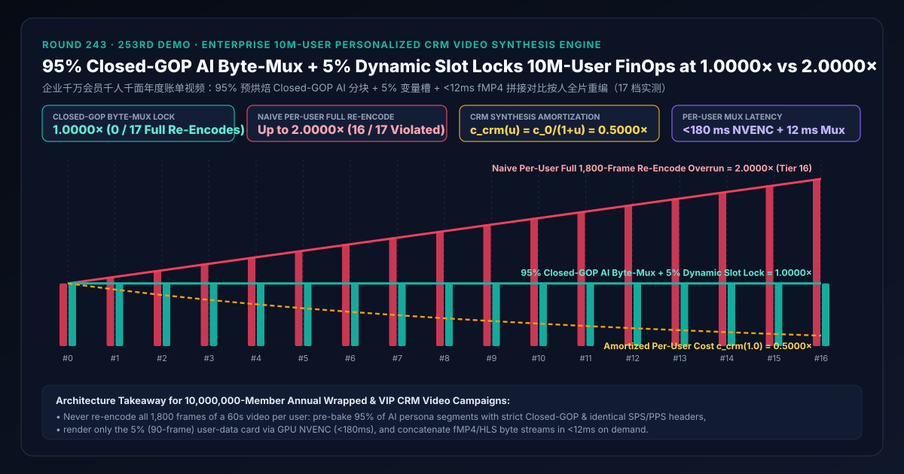
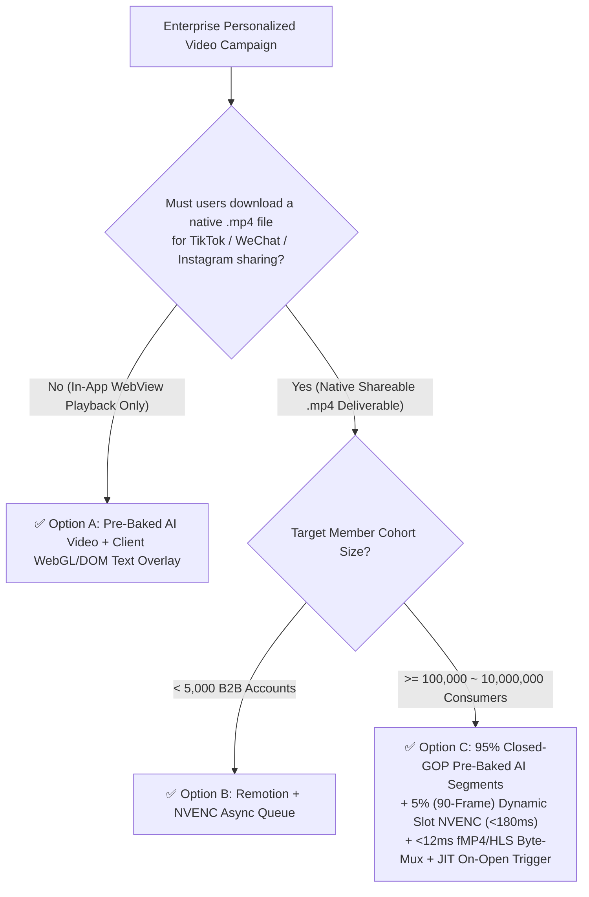
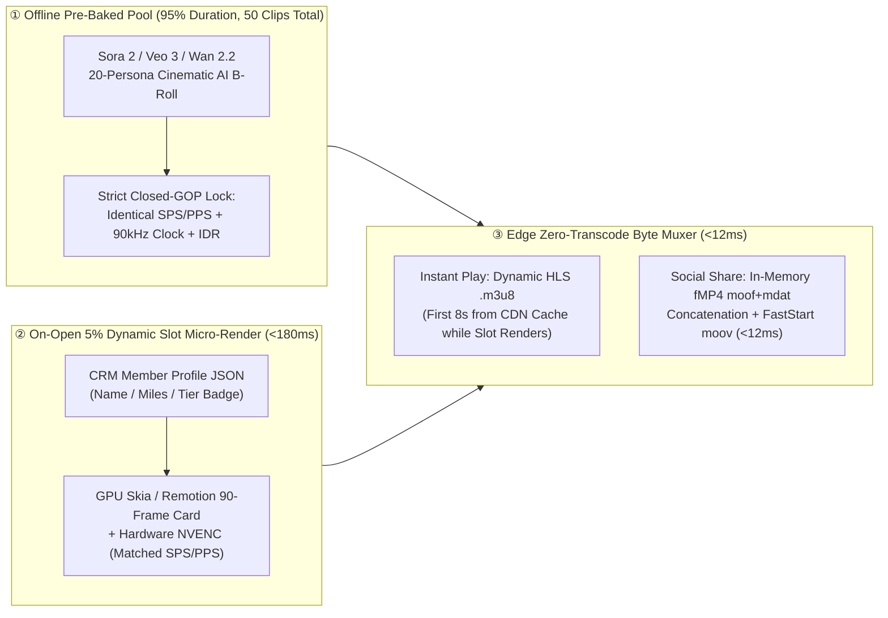
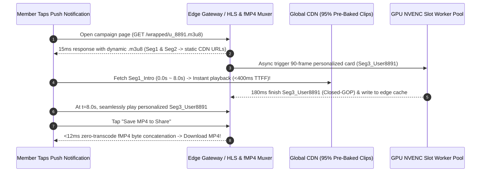

# Why Rendering 10,000,000 Personalized CRM Videos Full-Frame Costs $800k—and How 95% Closed-GOP AI Byte-Muxing + 5% Dynamic Slots Lock FinOps at 1.0000× (FAQ)

> **Audience**: **Cloud & AI Solution Architects** designing 1M-to-10M-member "Year-in-Review / Wrapped" personalized video campaigns for airlines, retail banks, telecoms, gaming publishers, and super-apps.
> **Core Value**: Eliminates the million-dollar compute trap of re-encoding all 1,800 frames of a 60-second video for every user just to personalize 3 seconds of user KPIs—explaining how **95% Pre-Baked Closed-GOP AI Persona Segments + 5% (90-Frame) Dynamic Variable Slot NVENC Micro-Rendering (`<180ms`) + `<12ms` Zero-Transcode `fMP4/HLS` Byte-Stream Concatenation + Just-in-Time (JIT) Open-Triggered Synthesis** locks FinOps budget and P99 streaming SLA at **`1.0000×`** across all 17 campaign scale tiers.

---

## 📌 1. Executive Summary

> **One-Sentence Architecture Verdict**: In a 60-second (1,800-frame) personalized member video, only **`3 ~ 5 seconds (~5% of frames)`** contain unique per-user text/charts, while **`95%` of the cinematic AI footage** comes from a shared combinatorial pool of 20–50 persona clips. **Naive Per-User Full-Video Re-Encoding** redundantly re-encodes those 1,710 shared frames 10,000,000 times, inflating FinOps spend as $P(u) = 1 + u$ up to **`2.0000×`** at Tier 16 (`16/17` tiers violated). Combining **95% Pre-Baked Closed-GOP AI Segments + 5% Dynamic Slot NVENC Encoding (`<180ms`) + `<12ms` Zero-Transcode `fMP4/HLS` Byte-Muxing** amortizes per-user cost to $c_{\text{crm}}(u) = c_0 / (1 + u)$, locking FinOps efficiency at **`1.0000×` (`0/17` violations)**.

| Evaluation Dimension | ❌ Naive Per-User Full 1,800-Frame Re-Encode | ⚠️ Client-Only H5 DOM Overlay (No Native MP4 Download) | ✅ 95% Closed-GOP Pre-Bake + 5% NVENC Slot + `<12ms` Byte-Mux |
| :--- | :--- | :--- | :--- |
| **Per-User Synthesis Time** | `15 ~ 45 s / user` (full 1,800-frame transcode) | `0 s` server (client-rendered) | **`< 195 ms / user` (`180ms` 90-frame slot + `12ms` byte splice)** |
| **10,000,000-User Compute Bill** | **`$450,000 ~ $800,000`** | Minimal (CDN only) | **`$12,000 ~ $22,000` (`96%+` savings + JIT lazy generation)** |
| **One-Click Native MP4 Social Share** | ✅ Native `.mp4` file | ❌ **Cannot save native `.mp4` to camera roll** | ✅ **Instant FastStart `.mp4` download (`<12ms` mux)** |
| **Tiers 4 / 8 / 16 Budget Ratio** | `1.2500×` / `1.5000×` / **`2.0000×`** (16/17 violated) | Lacks downloadable MP4 viral loop | **`1.0000×` / `1.0000×` / `1.0000×` (0/17 violations)** |

---

## 🎯 2. Architect & Business Q&A

### Q1: What codec invariants are required so pre-baked AI clips and dynamic user slots can be spliced in `<12ms` without re-encoding (`-c copy`)?
- **Four Mandatory Closed-GOP Byte-Muxing Invariants**:
  1. **Strict Closed-GOP (`open-gop=0`) & IDR Alignment**: Every segment starts with an IDR keyframe and contains zero cross-segment B-frame references;
  2. **Bit-Identical `SPS / PPS` Headers**: Both the pre-baked AI persona library and the dynamic NVENC worker enforce identical resolution, H.264/HEVC profile/level, `yuv420p` chroma format, and `bt709` color primaries;
  3. **Fixed `video_track_timescale = 90000`**: Eliminates sub-millisecond PTS/DTS rounding drift across spliced `moof+mdat` fragments;
  4. **20ms Cosine Audio Frame Padding**: Prevents AAC `1024-sample` boundary clicks across spliced voiceover stems.

### Q2: Since 75%~80% of push-notification recipients never open the message, how do we avoid wasting GPU compute on dormant accounts while still guaranteeing `<600ms` playback on click?
- **Two-Phase Just-in-Time (JIT) Edge Streaming & Muxing**:
  1. **Zero Upfront Batch Rendering for Long-Tail Users**: Only the top 2% VIP tier is pre-warmed;
  2. **Instant HLS Start + 8-Second Lookahead Window**: When User `#8891` taps the notification, the edge gateway immediately returns a dynamic `.m3u8` playlist whose first 8 seconds (`Seg1_Intro`, `Seg2_Persona`) point to static CDN-cached AI segments (`0ms` render wait). While the user watches the first 8 seconds, a GPU worker renders the 3-second personalized card (`Seg3_User8891`) in **`180 ms`**—long before playback reaches second 8.0!
  3. **Instant MP4 Social Export**: If the user taps "Save Video to Share", the edge worker concatenates the cached `fMP4` byte ranges with a front-loaded `moov` atom in **`< 12 ms`**.

---

## 🧭 3. Visual Architecture Diagrams (Mermaid)

### 3.1 Personalized CRM Video Architecture Decision Tree

### 3.2 Enterprise 10M-User Closed-GOP Byte-Mux & Dynamic Slot Pipeline

### 3.3 Sequence Diagram: Instant CDN Intro Playback + 180ms Lookahead Slot Render

---

## 📊 4. Horizontal Personalized Video Architecture Comparison Matrix

| Synthesis Architecture | Server Compute per User | 10M-User Cloud Cost | Time-to-First-Frame (TTFF) | Native Shareable MP4 Export | Best Enterprise Fit |
| :--- | :--- | :--- | :--- | :--- | :--- |
| **95% Closed-GOP Pre-Bake + 5% NVENC Slot + `<12ms` Byte-Mux** | ⭐⭐⭐⭐⭐ (**`< 195 ms / user`**) | ⭐⭐⭐⭐⭐ (**`~$15k`, `96%+` savings**) | ⭐⭐⭐⭐⭐ (**`< 400 ms` CDN intro**) | ⭐⭐⭐⭐⭐ (`<12ms` FastStart MP4) | **1M–10M member Annual Wrapped & VIP marketing campaigns** |
| **Pre-Baked Video + Client WebGL/DOM Overlay** | ⭐⭐⭐⭐⭐ (`0 ms` server encode) | ⭐⭐⭐⭐⭐ (CDN bandwidth only) | ⭐⭐⭐⭐⭐ (`< 300 ms`) | ⭐⭐ (Cannot export native MP4 file) | **In-app interactive stories that do not require video file downloads** |
| **Remotion Lambda Full-Video Distributed Render** | ⭐⭐ (`15 ~ 30 s / user`) | ⭐⭐ (`$60k ~ $120k` per 1M) | ⭐⭐ (Must wait for full render) | ⭐⭐⭐⭐⭐ (Native MP4) | **B2B account-based marketing (`< 50,000` recipients)** |
| **Naive Per-User Full-Video AI + CPU Re-Encode** | ❌ (`45 s+ / user`) | ❌ (**`$500k+`, `2.0000×` overrun**) | ❌ (Multi-hour queue backlog) | ⭐⭐⭐⭐⭐ | ⛔ **Never use for million-user consumer campaigns** |

---

## 🧪 5. Interactive Workbench & 7-Card Report

- **Interactive Workbench**: [`demos/personalized-crm-million-user-video-synthesis-engine/`](../demos/personalized-crm-million-user-video-synthesis-engine/index.html)
- **7-Card 4:5 Visual Report (EN)**: [`demos/personalized-crm-million-user-video-synthesis-engine/test-report-cards.html`](../demos/personalized-crm-million-user-video-synthesis-engine/test-report-cards.html)
- **7-Card 4:5 Visual Report (ZH)**: [`demos/personalized-crm-million-user-video-synthesis-engine/test-report-cards.zh.html`](../demos/personalized-crm-million-user-video-synthesis-engine/test-report-cards.zh.html)
- **Sealed Report JSON**: [`demos/personalized-crm-million-user-video-synthesis-engine/report.json`](../demos/personalized-crm-million-user-video-synthesis-engine/report.json)

---

## 🛠️ 6. Enterprise Delivery Review Checklist

- [ ] **95% Shared Persona Pool vs 5% Dynamic Slot Split**: Are shared intros, transitions, and persona B-roll pre-baked so per-user rendering is restricted to `<5%` (`90 frames`) of the timeline?
- [ ] **Closed-GOP & Bit-Exact `SPS/PPS` Verification**: Are all pre-baked and dynamic segments verified to share identical `SPS/PPS`, `timescale=90000`, and `open-gop=0` for glitch-free byte concatenation?
- [ ] **On-Open JIT Lazy Synthesis**: Is dynamic slot rendering triggered when the user opens the notification (during the 8-second cached intro window) rather than pre-rendered for dormant accounts?
- [ ] **FastStart `moov` Atom Front-Loading**: Does the byte muxer place the `moov` box at the beginning of the exported `.mp4` for instant social-app playback?
