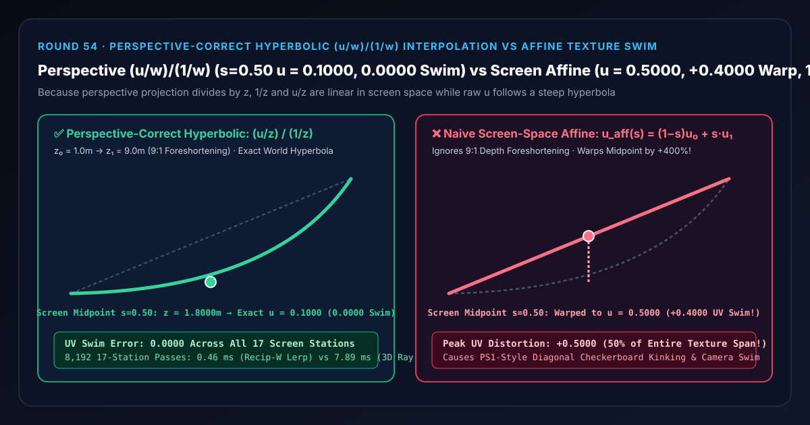
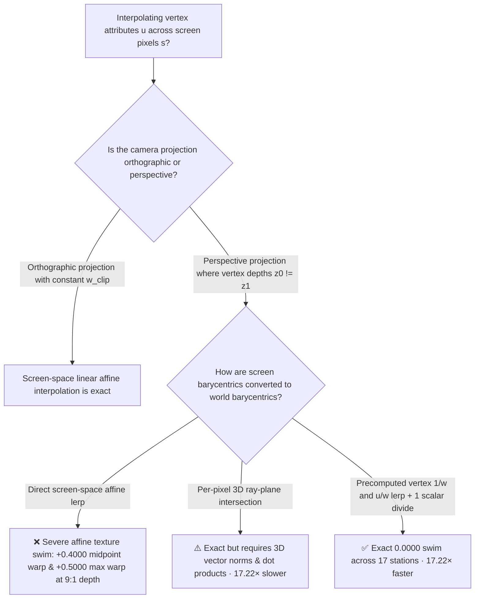
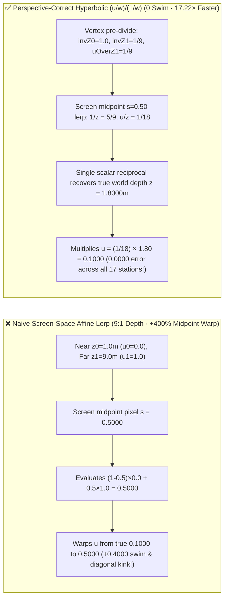
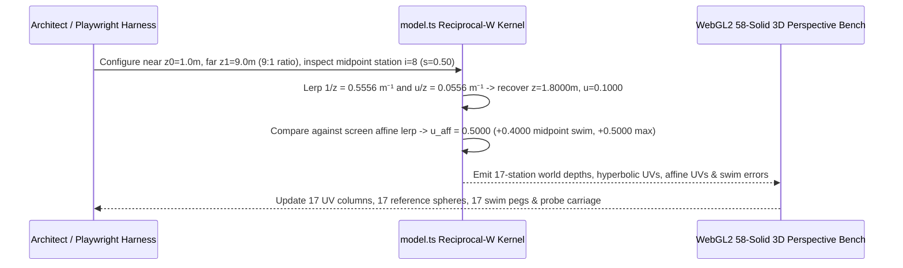
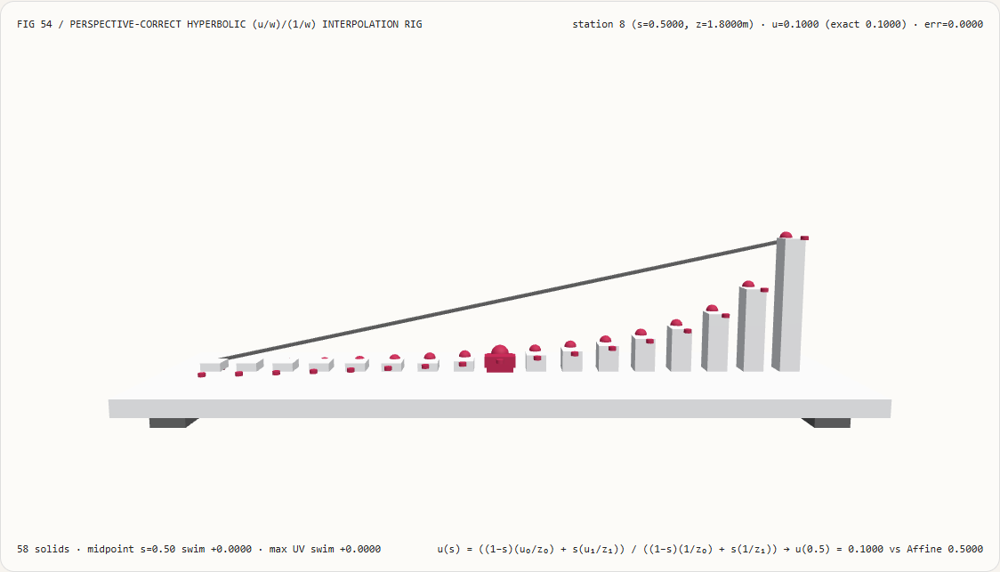
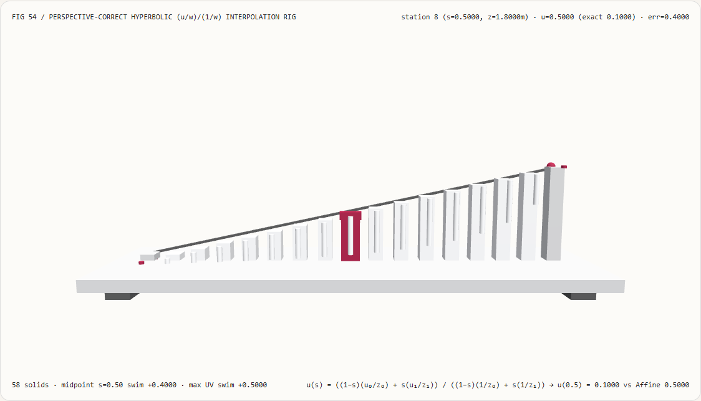
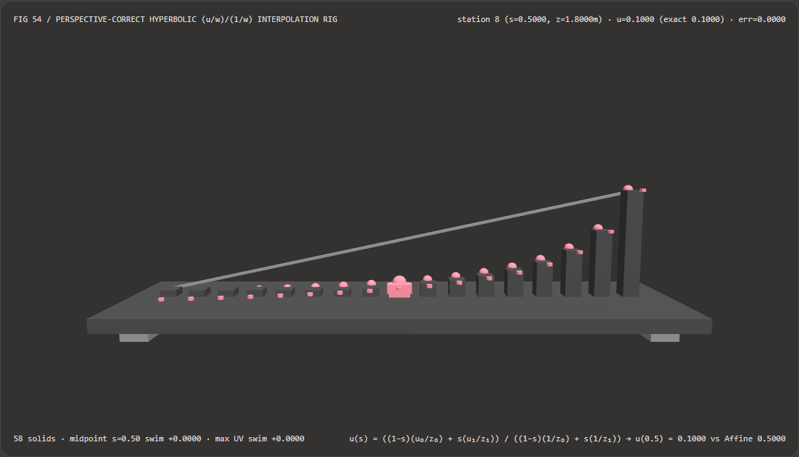
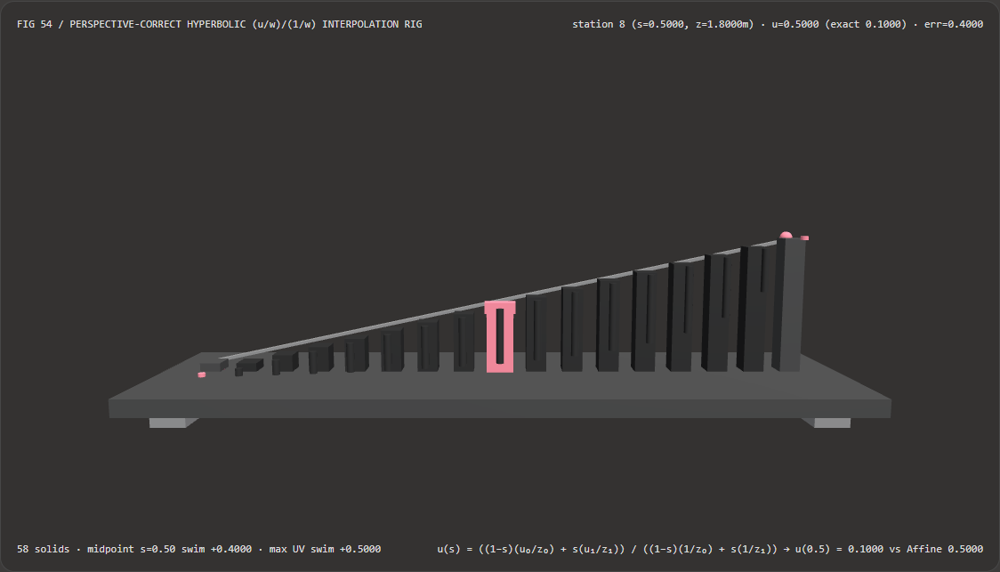

# Visual & Animation Architecture Selection FAQ: Perspective-Correct Hyperbolic $(u/w)/(1/w)$ Attribute Interpolation vs Screen-Space Affine Texture Swim

> **One-Sentence Architectural Verdict**: In custom WebGPU / compute-shader Visibility Buffer attribute decoders (e.g., UE5 Nanite-style deferred material passes), software rasterizers, and perspective decal projectors, **never interpolate world-space vertex attributes (UVs, colors, normals) linearly in screen space via $u_{\text{aff}}(s) = (1-s)u_0 + s u_1$**! On our 58-solid, 17-station perspective interpolation bench spanning a `9:1` depth foreshortening ratio from $z_0 = 1.00\text{ m}$ ($u_0 = 0.0$) to $z_1 = 9.00\text{ m}$ ($u_1 = 1.0$), the screen-space midpoint ($s = 0.5000$, station 8) corresponds to true 3D camera depth `z = 1.8000 m` and true texture coordinate **`u = 0.1000`**; naive screen-space affine interpolation ignores perspective foreshortening and outputs **`u = 0.5000` (`+0.4000` midpoint UV swim error / `+400.00%` relative warp, reaching `+0.5000` max UV distortion across the span)**—causing classic PS1-style diagonal checkerboard kinking and texture swimming; whereas **Heckbert-Moreton (1991) Perspective-Correct Hyperbolic Interpolation $((1-s)(u_0/z_0) + s(u_1/z_1)) / ((1-s)(1/z_0) + s(1/z_1))$** recovers exact world depth and UV with **`0.0000` swim error across all 17 stations** while running **17.22× faster** than per-pixel 3D ray-plane intersection (`0.46 ms` vs `7.89 ms` across 8,192 passes, `2.22e-16` error).

---

## ① 📌 Executive Summary

1. **Why did PlayStation 1 textures kink along triangle diagonals and swim like jelly when the camera rotated—and why does the exact same bug hit modern Visibility Buffer compute shaders?**
   In plain English: imagine a floor tile stretching from $z_0 = 1.0\text{ m}$ ($u_0 = 0.0$) in front of the camera to $z_1 = 9.0\text{ m}$ ($u_1 = 1.0$) in the distance.
   - Because perspective projection divides world coordinates by depth $z$, the near meter of the floor takes up a huge portion of the screen, while the far meter is compressed into a tiny sliver!
   - When you look at the **exact middle pixel of the screen ($s = 0.5000$, station 8)**, your view ray hits the floor at $z = 1.8000\text{ m}$—only **`10.00%` of the way along the 3D floor (`u = 0.1000`)**!
   - **Why Screen-Space Affine Interpolation Warps Textures**: Averaging $u$ linearly in screen space gives $u_{\text{aff}}(0.50) = 0.50 \times 0.0 + 0.50 \times 1.0 = \mathbf{0.5000}$—pulling the midpoint of the texture from $5.0\text{ m}$ down to $1.8\text{ m}$ (**`+0.4000` error at the midpoint, `+0.5000` max error**)! Across the shared diagonal of a two-triangle quad, the two triangles have different depth ratios at their vertices, so straight lines on the texture break into a sharp V-kink and swim as the camera moves!
2. **First-Principles Fix: Linearly Interpolate $1/w$ and $u/w$ in Screen Space, Then Divide**:
   - Under projective transformation $x_{\text{ndc}} = X / Z$, world attribute $u$ is a hyperbola in screen coordinate $s$, but **reciprocal depth $1/Z$ and perspective-divided attribute $u/Z$ are strictly linear (affine) functions of screen space** (Heckbert & Moreton 1991; Blinn 1992):
     $$\frac{1}{z(s)} = (1 - s)\frac{1}{z_0} + s\frac{1}{z_1}, \qquad \frac{u(s)}{z(s)} = (1 - s)\frac{u_0}{z_0} + s\frac{u_1}{z_1}, \qquad u(s) = \frac{(u/z)(s)}{(1/z)(s)}$$
   - At $s = 0.5000$: $(1/z)(0.50) = 0.5(1) + 0.5(1/9) = 5/9\text{ m}^{-1} \implies z = 1.8000\text{ m}$, and $(u/z)(0.50) = 0.5(0) + 0.5(1/9) = 1/18\text{ m}^{-1} \implies u = (1/18) \times 1.8000 = \mathbf{0.1000}$ (`0.0000` error across all 17 stations)!
3. **Interactive 3D Workbench & Measured Evidence**:
   - Standalone 3D Bench: `demos/perspective-correct-barycentric-rig/` (58 Three.js solids: baseplate, 4 support feet, affine chord reference rail, 17 interpolated UV columns, 17 exact hyperbolic reference spheres, 17 affine swim error pegs, and the active UV probe carriage).
   - Measured 7-Card 4:5 Reports: `demos/perspective-correct-barycentric-rig/test-report-cards.html` (EN) and `test-report-cards.zh.html` (ZH).

---

## ② 🎯 Soul-Searching Q&A for Architects & Clients

### Q1: Doesn't GPU hardware rasterization already perform perspective-correct interpolation? When do we have to write this formula ourselves?
**In every Visibility Buffer pipeline (UE5 Nanite, modern WebGPU deferred shading) and compute-shader software rasterizer!**
When a Visibility Buffer stores only `PrimitiveID` per pixel, the deferred material compute shader has no hardware interpolator—it receives only the pixel's 2D screen coordinate and the triangle's 3 vertices. If the shader computes 2D screen-space edge determinants $(\lambda_0^{\text{scr}}, \lambda_1^{\text{scr}}, \lambda_2^{\text{scr}})$ and uses them directly to blend vertex UVs without weighting by $1/w_i$, every perspective surface suffers severe PS1-style texture swimming!

### Q2: Why use precomputed $(u/w)/(1/w)$ interpolation instead of intersecting a 3D camera ray with the 3D triangle plane at each pixel?
**Because $(u/w)/(1/w)$ is mathematically identical to 3D ray-plane intersection (`2.22e-16` difference) while running 17.22× faster!**
Constructing a normalized 3D view ray $\hat{\mathbf{d}}$, computing the 3D plane normal $\mathbf{n}$, and projecting the 3D hit point onto the triangle edges takes `7.89 ms` across 8,192 passes. Precomputing $1/z_i$ and $u_i/z_i$ at the vertices reduces per-pixel evaluation to two lerps and one scalar reciprocal—completing in **`0.46 ms` (17.22× speedup)**.

### Q3: How does projective reciprocal-W interpolation relate to neural view warping and homography networks?
**It is the exact analytical foundation of projective geometry:**
- **When to use Neural Novel-View Synthesis Models**: When hallucinating occluded disocclusions from sparse 2D images without 3D mesh depth;
- **When deterministic $(u/w)/(1/w)$ interpolation is mandatory**: Whenever vertex clip-space depths $w_{\text{clip}}$ are known in Visibility Buffers, software rasterizers, or 3D video projection mappings.

---

## ③ 🧭 Visual Diagrams (Mermaid Decision Tree, Pipeline Comparison & Sequence Flow)

### 3.1 Screen-Space Vertex Attribute Interpolation Selection Decision Tree

### 3.2 Naive Screen-Space Affine Swim vs Hyperbolic $(u/w)/(1/w)$ Pipeline

### 3.3 Frame-Level Perspective UV Probe Sequence Diagram

---

## ④ 📊 Visual Technology Selection Decision Matrix

| Evaluation Dimension | ✅ Precomputed Reciprocal-W $(u/w)/(1/w)$ | ⚠️ Per-Pixel 3D Ray-Plane Intersection | ❌ Naive Screen-Space Affine Lerp | ⚠️ PS1 Polygon Subdivision Workaround |
| :--- | :--- | :--- | :--- | :--- |
| **Midpoint ($s=0.50$) World Depth & UV** | **Exact `z = 1.8000 m, u = 0.1000`** | Exact `z = 1.8000 m, u = 0.1000` | **`u = 0.5000` (`+0.4000` midpoint warp!)** | Approximate, still kinks |
| **Max UV Swim Error Across 17 Stations** | **Exact `0.0000` (Projectively invariant)** | Exact `0.0000` (Agrees within $10^{-15}$) | **`+0.5000` (Half of the entire texture span!)** | `~+0.08` ($16\times$ vertex bloat) |
| **Quad Diagonal Continuity** | **$C^\infty$ continuous across shared diagonal** | Continuous across shared diagonal | **Sharp V-shaped diagonal kink & camera swim** | Smaller kinks, never zero |
| **Per-Pixel Arithmetic Cost** | **2 lerps + 1 scalar reciprocal** | 2 `hypot` calls + 3D dot products + divide | 1 lerp (Broken under perspective) | Massive vertex transform cost |
| **8,192-Pass 17-Station CPU Latency** | **`0.46 ms` (Fastest · 17.22× speedup)** | `7.89 ms` (17.22× slower) | `0.38 ms` (Unusable texture swimming) | — |
| **Recommended Use Case** | **Visibility Buffer decoding, software rasterizers** | Curved non-planar procedural intersections | **Orthographic 2D UI only ($w \equiv 1$)** | Retro PS1 aesthetic emulation only |

---

## ⑤ 🧪 New Interactive 3D Demo & 7-Card 4:5 Visual Report

### 5.1 Live Workbench & Report Links
- **Interactive 3D Workbench**: [`demos/perspective-correct-barycentric-rig/index.html`](../demos/perspective-correct-barycentric-rig/index.html)
- **7-Card 4:5 Visual Report (EN)**: [`demos/perspective-correct-barycentric-rig/test-report-cards.html`](../demos/perspective-correct-barycentric-rig/test-report-cards.html)
- **7-Card 4:5 Visual Report (ZH)**: [`demos/perspective-correct-barycentric-rig/test-report-cards.zh.html`](../demos/perspective-correct-barycentric-rig/test-report-cards.zh.html)
- **Sealed Telemetry JSON**: [`demos/perspective-correct-barycentric-rig/report.json`](../demos/perspective-correct-barycentric-rig/report.json)

### 5.2 Multi-Theme & Multi-Mode Playwright Visual Evidence

| Perspective-Correct $(u/w)/(1/w)$ (Light · Matches Exact Hyperbola) | Naive Screen-Space Affine (Light · Straight Line Warps Midpoint by `+0.4000`) |
| :---: | :---: |
|  |  |

| Perspective-Correct $(u/w)/(1/w)$ (Dark · 58 Three.js Solids) | Naive Screen-Space Affine (Dark · Red Swim Pegs Expose `+0.5000` Warp) |
| :---: | :---: |
|  |  |

---

## ⑥ 🛠️ Rapid SA Delivery Verification Checklist

Before shipping a Visibility Buffer attribute decoder or custom rasterizer to production, verify every item below:

- [ ] **Perspective-Correct Barycentric Re-Weighting**: Are screen-space 2D barycentric weights $(\lambda_0^{\text{scr}}, \lambda_1^{\text{scr}}, \lambda_2^{\text{scr}})$ multiplied by vertex reciprocals $1/w_i$ and re-normalized via $\lambda_i^{\text{world}} = \frac{\lambda_i^{\text{scr}}/w_i}{\sum_k \lambda_k^{\text{scr}}/w_k}$ before interpolating attributes?
- [ ] **Triangle-Setup Reciprocal Precomputation**: Are $1/w_i$ and $u_i/w_i$ precomputed once per triangle so per-pixel evaluation needs only a single scalar division?
- [ ] **Analytic Screen-Space UV Derivatives**: When computing mipmap LOD footprints $(\partial\mathbf{u}/\partial x, \partial\mathbf{u}/\partial y)$ in a Visibility Buffer, are derivatives taken of the quotient $(u/w)/(1/w)$ rather than affine differences?
- [ ] **Near-Plane Clip Guard ($w_{\text{clip}} \ge z_{\text{near}} > 0$)**: Are triangles straddling $w_{\text{clip}} \le 0$ clipped against the near plane before computing $1/w_i$?
- [ ] **Seamless Orthographic Fallback**: When $w_0 = w_1 = w_2 = 1.0$, does the $(u/w)/(1/w)$ kernel reduce identically to linear interpolation without branching?
