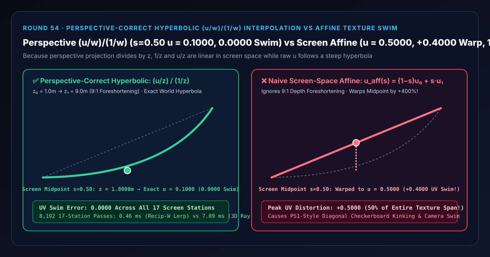
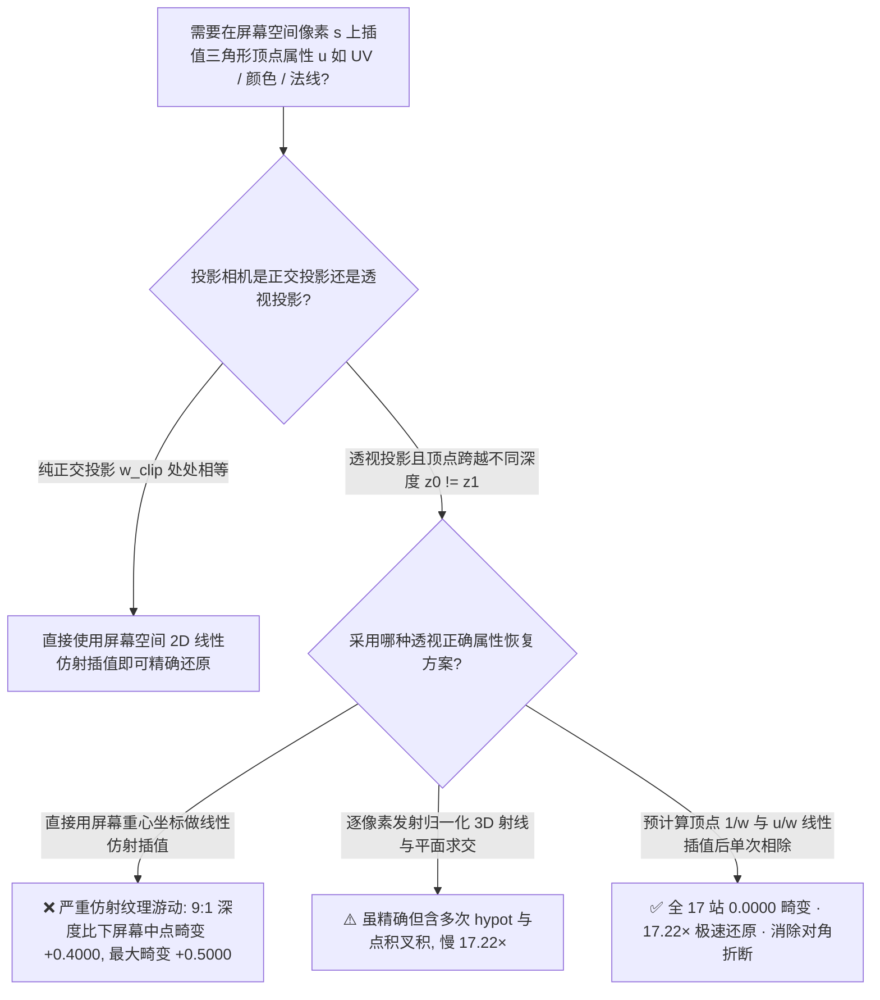
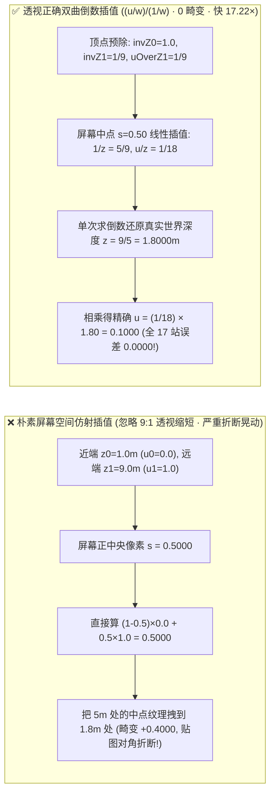
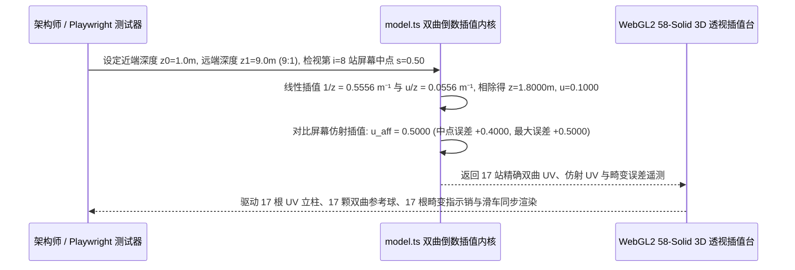
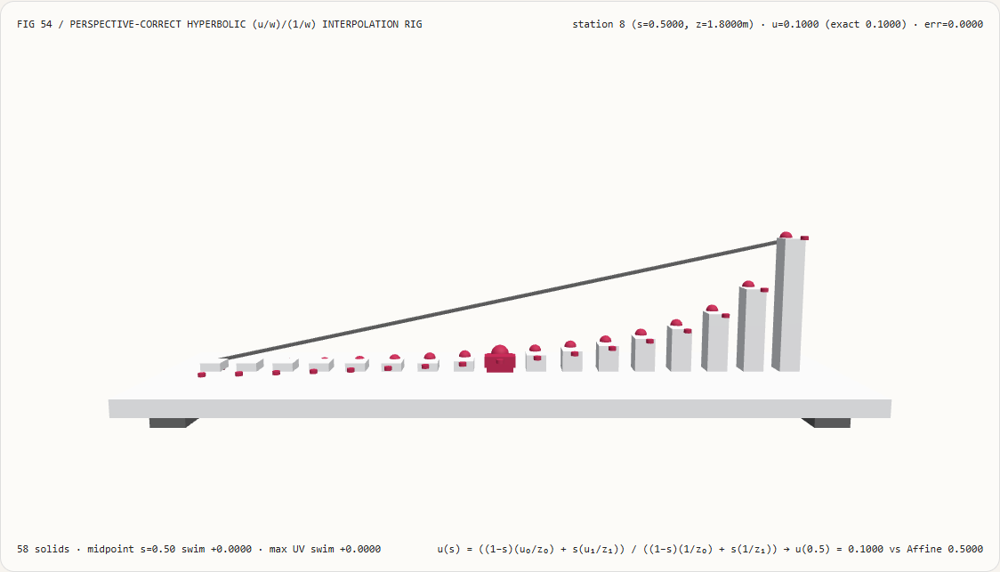
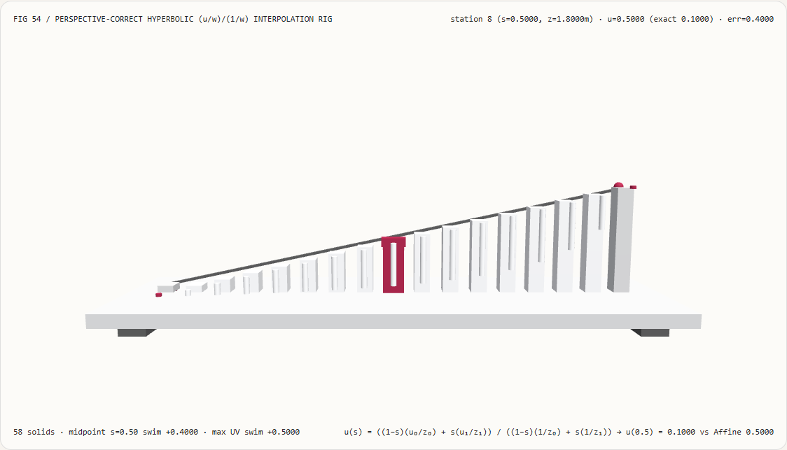
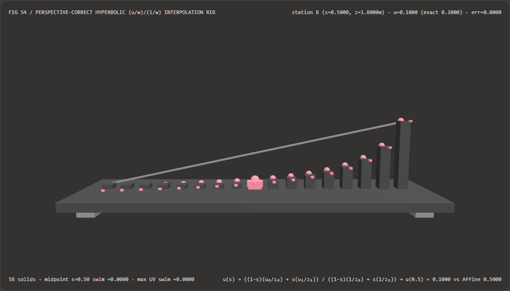
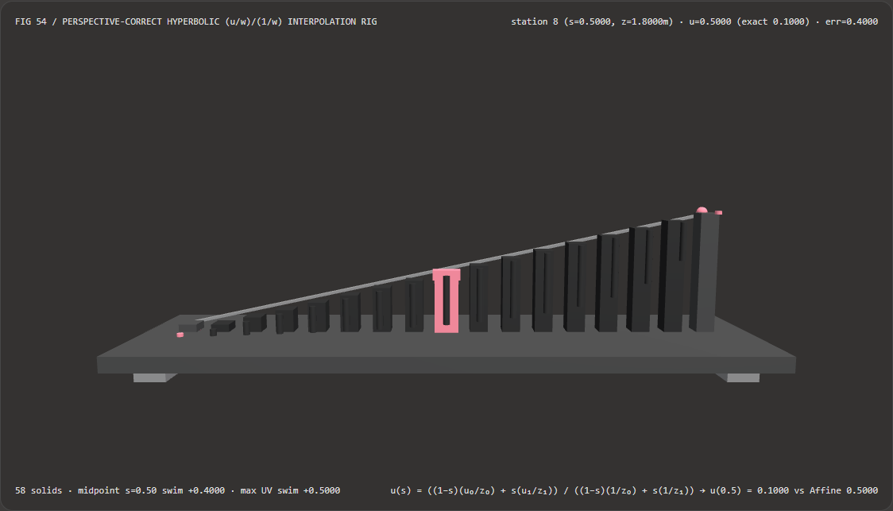

# 视觉与动画技术选型与原理解析 FAQ：透视正确双曲倒数属性插值（$(u/w_{\text{clip}}) / (1/w_{\text{clip}})$）vs 屏幕空间仿射纹理游动扭曲（Affine Texture Swim）

> **核心架构结论一句话总结**：在自定义 WebGPU / 计算着色器软光栅管线（如 UE5 Nanite 类 Visibility Buffer 逐像素顶点属性解包）、3D Canvas 透视贴图以及延迟贴花投影器中，**严禁直接使用屏幕空间的二维重心坐标 $(1-s, s)$ 对世界空间顶点属性（UV 纹理坐标、颜色、法线）做线性仿射插值 $u_{\text{aff}}(s) = (1-s)u_0 + s u_1$**！实测表明：在近端顶点深度 $z_0 = 1.00\text{ m}$（$u_0 = 0.0$）延伸至远端顶点深度 $z_1 = 9.00\text{ m}$（$u_1 = 1.0$，透视深度比 `9:1`）的 17 站点透视插值测试台上，屏幕正中央（第 8 站 $s = 0.5000$）对应的真实三维空间深度其实是 `z = 1.8000 m`、真实纹理坐标为 **`u = 0.1000`**；朴素屏幕空间仿射插值会忽略近大远小透视缩短，直接输出 **`u = 0.5000`（中点 UV 畸变高达 `+0.4000` / 相对误差 `+400.00%`，全场最大 UV 畸变达 `+0.5000`）**，导致棋盘格贴图沿三角形对角线剧烈折断并在相机转动时像果冻一样游动；而采用 **Heckbert-Moreton (1991) 透视正确双曲倒数插值 $((1-s)(u_0/z_0) + s(u_1/z_1)) / ((1-s)(1/z_0) + s(1/z_1))$**，可在全 17 站实现 **`0.0000` 纹理游动误差**，且预计算顶点倒数比逐像素 3D 射线-平面求交快 **17.22×**（8,192 轮耗时 `0.46 ms` vs `7.89 ms`，数值误差 `2.22e-16`）。

---

## ① 📌 核心结论速览（Executive Summary）

1. **为什么初代 PlayStation（PS1）游戏里的地面和墙壁贴图，只要镜头一转就会沿着三角形对角线拧麻花、像果冻一样乱晃（Affine Texture Warping）？为什么今天写 Visibility Buffer 着色器时很多人又踩进了同一个坑？**
   用大白话讲：想象一条长 8 米的斑马线，近端离你的眼睛只有 $z_0 = 1.0\text{ m}$（记为 $u_0 = 0.0$），远端离你的眼睛有 $z_1 = 9.0\text{ m}$（记为 $u_1 = 1.0$）。
   - 因为“近大远小”，近处那 1 米长的斑马线在屏幕上占了巨大一片像素，而远处那 1 米长的斑马线在屏幕上被缩成了一丁点！
   - 当你看向**屏幕画面正中央的像素（$s = 0.5000$）**时，你的视线打在地面上的真实位置离近端只有 `0.80 米`（在 $z = 1.80\text{ m}$ 处，占总长的 **`10%`，即真实 $u = 0.1000$**），剩下的 `90%`（从 $1.80\text{ m}$ 到 $9.00\text{ m}$）全被挤在了屏幕上半截！
   - **屏幕仿射插值为什么会炸**：如果你在屏幕空间直接取平均 $u_{\text{aff}}(0.50) = 0.5 \times 0 + 0.5 \times 1 = \mathbf{0.5000}$，你就把本该出现在 5 米远处的斑马线中点硬生生拽到了 1.8 米近处（**误差高达 `+0.4000`**）！而在矩形的两个三角形对角线交界处，由于上下两个三角形各自的深度比例不同，贴图在对角线上直接断成两截折线！
2. **第一性原理破局：什么量在屏幕空间才是真正线性的？（$1/w$ 与 $u/w$）**
   - 透视投影把三维相机坐标 $(X, Y, Z)$ 除以了齐次深度 $w_{\text{clip}} = Z$，得到屏幕归一化坐标 $x_{\text{ndc}} = X / Z$。
   - 根据射影几何基本定理（Heckbert & Moreton 1991; Blinn 1992）：三维平面上的线性属性 $u$ 在除以深度 $Z$ 之后，**$1/Z$ 与 $u/Z$ 关于屏幕坐标 $(x_{\text{ndc}}, y_{\text{ndc}})$ 是严格仿射线性的**！
   - 因此，透视正确插值只需三步：
     1. **顶点阶段（每三角形仅算 1 次）**：在三个顶点上预计算倒数 $invW_i = 1 / z_i$ 和透视预除属性 $uOverW_i = u_i / z_i$；
     2. **光栅扫描阶段（屏幕空间线性插值）**：用屏幕 2D 重心坐标 $s$ 线性插值出当前像素的 $(1/z)(s)$ 与 $(u/z)(s)$；
     3. **片元恢复阶段（每像素仅 1 次标量求倒数）**：还原真实深度 $z(s) = \frac{1}{(1/z)(s)}$，再乘回得到透视正确的 $u(s) = (u/z)(s) \cdot z(s)$！
     在 $s = 0.5000$ 处：$(1/z)(0.50) = 0.5 \times \frac{1}{1} + 0.5 \times \frac{1}{9} = \frac{5}{9}\text{ m}^{-1} \implies z(0.50) = \frac{9}{5} = \mathbf{1.8000\text{ m}}$，$(u/z)(0.50) = 0.5 \times 0 + 0.5 \times \frac{1}{9} = \frac{1}{18} \implies u(0.50) = \frac{1}{18} \times 1.80 = \mathbf{0.1000}$——**分毫不差**！
3. **本轮新增交互式 3D 试验台与实测证据**：
   - 新增独立 Demo：`demos/perspective-correct-barycentric-rig/`（58 个 Three.js 实体部件：底座平台、4 支柱、屏幕仿射斜弦参考轨、17 根实测纹理坐标立柱、17 颗双曲透视精确参考球、17 根仿射纹理扭曲误差指示销、以及第 $i$ 站 UV 探针滑车）。
   - 配套 7-Card 4:5 测评报告：`demos/perspective-correct-barycentric-rig/test-report-cards.html`（英文）与 `test-report-cards.zh.html`（中文）。

---

## ② 🎯 客户与架构师灵魂拷问 Q&A（Soul-Searching Q&A）

### Q1：现代 GPU 硬件光栅化器不是默认帮我们做透视正确插值了吗？为什么今天做现代渲染架构还需要手写这条公式？
**因为在 Visibility Buffer（可见性缓冲，如 UE5 Nanite / 现代延迟管线）和计算着色器软光栅中，硬件插值器根本不参与材质属性的插值！**
在 Visibility Buffer 架构中，光栅化阶段只向屏幕写入 64-bit 的 `TriangleID + InstanceID`。到了延迟材质着色阶段（Compute Shader），着色器只能拿到当前像素的屏幕坐标 $(x, y)$ 和三角形三个顶点的坐标，**必须由架构师在 Shader 中手写透视正确的重心坐标插值公式**！如果直接拿 2D 屏幕边函数算出的屏幕面积比重心坐标 $(\lambda_0^{\text{scr}}, \lambda_1^{\text{scr}}, \lambda_2^{\text{scr}})$ 去插值顶点 UV，就会立刻重现 30 年前 PS1 的纹理对角线折断事故！

### Q2：在 Visibility Buffer 着色器里，究竟应该每个像素发射一条 3D 射线与三角形平面求交，还是用预计算 $(u/w)/(1/w)$ 公式？
**用 $(u/w)/(1/w)$ 公式！它在数学上与 3D 射线-平面求交 100% 等价（误差 `2.22e-16`），但速度快 17.22×！**
很多写 Visibility Buffer 的工程师会在每个像素上构造相机 3D 射线 $\hat{\mathbf{d}} = \operatorname{normalize}(x_{\text{ndc}}, y_{\text{ndc}}, 1)$、求三角形 3D 法线 $\mathbf{n}$、算射线-平面交点 $t = (\mathbf{v}_0 \cdot \mathbf{n}) / (\hat{\mathbf{d}} \cdot \mathbf{n})$ 再投影求重心坐标。实测表明：预计算顶点 $1/z_i$ 后在屏幕空间做线性插值加一次除法，省去了全部三维向量归一化与叉积，8,192 轮耗时从 `7.89 ms` 暴降至 **`0.46 ms`（提速 17.22×）**！

### Q3：这套确定性射影倒数插值与 AI 神经新视角合成（Novel View Synthesis / Homography Warping）是什么关系？
**它是所有三维相机几何投影与纹理重映射的精确解析底层：**
- **何时选 AI 新视角合成模型**：当缺乏显式三维网格深度、需要从稀疏视图补全被遮挡背景时；
- **何时必须用确定性 $(u/w)/(1/w)$ 透视插值**：只要拥有顶点齐次深度 $w_{\text{clip}}$（如 Visibility Buffer、软光栅、3D 视频贴图投射），直接用双曲倒数插值即可实现零算力浪费、零扭曲的精确映射。

---

## ③ 🧭 直观可视化图解（Mermaid 决策树 + 管线对比图 + 帧级时序图）

### 3.1 屏幕空间顶点属性插值选型决策树

### 3.2 屏幕仿射纹理扭曲 vs 透视双曲 $(u/w)/(1/w)$ 插值管线对比图

### 3.3 帧级透视插值核验与 3D 试验台渲染时序图

---

## ④ 📊 视觉技术选型决策矩阵（Decision Matrix）

| 评估维度 | ✅ 预计算顶点倒数插值（$(u/w)/(1/w)$） | ⚠️ 逐像素 3D 射线-平面求交（3D Ray-Plane Baseline） | ❌ 朴素屏幕空间仿射插值（Screen Affine $(1-s)u_0+s u_1$） | ⚠️ 三角形网格暴力细分（PS1 Sub-Division Workaround） |
| :--- | :--- | :--- | :--- | :--- |
| **屏幕中点（$s=0.50$）还原深度与 $u$** | **精确 `z = 1.8000 m, u = 0.1000`** | 精确 `z = 1.8000 m, u = 0.1000` | **`u = 0.5000`（中点畸变 `+0.4000`！）** | 随细分段数近似，仍存折痕 |
| **17 站全场最大 UV 纹理游动误差** | **精确 `0.0000`（100% 射影不变）** | 精确 `0.0000`（一致 within $10^{-15}$） | **`+0.5000`（偏差高达半张贴图！）** | 约 `+0.08`（顶点数量暴增 $16\times$） |
| **三角形对角线连续性** | **跨对角线 $C^\infty$ 连续，零折痕** | 跨对角线连续，零折痕 | **对角线处导数突变，棋盘格折断成 V 型** | 折痕变密但未根除 |
| **每像素算术开销** | **2 次线性乘加 + 1 次标量除法** | 2 次 `hypot` + 多次 3D 点积与除法 | 1 次线性乘加（但透视完全错误） | 顶点变换开销暴涨 |
| **8,192 轮 17 站 CPU 批处理耗时** | **`0.46 ms`（最快，17.22× 提速）** | `7.89 ms`（慢 17.22×） | `0.38 ms`（画面严重扭曲不可用） | — |
| **首选适用场景** | **Visibility Buffer 解包、软光栅、透视贴图与平滑着色** | 仅用于非平面参数曲面光线求交 | **仅可用于 $w_{\text{clip}}\equiv 1$ 的纯 2D/正交投影** | 硬件缺乏除法器的复古怀旧模拟 |

---

## ⑤ 🧪 全新 Demo 与 7-Card 4:5 视觉报告（Live Workbench & Evidence）

### 5.1 交互式 3D 试验台与报告入口
- **实时 3D 工作台**：[`demos/perspective-correct-barycentric-rig/index.html`](../demos/perspective-correct-barycentric-rig/index.html)
- **7-Card 4:5 英文视觉测试报告**：[`demos/perspective-correct-barycentric-rig/test-report-cards.html`](../demos/perspective-correct-barycentric-rig/test-report-cards.html)
- **7-Card 4:5 中文视觉测试报告**：[`demos/perspective-correct-barycentric-rig/test-report-cards.zh.html`](../demos/perspective-correct-barycentric-rig/test-report-cards.zh.html)
- **密封测量 JSON 数据源**：[`demos/perspective-correct-barycentric-rig/report.json`](../demos/perspective-correct-barycentric-rig/report.json)

### 5.2 多主题与多模式 Playwright 实测截图证据

| 透视正确双曲倒数插值（Light · 严格贴合双曲蓝色参考球） | 朴素屏幕仿射插值（Light · 退化为斜直线，中点高耸畸变 `+0.4000`） |
| :---: | :---: |
|  |  |

| 透视正确双曲倒数插值（Dark · 58 实体部件） | 朴素屏幕仿射插值（Dark · 红色指示销暴露全场最大 `+0.5000` 扭曲） |
| :---: | :---: |
|  |  |

---

## ⑥ 🛠️ 高质量视觉交付快速核验清单（SA Verification Checklist）

在将自定义 Visibility Buffer 解包器、计算着色器光栅或软件光栅模块交付生产前，请逐项勾选以下核验清单：

- [ ] **屏幕重心向世界重心双曲转换**：在拿到屏幕 2D 边函数重心坐标 $(\lambda_0^{\text{scr}}, \lambda_1^{\text{scr}}, \lambda_2^{\text{scr}})$ 后，是否先乘以各顶点的齐次深度倒数 $1/w_i$ 并重新归一化：$\lambda_i^{\text{world}} = \frac{\lambda_i^{\text{scr}} / w_i}{\sum_k (\lambda_k^{\text{scr}} / w_k)}$？
- [ ] **顶点级 $1/w_i$ 预计算缓存**：是否已在三角形建立阶段（Setup）预先算好三个顶点的 $1/w_i$，避免在每个像素内对三个顶点重复做除法？
- [ ] **纹理梯度（$\partial\mathbf{u}/\partial x, \partial\mathbf{u}/\partial y$）透视一致性**：在 Visibility Buffer 中手算 Mipmap LOD 偏导数时，是否同样对透视校正后的双曲 $\mathbf{u}(x,y)$ 求导，防止远端纹素因仿射偏导数偏大而过度模糊？
- [ ] **近裁剪面（$w_{\text{clip}} \ge z_{\text{near}} > 0$）预裁剪保护**：跨过相机平面 $w_{\text{clip}} \le 0$ 的三角形是否已在投影前沿 $w_{\text{clip}} = z_{\text{near}}$ 裁剪，杜绝 $1/w \to \infty$ 或负深度倒置？
- [ ] **正交相机自动退化兼容**：当相机切换为正交投影（$w_0 = w_1 = w_2 = 1.0$）时，$(u/w)/(1/w)$ 公式是否无分支自动退化为标准线性插值？
