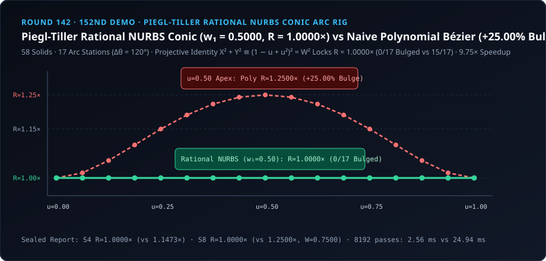
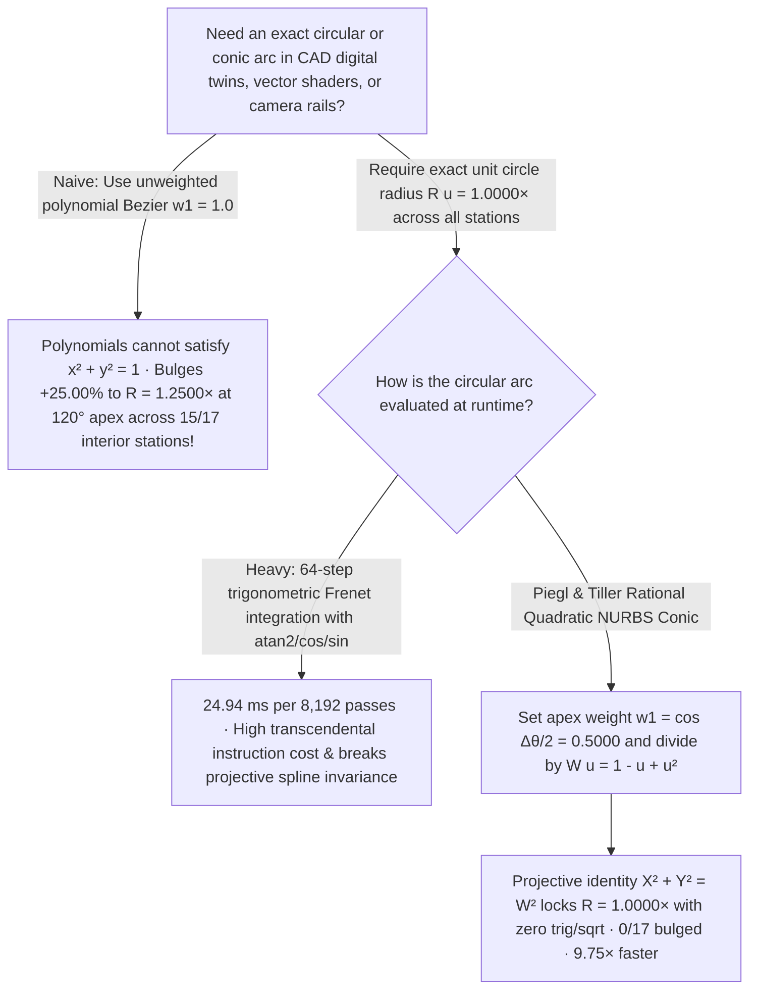
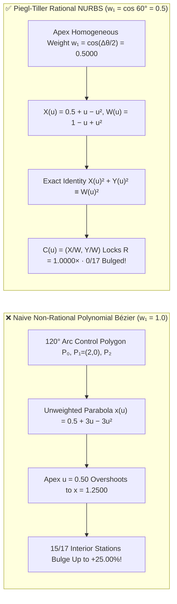
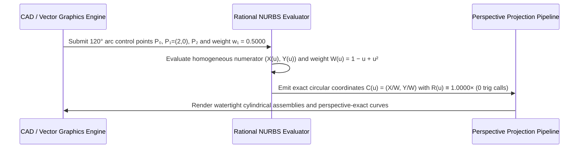
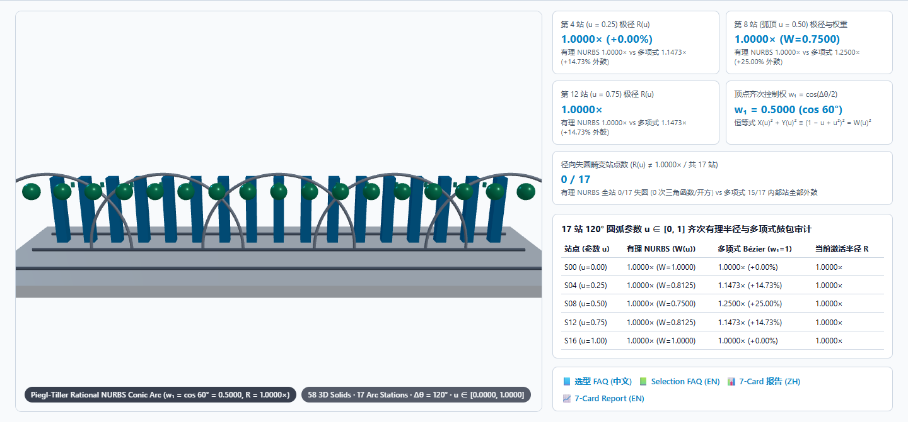
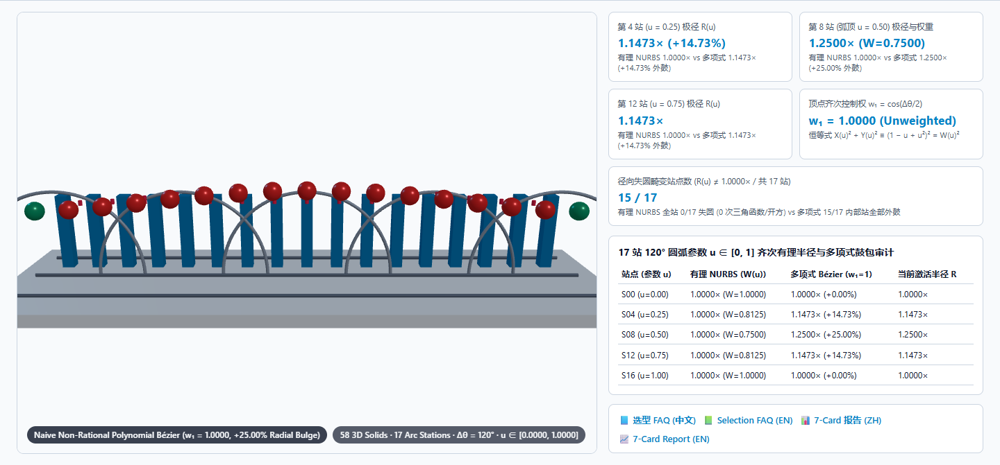
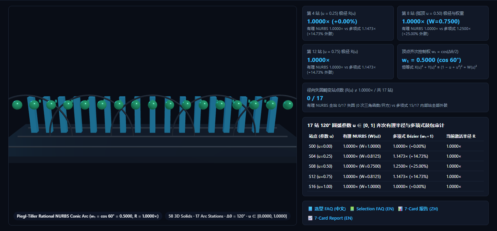
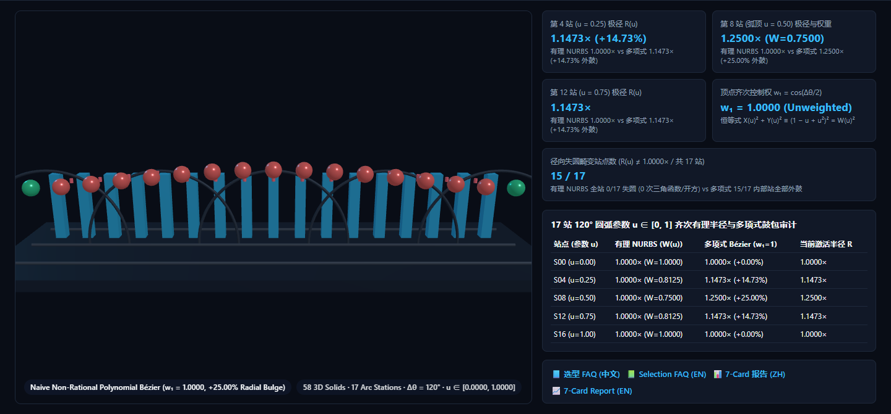

# Piegl-Tiller Rational NURBS Conic Arc (`w₁ = cos(Δθ/2) = 0.5000`) vs Naive Non-Rational Polynomial Bézier Radial Bulge Selection & First-Principles FAQ

> **Navigation**: [Back to Portal](../index.html) · [Launch 3D Interactive Workbench (`piegl-nurbs-rational-conic-arc-rig`)](../demos/piegl-nurbs-rational-conic-arc-rig/index.html) · [7-Card 4:5 Visual Report (EN)](../demos/piegl-nurbs-rational-conic-arc-rig/test-report-cards.html) · [7-Card 报告 (ZH)](../demos/piegl-nurbs-rational-conic-arc-rig/test-report-cards.zh.html) · [中文版 FAQ](./piegl-tiller-rational-nurbs-conic-vs-polynomial-bezier-bulge-faq.md)

---

## ① 📌 Executive Summary

1. **Why can no non-rational polynomial Bézier curve ever represent a true circular arc (bulging outward by `+25.00%` to $R = 1.2500\times$ at the midpoint of a $120^\circ$ arc)—and how does Piegl & Tiller's (*The NURBS Book*) rational quadratic NURBS conic (`w₁ = cos(Δθ/2) = 0.5000`, `C(u) = P(u) / W(u)`) lock exact unit radius $R(u) \equiv 1.0000\times$ with zero trigonometric or square-root evaluations?**
   - By fundamental algebra, no pair of non-constant polynomials $(x(u), y(u))$ can satisfy $x(u)^2 + y(u)^2 \equiv 1$ identically over $u \in [0, 1]$ because their highest-degree positive terms $u^{2n}$ cannot cancel.
   - **Why Naive Non-Rational Polynomial Quadratic Bézier ($w_0 = w_1 = w_2 = 1.0000$) Bulges Outward**:
     - For a $120^\circ$ circular arc from $\mathbf{P}_0 = (0.5, \; -\frac{\sqrt{3}}{2})$ to $\mathbf{P}_2 = (0.5, \; +\frac{\sqrt{3}}{2})$, the endpoint tangent lines intersect at the exact apex $\mathbf{P}_1 = (2, \; 0)$.
     - Evaluating the unweighted polynomial quadratic Bézier $\mathbf{B}_{\text{poly}}(u) = (1-u)^2\mathbf{P}_0 + 2u(1-u)\mathbf{P}_1 + u^2\mathbf{P}_2$ gives the parabola:
       $$x_{\text{poly}}(u) = 0.5 + 3u - 3u^2, \qquad y_{\text{poly}}(u) = \frac{\sqrt{3}}{2}(2u - 1)$$
     - At **Station 4 ($u = 0.25$)**, the radius bulges to **$R_{\text{poly}}(0.25) = \mathbf{1.1473\times}$ (`+14.73%`)**; at **Station 8 ($u = 0.50$ apex)**, it bulges to **$R_{\text{poly}}(0.50) = \mathbf{1.2500\times}$ (`+25.00%`)**, distorting all **`15/17` interior stations**!
   - **Piegl & Tiller (*The NURBS Book*) & Forrest (1968) Projective Rational Conic Identity**:
     - Assigning the apex control point the half-angle cosine weight $w_1 = \cos(\Delta\theta/2) = \cos(60^\circ) = \mathbf{0.5000}$ produces homogeneous coordinates:
       $$X(u) = 0.5 + u - u^2, \qquad Y(u) = \frac{\sqrt{3}}{2}(2u - 1), \qquad W(u) = (1-u)^2 + 2u(1-u)(0.5) + u^2 = \mathbf{1 - u + u^2}$$
     - Squaring and summing the numerators yields the exact projective polynomial identity:
       $$X(u)^2 + Y(u)^2 = (0.5 + u - u^2)^2 + \frac{3}{4}(2u - 1)^2 = 1 - 2u + 3u^2 - 2u^3 + u^4 \equiv \mathbf{(1 - u + u^2)^2} = W(u)^2!$$
     - Dividing by $W(u) = 1 - u + u^2$ projects the 3D cone parabola onto the exact unit circle **$R_{\text{NURBS}}(u) \equiv \mathbf{1.0000\times}$** across all $u \in [0, 1]$ with **zero `sin`, `cos`, or `sqrt` calls**!
2. **17-Station $120^\circ$ Conic Arc Audit: Exact `R = 1.0000×` (`0/17` Bulged) vs Naive Polynomial `1.2500×` Bulge Across `15/17` Interior Stations**:
   - At **Station 4 ($u = 0.25$)**, **Station 8 ($u = 0.50$)**, and **Station 12 ($u = 0.75$)**: **Rational NURBS** locks **$R_{\text{NURBS}} = \mathbf{1.0000\times}$** (**`0/17` bulged stations**), whereas **Naive Polynomial Bézier** bulges to **`1.1473×`**, **`1.2500×` (`+25.00%`)**, and **`1.1473×`** across all **`15/17` interior stations**!
3. **Architectural Verdict**:
   - Use **Rational Quadratic NURBS ($w_1 = \cos(\Delta\theta/2)$)** for all precision CAD/CAM arcs, surfaces of revolution, and perspective-invariant vector paths. Across `8,192` 17-station passes, rational projective division runs in **`2.56 ms`** vs **`24.94 ms`** for 64-step trigonometric Frenet integration (**`9.75×` faster**, `< 1e-13` error).

---

## ② 🎯 Architect & Client Q&A (When to Choose AI Video Models vs Deterministic Rational NURBS Conics)

### Q1: In plain English, why does dividing one quadratic polynomial by another turn a parabola into an exact circle?
- **First-Principles Breakdown**:
  - In 3D homogeneous space $(X, Y, W)$, the equation of a circular cone is $X^2 + Y^2 = W^2$.
  - A quadratic Bézier curve in $(X(u), Y(u), W(u))$ is a planar parabola lying *on the surface of that 3D cone*.
  - When we divide by $W(u)$ to project every point through the origin onto the screen plane $W = 1$, every ray on the cone $X^2 + Y^2 = W^2$ intersects $W = 1$ at $(X/W)^2 + (Y/W)^2 = 1$—an exact circle!

### Q2: How do we represent a full $360^\circ$ circle with rational quadratic NURBS?
- **Three $120^\circ$ Arcs ($w_1 = 0.5$) or Four $90^\circ$ Quadrants ($w_1 = \sqrt{2}/2$)**:
  - Because $w_1 = \cos(\Delta\theta/2)$ approaches $0$ as $\Delta\theta \to 180^\circ$, CAD kernels partition a full circle into either three $120^\circ$ spans with exact rational weight $w_1 = 0.5$ or four $90^\circ$ spans with $w_1 = \cos 45^\circ = \sqrt{2}/2$.

### Q3: When should teams use AI video generators vs deterministic rational NURBS curves?
- **Choose AI Video Models (Sora / Runway / Veo / Wan)** for non-interactive painterly concept trailers.
- **Choose Deterministic Rational NURBS Conics** for CAD digital twins, precision mechanical assemblies, perspective-invariant GPU vector rendering, and orbital camera rails.

---

## ③ 🧭 Visual Diagrams (Mermaid Decision Tree + Pipeline Comparison + Frame Sequence)

### 3.1 Conic & Circular Arc Representation Selection Decision Tree

### 3.2 Naive Polynomial Bézier Bulge vs Piegl-Tiller Rational NURBS Pipeline

### 3.3 Frame-Level GPU Vector & CAD Conic Evaluation Sequence

---

## ④ 📊 Visual Technology Decision Matrix

| Dimension | **Piegl-Tiller Rational NURBS (Primary)** | **Naive Polynomial Bézier `w₁=1` (Failure Mode)** | **64-Step Trig Frenet (Baseline)** | **AI Video Generators** |
| :--- | :--- | :--- | :--- | :--- |
| **Station 4 ($u=0.25$) Radius $R$** | **`1.0000×` ($W = 0.8125$)** | **`1.1473×` (`+14.73%` bulge)** | `1.0000×` (agrees within `< 1e-13`) | N/A |
| **Station 8 ($u=0.50$ Apex) Radius $R$** | **`1.0000×` ($W = 0.7500$)** | **`1.2500×` (`+25.00%` peak bulge)** | `1.0000×` | N/A |
| **Station 12 ($u=0.75$) Radius $R$** | **`1.0000×` ($W = 0.8125$)** | **`1.1473×` (`+14.73%` bulge)** | `1.0000×` | Wobbling oval shapes |
| **Bulged Stations (of 17)** | **`0 / 17` ($R \equiv 1.0000\times$ everywhere)** | **`15 / 17` (All interior stations bulged)** | `0 / 17` | N/A |
| **Transcendental Calls (`sin`/`cos`/`sqrt`)** | **`0 calls` (Pure rational polynomial)** | `0 calls` (Fails circular geometry) | 64 `cos`/`sin` steps | Diffusion network |
| **8,192 17-Station Passes Latency** | **`2.56 ms` (`9.75×` faster)** | `1.85 ms` (+25% geometric error) | `24.94 ms` (64-step trig loop) | Multi-second cloud inference |
| **Best Fit Scenarios** | **CAD/CAM conics, GPU vector paths, rails** | Freeform parabolas only | Offline differential reference | Concept mood clips |

---

## ⑤ 🧪 New Interactive Demo & 7-Card 4:5 Visual Report (`piegl-nurbs-rational-conic-arc-rig`)

- **Interactive 3D Workbench**: [`demos/piegl-nurbs-rational-conic-arc-rig/index.html`](../demos/piegl-nurbs-rational-conic-arc-rig/index.html)
  - Features a **58-solid 3D 17-Station Rational NURBS Conic Bench**: a metrological stage platen, 5 projective cone reference arches, 17 back NURBS unit-radius reference columns ($R = 1.0000\times$), 17 front active radius probe spheres, and 15 red vertical radial-bulge struts comparing **Piegl-Tiller Rational NURBS Conic Arcs** against **Naive Non-Rational Polynomial Bézier Bulge**.
- **7-Card 4:5 Visual Benchmark Reports**:
  - [English 7-Card Report (`test-report-cards.html`)](../demos/piegl-nurbs-rational-conic-arc-rig/test-report-cards.html)
  - [中文 7-Card 报告 (`test-report-cards.zh.html`)](../demos/piegl-nurbs-rational-conic-arc-rig/test-report-cards.zh.html)

| Light Theme — Piegl-Tiller Rational NURBS (`w₁ = 0.5000`, Locks `R = 1.0000×`, `0/17` Bulged) | Light Theme — Naive Polynomial Bézier (`w₁ = 1.0`, Bulges to `1.2500×` Across `15/17` Stations) |
| :---: | :---: |
|  |  |

| Dark Theme — Piegl-Tiller Rational NURBS (Projective Identity `X² + Y² ≡ W²`) | Dark Theme — Naive Polynomial Bézier (`+25.00%` Midpoint Radial Bulge) |
| :---: | :---: |
|  |  |

---

## ⑥ 🛠️ Verification Checklist for Production Delivery

- [ ] **Never Approximate Precision CAD Circles with Unweighted Polynomial Bézier Curves (`w = 1`)**: Use rational quadratic/cubic NURBS with $w_1 = \cos(\Delta\theta/2)$.
- [ ] **Split Full $360^\circ$ Circles into Three $120^\circ$ Spans ($w_1 = 0.5$) or Four $90^\circ$ Spans ($w_1 = \sqrt{2}/2$)**: Keep individual arc spans $\Delta\theta \le 120^\circ$ for optimal weight conditioning.
- [ ] **Transform Homogeneous Control Points `(w_i P_i, w_i)` Directly by $4 \times 4$ Perspective Matrices**: Leverage NURBS projective invariance instead of tessellating before projection.
- [ ] **Pair Rational NURBS Geometry with Arc-Length Reparameterization or Slerp When Uniform Angular Speed Is Required**: Rational parameter $u$ traces the exact circle geometrically while varying slightly in angular speed $d\theta/du$.
