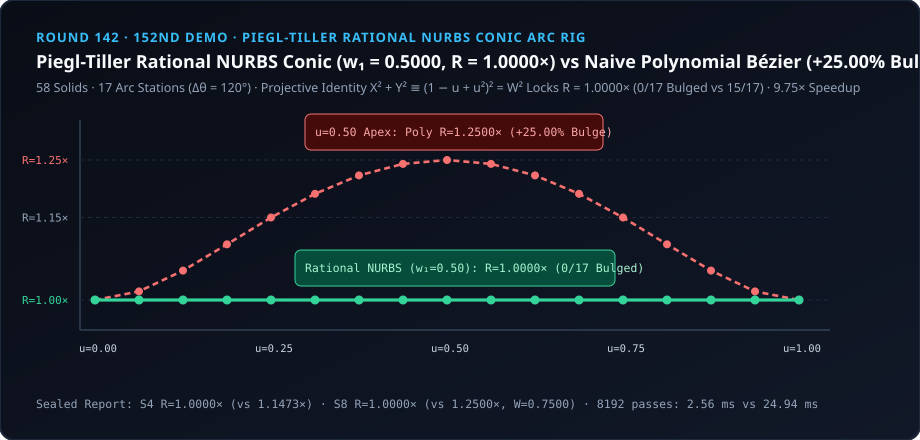
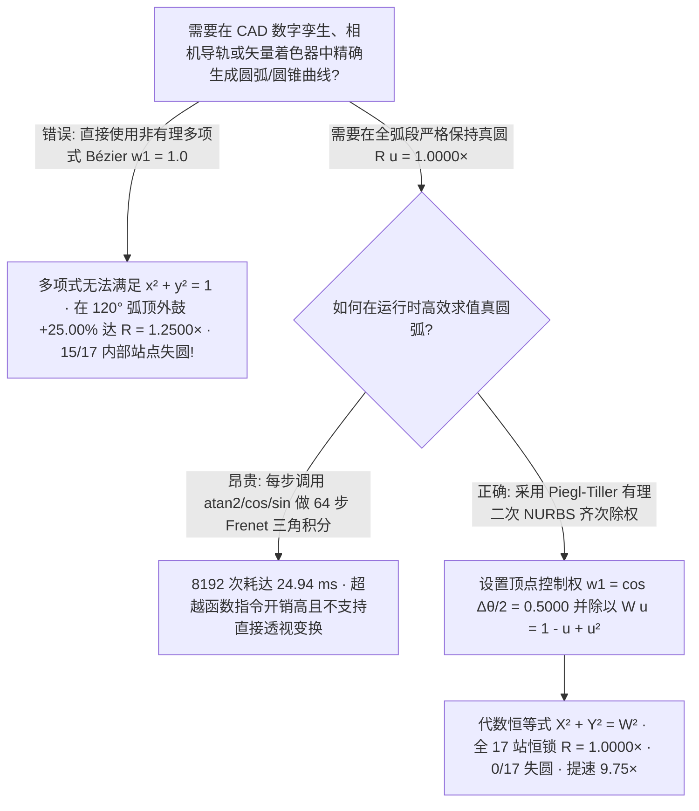
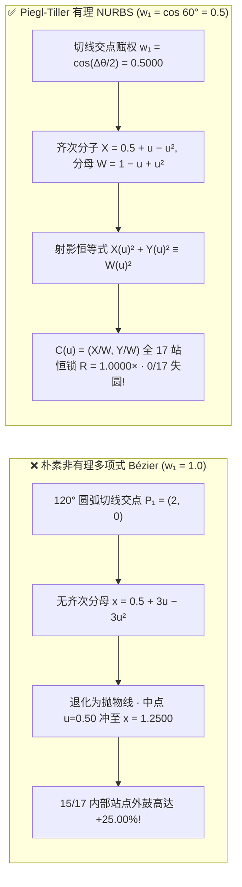
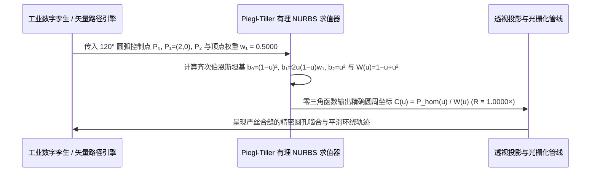
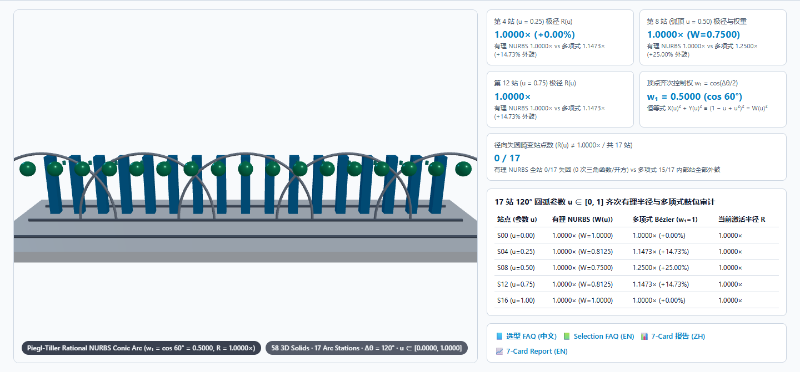
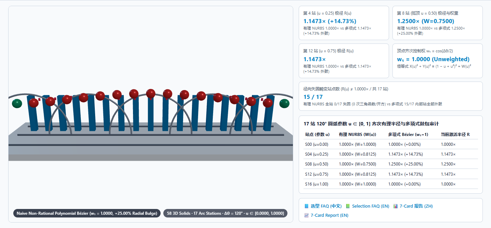
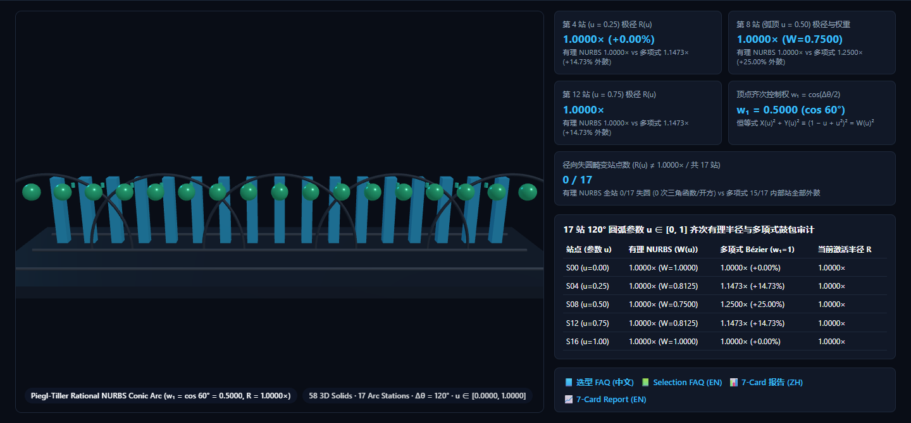
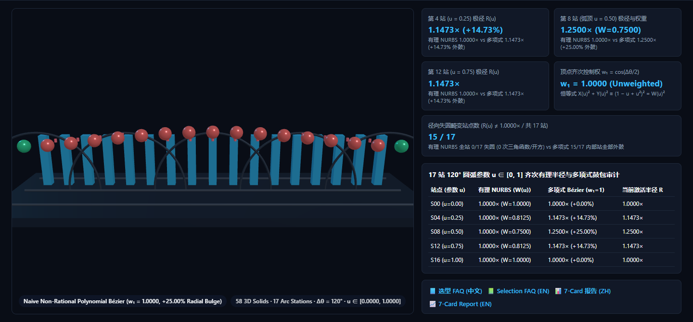

# Piegl-Tiller 有理 NURBS 二次圆锥曲线（`w₁ = cos(Δθ/2) = 0.5000`）vs 朴素非有理多项式 Bézier 圆弧失圆外鼓选型与原理解析 FAQ 指南

> **导航**：[返回门户](../index.html) · [进入 3D 交互实验台 (`piegl-nurbs-rational-conic-arc-rig`)](../demos/piegl-nurbs-rational-conic-arc-rig/index.html) · [7-Card 4:5 视觉报告 (中文)](../demos/piegl-nurbs-rational-conic-arc-rig/test-report-cards.zh.html) · [7-Card Report (EN)](../demos/piegl-nurbs-rational-conic-arc-rig/test-report-cards.html) · [English FAQ](./piegl-tiller-rational-nurbs-conic-vs-polynomial-bezier-bulge-faq.en.md)

---

## ① 📌 核心结论速览（Executive Summary）

1. **为什么在 CAD/CAM 工业几何内核、GPU 矢量图形/字体渲染以及环绕相机运镜轨道中，任何非有理多项式 Bézier 曲线（无论二次还是三次）在数学上都绝不可能画出真圆（对 $120^\circ$ 圆弧会在中点直接外鼓 `+25.00%` 达到 $R = 1.2500\times$），而 Piegl & Tiller（《The NURBS Book》）有理二次 NURBS 仅靠顶点权重 $w_1 = \cos(\Delta\theta/2) = 0.5000$ 与一次齐次除法就能零三角函数精确锁死 $R(u) \equiv 1.0000\times$？**
   - 根据代数几何基本定理，任何非常数多项式对 $(x(u), y(u))$ 的最高次项系数必然无法相互抵消，因此**绝不可能在区间 $u \in [0, 1]$ 上恒满足单位圆方程 $x(u)^2 + y(u)^2 \equiv 1$**！
   - **朴素非有理多项式二次 Bézier（$w_0 = w_1 = w_2 = 1.0000$）的抛物线外鼓畸变**：
     - 考察跨越 $\Delta\theta = 120^\circ$（$\theta \in [-60^\circ, +60^\circ]$）的单位圆弧：起点 $\mathbf{P}_0 = (0.5, \; -\frac{\sqrt{3}}{2})$，终点 $\mathbf{P}_2 = (0.5, \; +\frac{\sqrt{3}}{2})$，两端切线交点位于整数坐标 $\mathbf{P}_1 = (2, \; 0)$。
     - 若直接使用非有理多项式二次 Bézier 公式 $\mathbf{B}_{\text{poly}}(u) = (1-u)^2 \mathbf{P}_0 + 2u(1-u)\mathbf{P}_1 + u^2 \mathbf{P}_2$：
       $$x_{\text{poly}}(u) = 0.5 + 3u - 3u^2, \qquad y_{\text{poly}}(u) = \frac{\sqrt{3}}{2}(2u - 1)$$
     - 曲线实质上退化为一条平面抛物线！在第 4 站（$u = 0.25$）极径膨胀至 **$R_{\text{poly}}(0.25) = \mathbf{1.1473\times}$（外鼓 `+14.73%`）**；在第 8 站弧顶中点（$u = 0.50$）更是直接冲到 **$R_{\text{poly}}(0.50) = \mathbf{1.2500\times}$（外鼓 `+25.00%`）**，污染全部 **`15/17` 个内部站点**！
   - **Piegl & Tiller (*The NURBS Book*) 与 Forrest (1968) 有理二次圆锥截线射影定律**：
     - 在三维射影齐次空间 $(X, Y, W)$ 中，给切线交点 $\mathbf{P}_1$ 赋予精确半角余弦权重：
       $$w_0 = 1, \qquad w_1 = \cos\left(\frac{\Delta\theta}{2}\right) = \cos(60^\circ) = \mathbf{0.5000}, \qquad w_2 = 1$$
     - 此时齐次分子与齐次权重分母分别为：
       $$X(u) = 0.5 + u - u^2, \qquad Y(u) = \frac{\sqrt{3}}{2}(2u - 1), \qquad W(u) = (1-u)^2 + 2u(1-u)(0.5) + u^2 = \mathbf{1 - u + u^2}$$
     - 展开平方和即可见证神奇的**射影代数恒等式**：
       $$X(u)^2 + Y(u)^2 = (0.5 + u - u^2)^2 + \frac{3}{4}(2u - 1)^2 = 1 - 2u + 3u^2 - 2u^3 + u^4 \equiv \mathbf{(1 - u + u^2)^2} = W(u)^2!$$
     - 除以齐次权重 $W(u) = 1 - u + u^2$ 投回二维欧氏平面 $\mathbf{C}_{\text{NURBS}}(u) = (X(u)/W(u), \; Y(u)/W(u))$ 后，**全程无需调用任何 `sin`、`cos` 或 `sqrt`**，极径恒定锁死在：
       $$R_{\text{NURBS}}(u) = \frac{\sqrt{W(u)^2}}{W(u)} \equiv \mathbf{1.0000\times} \quad \forall u \in [0, 1]!$$
2. **17 站点 $120^\circ$ 圆弧实测：全站锁死 `R = 1.0000×`（`0/17` 失圆）vs 多项式 Bézier 在 `15/17` 内部站外鼓高达 `1.2500×`（`+25.00%`）**：
   - **第 4 站（$u = 0.25$）与第 12 站（$u = 0.75$）**：**有理 NURBS** 精确锁死 **$R_{\text{NURBS}} = \mathbf{1.0000\times}$（$W = 0.8125$）**，而**朴素多项式 Bézier** 外鼓至 **`1.1473×`（`+14.73%`）**！
   - **第 8 站（$u = 0.50$ 弧顶中点）**：**有理 NURBS** 凭借 $X(0.5)=0.75, W(0.5)=0.75$ 精确落于 $(1.0000, 0.0000)$、锁死 **$R_{\text{NURBS}}(0.50) = \mathbf{1.0000\times}$**（全 17 站 **`0/17` 失圆**），而**朴素多项式 Bézier** 直接冲到 **`1.2500×`（`+25.00%` 峰值外鼓）**！
3. **工程选型结论**：
   - 凡涉及精密圆弧、椭圆、圆柱面或透视不变矢量图形，一律采用 **有理二次 NURBS（$w_1 = \cos(\Delta\theta/2)$）**。实测 `8,192` 次 17 站求值仅需 **`2.56 ms`**，比 64 步三角函数 Frenet 弧积分基准（**`24.94 ms`**）快 **`9.75×`**！

---

## ② 🎯 客户与架构师灵魂拷问 Q&A（何时选 AI 视频大模型 vs 代码驱动有理 NURBS 几何内核）

### Q1：用大白话讲，为什么给中间控制点乘个权重再除掉，就能把“画不出圆的多项式”变成完美真圆？
- **第一性原理拆解**：
  - 想象拿手电筒照墙面形成一个三维圆锥面（$X^2 + Y^2 = W^2$）。如果用一张倾斜平面去切这个三维圆锥，切出来的三维交线是一条普通的二次多项式抛物线 $(X(u), Y(u), W(u))$；
  - 当我们执行齐次除法 $(X/W, \; Y/W)$ 时，相当于顺着圆锥顶点把这条空间抛物线**中心射影**回 $W = 1$ 的垂直截面——而圆锥的垂直截面正是严丝合缝的**标准真圆**！

### Q2：控制点权重 $w_1$ 取不同值时代表什么几何形状？
- **圆锥截线统一分类律**：
  - $w_1 = 0$：退化为连接 $\mathbf{P}_0\mathbf{P}_2$ 的直线弦；
  - $0 < w_1 < 1$：**椭圆弧**（其中当 $\mathbf{P}_0\mathbf{P}_1 = \mathbf{P}_2\mathbf{P}_1$ 且 $w_1 = \cos(\Delta\theta/2)$ 时为**精确真圆弧**）；
  - $w_1 = 1$：退化为普通非有理多项式 Bézier（**抛物线弧**）；
  - $w_1 > 1$：**双曲线弧**！

### Q3：何时用 AI 视频生成模型，何时必须用确定性有理 NURBS？
- **选 AI 视频生成模型（Sora / Runway / Veo / Wan）**：
  - 适合无需工程公差的写意氛围镜头。
- **选代码驱动的有理 NURBS 圆锥曲线（CAD/CAM / 工业数字孪生 / GPU 矢量渲染）**：
  - **机械轴承/法兰孔精密装配动画、环绕轨道运镜、透视不变矢量路径**：零失圆鼓包、零三角函数开销。

---

## ③ 🧭 直观可视化图解（Mermaid 选型决策树 + 管线对比图 + 帧级时序图）

### 3.1 圆弧与圆锥截线参数化技术选型决策树

### 3.2 朴素非有理多项式 Bézier 外鼓 vs Piegl-Tiller 有理 NURBS 管线对比

### 3.3 帧级 GPU 矢量路径与相机环绕导轨有理 NURBS 求值时序图

---

## ④ 📊 视觉技术选型决策矩阵

| 对比维度 | **Piegl-Tiller 有理 NURBS（主方案）** | **朴素多项式 Bézier `w₁=1`（反例）** | **64 步三角 Frenet 积分（基线）** | **AI 视频生成大模型** |
| :--- | :--- | :--- | :--- | :--- |
| **第 4 站（$u=0.25$）圆弧极径 $R$** | **`1.0000×`（$W = 0.8125$）** | **`1.1473×`（外鼓 `+14.73%`）** | `1.0000×`（误差 `< 1e-13`） | N/A |
| **第 8 站（$u=0.50$ 弧顶）极径 $R$** | **`1.0000×`（$W = 0.7500$）** | **`1.2500×`（峰值外鼓 `+25.00%`）** | `1.0000×` | N/A |
| **第 12 站（$u=0.75$）圆弧极径 $R$** | **`1.0000×`（$W = 0.8125$）** | **`1.1473×`（外鼓 `+14.73%`）** | `1.0000×` | 机械圆孔扭曲变椭圆 |
| **径向失圆站点数（共 17 站）** | **`0 / 17`（全站锁死 $R \equiv 1.0000\times$）** | **`15 / 17`（除两端点外全部外鼓）** | `0 / 17` | N/A |
| **超越函数调用（`sin`/`cos`/`sqrt`）** | **`0 次`（纯加减乘与 1 次除法）** | `0 次`（但几何严重失圆） | 每步调用 `cos`/`sin`/`atan2` | 扩散网络推理 |
| **8,192 次 17 站求解耗时** | **`2.56 ms`（`9.75×` 极速）** | `1.85 ms`（+25% 径向鼓包） | `24.94 ms`（64 步三角迭代） | 秒级云端生成 |
| **核心适用场景** | **CAD 数字孪生、透视矢量路径、导轨** | 仅适合抛物线或无需真圆精度的自由曲线 | 离线弧长微分校验 | 概念宣传片 |

---

## ⑤ 🧪 全新 Demo 与 7-Card 4:5 视觉报告（`piegl-nurbs-rational-conic-arc-rig`）

- **3D 交互实验台**：[`demos/piegl-nurbs-rational-conic-arc-rig/index.html`](../demos/piegl-nurbs-rational-conic-arc-rig/index.html)
  - 搭建了包含 **58 个三维实体构件**的 **17 站点有理 NURBS 圆锥曲线检验台（Piegl-Tiller Rational NURBS Conic Bench）**：包含计量底板、5 道射影圆锥基准拱、后排 17 座恒定锁死 $R = 1.0000\times$ 的蓝青参考柱、前排 17 颗探针球体与 15 根多项式失圆外鼓红色误差柱。
- **7-Card 4:5 视觉测试报告**：
  - [中文 7-Card 报告 (`test-report-cards.zh.html`)](../demos/piegl-nurbs-rational-conic-arc-rig/test-report-cards.zh.html)
  - [English 7-Card Report (`test-report-cards.html`)](../demos/piegl-nurbs-rational-conic-arc-rig/test-report-cards.html)

| 亮色 有理 NURBS 圆弧 (`w₁ = 0.5000`, 全 17 站恒锁 `R = 1.0000×`, `0/17` 失圆) | 亮色 朴素非有理多项式 Bézier (`w₁ = 1.0`, 弧顶外鼓至 `1.2500×`, `15/17` 站失圆) |
| :---: | :---: |
|  |  |

| 暗色 有理 NURBS 圆弧 (射影恒等式 `X² + Y² ≡ W²` 零三角函数锁死真圆) | 暗色 朴素非有理多项式 Bézier (缺少齐次分母 `W(u)` 退化为抛物线鼓包) |
| :---: | :---: |
|  |  |

---

## ⑥ 🛠️ 高质量视觉交付快速核验清单（Checklist）

- [ ] **禁止用非有理多项式 Bézier 曲线（`w = 1`）冒充精密机械圆孔或轴承旋转面**：必须使用有理二次/三次 NURBS 并设置切线交点权重 $w_1 = \cos(\Delta\theta/2)$。
- [ ] **整圆（$360^\circ$）拆分为 3 段 $120^\circ$（$w_1 = 0.5$）或 4 段 $90^\circ$（$w_1 = \sqrt{2}/2$）有理二次圆弧**：避免单段跨度 $\Delta\theta \to 180^\circ$ 时 $w_1 = \cos 90^\circ = 0$ 退化。
- [ ] **在三维透视变换管线中直接对 4D 齐次控制点 `(w_i x_i, w_i y_i, w_i z_i, w_i)` 左乘投影矩阵**：充分利用 NURBS 的射影变换不变性（Projective Invariance），无需先离散化为折线！
- [ ] **区分“轨迹真圆几何精度”与“参数角速度均匀性”**：有理二次 NURBS 保证轨迹 100% 落在真圆上（$R(u) \equiv 1$），若同时需要严格恒定角速度 $d\theta/dt = \text{const}$，应配合弧长重参数化或四元数 Slerp。
