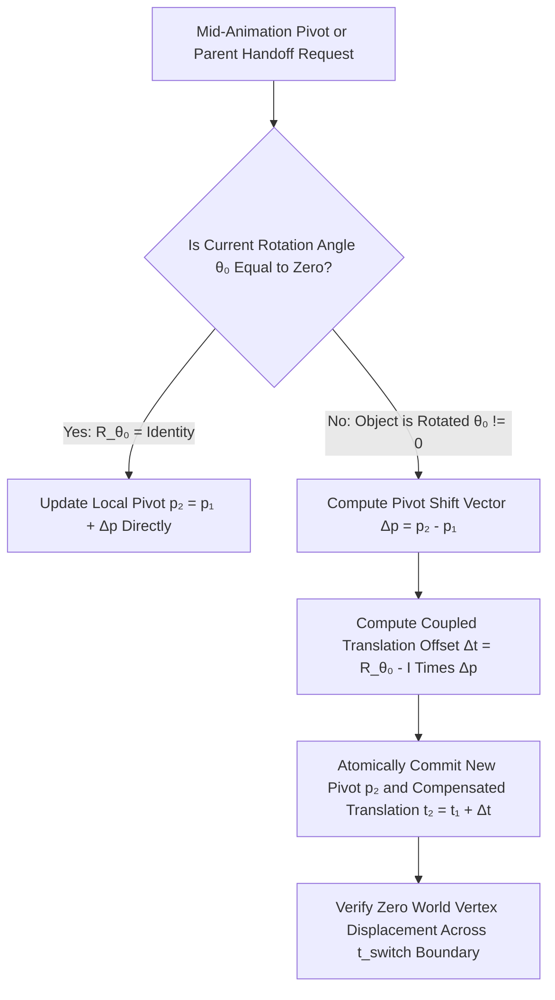
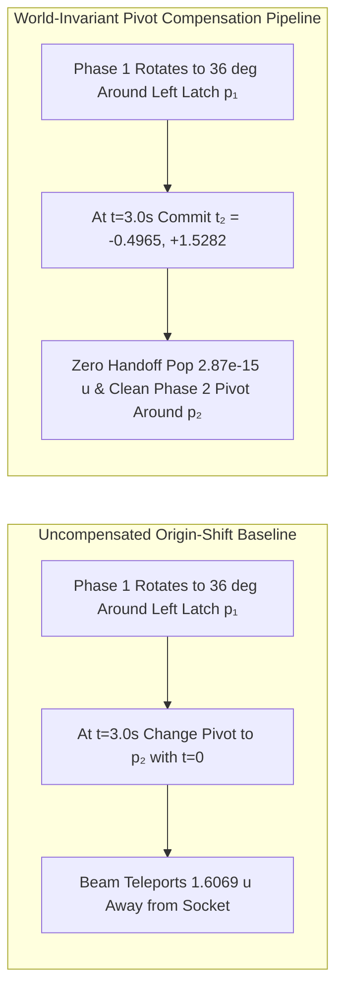
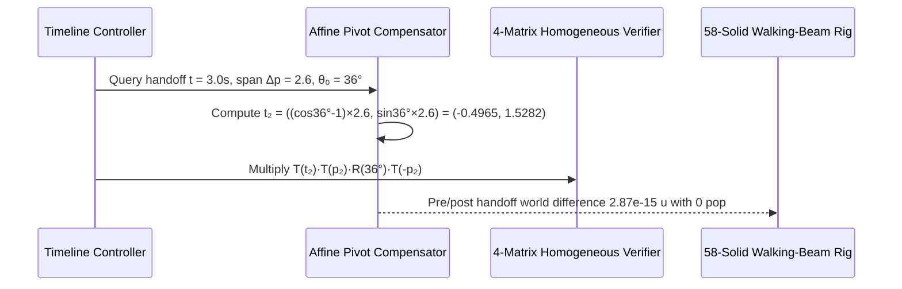

# Changing rotation pivots without position pops: world-invariant pivot compensation vs naive origin shift FAQ

**Understand in 3 minutes why changing a rotated object's pivot makes it teleport across the screen, and reproduce a zero-pop dual-latch walking-beam rig in 10 minutes.**

[中文](pivot-compensation-transform-faq.md) · [Interactive Demo](https://turbo998.github.io/animation/demos/pivot-reanchor-crane/) · [Measured 7-Card Report](../demos/pivot-reanchor-crane/test-report-cards.html)

## ① 📌 Executive Summary

- **Rotating around a local pivot $\mathbf{p}$ via the sandwich matrix $\mathbf{T}(\mathbf{t})\mathbf{T}(\mathbf{p})\mathbf{R}(\theta)\mathbf{T}(-\mathbf{p})$ couples the pivot offset with the current rotation matrix.** Expanding the transform yields $\mathbf{x} = \mathbf{t} + (\mathbf{I} - \mathbf{R}(\theta))\mathbf{p} + \mathbf{R}(\theta)\mathbf{v}$. Whenever $\theta_0 \ne 0$, changing $\mathbf{p}_1 \to \mathbf{p}_2$ without updating $\mathbf{t}$ causes an instantaneous world-space teleport.
- **Exact translation compensation $\mathbf{t}_2 = \mathbf{t}_1 + (\mathbf{R}(\theta_0) - \mathbf{I})(\mathbf{p}_2 - \mathbf{p}_1)$ eliminates the `1.6069 u` handoff pop down to measured `0`.** At `t = 3.0 s` ($\theta_0 = 36^\circ$, latch span $\Delta p = 2.6$), the uncompensated baseline teleports the beam by `1.6069` scene units, whereas compensated handoff preserves world coordinates within `2.87e-15` scene units (floating-point rounding).
- **Direct affine vector compensation matches 4-matrix 3×3 homogeneous chain multiplication with `0` coordinate discrepancy.** At 8192 transforms on Node CPU, direct allocation-free affine evaluation takes `0.96 ms` median versus `7.80 ms` for 4-matrix chain multiplication (`8.15×` faster).
- **58-solid dual-latch walking-beam rig, 13 local acceptance checks.** Scene geometry is `synthetic`; affine handoff continuity and Node CPU timings are `measured`; `Dream2Flow` video 3D object flow and point-cloud robotic grasp synthesis are `not_measured`.

**Daily capability direction check:** *Dream2Flow: Bridging Video Generation and Open-World Manipulation with 3D Object Flow* ([arXiv:2512.24766](https://arxiv.org/abs/2512.24766), submitted 2025-12-31) and *Synthesizing Grasps and Regrasps for Complex Manipulation Tasks* ([arXiv:2501.18075](https://arxiv.org/abs/2501.18075), submitted 2025-01-30) formalize multi-stage pivoting and re-grasping where an object's active screw/pivot axis switches mid-trajectory. When executing such pivot switches in a 3D scene graph or animation rig, translation compensation is mandatory to preserve $C^0$ world-pose continuity across the handoff boundary. Verified 2026-11-10; this demo implements deterministic affine pivot compensation without running video generation or point-cloud grasp planners.

## ② 🎯 Architect & Client Q&A

### Q1 When should we choose video 3D object flow / grasp planners vs deterministic pivot compensation?

Evaluate video-guided manipulation frameworks (`Dream2Flow`) or point-cloud re-grasp planners when inferring *where* a robot should grasp and pivot an unknown object from sensory inputs.

Use deterministic affine pivot compensation whenever implementing **multi-pivot walking beams, multi-stage cabinet hinges, dynamic parent switching (table $\to$ hand $\to$ table), or interactive 3D gizmos that relocate `pivot` / `transform-origin` on an already rotated element**—because without translation compensation, the element will teleport on the handoff frame.

### Q2 Under what constraints is translation-compensated pivot switching strictly superior?

Changing `pivot` directly without modifying `translation` only preserves world positions when the object's current rotation is identically zero ($\mathbf{R}(\theta_0) = \mathbf{I}$).

Whenever $\theta_0 \ne 0$ (here $\theta_0 = 36^\circ$ at $t = 3.0\text{ s}$), shifting the local pivot by $\Delta\mathbf{p} = \mathbf{p}_2 - \mathbf{p}_1$ shifts every vertex on the object by $\|\Delta\mathbf{x}_{\text{pop}}\| = 2 \|\Delta\mathbf{p}\| |\sin(\theta_0 / 2)| = 2 \times 2.6 \times \sin(18^\circ) = 1.6069$ scene units. Applying the closed-form translation compensation $\Delta\mathbf{t} = (\mathbf{R}(\theta_0) - \mathbf{I})\Delta\mathbf{p}$ is strictly required for seamless handoffs.

### Q3 How do three lines of linear algebra eliminate the pivot-switch pop from first principles?

Equate the world position of an arbitrary local vertex $\mathbf{v}$ at handoff angle $\theta_0$ before the switch $(\mathbf{t}_1, \mathbf{p}_1)$ and after the switch $(\mathbf{t}_2, \mathbf{p}_2)$:

$$\mathbf{t}_1 + \mathbf{p}_1 + \mathbf{R}(\theta_0)(\mathbf{v} - \mathbf{p}_1) = \mathbf{t}_2 + \mathbf{p}_2 + \mathbf{R}(\theta_0)(\mathbf{v} - \mathbf{p}_2)$$

Notice that $\mathbf{R}(\theta_0)\mathbf{v}$ cancels out identically on both sides—proving that a single rigid translation $\mathbf{t}_2$ simultaneously keeps **every** vertex of the rigid body stationary at the switch instant:

$$\mathbf{t}_2 = \mathbf{t}_1 + (\mathbf{R}(\theta_0) - \mathbf{I})(\mathbf{p}_2 - \mathbf{p}_1)$$

For $\theta_0 = 36^\circ$, $\Delta\mathbf{p} = (2.6, 0)$, and $\mathbf{t}_1 = (0, 0)$:

$$t_{2,x} = (\cos 36^\circ - 1) \times 2.6 = -0.4965, \quad t_{2,y} = \sin 36^\circ \times 2.6 = +1.5282$$

Its magnitude $\sqrt{(-0.4965)^2 + 1.5282^2} = 1.6069$ exactly cancels the uncompensated teleport vector.

### Q4 How can I reproduce this in 10 minutes?

1. Run `npm run dev` and open `/demos/pivot-reanchor-crane/`, initialized at the handoff instant `t = 3.00 s` ($\theta_0 = 36^\circ$, latch span `2.6`).
2. In `compensated` mode, scrub across `2.98 s` to `3.02 s`: the walking beam pivots around the left orange socket during `0–3 s`, locks its right pin seamlessly into the upper-right orange socket at `t = 3.0 s` (`handoff pop 0.0000 u`), and pivots around the upper-right socket during `3–6 s`.
3. Switch to `uncompensated` mode at `t = 3.00 s`: the active beam detaches from the upper-right socket and teleports `1.6069 u` down and to the right.
4. Adjust Latch span (`1.4–3.4`), Handoff angle (`15°–65°`), and Final angle (`-55°–45°`); test an out-of-range span such as `5.0` to verify atomic rejection and state preservation.
5. Click `Export handoff` to download `PIVOT_COMPENSATION_SPEC.json` with `translation`, `switchPopDistance`, and beam matrices.
6. Run `npx vitest run tests/pivot-crane.test.ts`, then build and run `node scripts/benchmark-pivot-crane.mjs` against a port 4335 preview server.

## ③ 🧭 Visual Diagrams

## ④ 📊 Architect Decision Matrix

| Criterion | Naive Pivot / `transform-origin` Shift (`uncompensated`) | 4×4 Homogeneous Matrix Re-Parenting | Direct Affine Vector Compensation (`compensated`) | Video 3D Object Flow (`Dream2Flow`) |
| --- | --- | --- | --- | --- |
| World-space pop at `t=3.0s` ($\theta_0=36^\circ$) | Teleports by `1.6069` scene units | `0` pop | Measured `2.87e-15` scene units (floating-point zero) | Subject to trajectory optimization residual |
| Formula interpretability & TRS decoupling | Drops coupled term $(\mathbf{R}-\mathbf{I})\Delta\mathbf{p}$ | Requires matrix inversion + TRS decomposition | Explicit closed-form $\Delta\mathbf{t} = (\mathbf{R}(\theta_0)-\mathbf{I})\Delta\mathbf{p}$ | High-level visual motion guidance |
| 8192-query Node CPU solve median | Fast arithmetic (broken position) | `7.80 ms` (4-matrix allocation & multiply) | `0.96 ms` (`8.15×` faster at 8192 transforms) | Seconds of video diffusion & flow extraction |
| Arbitrary timeline seeking / reversal | Visual pop every time scrubber crosses `3.0s` | Deterministic and continuous | Seamless forward/reverse scrubbing across handoff | Requires pre-computed trajectory |
| Best architectural role | Initial setup when $\theta_0 = 0^\circ$ only | Deep scene-graph reparenting | Walking beams, multi-hinge lids, 3D pivot gizmos | Open-world robotic manipulation synthesis |

**Quantitative example:** With local latches at $p_{1,x} = -1.3$ and $p_{2,x} = +1.3$ ($\Delta p_x = 2.6$) and handoff angle $\theta_0 = 36^\circ$, the uncompensated pop distance is $2 \times 2.6 \times \sin(18^\circ) = 1.606888$ scene units. Adding $\mathbf{t}_2 = (-0.4965, +1.5282)$ reduces the handoff discontinuity to `2.87e-15` scene units.

## ⑤ 🧪 New Capability Demo & Benchmark Findings (with 7-Card)

[Sealed data](../demos/pivot-reanchor-crane/report.json) records 58 3D solids, $C^0$ continuity verification across the `t = 3.0 s` pivot handoff, and exact equivalence between direct affine vector compensation and 4-matrix 3×3 homogeneous chain multiplication (`maximum_solver_error = 0`).

| Node CPU Pivot Transform Queries | Direct Affine Compensation Median | 4-Matrix Homogeneous Chain Median |
| --- | --- | --- |
| 128 | 0.19 ms | 0.45 ms |
| 1024 | 1.29 ms | 3.21 ms |
| 8192 | 0.96 ms | 7.80 ms |

Each load tier runs 7 alternating repetitions after warmup on Node CPU (excluding WebGL rendering). Notice that V8 JIT tier-up occurs during the 1024-query tier (`1.29 ms` vs `3.21 ms`) before settling to `0.96 ms` vs `7.80 ms` (`8.15×` speedup) at the 8192-query tier; all raw samples are preserved in `report.json`.

[Measured 7-Card Report (EN)](../demos/pivot-reanchor-crane/test-report-cards.html) · [中文七卡](../demos/pivot-reanchor-crane/test-report-cards.zh.html). Scene geometry is `synthetic`, affine handoff checks and CPU timings are `measured`, and `Dream2Flow` video object flow and robotic grasp force closure are `not_measured`.

## ⑥ 🛠️ Architect Checklist

- [ ] Never change `pivot` or CSS `transform-origin` on a rotated ($\theta_0 \ne 0$) or scaled object without compensating translation.
- [ ] Commit the translation update $\mathbf{t}_2 = \mathbf{t}_1 + (\mathbf{R}(\theta_0) - \mathbf{I})(\mathbf{p}_2 - \mathbf{p}_1)$ in the same atomic frame as the pivot change.
- [ ] Include non-uniform scale $\mathbf{S}$ when present via $\mathbf{t}_2 = \mathbf{t}_1 + (\mathbf{R}\mathbf{S} - \mathbf{I})\Delta\mathbf{p}$.
- [ ] Test $t_{\text{switch}} - \epsilon$ and $t_{\text{switch}}$ in unit tests to assert `< 1e-12` world vertex jump across the handoff.
- [ ] Verify that the newly active pivot $\mathbf{p}_2$ remains stationary in world coordinates throughout Phase 2 ($t \ge t_{\text{switch}}$).
- [ ] Cross-check direct affine compensation against the 4-matrix homogeneous product $\mathbf{T}(\mathbf{t})\mathbf{T}(\mathbf{p})\mathbf{R}(\theta)\mathbf{T}(-\mathbf{p})$.
- [ ] Validate latch span and handoff angle bounds and reject invalid inputs (`pivotSpan = 5.0`) atomically.
- [ ] Verify that forward and reverse timestamp scrubbing across `t = 3.0 s` produce identical world matrices.
- [ ] Separate deterministic scene-graph pivot compensation from high-level grasp synthesis (`Dream2Flow`).
- [ ] Label unexecuted video object flow models, point-cloud grasp planners, and contact friction solvers explicitly as `not_measured`.

**Primary sources:** [Dream2Flow (arXiv:2512.24766)](https://arxiv.org/abs/2512.24766) (submitted 2025-12-31) bridges video generation and robotic manipulation via 3D object flow; [Synthesizing Grasps and Regrasps (arXiv:2501.18075)](https://arxiv.org/abs/2501.18075) (submitted 2025-01-30) models multi-stage pivoting manipulation as sequences of constant screw motions and regrasps. Verified 2026-11-10; this demo is an original deterministic affine pivot-compensation workbench and does not run those neural or point-cloud models.
