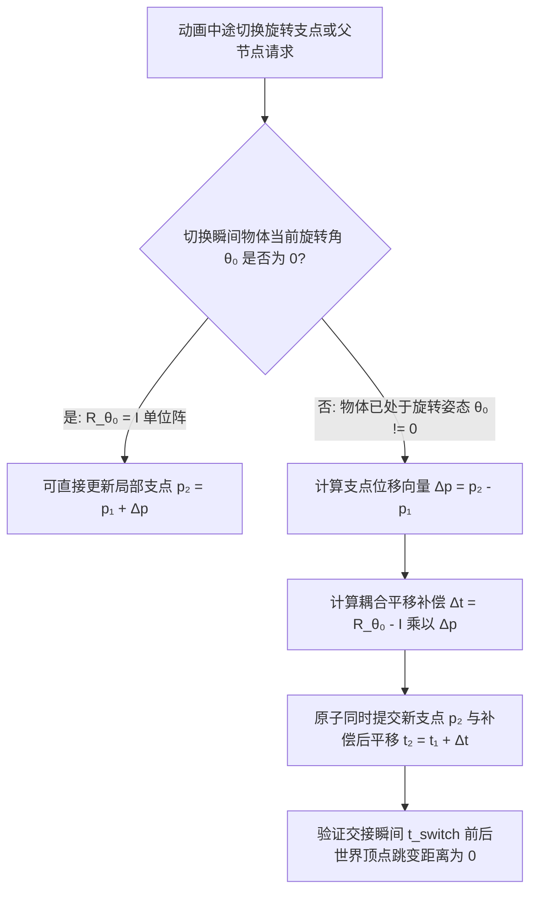
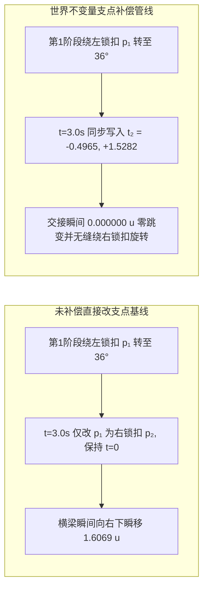
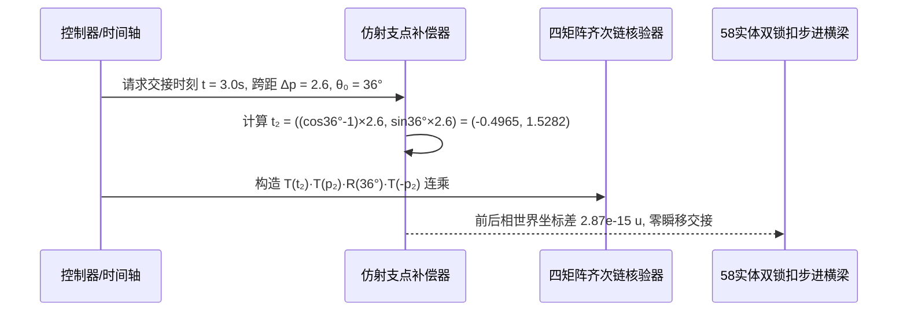

# 切换旋转中心不瞬移：支点补偿变换矩阵与直接改 Pivot 选型 FAQ

**3 分钟看懂为什么动画中途修改旋转中心会让物体瞬移，10 分钟复刻世界坐标零跳变的双锁扣支点交接机构。**

[English](pivot-compensation-transform-faq.en.md) · [交互 Demo](https://turbo998.github.io/animation/demos/pivot-reanchor-crane/) · [中文七卡](../demos/pivot-reanchor-crane/test-report-cards.zh.html)

## ① 📌 核心结论速览

- **绕局部支点 $\mathbf{p}$ 旋转的三明治矩阵 $\mathbf{T}(\mathbf{t})\mathbf{T}(\mathbf{p})\mathbf{R}(\theta)\mathbf{T}(-\mathbf{p})$ 把支点坐标与旋转角耦合进了世界平移项。** 展开后，任意局部顶点 $\mathbf{v}$ 的世界坐标为 $\mathbf{x} = \mathbf{t} + (\mathbf{I} - \mathbf{R}(\theta))\mathbf{p} + \mathbf{R}(\theta)\mathbf{v}$。只要当前旋转角 $\theta_0 \ne 0$，直接把支点从 $\mathbf{p}_1$ 改成 $\mathbf{p}_2$ 就会造成瞬间世界跳变。
- **精确平移补偿公式 $\mathbf{t}_2 = \mathbf{t}_1 + (\mathbf{R}(\theta_0) - \mathbf{I})(\mathbf{p}_2 - \mathbf{p}_1)$ 将交接跳变从 `1.6069 u` 降为实测 `0`。** 在 `t = 3.0 s`（交接角 $\theta_0 = 36^\circ$、双锁扣跨距 $\Delta p = 2.6$）切换支点瞬间，未补偿基线瞬间向右下瞬移 `1.6069` 示意单位，而补偿模式在交接前后的世界坐标跳变仅 `2.87e-15` 示意单位（浮点舍入级）。
- **直接仿射向量补偿与 4 个 3×3 齐次矩阵链式连乘逐位等价。** 两种求解器在全部负载下的最大坐标差为 `0`，8192 次变换计算中位数为 `0.96 ms` 对比 `7.80 ms`（快 `8.15×`）。
- **58 实体双锁扣步进横梁工作台，13 项本机实测验收。** 场景为 `synthetic`；仿射补偿与 Node CPU 耗时为 `measured`；`Dream2Flow` 视频三维物体流提取与机器人点云重抓握力控为 `not_measured`。

**每日能力方向核验：** *Dream2Flow: Bridging Video Generation and Open-World Manipulation with 3D Object Flow*（[arXiv:2512.24766](https://arxiv.org/abs/2512.24766)，2025-12-31 提交）与 *Synthesizing Grasps and Regrasps for Complex Manipulation Tasks*（[arXiv:2501.18075](https://arxiv.org/abs/2501.18075)，2025-01-30 提交）均指出：在多阶段枢轴旋转（Pivoting）与重抓握（Re-grasping）操纵中，物体的瞬时旋转轴（Screw Axis / Pivot）会随阶段切换；在三维场景图或动画控制器中切换有效支点时，必须维持交接时刻的 $C^0$ 世界位姿连续性。2026-11-10 核验原文；本例仅实现确定性支点平移补偿，未运行视频生成或点云抓握规划。

## ② 🎯 客户与架构师灵魂拷问 Q&A

### Q1 何时选视频三维物体流/机器人抓握模型，何时选确定性支点平移补偿？

当需要从单张图像和人类语言指令推理未知物体该如何翻动、在哪里换手重抓时，可评估 `Dream2Flow` 或点云重抓握规划算法。

当在 Three.js、Blender、CSS 3D (`transform-origin`) 或工业数字孪生中实现**双销交替步进机构、翻盖多级铰链、机械手抓取放回（Parent Switching）、或允许用户在已旋转组件上拖动旋转中心手柄**时，确定性支点平移补偿公式是保证画面绝不瞬移的唯一数学法则。

### Q2 在什么约束下支点平移补偿比直接改 `pivot` / `transform-origin` 严格更优？

只有当物体当前旋转角严格等于 $0^\circ$（$\mathbf{R}(\theta_0) = \mathbf{I}$）时，直接修改 `pivot` 才不会改变世界位置。

一旦物体已经旋转了 $\theta_0 \ne 0$（例如第一阶段绕左销轴旋转了 $36^\circ$），直接把 `pivot` 从左端 $(-1.3, 0)$ 改为右端 $(+1.3, 0)$ 会导致整根横梁瞬间跳飞 $2 \|\Delta\mathbf{p}\| \sin(\theta_0/2) = 2 \times 2.6 \times \sin(18^\circ) = 1.6069$ 示意单位！在一切多阶段铰链交接和非破坏性枢轴编辑中，支点平移补偿严格更优。

### Q3 底层管线如何用三行线性代数消除支点交接跳变？

写出交接瞬间 $\theta = \theta_0$ 时同一个局部点 $\mathbf{v}$ 在旧支点 $(\mathbf{t}_1, \mathbf{p}_1)$ 与新支点 $(\mathbf{t}_2, \mathbf{p}_2)$ 下的世界坐标，并令两者相等：

$$\mathbf{t}_1 + \mathbf{p}_1 + \mathbf{R}(\theta_0)(\mathbf{v} - \mathbf{p}_1) = \mathbf{t}_2 + \mathbf{p}_2 + \mathbf{R}(\theta_0)(\mathbf{v} - \mathbf{p}_2)$$

注意等式两边的 $\mathbf{R}(\theta_0)\mathbf{v}$ 项**完全与 $\mathbf{v}$ 无关地自动消去**！移项即得对全物体所有顶点同时成立的唯一平移补偿量：

$$\mathbf{t}_2 = \mathbf{t}_1 + (\mathbf{R}(\theta_0) - \mathbf{I})(\mathbf{p}_2 - \mathbf{p}_1)$$

代入本例二维旋转 $\theta_0 = 36^\circ$、$\Delta\mathbf{p} = (2.6, 0)$、$\mathbf{t}_1 = (0, 0)$：

$$t_{2,x} = (\cos 36^\circ - 1) \times 2.6 = -0.4965, \quad t_{2,y} = \sin 36^\circ \times 2.6 = +1.5282$$

补偿向量的模长 $\sqrt{(-0.4965)^2 + 1.5282^2} = 1.6069$ 恰好抵消了未补偿基线的瞬移量！

### Q4 十分钟如何复刻？

1. `npm run dev` 后打开 `/demos/pivot-reanchor-crane/`，默认停在交接时刻 `t = 3.00 s`（$\theta_0 = 36^\circ$、锁扣跨距 `2.6`）。
2. 在支点平移补偿模式（`compensated`）下，在 `2.98 s` 与 `3.02 s` 之间来回拖动滑块：`0–3 s` 绕左侧锁座旋转，`3.0 s` 交接瞬间右端销轴精准落入右上橙色锁座（`handoff pop = 0.0000 u`），`3–6 s` 改为绕右上锁座反向旋转。
3. 切换到直接改支点基线（`uncompensated`）：在 `t = 3.00 s` 处，前景横梁瞬间脱离右上锁座，向右下跳飞 `1.6069 u`。
4. 修改锁扣跨距（`1.4–3.4`）、交接角（`15°–65°`）与终态角（`-55°–45°`）；若输入越界跨距 `5.0`，系统原子拒绝并保留有效配置。
5. 点击导出 `PIVOT_COMPENSATION_SPEC.json`，核验补偿平移向量 `translation` 与世界矩阵。
6. 运行 `npx vitest run tests\pivot-crane.test.ts`；构建并在 4335 端口预览后执行 `node scripts\benchmark-pivot-crane.mjs`。

## ③ 🧭 直观可视化图解

## ④ 📊 Architect Decision Matrix

| 评估维度 | 直接修改 `pivot` / `transform-origin` (`uncompensated`) | 4×4 齐次矩阵逆乘重挂接 (`M_new = P_2^-1 M_old`) | 本例闭式仿射向量补偿 (`compensated`) | 视频物体流重抓握 (`Dream2Flow`) |
| --- | --- | --- | --- | --- |
| `t=3.0s`（$\theta_0=36^\circ$）交接瞬移量 | 瞬间跳变 `1.6069` 示意单位 | `0` 跳变 | 实测 `2.87e-15` 示意单位（浮点级零跳变） | 依赖轨迹优化收敛精度 |
| 公式可解释性与参数解耦 | 丢失旋转耦合项 $(\mathbf{R}-\mathbf{I})\Delta\mathbf{p}$ | 矩阵链连乘，需分解回 TRS | 显式给出平移增量 $\Delta\mathbf{t} = (\mathbf{R}(\theta_0)-\mathbf{I})\Delta\mathbf{p}$ | 用于高层视觉动作规划 |
| 8192 次变换 Node CPU 耗时中位数 | 快（但位置错误） | `7.80 ms`（4 矩阵齐次连乘开销） | `0.96 ms`（比 4 矩阵连乘快 `8.15×`） | 需秒级视频扩散与流提取 |
| 任意时间轴拖拽与逆序重访 | 跨 `3.0s` 时发生视觉闪烁跳变 | 确定性连续 | 正逆序跨越交接点完全平滑无跳变 | 需预计算整段轨迹 |
| 适用工程场景 | 仅限未旋转（$\theta=0$）初始设置 | 复杂深层嵌套骨骼父子切换 | 双销步进机构、多铰链翻盖、3D 枢轴手柄 | 开放世界机器人视觉操纵 |

**定量算例：** 双锁扣局部坐标分别为 $p_{1,x} = -1.3$ 与 $p_{2,x} = +1.3$（$\Delta p_x = 2.6$）。当横梁绕左锁扣逆时针转至 $\theta_0 = 36^\circ$ 时，瞬移弦长公式给出 $2 \times 2.6 \times \sin(18^\circ) = 5.2 \times 0.309017 = 1.606888$ 示意单位。写入补偿平移 $\mathbf{t}_2 = (-0.4965, +1.5282)$ 后，交接前后的世界坐标差降为 `2.87e-15` 示意单位。

## ⑤ 🧪 全新 Demo 与 Benchmark 核心发现（含 7-Card）

[封存数据](../demos/pivot-reanchor-crane/report.json)记录了 58 个三维实体、`t = 3.0 s` 支点交接瞬间的连续性核验，以及直接仿射向量补偿与 4 个 3×3 齐次矩阵链式连乘求解器的等价性与耗时对照。两种求解方式在全部负载下的最大坐标差为 `0`。

| Node CPU 支点变换查询数 | 直接仿射向量补偿中位数 | 四矩阵齐次链式连乘中位数 |
| --- | --- | --- |
| 128 | 0.19 ms | 0.45 ms |
| 1024 | 1.29 ms | 3.21 ms |
| 8192 | 0.96 ms | 7.80 ms |

每档负载在预热后按交替顺序重复 7 次，记录 Node CPU 耗时中位数（不含 WebGL 渲染）。注意：在 8192 次批量下，V8 JIT 对无数组分配的直接仿射路径完成了内联优化（`0.96 ms` 对比 4 矩阵分配连乘 `7.80 ms`，快约 `8.15×`），而在 1024 次档位两路径刚触发 JIT 编译转换，原始样本均完整保留于 `report.json`。

[中文七卡](../demos/pivot-reanchor-crane/test-report-cards.zh.html) · [English](../demos/pivot-reanchor-crane/test-report-cards.html)。画面为 `synthetic`，仿射变换与 CPU 计时为 `measured`；`Dream2Flow` 视频三维物体流与机器人点云抓握力控为 `not_measured`。

## ⑥ 🛠️ Architect Checklist

- [ ] 绝不在物体已旋转（$\theta_0 \ne 0$）或已缩放状态下仅修改 `pivot` / `transform-origin` 而不补偿平移。
- [ ] 在切换局部支点 $\Delta\mathbf{p} = \mathbf{p}_2 - \mathbf{p}_1$ 的同一原子帧内，更新平移向量 $\mathbf{t}_2 = \mathbf{t}_1 + (\mathbf{R}(\theta_0) - \mathbf{I})\Delta\mathbf{p}$。
- [ ] 若同时包含非均匀缩放 $\mathbf{S}$，按完整三明治展开式 $\mathbf{t}_2 = \mathbf{t}_1 + (\mathbf{R}\mathbf{S} - \mathbf{I})\Delta\mathbf{p}$ 计算补偿。
- [ ] 在自动化测试中采样交接时刻左右无穷小邻域（$t_{\text{switch}} - \epsilon$ 与 $t_{\text{switch}}$），验证所有关键顶点世界位移 `< 1e-12`。
- [ ] 验证交接后（$t > t_{\text{switch}}$）新支点 $\mathbf{p}_2$ 在世界坐标系中保持静止不动。
- [ ] 用完整的 4 矩阵齐次连乘 $\mathbf{T}(\mathbf{t})\mathbf{T}(\mathbf{p})\mathbf{R}(\theta)\mathbf{T}(-\mathbf{p})$ 与直接仿射公式做独立交叉核验。
- [ ] 对锁扣跨距、交接角与终态角执行参数边界校验，对越界参数执行原子拒绝。
- [ ] 验证正序与逆序拖拽时间滑块跨越交接点时，导出的世界变换矩阵完全一致。
- [ ] 区分确定性场景图支点补偿与视觉抓握点规划（如 `Dream2Flow`），各司其职。
- [ ] 未执行的视频物体流重建、点云力闭合分析与接触摩擦仿真统一标注为 `not_measured`。

**一手来源：** [Dream2Flow (arXiv:2512.24766)](https://arxiv.org/abs/2512.24766)（2025-12-31 提交）通过三维物体流将生成视频中的物体运动转化为机器人操纵轨迹；[Synthesizing Grasps and Regrasps (arXiv:2501.18075)](https://arxiv.org/abs/2501.18075)（2025-01-30 提交）将复杂枢轴翻动形式化为分段常旋量运动与重抓握切换。2026-11-10 核验；本例为原创确定性支点平移补偿测试台，未运行上述视觉与抓握模型。
