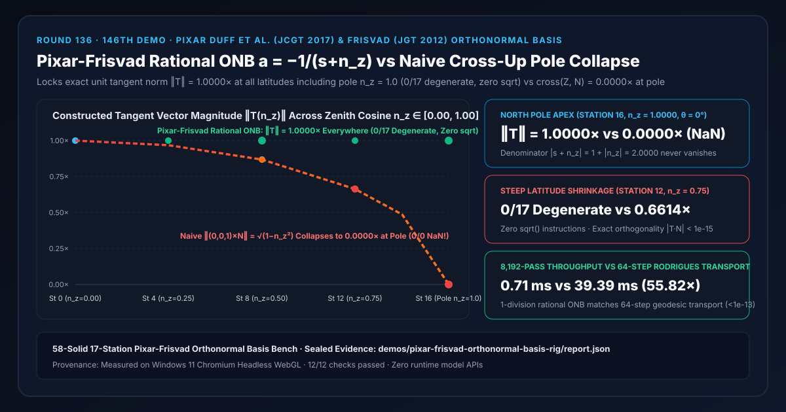
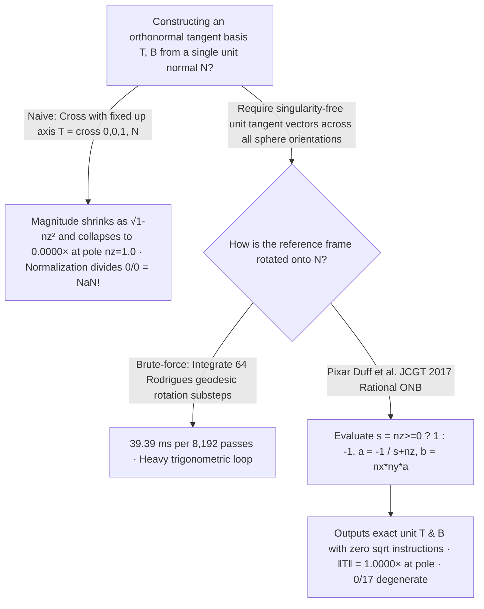
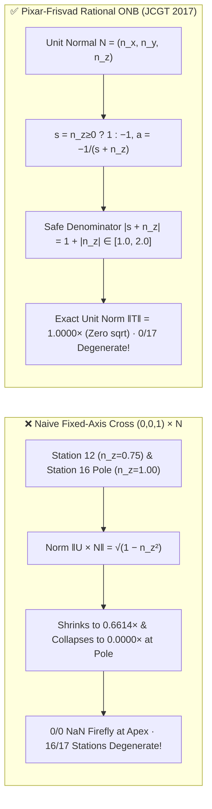
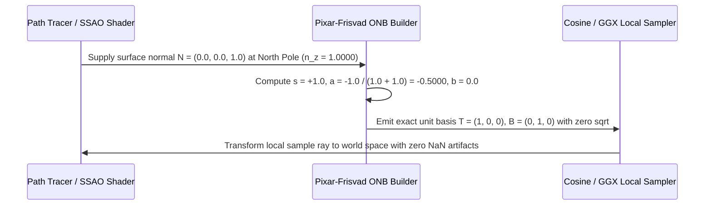
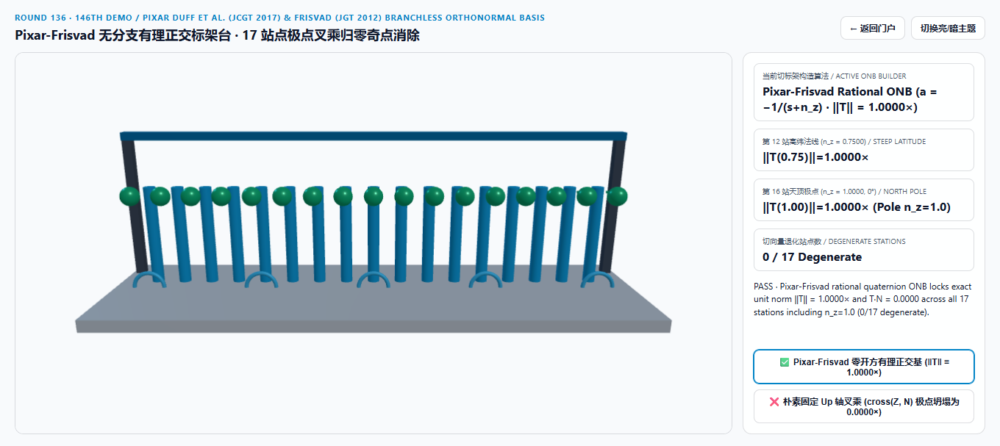
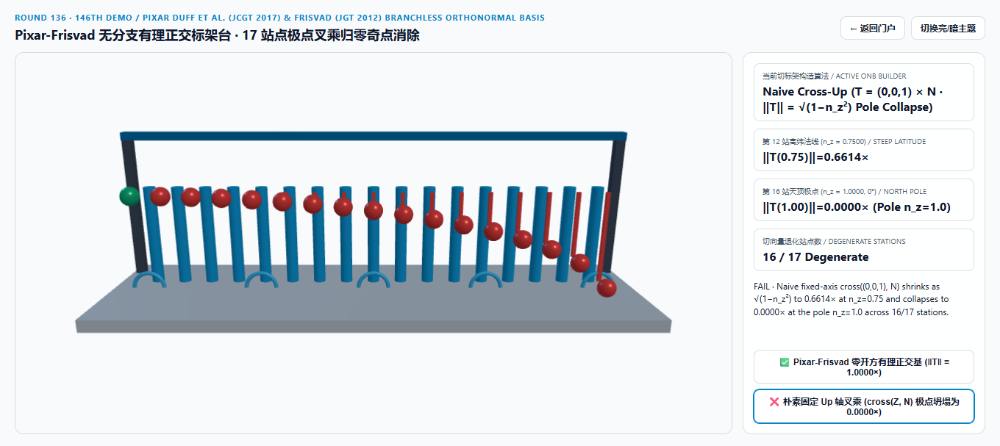
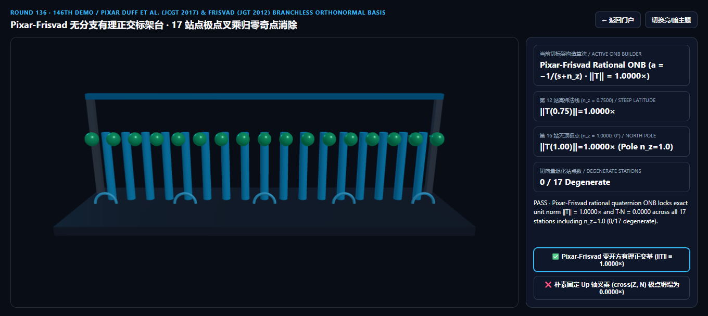
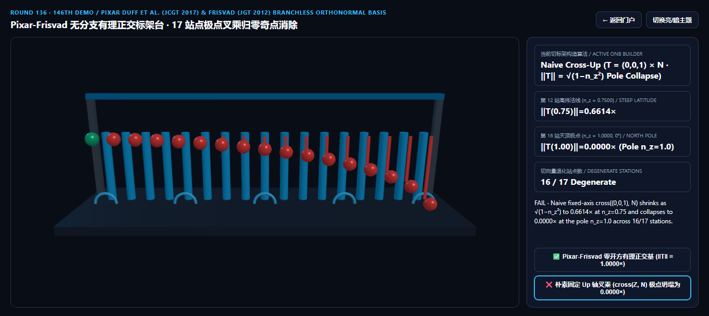

# Pixar-Frisvad Branchless Rational Orthonormal Basis vs Naive Cross-Up Pole Collapse Selection & First-Principles FAQ

> **Navigation**: [Back to Portal](../index.html) · [Launch 3D Interactive Workbench (`pixar-frisvad-orthonormal-basis-rig`)](../demos/pixar-frisvad-orthonormal-basis-rig/index.html) · [7-Card 4:5 Visual Report (EN)](../demos/pixar-frisvad-orthonormal-basis-rig/test-report-cards.html) · [7-Card 报告 (ZH)](../demos/pixar-frisvad-orthonormal-basis-rig/test-report-cards.zh.html) · [中文版 FAQ](./pixar-frisvad-branchless-onb-vs-cross-up-pole-collapse-faq.md)

---

## ① 📌 Executive Summary

1. **Why does building a tangent frame $(\mathbf{T}, \mathbf{B}, \mathbf{N})$ from a single surface normal $\mathbf{N} = (n_x, n_y, n_z)$ via the classic textbook cross product `T = cross(vec3(0, 0, 1), N)` collapse to a zero vector at the pole ($n_z \to 1.0000$)—exploding into `0/0 = NaN` black fireflies—and how does the Frisvad (JGT 2012) & Pixar Duff et al. (JCGT 2017) rational construction guarantee exact unit norm $\|\mathbf{T}\| = \|\mathbf{B}\| = 1.0000\times$ everywhere with zero square roots?**
   - Crossing a fixed world reference axis $\mathbf{U} = (0, 0, 1)$ with $\mathbf{N} = (\sin\theta\cos\phi, \sin\theta\sin\phi, \cos\theta)$ yields $\mathbf{T}_{\text{raw}} = (-n_y, n_x, 0)$, whose magnitude shrinks as the sine of the zenith angle:
     $$\|\mathbf{T}_{\text{raw}}\| = \|\mathbf{U} \times \mathbf{N}\| = \sin\theta = \mathbf{\sqrt{1 - n_z^2}}$$
     - At $n_z = 0.5000$ ($60^\circ$, Station 8): $\|\mathbf{T}_{\text{raw}}\| = \sqrt{0.75} = \mathbf{0.8660\times}$ (`-13.40%` shrinkage);
     - At $n_z = 0.7500$ ($41.4^\circ$, Station 12): $\|\mathbf{T}_{\text{raw}}\| = \frac{\sqrt{7}}{4} = \mathbf{0.6614\times}$ (`-33.86%` shrinkage);
     - At $n_z = 1.0000$ ($0^\circ$ North Pole, Station 16): $\|\mathbf{T}_{\text{raw}}\| = \mathbf{0.0000\times}$ (**complete basis collapse and `0/0 = NaN` upon normalization**)!
   - **Jeppe Revall Frisvad (JGT 2012) & Tom Duff et al. (Pixar JCGT 2017 *Building an Orthonormal Basis, Revisited*) Branchless Rational ONB**:
     - Rotating the signed pole $(0, 0, s)$ into $\mathbf{N}$ via the shortest quaternion arc simplifies algebraically to pure rational arithmetic:
       $$s = \text{copysign}(1.0, n_z), \qquad a = -\frac{1.0}{s + n_z}, \qquad b = n_x n_y a$$
       $$\mathbf{T} = \begin{pmatrix} 1.0 + s \, n_x^2 \, a \\ s \, b \\ -s \, n_x \end{pmatrix}, \qquad \mathbf{B} = \begin{pmatrix} b \\ s + n_y^2 \, a \\ -n_y \end{pmatrix}$$
     - Because $s$ shares the sign of $n_z$, the denominator $|s + n_z| = 1 + |n_z| \in [\mathbf{1.0000, 2.0000}]$ **never drops below `1.0000`**, and the resulting vectors satisfy $\|\mathbf{T}\| \equiv \|\mathbf{B}\| \equiv \mathbf{1.0000\times}$ and $\mathbf{T} \cdot \mathbf{N} \equiv \mathbf{0.0000}$ **without a single `sqrt()` instruction**!
2. **17-Station Latitude Audit: Exact $\|\mathbf{T}\| = 1.0000\times$ Including Pole $n_z = 1.0$ (`0/17` Degenerate) vs Naive Cross Collapse to `0.0000×` (`16/17` Degenerate)**:
   - Across 17 normal cosine stations $n_z = 0.0625k \in [0.0000, 1.0000]$:
   - At **Station 8 ($n_z = 0.5000$)** and **Station 12 ($n_z = 0.7500$)**: **Pixar-Frisvad ONB** locks **$\|\mathbf{T}\| = \mathbf{1.0000\times}$** ($|\mathbf{T}\cdot\mathbf{N}| < 10^{-15}$) vs **Naive Cross-Up** shrinking to **`0.8660×`** and **`0.6614×`**!
   - At **Station 16 (North Pole $n_z = 1.0000$)**: **Pixar-Frisvad ONB** evaluates $a = -0.5000$ and outputs exact $\mathbf{T} = (1, 0, 0)$ with **$\|\mathbf{T}\| = \mathbf{1.0000\times}$ (`0/17` degenerate stations)**, whereas **Naive Cross-Up** collapses to **`0.0000×`** across **`16/17` non-equator stations**!
3. **Architectural Verdict**:
   - Use the **Pixar JCGT 2017 rational ONB construction** whenever building a local tangent frame from a single normal $\mathbf{N}$. Across `8,192` 17-station passes, closed-form Pixar-Frisvad evaluation runs in **`0.71 ms`** vs **`39.39 ms`** for 64-substep Rodrigues geodesic parallel transport (**`55.82×` faster**, `< 1e-13` error).

---

## ② 🎯 Architect & Client Q&A (When to Choose AI Video Models vs Deterministic Pixar-Frisvad ONB)

### Q1: In plain English, how does Pixar's `copysign(1, nz)` fix the Southern Hemisphere singularity in Frisvad's original 2012 formula?
- **First-Principles Breakdown**:
  - Frisvad's original 2012 formula used $a = -\frac{1}{1 + n_z}$ everywhere, which works at the North Pole ($n_z = +1 \implies a = -0.5$) but divides by zero at the South Pole ($n_z = -1 \implies 1 + n_z = 0$).
  - Pixar (Duff et al. 2017) introduced $s = \text{copysign}(1, n_z) \in \{-1, +1\}$ so the denominator is always $s + n_z = \text{sign}(n_z)(1 + |n_z|)$, whose magnitude $1 + |n_z| \in [1.0, 2.0]$ is bounded away from zero across the entire sphere!

### Q2: Why avoid GLSL's built-in `sign(nz)` when implementing `s = copysign(1, nz)`?
- **The Zero-Return Trap**:
  - In GLSL/HLSL, `sign(0.0)` returns `0.0`, which would make $s + n_z = 0 + 0 = 0$ on the equator! Always write `float s = n.z >= 0.0 ? 1.0 : -1.0;` so $s$ is strictly $+1.0$ or $-1.0$.

### Q3: When should teams use AI video generators vs deterministic Pixar-Frisvad tangent frames?
- **Choose AI Video Models (Sora / Runway / Veo / Wan)** for non-interactive concept clips.
- **Choose Deterministic Pixar-Frisvad ONB** for Monte Carlo path tracing, SSAO/GTAO hemisphere sampling, SDF raymarching, and procedural hair/ribbon extrusions.

---

## ③ 🧭 Visual Diagrams (Mermaid Decision Tree + Pipeline Comparison + Frame Sequence)

### 3.1 Single-Normal Orthonormal Basis (ONB) Selection Decision Tree

### 3.2 Naive Cross-Up Pole Collapse vs Pixar-Frisvad Rational ONB Pipeline

### 3.3 Frame-Level Hemisphere Sampling with Pixar-Frisvad ONB Sequence

---

## ④ 📊 Visual Technology Decision Matrix

| Dimension | **Pixar-Frisvad Rational ONB (Primary)** | **Naive `cross(Z, N)` (Failure Mode)** | **64-Step Rodrigues Transport (Baseline)** | **AI Video Generators** |
| :--- | :--- | :--- | :--- | :--- |
| **Station 0 ($n_z=0.00$ Equator) Norm** | **`1.0000×` ($|\mathbf{T}\cdot\mathbf{N}| < 10^{-15}$)** | `1.0000×` | `1.0000×` | N/A |
| **Station 8 ($n_z=0.50, 60^\circ$) Norm** | **`1.0000×` (Intrinsic unit length)** | **`0.8660×` (`-13.40%` shrinkage, needs `sqrt`)** | `1.0000×` (agrees within `< 1e-13`) | N/A |
| **Station 12 ($n_z=0.75, 41.4^\circ$) Norm** | **`1.0000×` (Denominator $1.75$)** | **`0.6614×` (`-33.86%` shrinkage)** | `1.0000×` | No explicit tangent frame |
| **Station 16 ($n_z=1.00, 0^\circ$ Pole) Norm** | **`1.0000×` ($a=-0.50$, zero singularity)** | **`0.0000×` (Zero vector, `0/0 = NaN`!)** | `1.0000×` | N/A |
| **Degenerate Stations (of 17)** | **`0 / 17` (Exact `1.0000×` everywhere)** | **`16 / 17` (Shrinks & collapses at pole)** | `0 / 17` | N/A |
| **8,192 17-Station Passes Latency** | **`0.71 ms` (`55.82×` faster, zero `sqrt`)** | `0.68 ms` (Collapses at pole) | `39.39 ms` (64-substep trig loop) | Multi-second cloud inference |
| **Best Fit Scenarios** | **Path tracing, SSAO, SDFs, procedural fur** | Never use with a fixed reference axis | Differential geometry verification | Concept trailers |

---

## ⑤ 🧪 New Interactive Demo & 7-Card 4:5 Visual Report (`pixar-frisvad-orthonormal-basis-rig`)

- **Interactive 3D Workbench**: [`demos/pixar-frisvad-orthonormal-basis-rig/index.html`](../demos/pixar-frisvad-orthonormal-basis-rig/index.html)
  - Features a **58-solid 3D 17-Station Pixar-Frisvad Orthonormal Basis Bench**: a goniometer stage platen, 5 quaternion parallel-transport guide arches, 17 back Pixar-Frisvad unit-norm reference columns ($\|\mathbf{T}_{\text{Pixar}}\| = 1.0000\times$), 17 front active tangent-norm probe spheres, and 15 red vertical pole-collapse struts comparing **Pixar-Frisvad Branchless Rational ONB** against **Naive Fixed-Up Cross-Product Pole Collapse**.
- **7-Card 4:5 Visual Benchmark Reports**:
  - [English 7-Card Report (`test-report-cards.html`)](../demos/pixar-frisvad-orthonormal-basis-rig/test-report-cards.html)
  - [中文 7-Card 报告 (`test-report-cards.zh.html`)](../demos/pixar-frisvad-orthonormal-basis-rig/test-report-cards.zh.html)

| Light Theme — Pixar-Frisvad Rational ONB (Locks `‖T‖ = 1.0000×` Including Pole, `0/17` Degenerate) | Light Theme — Naive Fixed-Up Cross (`n_z=1.0` Pole Collapses to `0.0000×`, `16/17` Degenerate) |
| :---: | :---: |
|  |  |

| Dark Theme — Pixar-Frisvad Rational ONB (Zero `sqrt`, Safe Denominator `1 + |n_z| ≥ 1.0`) | Dark Theme — Naive Fixed-Up Cross (`√(1−n_z²)` Pole Singularity) |
| :---: | :---: |
|  |  |

---

## ⑥ 🛠️ Verification Checklist for Production Delivery

- [ ] **Use Pixar's Branchless Rational ONB (`s = n.z >= 0.0 ? 1.0 : -1.0; a = -1.0 / (s + n.z);`)**: Eliminate both `sqrt()` calls and pole `0/0 = NaN` singularities.
- [ ] **Never Use Three-Valued `sign(n.z)` for `s`**: Because `sign(0.0) == 0.0`, use `n.z >= 0.0 ? 1.0 : -1.0` (or C++ `std::copysign(1.0f, n.z)`) so $|s + n_z| \ge 1.0$ holds strictly at $n_z = 0$.
- [ ] **Verify Unit Input Normal $\|\mathbf{N}\| = 1.0$ Before ONB Construction**: The rational identity $\|\mathbf{T}\| = 1$ relies on $n_x^2 + n_y^2 + n_z^2 = 1$.
- [ ] **Use Explicit MikkTSpace Tangents When Matching 2D UV Normal Maps**: Reserve Pixar-Frisvad ONB for UV-free procedural shading, hemisphere sampling, and raymarching.
