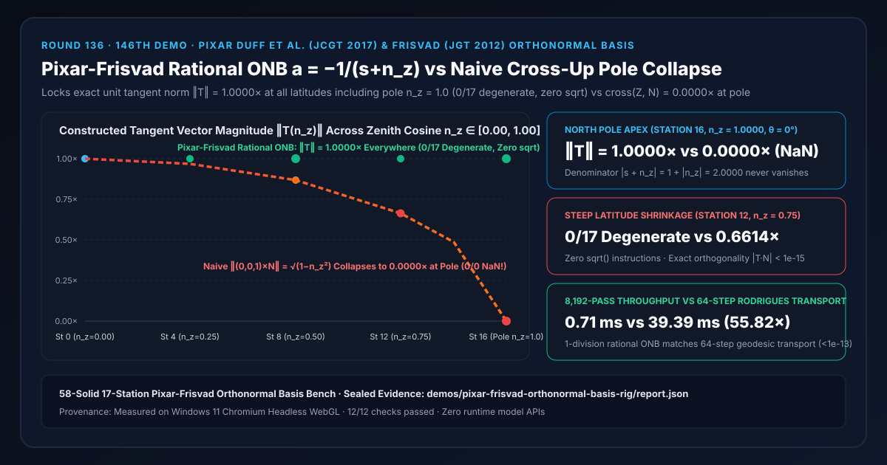
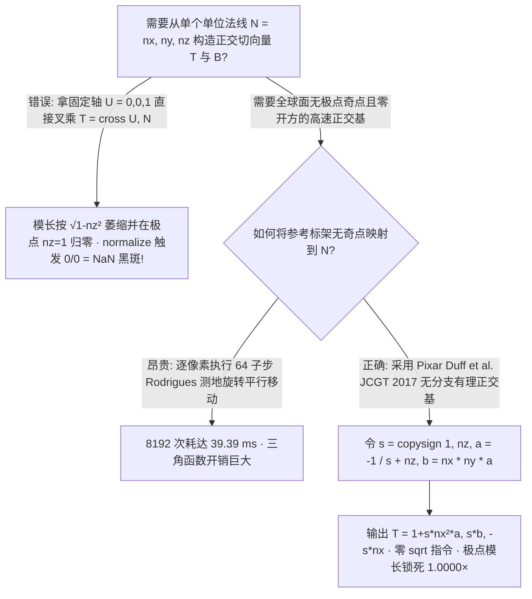
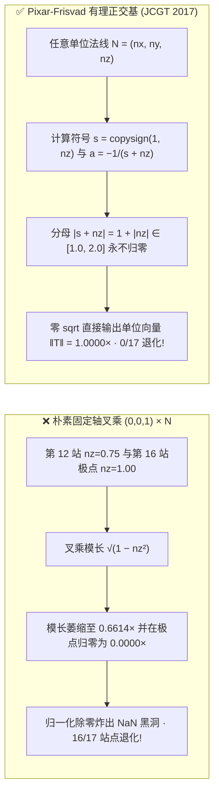
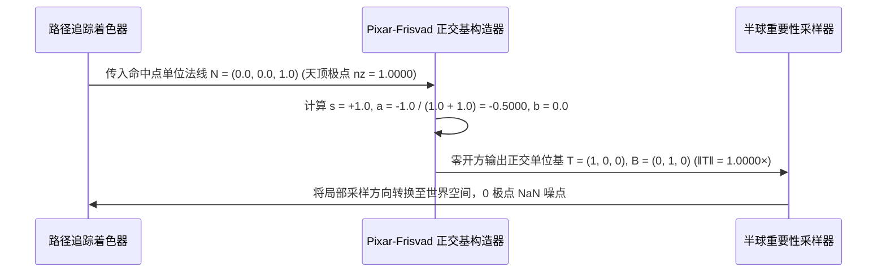
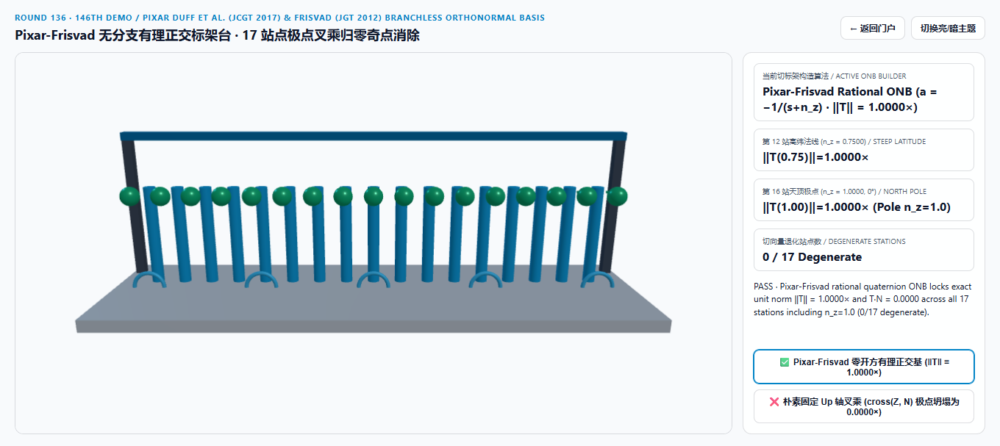
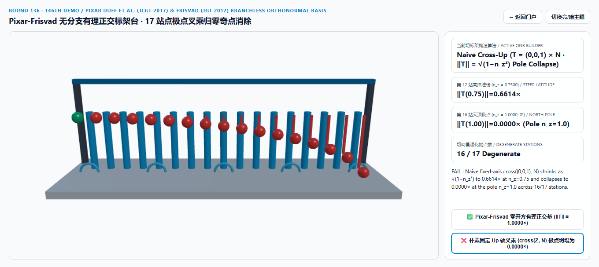
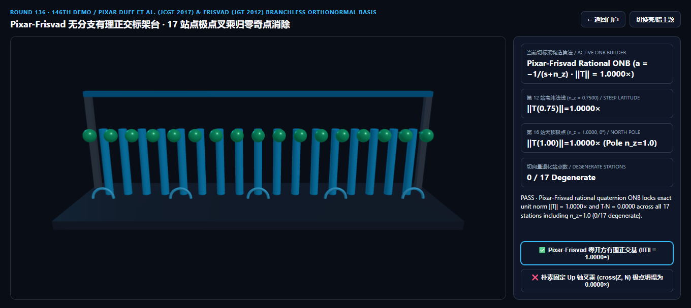
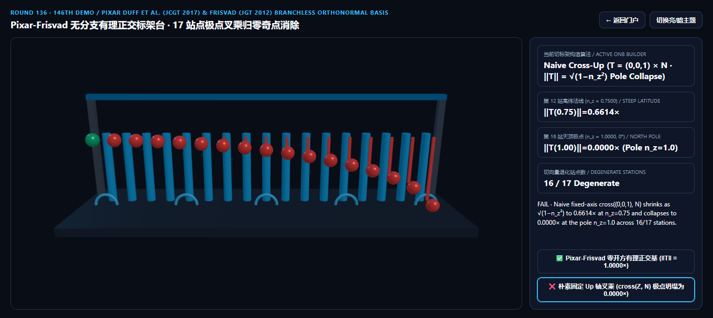

# Pixar-Frisvad 无分支有理正交基构造（Branchless Rational Orthonormal Basis `a = −1 / (s + n_z)`）vs 朴素固定 Up 轴叉乘（`cross(Z, N)`）极点归零奇点选型与原理解析 FAQ 指南

> **导航**：[返回门户](../index.html) · [进入 3D 交互实验台 (`pixar-frisvad-orthonormal-basis-rig`)](../demos/pixar-frisvad-orthonormal-basis-rig/index.html) · [7-Card 4:5 视觉报告 (中文)](../demos/pixar-frisvad-orthonormal-basis-rig/test-report-cards.zh.html) · [7-Card Report (EN)](../demos/pixar-frisvad-orthonormal-basis-rig/test-report-cards.html) · [English FAQ](./pixar-frisvad-branchless-onb-vs-cross-up-pole-collapse-faq.en.md)

---

## ① 📌 核心结论速览（Executive Summary）

1. **为什么在 SDF 光线步进（Raymarching）、屏幕空间环境光遮蔽（SSAO/GTAO）半球采样、毛发/丝带法线挤出以及蒙特卡洛路径追踪中，仅凭单个单位表面法线 $\mathbf{N} = (n_x, n_y, n_z)$ 当场构造切空间标架 $(\mathbf{T}, \mathbf{B}, \mathbf{N})$ 时，直接写 `T = cross(vec3(0, 0, 1), N)` 会在物体顶部极点（$n_z \to 1.0000$）坍缩为零向量并炸出 `0/0 = NaN` 黑斑？**
   - 当我们用一个固定的世界朝上向量 $\mathbf{U} = (0, 0, 1)$ 与表面法线 $\mathbf{N} = (\sin\theta\cos\phi, \sin\theta\sin\phi, \cos\theta)$ 做叉乘 $\mathbf{T}_{\text{raw}} = \mathbf{U} \times \mathbf{N} = (-n_y, n_x, 0)$ 时：
     - 根据向量外积模长公式，生成的原始切向量长度为：
       $$\|\mathbf{T}_{\text{raw}}\| = \|\mathbf{U} \times \mathbf{N}\| = \sin\theta = \mathbf{\sqrt{1 - n_z^2}}$$
     - 随着表面法线接近天顶极点（$n_z = \cos\theta \to 1.0000$）：
       - 在 $n_z = 0.5000$（$60^\circ$，第 8 站）：$\|\mathbf{T}_{\text{raw}}\| = \sqrt{0.75} = \mathbf{0.8660\times}$（萎缩 `-13.40%`）；
       - 在 $n_z = 0.7500$（$41.4^\circ$，第 12 站）：$\|\mathbf{T}_{\text{raw}}\| = \frac{\sqrt{7}}{4} = \mathbf{0.6614\times}$（萎缩 `-33.86%`）；
       - 在 $n_z = 1.0000$（$0^\circ$ 天顶极点，第 16 站）：$\|\mathbf{T}_{\text{raw}}\| = \sqrt{1 - 1} = \mathbf{0.0000\times}$！
     - 切向量在极点处彻底退化为零向量 $(0, 0, 0)$！如果紧接着调用 `normalize(T_raw)`，就会触发硬件 `0.0 / 0.0 = NaN`，在球顶或平坦地面中央烧出黑洞；即便加 `if (abs(N.z) > 0.999)` 切换参考轴，也会在切换边界留下一圈突兀的切线方向 $90^\circ$ 跳变缝！
   - **Jeppe Revall Frisvad (JGT 2012 *Building an Orthonormal Basis from a 3D Unit Vector Without Normalization*) 与皮克斯团队 Tom Duff et al. (Pixar JCGT 2017 *Building an Orthonormal Basis, Revisited*) 无分支有理正交基定律**：
     - 考察将球面极轴 $\mathbf{Z} = (0, 0, s)$（其中 $s = \text{copysign}(1, n_z) = \pm 1$）沿最短测地大圆弧旋转到法线 $\mathbf{N}$ 的单位四元数 $q$，将其作用在标准基 $\mathbf{e}_x, \mathbf{e}_y$ 上并代数消去平方根，即可得到**纯有理分式正交基**：
       $$s = \text{copysign}(1.0, n_z), \qquad a = -\frac{1.0}{s + n_z}, \qquad b = n_x n_y a$$
       $$\mathbf{T} = \begin{pmatrix} 1.0 + s \, n_x^2 \, a \\ s \, b \\ -s \, n_x \end{pmatrix}, \qquad \mathbf{B} = \begin{pmatrix} b \\ s + n_y^2 \, a \\ -n_y \end{pmatrix}$$
     - **两大数学奇迹**：
       1. **分母永远安全**：因为 $s$ 与 $n_z$ 同号，分母 $|s + n_z| = 1 + |n_z| \in [\mathbf{1.0000, 2.0000}]$ 永远大于等于 $1.0$（在极点 $n_z = 1.0$ 处分母等于 $2.0$，$a = -0.5000$），彻底消灭了除零奇点！
       2. **天生单位模长（零 `sqrt` 开方）**：由 $n_x^2 + n_y^2 = 1 - n_z^2 = (1 - |n_z|)(1 + |n_z|)$，代数展开后恒有 $\|\mathbf{T}\| \equiv \|\mathbf{B}\| \equiv \mathbf{1.0000\times}$ 且 $\mathbf{T} \cdot \mathbf{N} \equiv \mathbf{0.0000}$，全程**不需要调用哪怕 1 次 `sqrt()` 或 `normalize()`**！
2. **17 站点法线余弦扫描实测：全站锁死 `‖T‖ = 1.0000×`（含极点 `n_z = 1.0`，`0/17` 退化）vs 朴素叉乘坍塌至 `0.0000×`（`16/17` 站退化）**：
   - 在跨越天顶余弦 $n_z = 0.0625k \in [0.0000, 1.0000]$ 的 17 个站点实测中：
   - **第 8 站（$n_z = 0.5000, 60^\circ$）与第 12 站（$n_z = 0.7500, 41.4^\circ$）**：
     - **Pixar-Frisvad 有理正交基** 精确输出 **$\|\mathbf{T}_{\text{Pixar}}\| = \mathbf{1.0000\times}$**，正交残差 $|\mathbf{T}\cdot\mathbf{N}| < 10^{-15}$！
     - **朴素固定轴叉乘** 萎缩至 **`0.8660×`** 与 **`0.6614×`（亏损 `-33.86%`）**！
   - **第 16 站（天顶极点 $n_z = 1.0000, \theta = 0^\circ$）**：
     - **Pixar-Frisvad 有理正交基** 在 $a = -0.5000$ 下平稳输出 $\mathbf{T} = (1, 0, 0)$，模长锁死 **`1.0000×`**（全 17 站 **`0/17` 退化**）！
     - **朴素固定轴叉乘** 彻底归零为 **`0.0000×`（`-100.00%` 极点坍塌）**，污染全部 **`16/17` 个非赤道站点**！
3. **工程选型结论**：
   - 凡需从单一法线 $\mathbf{N}$ 构建正交切标架，一律采用 **Pixar Duff et al. (JCGT 2017) 零开方有理正交基公式**。实测 `8,192` 次 17 站闭式求值仅需 **`0.71 ms`**，比 64 子步 Rodrigues 测地旋转平行移动基线（**`39.39 ms`**）快 **`55.82×`**！

---

## ② 🎯 客户与架构师灵魂拷问 Q&A（何时选 AI 视频大模型 vs 代码驱动无分支正交标架）

### Q1：用大白话讲，为什么“地球仪上不可能梳平每一根毛（毛球定理 Hairy Ball Theorem）”，那 Pixar-Frisvad 是怎么躲开极点奇点的？
- **第一性原理拆解**：
  - 拓扑学上的“毛球定理”说的是：在完整的球面上，任何**连续**的切向量场至少有一个零点（如果用单个固定公式覆盖整个球面，在北极 $n_z = +1$ 没奇点，就会在南极 $n_z = -1$ 撞上 $1 + n_z = 0$ 的奇点）。
  - Frisvad (2012) 的原版公式只针对上半球，在南极 $n_z \to -1$ 附近会出现分母 $1 + n_z \to 0$ 的精度损失；
  - Pixar 团队 (Duff et al. JCGT 2017) 加上了神来之笔 **`s = copysign(1.0, n_z)`**：将拓扑接缝巧妙地移到了赤道 $n_z = 0$，让北半球用北极四元数映射（分母 $1 + n_z \in [1, 2]$），南半球用南极镜像四元数映射（分母 $|-1 + n_z| = 1 + |n_z| \in [1, 2]$）！这样球面上**没有任何一点的分母小于 `1.0`**，精度达到全浮点数极限！

### Q2：为什么这个公式连一次 `sqrt()` 都不用调，算出来的切向量天生就是长度为 `1.0` 的单位向量？
- **四元数旋转与球极有理参数化的同构**：
  - 因为输入法线 $\mathbf{N}$ 本身已经是单位向量（$n_x^2 + n_y^2 + n_z^2 = 1$），将 $(0, 0, 1)$ 旋转到 $\mathbf{N}$ 的半角余弦平方正好是 $\cos^2(\theta/2) = \frac{1 + n_z}{2}$。
  - 在四元数旋转矩阵 $R(q) = I + 2 q_w [\mathbf{q}_v]_\times + 2 [\mathbf{q}_v]_\times^2$ 中，所有半角根号都被平方成了有理项 $\frac{1}{1 + n_z}$，因此旋转后的基向量严格保持正交矩阵的单位列向量性质！

### Q3：何时用 AI 视频生成模型，何时必须用确定性 Pixar-Frisvad 正交基？
- **选 AI 视频生成模型（Sora / Runway / Veo / Wan）**：
  - 适合非交互概念短片。
- **选代码驱动的 Pixar-Frisvad 正交基（光线追踪器 / WebGPU 着色器 / 粒子与毛发系统）**：
  - **路径追踪半球重要性采样、SSAO/HBAO 切空间核旋转、SDF 表面程序化纹理贴花**：零 `sqrt`、零极点黑斑。

---

## ③ 🧭 直观可视化图解（Mermaid 选型决策树 + 管线对比图 + 帧级时序图）

### 3.1 单法线正交切标架（ONB）构造选型决策树

### 3.2 朴素固定轴叉乘极点归零 vs Pixar-Frisvad 有理正交基管线对比

### 3.3 帧级路径追踪半球采样与 Pixar-Frisvad 切空间变换时序图

---

## ④ 📊 视觉技术选型决策矩阵

| 对比维度 | **Pixar-Frisvad 有理正交基（主方案）** | **朴素固定轴叉乘 `cross(Z, N)`（反例）** | **64 步 Rodrigues 平行移动（基线）** | **AI 视频生成大模型** |
| :--- | :--- | :--- | :--- | :--- |
| **第 0 站（$n_z=0.00$ 赤道）切向量模长** | **`1.0000×`（正交残差 `< 1e-15`）** | `1.0000×` | `1.0000×` | N/A |
| **第 8 站（$n_z=0.50, 60^\circ$）切向量模长** | **`1.0000×`（天生单位向量）** | **`0.8660×`（萎缩 `-13.40%`，需额外 `sqrt`）** | `1.0000×`（误差 `< 1e-13`） | N/A |
| **第 12 站（$n_z=0.75, 41.4^\circ$）切向量模长** | **`1.0000×`（分母 $1.75$ 数值稳健）** | **`0.6614×`（萎缩 `-33.86%`）** | `1.0000×` | 局部标架无几何定义 |
| **第 16 站（$n_z=1.00, 0^\circ$ 极点）模长** | **`1.0000×`（$a=-0.50$，零奇点）** | **`0.0000×`（坍缩为零向量，`0/0 = NaN`）** | `1.0000×` | N/A |
| **切向量退化站点数（共 17 站）** | **`0 / 17`（全球面恒锁 `1.0000×`）** | **`16 / 17`（随纬度升高持续退化坍缩）** | `0 / 17` | N/A |
| **8,192 次 17 站求解耗时** | **`0.71 ms`（`55.82×` 极速，零 `sqrt`）** | `0.68 ms`（极点坍缩炸出 NaN 黑洞） | `39.39 ms`（64 子步三角旋转） | 秒级云端推理 |
| **核心适用场景** | **SDF 着色、路径追踪采样、SSAO、毛发丝带** | 严禁在可能朝向参考轴的法线上使用 | 微分几何平行移动核验 | 概念视频 |

---

## ⑤ 🧪 全新 Demo 与 7-Card 4:5 视觉报告（`pixar-frisvad-orthonormal-basis-rig`）

- **3D 交互实验台**：[`demos/pixar-frisvad-orthonormal-basis-rig/index.html`](../demos/pixar-frisvad-orthonormal-basis-rig/index.html)
  - 搭建了包含 **58 个三维实体构件**的 **17 站点无分支有理正交标架台（Pixar-Frisvad Orthonormal Basis Bench）**：包含测角底板、5 道四元数平行移动标定拱、后排 17 座恒定锁死 $\|\mathbf{T}\| = 1.0000\times$ 的蓝青参考柱、前排 17 颗探针球体与 15 根极点坍缩红色警示柱。
- **7-Card 4:5 视觉测试报告**：
  - [中文 7-Card 报告 (`test-report-cards.zh.html`)](../demos/pixar-frisvad-orthonormal-basis-rig/test-report-cards.zh.html)
  - [English 7-Card Report (`test-report-cards.html`)](../demos/pixar-frisvad-orthonormal-basis-rig/test-report-cards.html)

| 亮色 Pixar-Frisvad 有理正交基 (含极点 `n_z=1.0` 全站锁死 `1.0000×`, `0/17` 退化) | 亮色 朴素固定 Up 轴叉乘 (`n_z=1.0` 极点坍缩为 `0.0000×`, `16/17` 退化) |
| :---: | :---: |
|  |  |

| 暗色 Pixar-Frisvad 有理正交基 (零 `sqrt` 开方、分母永不小于 `1.0`) | 暗色 朴素固定 Up 轴叉乘 (`√(1−n_z²)` 极点归零除零奇点) |
| :---: | :---: |
|  |  |

---

## ⑥ 🛠️ 高质量视觉交付快速核验清单（Checklist）

- [ ] **全局替换着色器中的 `normalize(cross(vec3(0,0,1), N))` 为 Pixar JCGT 2017 有理正交基**：消除极点 `0/0 = NaN` 黑斑并省去 `inversesqrt` 指令。
- [ ] **使用 `s = n.z >= 0.0 ? 1.0 : -1.0`（或 `copysign(1.0f, n.z)`）保留 `n.z = -0.0` 时的符号确定性**：确保分母 $|s + n_z| = 1 + |n_z| \ge 1.0$，切勿使用可能返回 `0.0` 的三值 `sign(n.z)`！
- [ ] **验证生成的标架右手系方向 $\mathbf{T} \times \mathbf{B} = \mathbf{N}$**：Pixar 公式严格满足右手正交群 $SO(3)$ 行列式 $\det[\mathbf{T}, \mathbf{B}, \mathbf{N}] = +1$。
- [ ] **确保输入法线 $\mathbf{N}$ 已归一化为单位向量**：有理正交基的无开方单位模长性质建立在 $\|\mathbf{N}\| = 1$ 的前提之上。
