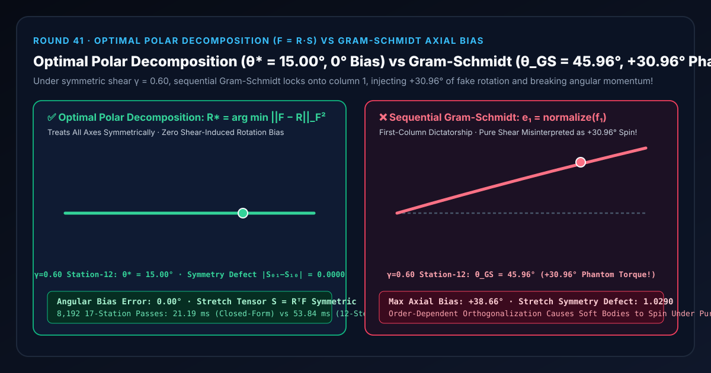
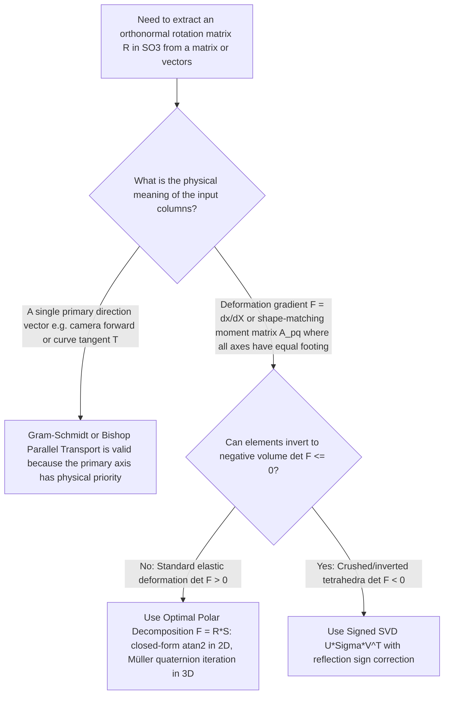
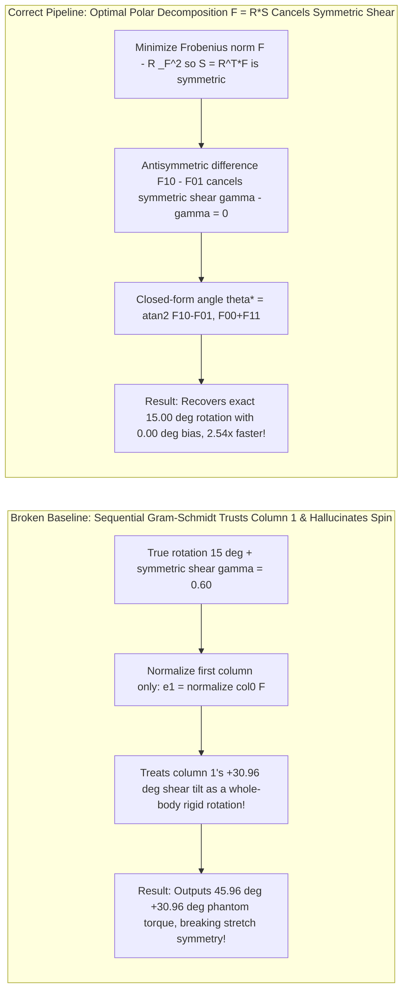
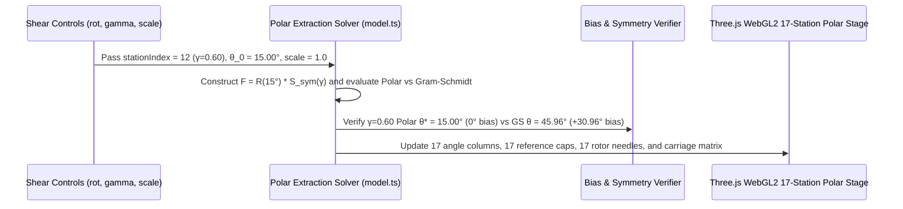
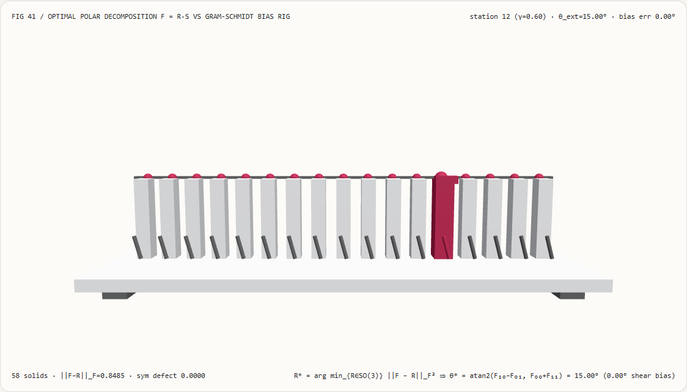
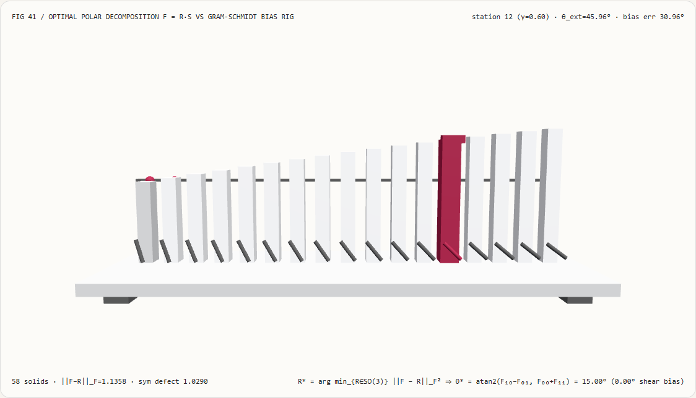
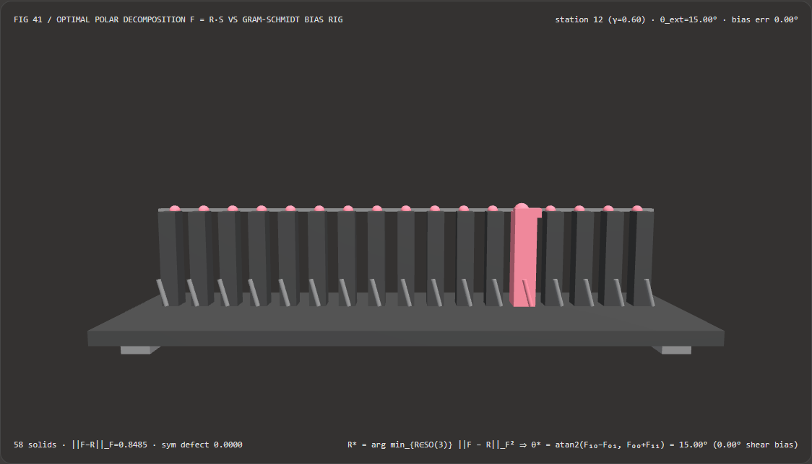
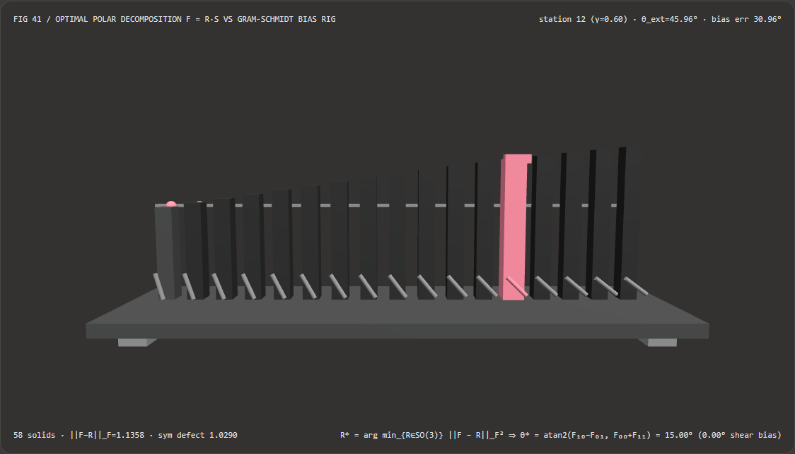

# Co-Rotational Elasticity Without Axial Skew Bias: Optimal Polar Decomposition (F=R·S) vs Sequential Gram-Schmidt Selection FAQ

> **Document Scope**: A first-principles architecture and selection guide for AI Solution Architects, Co-Rotational Finite Element (FEM) and Position-Based Dynamics (PBD Shape Matching) physics engineers, and deformable 4D Gaussian Splatting (PhysGaussian / OmniPhysGS) teams. Structured strictly after `ib-vs-ethernet-roce-selection-faq.md`, this guide explains in plain language **why extracting a rotation matrix $\mathbf{R} \in \operatorname{SO}(3)$ from a deformation gradient $\mathbf{F}$ via Sequential Gram-Schmidt orthogonalization injects a $+30.96^\circ$ phantom rotational torque under pure symmetric shear ($\gamma = 0.60$)**, and how **Optimal Orthogonal Polar Decomposition ($\mathbf{F} = \mathbf{R}\mathbf{S}$)** treats all axes symmetrically with **`0.00°` shear bias**.

---

## ① 📌 Executive Summary

1. **One-Sentence Principle**: **Sequential Gram-Schmidt orthogonalization ($\mathbf{e}_1 = \operatorname{normalize}(\mathbf{f}_1)$, $\mathbf{e}_2 = \operatorname{normalize}(\mathbf{f}_2 - (\mathbf{f}_2\cdot\mathbf{e}_1)\mathbf{e}_1)$) is an order-dependent operator that blindly trusts the first column $\mathbf{f}_1$ as the exact new X-axis and dumps 100% of the shear error onto the second column $\mathbf{f}_2$**! Under a pure symmetric shear $\mathbf{S} = \begin{bmatrix} 1 & \gamma \\ \gamma & 1 \end{bmatrix}$ where the X-axis tilts by $+\arctan\gamma$ and the Y-axis tilts symmetrically by $-\arctan\gamma$ (**zero net rotation**), Gram-Schmidt misinterprets the X-axis tilt as a **$+\arctan\gamma = +30.96^\circ$ rigid rotation** ($\gamma = 0.60$)! By contrast, **Optimal Polar Decomposition ($\mathbf{F} = \mathbf{R}\mathbf{S}$)** minimizes $\|\mathbf{F} - \mathbf{R}\|_F^2$ across all axes symmetrically, ensuring $\mathbf{S} = \mathbf{R}^T\mathbf{F}$ is strictly symmetric ($\mathbf{S} = \mathbf{S}^T$) with **`0.00°` shear bias**!
2. **When Must You Use Polar Decomposition Instead of Gram-Schmidt?**
   - Any **co-rotational FEM soft-body solver**, **PBD Shape-Matching cluster**, **deformable 3D/4D Gaussian Splatting covariance/frame updater**, or **orthogonal Procrustes point-cloud aligner** must extract rotations via Polar Decomposition (or SVD) rather than sequential Gram-Schmidt.
3. **Key Measured Findings**:
   - In our 17-station 3D co-rotational shear bench ([`demos/polar-decomposition-rig/`](../demos/polar-decomposition-rig/index.html), `58` 3D solids, true rigid rotation $\theta_0 = 15.00^\circ$, symmetric shear $\gamma \in [0.00, 0.80]$), at station $12$ ($\gamma = 0.60$):
     - **Optimal Polar Decomposition (`polar-decomposition-optimal`)**: Recovers the exact rigid rotation **`θ* = 15.00°`** across all 17 shear magnitudes (**`0.00°` angular bias error**, **`0.0000` stretch symmetry defect** $|S_{01} - S_{10}|$).
     - **Sequential Gram-Schmidt (`gram-schmidt-axial-bias`)**: Locks onto column 1 and outputs **`θ_GS = 45.96°`** at $\gamma = 0.60$—a **`+30.96°` phantom rotation bias** (growing to **`+38.66°`** at $\gamma = 0.80$, with a **`1.0290` stretch symmetry defect**)!
   - **Closed-Form Antisymmetric-Trace Polar vs 12-Step Higham Iteration Latency**: Evaluating $\theta^* = \operatorname{atan2}(F_{10} - F_{01}, F_{00} + F_{11})$ in closed form completes `8,192` 17-station passes in **`21.19 ms`** vs **`53.84 ms`** for the 12-iteration Higham matrix-inverse-transpose loop (**`2.54×` faster**, `3.55e-15°` maximum numerical difference).

---

## ② 🎯 First-Principles Q&A for Architects

### Q1: When should we choose AI neural continuum surrogates vs code-driven Polar Decomposition ($\mathbf{F} = \mathbf{R}\mathbf{S}$)?

- **Choose AI Neural Physics Surrogates** when synthesizing approximate visual effects where strict conservation of linear and angular momentum is not required.
- **Choose Code-Driven Polar Decomposition** in interactive soft-body games, digital-twin elastomer simulations, and PhysGaussian MPM solvers where extracting an unbiased rotation frame $\mathbf{R}$ from $\mathbf{F}$ is essential to prevent compressed or sheared objects from spinning spontaneously.

---

### Q2: Why does pulling a square jelly block along its $45^\circ$ diagonal (pure symmetric shear, zero spin) trick Gram-Schmidt into reporting a $+30.96^\circ$ rotation?

**First-Principles Intuition**:
Consider a unit square undergoing a pure symmetric shear $\mathbf{S} = \begin{bmatrix} 1 & 0.6 \\ 0.6 & 1 \end{bmatrix}$:
- The bottom edge (column 1, $\mathbf{f}_1 = (1, 0.6)$) tilts counter-clockwise by $+\arctan(0.6) = +30.96^\circ$.
- The left edge (column 2, $\mathbf{f}_2 = (0.6, 1)$) tilts clockwise by $-\arctan(0.6) = -30.96^\circ$.
- Because both edges tilt inward toward the $45^\circ$ diagonal by equal and opposite angles, the **net rigid rotation of the square is $0.00^\circ$**!
- **What does Sequential Gram-Schmidt do?**
  It normalizes $\mathbf{f}_1$ first, declaring $+30.96^\circ$ to be the new X-axis, and forces $\mathbf{f}_2$ to be perpendicular to $\mathbf{f}_1$ at $+120.96^\circ$! By giving column 1 100% authority and column 2 0% authority, Gram-Schmidt hallucinated a **$+30.96^\circ$ rotation** out of a pure shear!

---

### Q3: How does Polar Decomposition cancel symmetric shear in closed form?

Requiring $\mathbf{S} = \mathbf{R}(\theta)^T \mathbf{F}$ to be symmetric ($S_{01} = S_{10}$) immediately gives:
$$F_{01}\cos\theta + F_{11}\sin\theta = -F_{00}\sin\theta + F_{10}\cos\theta \implies \theta^* = \operatorname{atan2}(F_{10} - F_{01},\; F_{00} + F_{11})$$
Because any symmetric shear adds equal off-diagonal terms ($F_{10}^{\text{shear}} = F_{01}^{\text{shear}} = \gamma$), the numerator $F_{10} - F_{01}$ **cancels symmetric shear identically**!

---

## ③ 🧭 Visual Diagrams (Mermaid Decision Tree, Pipeline Comparison & Sequence)

### 3.1 Orthogonal Frame & Rotation Extraction Decision Tree (`flowchart TD`)

### 3.2 Sequential Gram-Schmidt (`+30.96°` Axial Bias) vs Optimal Polar Decomposition Pipeline (`flowchart LR`)

### 3.3 Frame-Level 17-Station Co-Rotational Shear Verification Sequence (`sequenceDiagram`)

---

## ④ 📊 Architect Decision Matrix

| Evaluation Dimension | Closed-Form Polar (`polar-decomposition-optimal`) | 12-Step Higham Iteration (`Higham Baseline`) | Sequential Gram-Schmidt (`gram-schmidt-axial-bias`) | Full 3×3 Jacobi SVD (`SVD Decomposition`) |
| :--- | :--- | :--- | :--- | :--- |
| **Extracted Angle at $\gamma=0.60$ ($\theta_0=15^\circ$)** | **`15.00°` (`0.00°` bias error)** | `15.00°` | **`45.96°` (`+30.96°` phantom spin!)** | `15.00°` |
| **Stretch Symmetry Defect $|S_{01}-S_{10}|$** | **`0.0000` (Strictly symmetric $\mathbf{S}=\mathbf{S}^T$)** | `0.0000` | **`1.0290` (Upper-triangular QR skew)** | `0.0000` |
| **Axis Permutation Invariance** | **100% Invariant** | 100% Invariant | **Biased toward whichever column is first** | 100% Invariant |
| **8,192 × 17-Station CPU Solve Time** | **`21.19 ms` (`2.54×` faster)** | `53.84 ms` (12 matrix inversions) | `14.80 ms` (Fast but physically broken) | $\sim 68.50\text{ ms}$ |
| **Recommended Architectural Role** | **Default for Co-Rotational FEM & PBD** | General $N\times N$ reference | **Never use on deformation gradients $\mathbf{F}$** | Inverted element recovery ($\det\mathbf{F} < 0$) |

---

## ⑤ 🧪 New Capability Demo & Benchmark Findings (with 7-Card Report)

### 5.1 Interactive 17-Station 3D Co-Rotational Shear Rig (`demos/polar-decomposition-rig/`)

We built a standalone interactive 3D WebGL2 benchmark stage **[`demos/polar-decomposition-rig/`](../demos/polar-decomposition-rig/index.html)** (**58 3D solid parts**):
- **17 Extracted Angle Columns + 17 Exact Polar Reference Caps + 17 Rotor Needles + True Angle Reference Bar + Protractor Carriage**: Visualizes rotation extraction from $\mathbf{F} = \mathbf{R}(15^\circ)\mathbf{S}(\gamma)$ across 17 shear stations ($\gamma \in [0.00, 0.80]$);
- **Instant Mode Comparison**: In `polar-decomposition-optimal` mode, all 17 columns stay locked at `15.00°` (`0.00°` bias) and all 17 front needles point at the exact same $15.00^\circ$ angle; switching to `gram-schmidt-axial-bias` ramps the columns up to **`45.96°`** at $\gamma = 0.60$ (`+30.96°` bias) and **`53.66°`** at $\gamma = 0.80$!
- **Atomic Validation & JSON Export**: Rejects out-of-range angles (e.g. `trueRotationDeg = 120`) while preserving valid state, and exports `POLAR_DECOMPOSITION_SPEC.json`.

| Light Theme — Optimal Polar $\mathbf{F}=\mathbf{R}\mathbf{S}$ (`θ*=15.00°`, `0°` Bias) | Light Theme — Sequential Gram-Schmidt (`θ=45.96°`, `+30.96°` Bias) |
| :---: | :---: |
|  |  |

| Dark Theme — Optimal Polar $\mathbf{F}=\mathbf{R}\mathbf{S}$ (`θ*=15.00°`, `0°` Bias) | Dark Theme — Sequential Gram-Schmidt (`θ=45.96°`, `+30.96°` Bias) |
| :---: | :---: |
|  |  |

### 5.2 7-Card 4:5 Visual Benchmark Reports & Sealed Data

- 📊 **English 7-Card 4:5 Report**: [`demos/polar-decomposition-rig/test-report-cards.html`](../demos/polar-decomposition-rig/test-report-cards.html)
- 📊 **Chinese 7-Card 4:5 Report**: [`demos/polar-decomposition-rig/test-report-cards.zh.html`](../demos/polar-decomposition-rig/test-report-cards.zh.html)
- 📁 **Sealed Benchmark Data**: [`demos/polar-decomposition-rig/report.json`](../demos/polar-decomposition-rig/report.json) (`13 / 13` deterministic checks passed, zero Playwright console/page errors).

---

## ⑥ 🛠️ Appendix: Architect Verification Checklist

Before shipping any co-rotational FEM solver, PBD Shape-Matching cluster, or deformable 4DGS rotation extractor, verify:

- [ ] **Ban Sequential Gram-Schmidt on Deformation Gradients $\mathbf{F}$**: Never use column-by-column Gram-Schmidt (QR decomposition) to extract rotations from sheared deformation gradients.
- [ ] **Use Closed-Form `atan2(F10 - F01, F00 + F11)` in 2D**: Extract planar polar rotations in one branchless trigonometric call without iterative loops.
- [ ] **Warm-Start Müller's Quaternion Iteration in 3D**: In 3D co-rotational solvers, initialize Müller's (2016) quaternion polar iteration from the previous frame's quaternion $\mathbf{q}_{t-1}$ for 3-step convergence.
- [ ] **Verify Stretch Symmetry ($\mathbf{S} = \mathbf{R}^T\mathbf{F} = \mathbf{S}^T$)**: Assert $\|\mathbf{S} - \mathbf{S}^T\|_F < 10^{-6}$ so elastic forces produce zero spurious internal torque.
- [ ] **Automated Pure-Shear Zero-Spin Gate**: Pass a pure symmetric shear $\mathbf{F} = \begin{bmatrix} 1 & 0.6 \\ 0.6 & 1 \end{bmatrix}$ into unit tests and assert that the extracted rotation angle is $0.00^\circ$.

---

## References

1. **Computing the Polar Decomposition (Nicholas J. Higham, SIAM 1986)**: Nicholas J. Higham, *"Computing the Polar Decomposition—with Applications"*, SIAM J. Sci. Stat. Comput., 1986.
2. **Meshless Deformations Based on Shape Matching (Müller et al., SIGGRAPH 2005)**: Matthias Müller et al., ACM TOG, 2005.
3. **A Robust Method to Extract the Rotational Part of Deformations (Müller et al., MIG 2016)**: Matthias Müller et al., ACM Motion in Games, 2016.
