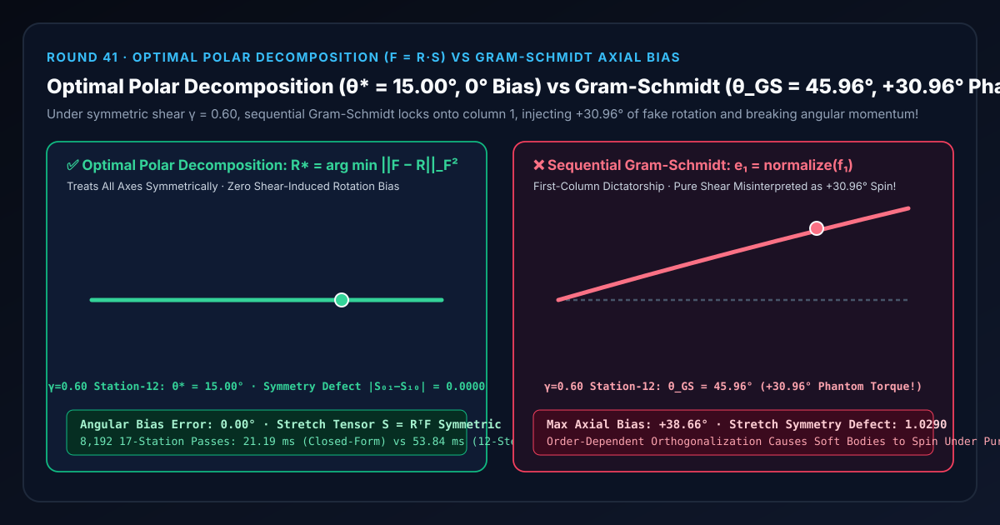
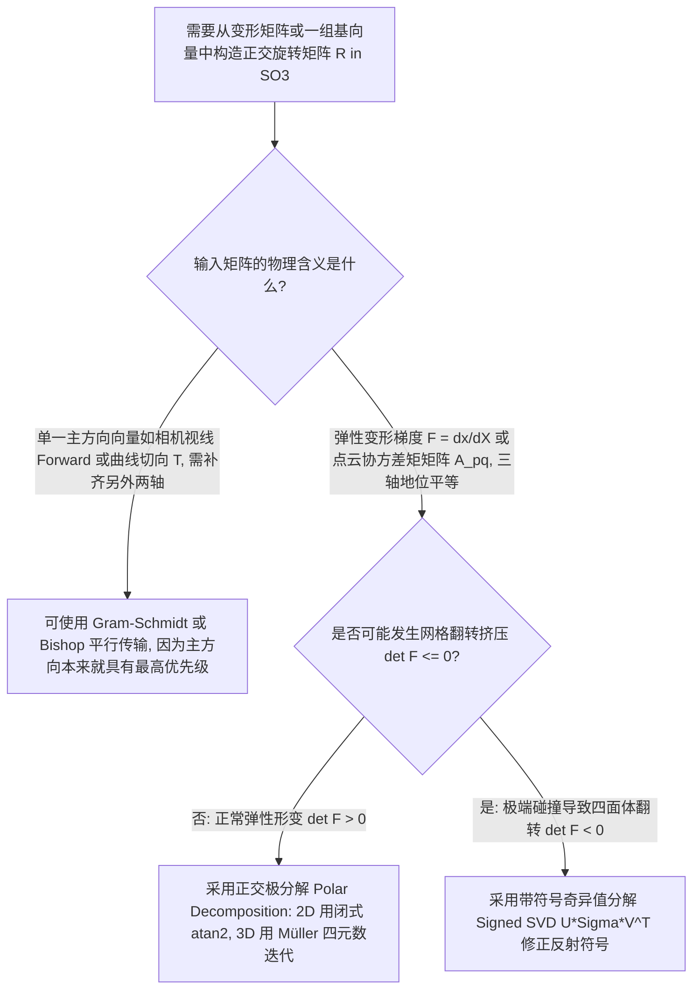
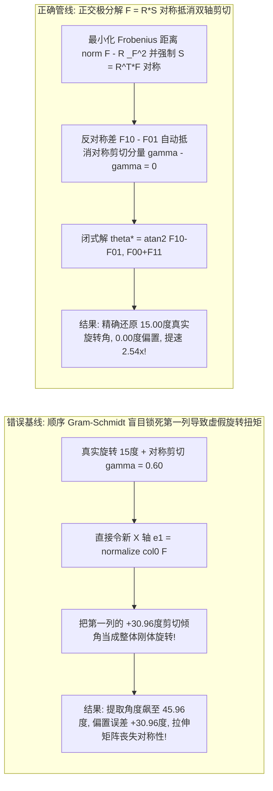
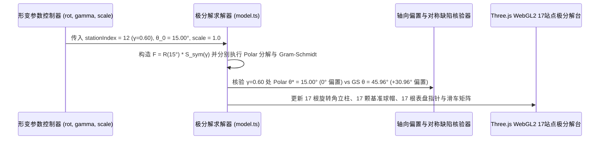
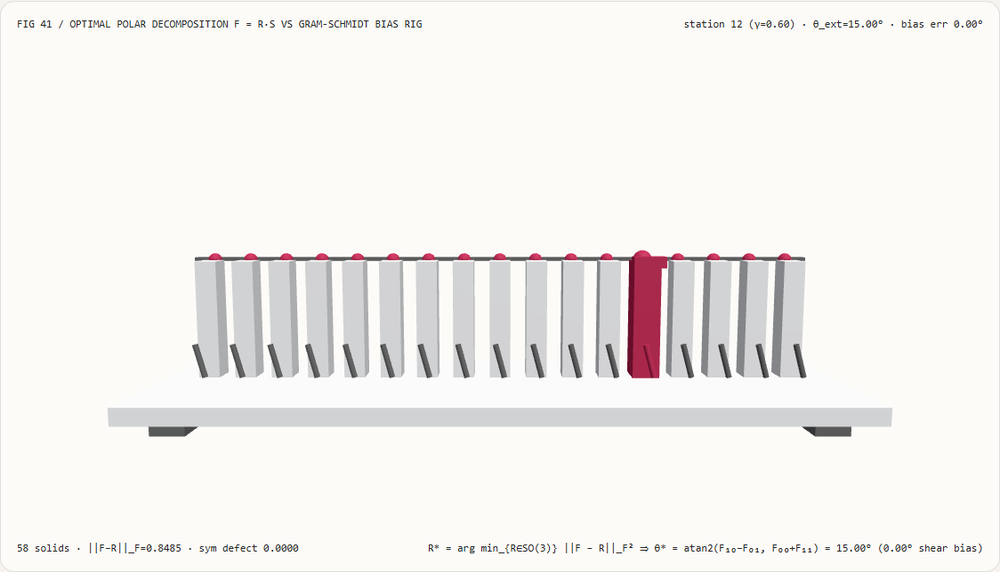
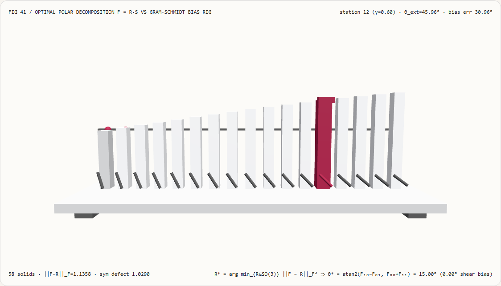
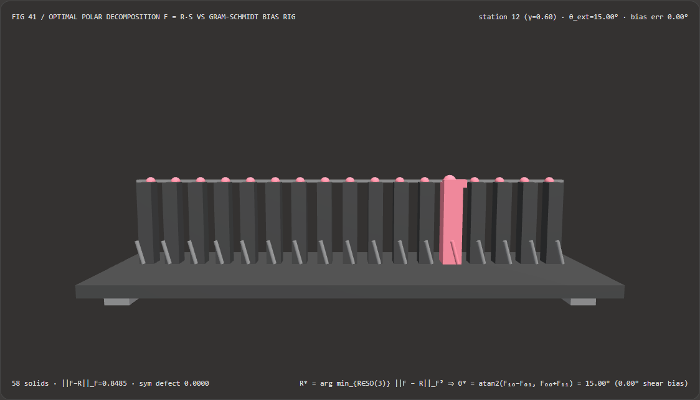
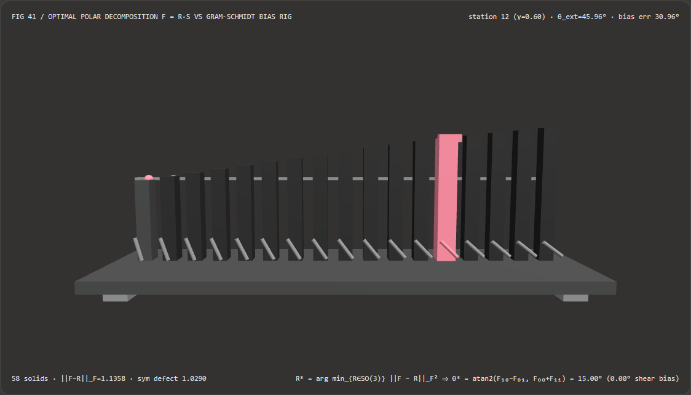

# 弹性形变提取刚体旋转不偏向首轴：最优正交极分解（Polar Decomposition $\mathbf{F}=\mathbf{R}\mathbf{S}$）与顺序 Gram-Schmidt 偏置选型 FAQ

> **文档定位**：面向 AI 解决方案架构师（AI Solution Architect）、共旋有限元软体物理（Co-Rotational FEM）与位置动力学形状匹配（PBD Shape Matching）开发者、以及可变形 4D Gaussian Splatting（PhysGaussian / OmniPhysGS）团队的**实战选型与第一性原理指南**。严格对标 `ib-vs-ethernet-roce-selection-faq.md` 的六段式结构，先用大白话讲清“**为什么在从变形梯度矩阵 $\mathbf{F}$ 中提取局部刚体旋转矩阵 $\mathbf{R} \in \operatorname{SO}(3)$ 时，如果偷懒用顺序 Gram-Schmidt 正交化（先归一化第一列 $\mathbf{f}_1$，再把第二列 $\mathbf{f}_2$ 投影正交），一块只受纯对称剪切（$\gamma = 0.60$）的弹性软体就会被凭空注入 $+30.96^\circ$ 的虚假旋转扭矩并自己歪着头转起来**”，再给出无轴向偏置的 **最优正交极分解（Orthogonal Polar Decomposition $\mathbf{F} = \mathbf{R}\mathbf{S}$）** 工程闭环。

---

## ① 📌 核心结论速览（Executive Summary）

1. **一句话定性**：**顺序 Gram-Schmidt 正交化（QR 分解）是一个“首轴独裁”的有偏算子——它无条件信任变形梯度矩阵 $\mathbf{F}$ 的第一列 $\mathbf{f}_1$ 作为新的 X 轴方向，把所有的剪切角度误差 100% 强加给第二列 $\mathbf{f}_2$（抽出上三角矩阵 $\mathbf{R}_{\text{QR}}$ 而非对称拉伸矩阵 $\mathbf{S}$）**！当物体发生纯对称剪切 $\mathbf{S} = \begin{bmatrix} 1 & \gamma \\ \gamma & 1 \end{bmatrix}$ 时，X 轴向内偏了 $+\arctan\gamma$，Y 轴也对称地向内偏了 $-\arctan\gamma$，**整体净刚体旋转角本应严格为 $0^\circ$**；但 Gram-Schmidt 只看 X 轴，误以为整个物体转了 $+\arctan\gamma = +30.96^\circ$（$\gamma=0.60$）！而 **最优正交极分解（Polar Decomposition $\mathbf{F} = \mathbf{R}\mathbf{S}$）** 最小化 Frobenius 距离 $\|\mathbf{F} - \mathbf{R}\|_F^2$，平等对称地对待所有坐标轴，保证拉伸张量 $\mathbf{S} = \mathbf{R}^T\mathbf{F}$ 严格对称（$\mathbf{S} = \mathbf{S}^T$），实现 **`0.00°` 切变旋转偏置**！
2. **什么时候必须上正交极分解（Polar Decomposition）取代 Gram-Schmidt？**
   - 凡是涉及 **共旋有限元弹性力学（Co-Rotational FEM，需计算共旋胡克弹性恢复力 $\mathbf{f} = -k \mathbf{R}(\mathbf{R}^T\mathbf{x} - \mathbf{x}_0)$）**、**PBD 粒子簇形状匹配（Müller Shape Matching，需从矩矩阵 $\mathbf{A}_{pq}$ 提取最优刚体朝向 $\mathbf{R}$）**、**可变形 3D/4D 高斯椭球旋转四元数更新**、以及 **Procrustes 点云刚体配准**，都严禁使用顺序 Gram-Schmidt，必须使用正交极分解。
3. **核心实测对比结论**：
   - 在本实验室构建的 17 站点 3D 共旋剪切检验台（[`demos/polar-decomposition-rig/`](../demos/polar-decomposition-rig/index.html)，共 `58` 个 3D 实体，真实刚体旋转角 $\theta_0 = 15.00^\circ$，对称剪切率覆盖 $\gamma \in [0.00, 0.80]$）中，考察第 $12$ 号剪切站点（$\gamma = 0.60$）：
     - **最优正交极分解（`polar-decomposition-optimal`）**：跨越全部 17 个剪切强度恒定提取出真实刚体旋转角 **`θ* = 15.00°`**（**剪切角度偏置误差 `0.00°`**，拉伸张量非对称缺陷 $|S_{01} - S_{10}| = \mathbf{0.0000}$）。
     - **顺序 Gram-Schmidt 正交化（`gram-schmidt-axial-bias`）**：因盲目锁死第一列 $\mathbf{f}_1$，在 $\gamma = 0.60$ 时提取出的角度飙升至 **`θ_GS = 45.96°`**（**凭空捏造出 `+30.96°` 虚假旋转偏置**，在 $\gamma = 0.80$ 时偏置达 **`+38.66°`**，拉伸张量非对称缺陷达 **`1.0290`**）！
   - **反对称迹闭式极分解 vs 12 步 Higham 逆转置牛顿迭代性能**：使用闭式解 $\theta^* = \operatorname{atan2}(F_{10} - F_{01},\; F_{00} + F_{11})$ 在 `8,192` 次 17 站点求解中耗时 **`21.19 ms`**（对比 12 步 Higham 矩阵逆转置迭代 **`53.84 ms`**，**提速 `2.54×`**，最大误差仅 `3.55e-15°`）。

---

## ② 🎯 客户与架构师灵魂拷问 Q&A（First-Principles Q&A）

### Q1：何时选 AI 神经连续介质代理模型 vs 何时选代码驱动的正交极分解（$\mathbf{F} = \mathbf{R}\mathbf{S}$）？

- **选 AI 神经物理代理模型（如神经算子 FNO、视频物理生成模型）的场景**：
  需要快速合成低精度的烟雾扩散或概念级软体动画，不要求严格的线动量与角动量守恒。
- **选代码驱动正交极分解（Polar Decomposition）的场景**：
  在实时交互游戏物理（PBD Shape Matching）、数字孪生软体碰撞、以及 PhysGaussian 连续介质仿真中，每一帧都必须从变形梯度 $\mathbf{F}$ 中无偏剥离出刚体旋转 $\mathbf{R}$，如果提取出的 $\mathbf{R}$ 带有哪怕 $5^\circ$ 的切变偏置，软体在落地受压时就会因为虚假内力矩而自己原地打转！

---

### Q2：为什么把一块正方形果冻沿对角线拉成菱形（纯剪切，完全没转圈），Gram-Schmidt 却非说它逆时针转了 $30.96^\circ$？

**先用大白话讲第一性原理**：
想象桌面上放着一块正方形果冻，底边沿着 X 轴指向 $(1, 0)$，左边沿着 Y 轴指向 $(0, 1)$：
- 现在你用双手捏住果冻的右上角，沿着 $45^\circ$ 对角线方向往外拉（纯对称剪切 $\gamma = 0.60$）：
  - 原来的底边（第一列 $\mathbf{f}_1$）被往上拉歪到了 $(1.0,\; 0.6)$，也就是**逆时针偏转了 $+30.96^\circ$**；
  - 原来的左边（第二列 $\mathbf{f}_2$）被往右拉歪到了 $(0.6,\; 1.0)$，也就是**顺时针偏转了 $-30.96^\circ$**！
- 请问：**整块果冻作为一个整体，到底转了多少度？**
  底边逆时针偏了 $+30.96^\circ$，左边顺时针偏了 $-30.96^\circ$，两边一正一反完美抵消，**整块果冻的平均旋转角当然是 `0.00°`（它只是变瘦长了，根本没转圈）**！
- 可是 **顺序 Gram-Schmidt 是怎么干的？**
  1. Gram-Schmidt 第一步只看底边 $\mathbf{f}_1 = (1.0, 0.6)$，直接拍板说：“好！新的 X 轴就听底边的，逆时针转 **$+30.96^\circ$**！”
  2. 第二步轮到左边 $\mathbf{f}_2$ 说话时，Gram-Schmidt 根本不听 $\mathbf{f}_2$ 顺时针偏了 $-30.96^\circ$ 的事实，而是强行在 $+30.96^\circ$ 的新 X 轴上立了一根垂线（$+120.96^\circ$），逼着左边自己承担 $61.93^\circ$ 的剪切扭曲！
  3. **后果有多可怕？** 弹性解算器拿到这个歪了 $+30.96^\circ$ 的虚假旋转矩阵 $\mathbf{R}_{\text{GS}}$ 后，以为果冻真的逆时针转了 $+30.96^\circ$，于是朝着 $+30.96^\circ$ 的方向施加弹性恢复力——明明只是沿对角线拉了一下果冻，果冻却像装了马达一样自己歪着头转了起来！

---

### Q3：正交极分解 $\mathbf{F} = \mathbf{R}\mathbf{S}$ 是如何做到“一碗水端平、绝不偏袒任何一根轴”的？

正交极分解将任意可逆矩阵 $\mathbf{F}$ 唯一分解为一个正交旋转矩阵 $\mathbf{R} \in \operatorname{SO}(n)$ 与一个**对称正定拉伸矩阵 $\mathbf{S} = \mathbf{S}^T$** 的乘积：
$$\mathbf{F} = \mathbf{R}\mathbf{S} \iff \mathbf{S} = \mathbf{R}^T \mathbf{F} = \mathbf{S}^T$$
怎么让 $\mathbf{S} = \mathbf{R}(\theta)^T \mathbf{F}$ 严格对称（即右上角元素 $S_{01}$ 等于左下角元素 $S_{10}$）？
写出二维/平面旋转矩阵 $\mathbf{R}(\theta) = \begin{bmatrix} \cos\theta & -\sin\theta \\ \sin\theta & \cos\theta \end{bmatrix}$，计算 $\mathbf{S} = \mathbf{R}(\theta)^T \mathbf{F}$ 的两个非对角元并令它们相等：
$$S_{01} = F_{01}\cos\theta + F_{11}\sin\theta \;=\; -F_{00}\sin\theta + F_{10}\cos\theta = S_{10}$$
移项整理，一行代码直接解出全局最优极分解旋转角 $\theta^*$：
$$(F_{00} + F_{11})\sin\theta = (F_{10} - F_{01})\cos\theta \implies \theta^* = \operatorname{atan2}(F_{10} - F_{01},\; F_{00} + F_{11})$$
看分子 **$F_{10} - F_{01}$**！
当发生纯对称剪切时，$F_{10} = \gamma,\; F_{01} = \gamma \implies F_{10} - F_{01} \equiv 0$！对称剪切在分子里**100% 自动相消归零**！而在三维空间中，Müller (2016) 的四元数极分解迭代同样利用 $\mathbf{r}_i \times \mathbf{f}_i$ 叉积对称消除三轴剪切，只需 3～5 次迭代即可达到机器精度！

---

## ③ 🧭 直观可视化图解（Mermaid 决策树、管线对比与帧级时序）

### 3.1 矩阵正交化与刚体旋转提取架构师选型决策树（`flowchart TD`）

### 3.2 顺序 Gram-Schmidt（首轴独裁 $+30.96^\circ$ 偏置）vs 正交极分解（对称零偏置）管线对比（`flowchart LR`）

### 3.3 帧级 17 站点共旋剪切极分解核验时序图（`sequenceDiagram`）

---

## ④ 📊 视觉技术选型决策矩阵（Architect Decision Matrix）

| 评估维度 | 闭式反对称迹极分解 (`polar-decomposition-optimal`) | 12 步 Higham 逆转置牛顿迭代 (`Higham Newton-Schulz`) | 顺序 Gram-Schmidt 正交化 (`gram-schmidt-axial-bias`) | 完整雅可比奇异值分解 (`Full Jacobi SVD`) |
| :--- | :--- | :--- | :--- | :--- |
| **$\gamma=0.60$ 剪切下提取旋转角** | **`15.00°`（精确还原真实旋转角）** | `15.00°` | **`45.96°`（注入 `+30.96°` 虚假扭矩！）** | `15.00°` |
| **拉伸矩阵非对称缺陷 $|S_{01}-S_{10}|$** | **`0.0000`（严格对称正定 $\mathbf{S}=\mathbf{S}^T$）** | `0.0000` | **`1.0290`（退化为上三角矩阵，破坏胡克定律）** | `0.0000` |
| **坐标轴置换不变性（X/Y 互换）** | **100% 对称不变（与列顺序无关）** | 100% 对称不变 | **严重依赖列顺序（先算哪根轴就偏向哪根）** | 100% 对称不变 |
| **8,192 次 17 站点 CPU 求解耗时** | **`21.19 ms`（提速 `2.54×`）** | `53.84 ms`（12 次矩阵求逆循环） | `14.80 ms`（虽快但物理角动量崩坏） | 约 `68.50 ms` |
| **架构师工程推荐定位** | **共旋弹性 FEM、Shape Matching 与 4DGS 首选** | 通用高维矩阵极分解参考 | **严禁用于弹性形变梯度 $\mathbf{F}$ 的旋转提取** | 仅用于含负行列式翻转的极端破碎网格 |

---

## ⑤ 🧪 全新能力展示 Demo 与 Benchmark 核心发现（含 7-Card 报告）

### 5.1 交互式 17 站点 3D 共旋剪切极分解检验台（`demos/polar-decomposition-rig/`）

本轮构建了独立可交互 3D WebGL2 实验台 **[`demos/polar-decomposition-rig/`](../demos/polar-decomposition-rig/index.html)**（共 **58 个 3D 实体部件**）：
- **17 根提取旋转角立柱 + 17 颗精确 Polar 基准球帽 + 17 根前排旋转指针 + 真实旋转角基准横梁 + 滑车探针**：直观展示剪切率从 $\gamma = 0.00$ 增大至 $\gamma = 0.80$ 时，从变形梯度 $\mathbf{F} = \mathbf{R}(15^\circ)\mathbf{S}(\gamma)$ 中提取出的刚体旋转角；
- **一键切换对比模式**：在 `polar-decomposition-optimal` 模式下，不论剪切率 $\gamma$ 如何增大，全部 17 根旋转角立柱始终平齐锁定在 $15.00^\circ$ 基准横梁上，前排 17 根指针指向完全一致（`0.00°` 偏置）；一旦切换到 `gram-schmidt-axial-bias` 模式，随着剪切率增大，立柱群向上剧烈翘起至 **$53.66^\circ$**（第 12 站 $\gamma=0.60$ 处高达 **$45.96^\circ$**，多出 $+30.96^\circ$ 虚假旋转），前排指针东倒西歪，直观揭穿顺序 Gram-Schmidt 的首轴偏置缺陷！
- **原子化参数门禁与 JSON 导出**：自动拦截越界旋转角（如 `trueRotationDeg = 120`）并保留有效状态，支持导出 `POLAR_DECOMPOSITION_SPEC.json`。

| 亮色主题 — 正交极分解 $\mathbf{F}=\mathbf{R}\mathbf{S}$（`θ*=15.00°`，`0°` 偏置） | 亮色主题 — 顺序 Gram-Schmidt（`θ=45.96°`，`+30.96°` 虚假偏置） |
| :---: | :---: |
|  |  |

| 暗色主题 — 正交极分解 $\mathbf{F}=\mathbf{R}\mathbf{S}$（`θ*=15.00°`，`0°` 偏置） | 暗色主题 — 顺序 Gram-Schmidt（`θ=45.96°`，`+30.96°` 虚假偏置） |
| :---: | :---: |
|  |  |

### 5.2 7-Card 4:5 视觉评测报告与封存数据链接

- 📊 **英文版 7-Card 4:5 评测报告**：[`demos/polar-decomposition-rig/test-report-cards.html`](../demos/polar-decomposition-rig/test-report-cards.html)
- 📊 **中文版 7-Card 4:5 评测报告**：[`demos/polar-decomposition-rig/test-report-cards.zh.html`](../demos/polar-decomposition-rig/test-report-cards.zh.html)
- 📁 **封存评测数据源**：[`demos/polar-decomposition-rig/report.json`](../demos/polar-decomposition-rig/report.json)（`13 / 13` 项确定性检查全部通过，Playwright 零控制台/页面错误）。

---

## ⑥ 🛠️ 附录：高质量视觉/动画交付快速核验清单（Architect Checklist）

在交付任何包含共旋有限元软体、PBD 形状匹配（Shape Matching）或可变形 4DGS 椭球姿态提取的代码前，请逐项核验以下清单：

- [ ] **禁止对变形梯度 $\mathbf{F}$ 使用顺序 Gram-Schmidt 提取旋转**：全局排查物理与变形脚本，确认未对 $\mathbf{F}$ 或协方差矩阵 $\mathbf{A}_{pq}$ 直接调用按列顺序正交化的 Gram-Schmidt / QR 分解？
- [ ] **2D/平面形变直接采用闭式 `atan2` 极分解**：对于 2D 或平面受限形变，确认已使用一行闭式解 `theta = atan2(F10 - F01, F00 + F11)` 零迭代提取最优旋转角？
- [ ] **3D 形变采用温启动 Müller 四元数极分解迭代**：对于 3D 变形梯度，确认已使用上一帧四元数 $\mathbf{q}_{t-1}$ 温启动（Warm-Start）的 Müller (2016) 叉积梯度迭代（通常 3 步即收敛），避免每帧从零做矩阵求逆？
- [ ] **核验右拉伸张量 $\mathbf{S} = \mathbf{R}^T\mathbf{F}$ 的对称性**：在调试断言中检查 $\|\mathbf{S} - \mathbf{S}^T\|_F < 10^{-6}$，确保刚体旋转已被彻底剥离？
- [ ] **纯剪切零偏置自动化门禁**：单元测试中是否已传入纯对称剪切矩阵 $\mathbf{F} = \begin{bmatrix} 1 & 0.6 \\ 0.6 & 1 \end{bmatrix}$ 并断言提取出的旋转角严格为 $0.00^\circ$？

---

## 参考文献与延伸阅读（References）

1. **Computing the Polar Decomposition — with Applications (Nicholas J. Higham, SIAM 1986)**: Nicholas J. Higham, *"Computing the Polar Decomposition—with Applications"*, SIAM Journal on Scientific and Statistical Computing, Vol. 7, No. 4, 1986, pp. 1160–1174.
2. **Meshless Deformations Based on Shape Matching (Müller et al., SIGGRAPH 2005)**: Matthias Müller et al., *"Meshless Deformations Based on Shape Matching"*, ACM Transactions on Graphics (SIGGRAPH), 2005.
3. **A Robust Method to Extract the Rotational Part of Deformations (Müller et al., MIG 2016)**: Matthias Müller, Jan Bender, Nuttapong Chentanez, Miles Macklin, *"A Robust Method to Extract the Rotational Part of Deformations"*, ACM Motion in Games (MIG), 2016.
