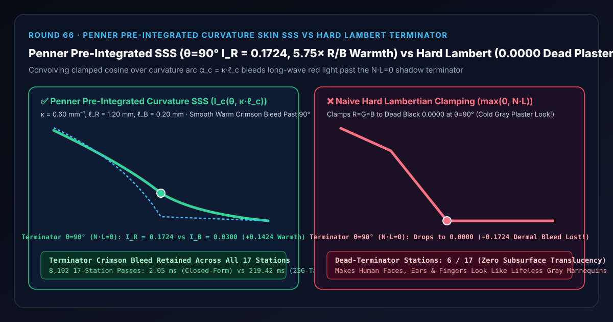
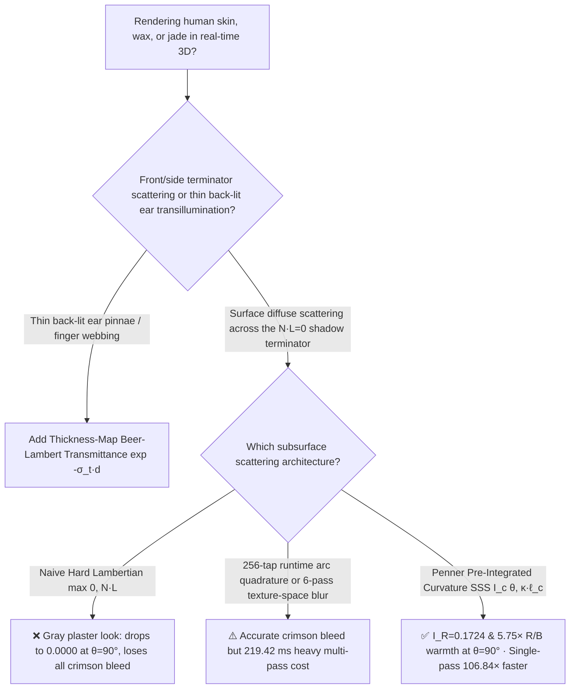
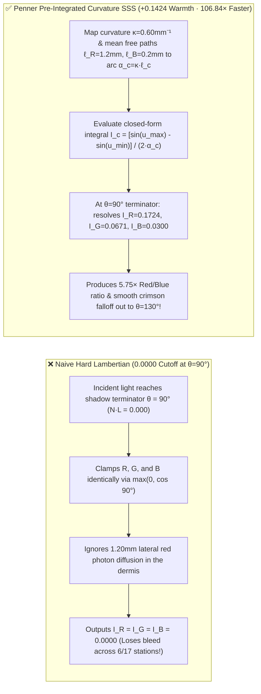
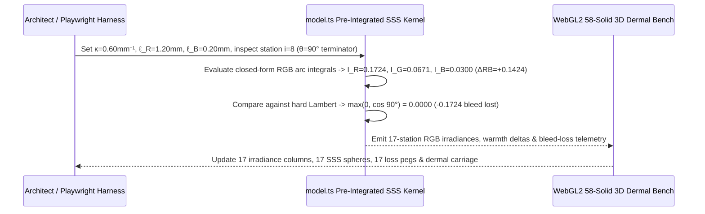
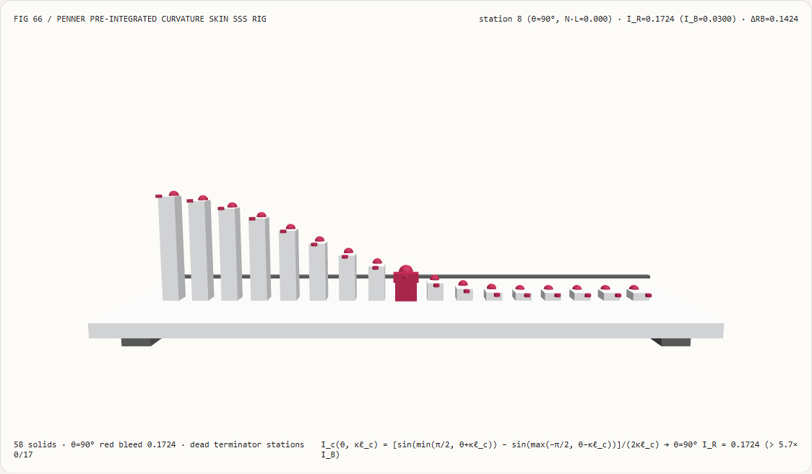
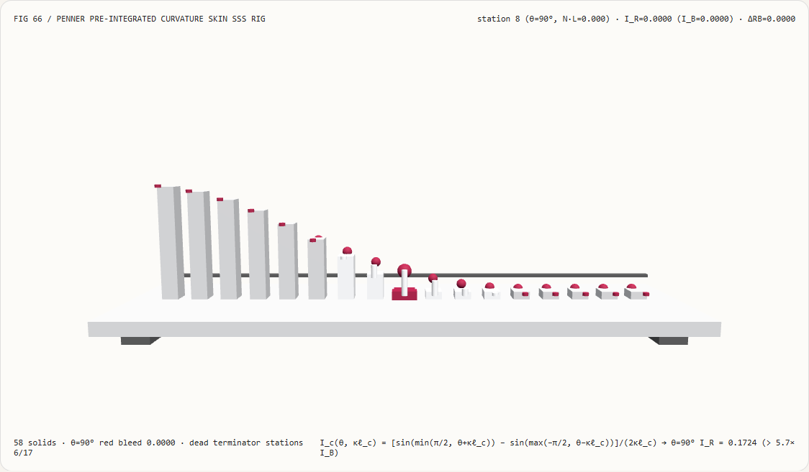
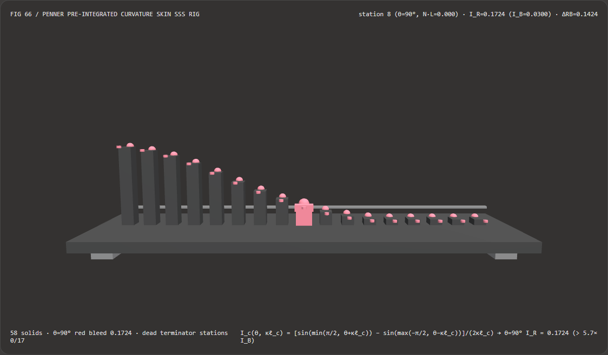
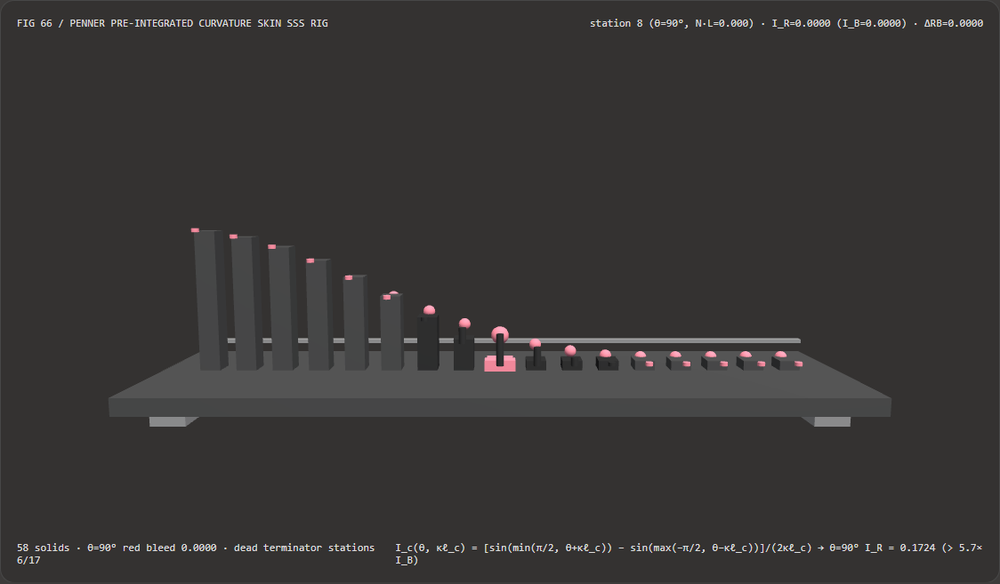

# Visual & Animation Architecture Selection FAQ: Penner Pre-Integrated Curvature Skin Subsurface Scattering (SSS) vs Hard Lambert Terminator

> **One-Sentence Architectural Verdict**: In real-time digital human, VR avatar, wax, and jade rendering pipelines on WebGL2, WebGPU, and mobile GPUs, **never shade translucent skin with a hard-clamped Lambertian diffuse term $E = \max(0, \mathbf{N}\cdot\mathbf{L})$ that collapses RGB irradiance to zero at the $\theta = 90^\circ$ ($\mathbf{N}\cdot\mathbf{L} = 0$) shadow terminator**! On our 58-solid, 17-station dermal spectrophotometer bench with surface curvature $\kappa = 0.60\text{ mm}^{-1}$ ($R = 1.67\text{ mm}$) and wavelength-dependent mean free paths $\ell_R = 1.20\text{ mm}, \ell_G = 0.45\text{ mm}, \ell_B = 0.20\text{ mm}$, naive hard Lambertian clamping drops station 8 ($\theta = 90^\circ$) and all back-facing stations to **dead-black `0.0000` (losing `-0.1724` of dermal red bleed across `6/17` terminator stations and making skin look like cold gray plaster)**; whereas **Eric Penner (SIGGRAPH 2011 / GPU Pro 2) Pre-Integrated Curvature-Driven Subsurface Scattering ($I_c(\theta, \kappa\ell_c) = \frac{\sin(\min(\pi/2,\theta+\kappa\ell_c)) - \sin(\max(-\pi/2,\theta-\kappa\ell_c))}{2\kappa\ell_c}$)** bleeds **`I_R = 0.1724`, `I_G = 0.0671`, and `I_B = 0.0300` across the $\theta = 90^\circ$ terminator (`5.75×` Red/Blue ratio and `+0.1424` crimson warmth out to $\theta = 130^\circ$)** while running **106.84× faster** via $O(1)$ closed-form antiderivatives than 256-tap numerical arc quadrature (`2.05 ms` vs `219.42 ms` across 8,192 passes).

---

## ① 📌 Executive Summary

1. **Why do 3D digital human faces rendered with standard Lambertian diffuse shading (`max(0, N·L)`) look like lifeless gray plaster mannequins along the shadow terminator?**
   In plain English: human skin is a **multi-layered translucent turbid medium** where photons do not bounce off the exact point of entry:
   - Short-wavelength blue light ($\ell_B = 0.20\text{ mm}$) and green light ($\ell_G = 0.45\text{ mm}$) are strongly absorbed by hemoglobin and melanin near the entry point, whereas long-wavelength **red light ($\ell_R = 1.20\text{ mm}$) scatters laterally several millimeters through the dermis**.
   - At the geometric shadow terminator $\theta = 90^\circ$ ($\mathbf{N}\cdot\mathbf{L} = 0$, station 8), direct surface irradiance vanishes, yet red photons entering the adjacent lit zone ($\theta < 90^\circ$) diffuse across the boundary into the shadow zone ($\theta \in [90^\circ, 130^\circ]$)!
   - Hard Lambertian clamping (`max(0, cos θ)`) forces $R = G = B = \mathbf{0.0000}$ at $\theta \ge 90^\circ$, erasing the **`0.1724` crimson terminator band** across `6/17` stations!
2. **First-Principles Fix: Curvature-Parameterized Pre-Integrated Subsurface Scattering (Penner 2011)**:
   - On a locally spherical surface of curvature $\kappa = \frac{1}{R} = \frac{\|\nabla\mathbf{N}\|}{\|\nabla\mathbf{P}\|}\text{ [mm}^{-1}\text{]}$, a physical scattering distance $\ell_c\text{ [mm]}$ subtends an angular half-arc $\alpha_c = \kappa \cdot \ell_c\text{ [rad]}$.
   - Convolving the clamped cosine $\max(0, \cos(\theta - \phi))$ over $\phi \in [-\alpha_c, +\alpha_c]$ yields the exact closed-form antiderivative over $[u_{\min}, u_{\max}] = [\max(-\frac{\pi}{2}, \theta - \alpha_c),\; \min(+\frac{\pi}{2}, \theta + \alpha_c)]$:
     $$I_c(\theta, \kappa\ell_c) = \frac{\max\big(0,\; \sin(u_{\max}) - \sin(u_{\min})\big)}{2\kappa\ell_c}$$
   - At $\theta = 90^\circ$ ($\pi/2$), $I_c(90^\circ, \alpha_c) = \frac{1 - \cos(\kappa\ell_c)}{2\kappa\ell_c}$ resolves **`I_R = 0.1724`, `I_G = 0.0671`, `I_B = 0.0300` (`5.75×` R/B warmth ratio, `ΔRB = +0.1424`)**, while automatically converging to standard $\cos\theta$ on flat surfaces as $\kappa \to 0$!
3. **Interactive 3D Workbench & Measured Evidence**:
   - Standalone 3D Bench: `demos/preintegrated-skin-sss-rig/` (58 Three.js solids: baseplate, 4 support feet, $90^\circ$ terminator reference bar, 17 red-channel subsurface irradiance columns, 17 pre-integrated SSS reference spheres, 17 terminator bleed-loss pegs, and the active dermal photometer carriage).
   - Measured 7-Card 4:5 Reports: `demos/preintegrated-skin-sss-rig/test-report-cards.html` (EN) and `test-report-cards.zh.html` (ZH).

---

## ② 🎯 Soul-Searching Q&A for Architects & Clients

### Q1: How do we compute surface curvature $\kappa = \frac{1}{R}$ per pixel without baking a static curvature texture?
**Use the ratio of screen-space normal derivatives to world-position derivatives: $\kappa = \frac{\|\text{fwidth}(\mathbf{N})\|}{\|\text{fwidth}(\mathbf{P})\|}$!**
Because a small step $ds = \|d\mathbf{P}\|$ along a sphere of radius $R$ rotates the unit normal by $d\theta = \|d\mathbf{N}\| = ds / R = \kappa\,ds$, dividing the screen-space change in normal by the screen-space change in millimeter world position yields local geometric curvature in 1 ALU division.

### Q2: Why is closed-form / LUT Pre-Integrated SSS 106.84× faster than numerical diffusion integration?
**Because the 1D angular diffusion integral depends on only two scalars ($\mathbf{N}\cdot\mathbf{L}$ and $\kappa$)!**
Evaluating the closed-form antiderivative (or sampling a $64\times 64$ `RGBA16F` pre-integrated LUT) takes **`2.05 ms`** across 8,192 17-station passes versus **`219.42 ms`** for 256-tap arc quadrature (**106.84× speedup**, `6.66e-16` max deviation), requiring zero extra render passes or framebuffers.

### Q3: How does deterministic Pre-Integrated Skin SSS relate to neural portrait relighting models?
**They serve distinct domains:**
- **When to use Neural Portrait Relighting**: For 2D video post-production on captured camera footage lacking 3D geometry;
- **When deterministic Pre-Integrated Skin SSS is mandatory**: In real-time 3D digital humans, games, and WebXR avatars requiring 60–120 FPS view-consistent lighting under dynamic point and directional lights.

---

## ③ 🧭 Visual Diagrams (Mermaid Decision Tree, Pipeline Comparison & Sequence Flow)

### 3.1 Real-Time Skin & Subsurface Scattering Architecture Decision Tree

### 3.2 Hard Lambert Terminator Cutoff vs Penner Pre-Integrated SSS Pipeline

### 3.3 Frame-Level Dermal Spectrophotometer Sequence Diagram

---

## ④ 📊 Visual Technology Selection Decision Matrix

| Evaluation Dimension | ✅ Penner Closed-Form Pre-Integrated SSS | ⚠️ 256-Tap Arc Quadrature Baseline | ❌ Naive Hard Lambert (`max(0, N·L)`) | ❌ Unscaled Fixed Wrap Lighting |
| :--- | :--- | :--- | :--- | :--- |
| **Red Irradiance at Terminator ($\theta=90^\circ$)** | **Exact `0.1724` (Warm dermal bleed)** | `0.1724` (`6.66e-16` diff) | **`0.0000` (Abrupt dead-black cutoff!)** | Arbitrary constant |
| **Red-to-Blue Ratio $I_R / I_B$ at $\theta=90^\circ$** | **`5.75×` (`0.1724` vs `0.0300`, crimson band)** | `5.75×` | **`0 / 0` (Zero wavelength dispersion)** | Monochrome wrap |
| **Physical Curvature $\kappa = 1/R$ Scaling** | **Automatic (Strong on nose/ears, flat on forehead)** | Automatic | None | **Scale-blind (Treats 10m boulder like 2mm finger)** |
| **Dead-Terminator Stations (out of 17)** | **`0 / 17` (Smooth out to $130^\circ$)** | `0 / 17` | **`6 / 17` (Loses entire $80^\circ\text{–}130^\circ$ tail)** | Over-brightens flat zones |
| **8,192-Pass 17-Station CPU Latency** | **`2.05 ms` (Fastest · 106.84× speedup)** | `219.42 ms` (106.84× slower) | `0.38 ms` (Cold gray plaster look) | `0.45 ms` (Non-physical) |
| **Recommended Use Case** | **Real-time digital humans, VR avatars, wax/jade props** | Offline 2D LUT baking | **Opaque dry stone, metal & concrete only** | Legacy fixed-function only |

---

## ⑤ 🧪 New Interactive 3D Demo & 7-Card 4:5 Visual Report

### 5.1 Live Workbench & Report Links
- **Interactive 3D Workbench**: [`demos/preintegrated-skin-sss-rig/index.html`](../demos/preintegrated-skin-sss-rig/index.html)
- **7-Card 4:5 Visual Report (EN)**: [`demos/preintegrated-skin-sss-rig/test-report-cards.html`](../demos/preintegrated-skin-sss-rig/test-report-cards.html)
- **7-Card 4:5 Visual Report (ZH)**: [`demos/preintegrated-skin-sss-rig/test-report-cards.zh.html`](../demos/preintegrated-skin-sss-rig/test-report-cards.zh.html)
- **Sealed Telemetry JSON**: [`demos/preintegrated-skin-sss-rig/report.json`](../demos/preintegrated-skin-sss-rig/report.json)

### 5.2 Multi-Theme & Multi-Mode Playwright Visual Evidence

| Penner Pre-Integrated Skin SSS (Light · Bleeds `I_R = 0.1724` Past $90^\circ$ Out to $130^\circ$) | Naive Hard Lambert (Light · Drops to `0.0000` at Station 8 $\theta=90^\circ$!) |
| :---: | :---: |
|  |  |

| Penner Pre-Integrated Skin SSS (Dark · 58 Three.js Solids) | Naive Hard Lambert (Dark · 6 Red Bleed-Loss Pegs Exposed) |
| :---: | :---: |
|  |  |

---

## ⑥ 🛠️ Rapid SA Delivery Verification Checklist

Before shipping a Pre-Integrated Skin Subsurface Scattering shader to production, verify every item below:

- [ ] **Wavelength-Separated Mean Free Paths ($\ell_R > \ell_G > \ell_B$)**: Are red, green, and blue scattering lengths ordered physically (e.g., `1.20 mm, 0.45 mm, 0.20 mm`) so the shadow terminator exhibits a warm crimson band?
- [ ] **World-to-Millimeter Curvature Scale**: Is world-space position derivative $\|\nabla\mathbf{P}\|$ scaled to millimeters before dividing $\|\nabla\mathbf{N}\| / \|\nabla\mathbf{P}\|$?
- [ ] **Dual-Normal Specular/Diffuse Decoupling**: Does the GGX oil-layer specular lobe use the sharp pore normal map while the red subsurface channel uses the smoothed macro normal?
- [ ] **LUT `CLAMP_TO_EDGE` Addressing**: If sampling a pre-baked 2D `(N·L * 0.5 + 0.5, curvature)` LUT texture, is texture wrap mode set to `CLAMP_TO_EDGE` so back-facing `N·L = -1` texels never wrap around to `N·L = +1`?
- [ ] **Flat-Surface White-Light Conservation ($\kappa \to 0$)**: Does the pre-integrated kernel converge to $I_R = I_G = I_B = \cos\theta$ as curvature $\kappa \to 0$ so flat skin regions do not shift hue under frontal lighting?
