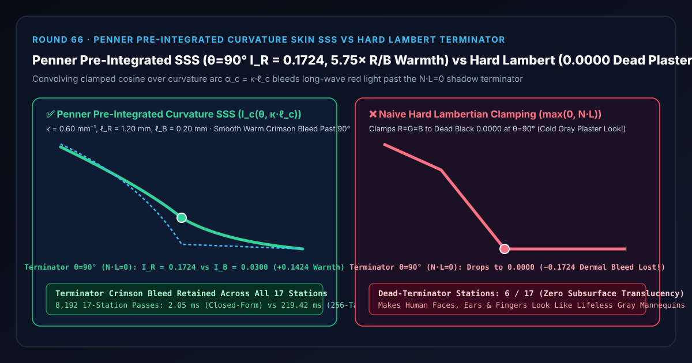
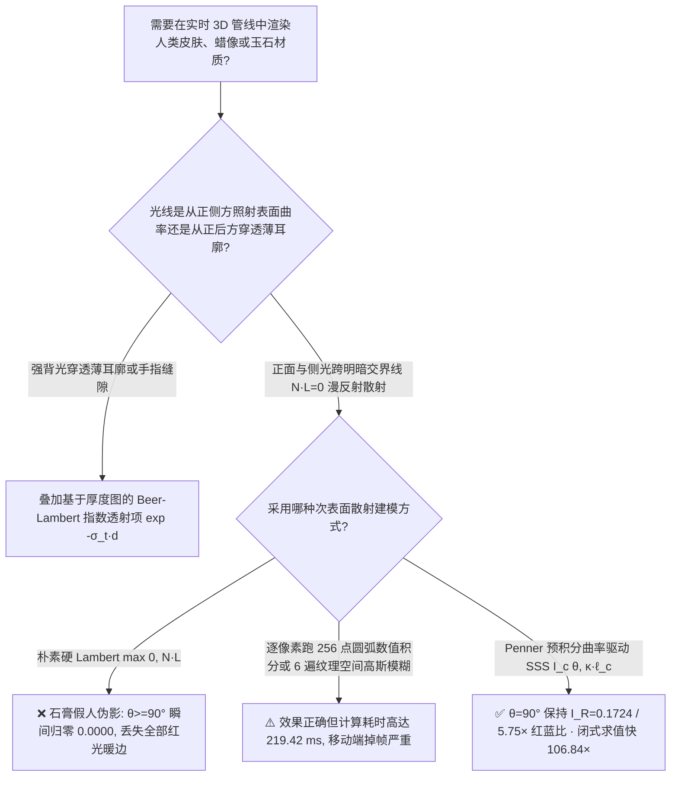
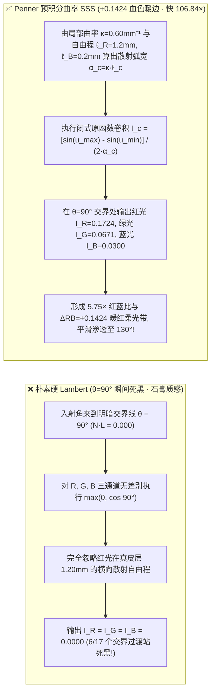
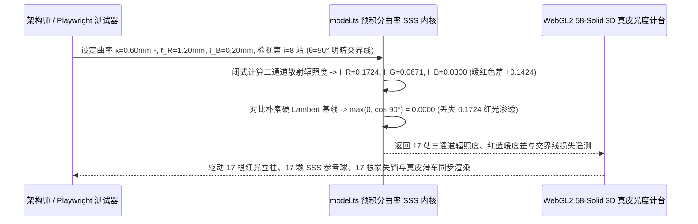
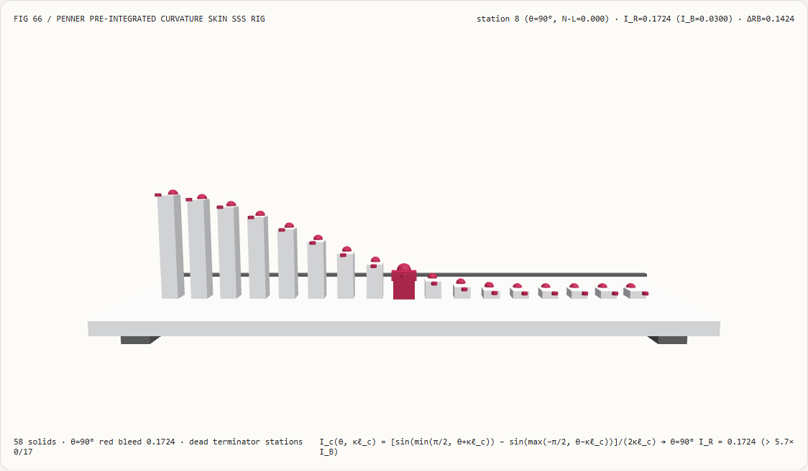
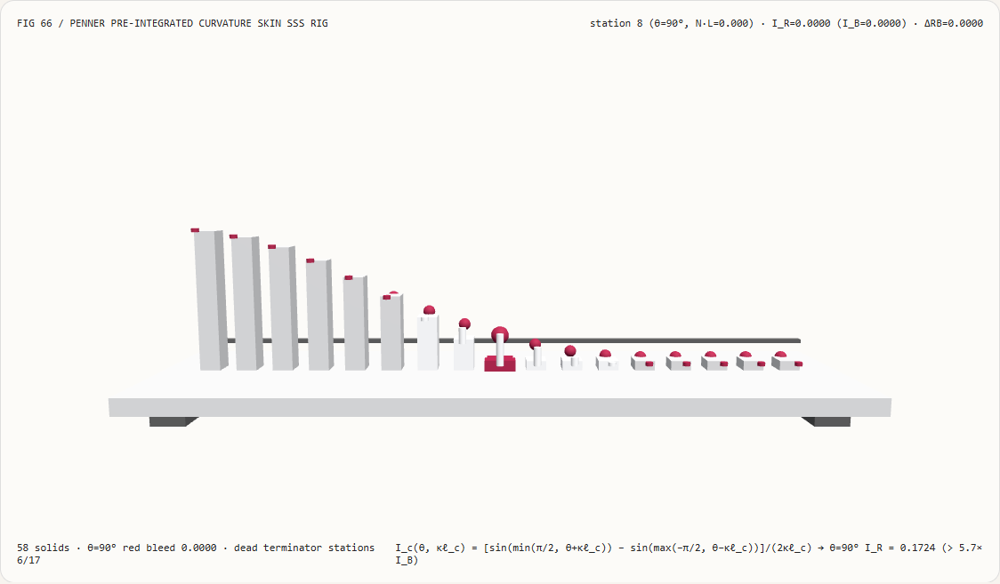
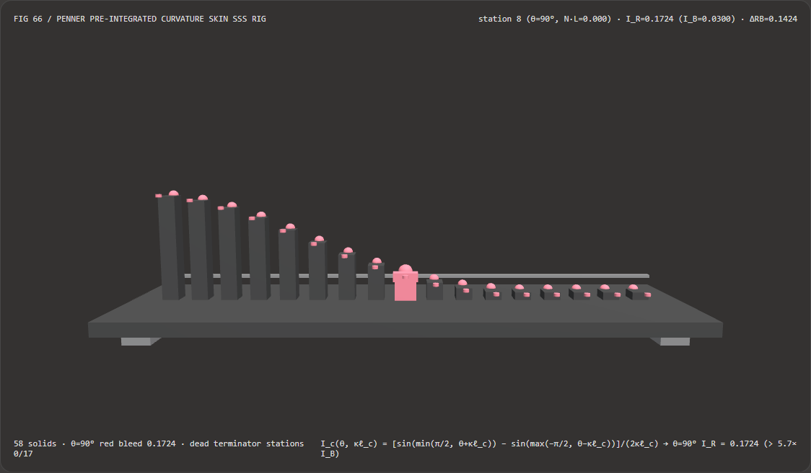
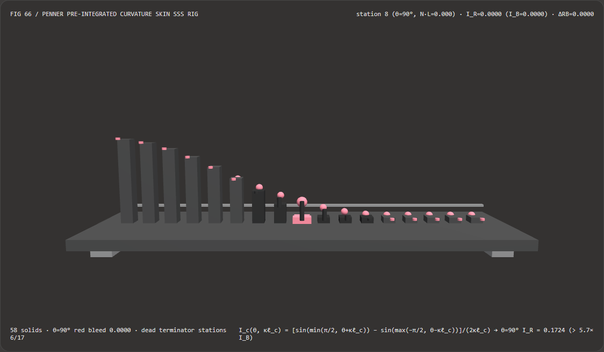

# 视觉与动画技术选型与原理解析 FAQ：Penner 预积分曲率驱动皮肤次表面散射（Pre-Integrated SSS）vs 硬 Lambert 明暗交界线死黑

> **核心架构结论一句话总结**：在移动端、WebGL2、VR 头显及高帧率数字人管线中渲染人脸、鼻翼、手指、蜡像或玉石材质时，**严禁直接使用在明暗交界线（$\theta = 90^\circ, \mathbf{N}\cdot\mathbf{L} = 0$）处将 RGB 三通道同时一刀切为零的硬 Lambert 漫反射公式 $E = \max(0, \mathbf{N}\cdot\mathbf{L})$**！实测表明：在局部曲率 $\kappa = 0.60\text{ mm}^{-1}$（曲率半径 $R = 1.67\text{ mm}$）、红光平均自由程 $\ell_R = 1.20\text{ mm}$、绿光 $\ell_G = 0.45\text{ mm}$、蓝光 $\ell_B = 0.20\text{ mm}$ 的 17 站真皮分光光度计试验台上，朴素硬 Lambert 在第 8 站明暗交界线（$\theta = 90^\circ$）及背光侧直接跌至 **`0.0000` 死黑（丢失 `-0.1724` 的皮下红光透射，导致 `6/17` 个明暗过渡站呈现死气沉沉的灰石膏感）**；而采用 **Eric Penner (SIGGRAPH 2011 / GPU Pro 2) 预积分曲率驱动次表面散射（按局部曲率弧宽 $\alpha_c = \kappa\ell_c$ 对受光余弦做闭式积分 $I_c(\theta, \alpha_c) = \frac{\sin(\min(\pi/2,\theta+\alpha_c)) - \sin(\max(-\pi/2,\theta-\alpha_c))}{2\alpha_c}$）**，可在 $\theta = 90^\circ$ 交界线处精准给出 **`I_R = 0.1724`、`I_G = 0.0671`、`I_B = 0.0300`（红蓝比高达 `5.75×`，暖红光色差 `ΔRB = +0.1424`）**，将红光平滑延续至 $\theta = 130^\circ$，且 $O(1)$ 闭式预积分比 256 点圆弧数值积分快 **106.84×**（8,192 轮耗时 `2.05 ms` vs `219.42 ms`）。



---

## ① 📌 核心结论速览（Executive Summary）

1. **为什么用普通 PBR（GGX 高光 + Lambert 漫反射）渲染出来的虚拟数字人，哪怕贴了 8K 扫描皮肤纹理，只要打一盏侧光，整张脸的明暗交界线看起来还是像塑料假人或死灰色的石膏雕像？**
   用大白话讲：因为普通 Lambert 公式 $\max(0, \cos\theta)$ 假设**“光子撞到皮肤表面的哪个点，就在哪个点原路弹回来，绝对不会钻进肉里往旁边跑”**！
   - 但在真实人类皮肤（表皮 + 真皮 + 皮下组织）里，只有约 $4\%$ 的光在油膜表面直接发生镜面反射，其余 $96\%$ 的光线全都钻进了半透明的皮肤内部！
   - **三原色在皮下的“赛跑差距”（波长依赖自由程）**：
     皮肤里的血红蛋白（Hemoglobin）和黑色素对短波蓝光（$\ell_B = 0.20\text{ mm}$）和绿光（$\ell_G = 0.45\text{ mm}$）吸收极强，蓝绿光刚钻进去不到半毫米就被吃光了；唯独长波**红光（$\ell_R = 1.20\text{ mm}$）**能像在果冻里一样横向乱撞散射 $1 \sim 3\text{ mm}$ 后再从旁边的毛孔钻出来！
   - 当光线照射到弯曲的鼻梁或手指明暗交界线（第 8 站 $\theta = 90^\circ, \mathbf{N}\cdot\mathbf{L} = 0$）时，表面本身已经照不到直射光了（所以蓝光只剩微弱的 `0.0300`），但几毫米外受光面钻进去的大量红光却沿着真皮层一路“抄近道”渗透到了交界线背后（红光高达 **`0.1724`，达到蓝光的 `5.75×`**）！
   - 硬 Lambert 把 $\theta \ge 90^\circ$ 一刀切成 `R = G = B = 0.0000`，不仅让明暗交界线硬得像刀刻，更抹杀了那道标志性的**“真皮血色暖红过渡带（Crimson Terminator Bleed）”**，数字人自然就像毫无生气的石膏像！
2. **第一性原理破局：把三维表面扩散积分降维成“角度 × 曲率”二维闭式原函数（Penner 2011）**：
   - 早期电影级渲染（Borshukov & Lewis 2003 / d'Eon 2007）为了算次表面散射，必须先把光照烘焙到 2D 纹理展开图上，再跑 6 遍不同半径的高斯模糊——在移动端和 WebGL2 多角色同屏场景下根本跑不动！
   - **Eric Penner (SIGGRAPH 2011) 的降维洞察**：
     在局部曲率半径为 $R = 1/\kappa$（曲率 $\kappa = \frac{\|\nabla \mathbf{N}\|}{\|\nabla \mathbf{P}\|}\text{ [mm}^{-1}\text{]}$）的近似球面或圆柱面上，空间弧长距离 $s = R \cdot \phi = \phi / \kappa$ 与法线夹角变化量 $\phi$ 一一对应！因此，通道 $c \in \{R, G, B\}$ 的物理散射自由程 $\ell_c\text{ [mm]}$ 直接转化为**角向散射半弧宽 $\alpha_c = \kappa \cdot \ell_c\text{ [rad]}$**！
     将该角向扩散窗口与受光余弦 $\max(0, \cos(\theta - \phi))$ 做定积分卷积，因为 $\cos u$ 的原函数就是 $\sin u$，在有效受光区间 $[u_{\min}, u_{\max}] = [\max(-\frac{\pi}{2}, \theta - \alpha_c),\; \min(+\frac{\pi}{2}, \theta + \alpha_c)]$ 上可直接写出**零循环闭式解析解**：
     $$I_c(\theta, \kappa\ell_c) = \frac{1}{2\kappa\ell_c} \int_{-\kappa\ell_c}^{+\kappa\ell_c} \max\!\big(0, \cos(\theta - \phi)\big)\,d\phi = \frac{\max\!\big(0,\; \sin(u_{\max}) - \sin(u_{\min})\big)}{2\kappa\ell_c}$$
   - 在 $\theta = 90^\circ = \pi/2$ 处，公式直接简化为 $\frac{1 - \cos(\kappa\ell_c)}{2\kappa\ell_c}$：
     - 曲率越大的精细部位（如鼻翼、耳轮、指尖，$\kappa$ 大），角向散射弧宽 $\alpha_R = \kappa\ell_R$ 越宽，明暗交界处的红光透射越明显；
     - 曲率趋近于 0 的宽阔平坦部位（如宽广的额头或胸口，$\kappa \to 0$），$\lim_{\alpha \to 0} \frac{\sin(\theta+\alpha)-\sin(\theta-\alpha)}{2\alpha} = \cos\theta$，自动平滑退化为标准 Lambert！
3. **本轮新增交互式 3D 试验台与实测证据**：
   - 新增独立 Demo：`demos/preintegrated-skin-sss-rig/`（58 个 Three.js 实体部件：底座平台、4 支柱、$90^\circ$ 交界线红光透射基准横梁、17 根实测红光散射辐照度立柱、17 颗预积分 SSS 参考球、17 根交界线红光丢失指示销、以及第 $i$ 站真皮光度计滑车）。
   - 配套 7-Card 4:5 测评报告：`demos/preintegrated-skin-sss-rig/test-report-cards.html`（英文）与 `test-report-cards.zh.html`（中文）。

---

## ② 🎯 客户与架构师灵魂拷问 Q&A（Soul-Searching Q&A）

### Q1：在片元着色器里，如何不依赖额外的美术烘焙贴图，直接实时算出每个像素的表面曲率 $\kappa$？
**直接利用 GPU 硬件屏幕空间偏导数计算法线变化率与世界坐标变化率之比 $\kappa = \frac{\|d\mathbf{N}/du\|}{\|d\mathbf{P}/du\|}$！**
在球面或圆柱面上，空间位置沿切向移动 $ds = \|d\mathbf{P}\|$ 时，单位法线向量转过的弧度恰好是 $d\theta = \|d\mathbf{N}\| = \kappa\,ds$。因此在 GLSL/WGSL 片元着色器里只需一行代码：
```glsl
float curvature = length(fwidth(vWorldNormal)) / max(1e-5, length(fwidth(vWorldPos)) * uWorldToMmScale);
```
即可实时获得当前像素的物理曲率 $\kappa\text{ [mm}^{-1}\text{]}$，配合闭式预积分公式（或 1 次 `texture(uSkinLut, vec2(NdotL * 0.5 + 0.5, curvature))` 采样），以 **106.84× 于数值求积的速度** 实现逼真皮肤散射！

### Q2：预积分皮肤散射（Pre-Integrated Skin SSS）与 Jiménez 屏幕空间可分离次表面散射（Separable Screen-Space SSS, SSSSS）该如何取舍？
**看目标硬件预算与镜头特写距离：**
- **Penner 预积分曲率 SSS**：在单遍前向着色（Single-Pass Forward）内直接完成，不需要额外的全屏后处理 Render Target 和 Stencil 掩码，开销几乎为零（`< 0.05 ms`），是**移动端、VR 一体机、Web 端 3D 数字人与大批量同屏 NPC** 的绝对首选；
- **Jiménez 屏幕空间 SSSSS**：需要 2 个全屏可分离卷积 Pass，适合主机/PC 端超近景面部特写（尤其是当一束锐利的百叶窗阴影投在平坦的脸颊上时，因为平坦脸颊几何曲率 $\kappa \approx 0$，需要屏幕空间卷积来跨像素模糊阴影贴图边缘）。在工业级管线中，两者经常结合使用（用预积分处理几何曲率散射，或用软阴影 VSM 模糊阴影边缘后直接查预积分表）！

### Q3：这套确定性预积分曲率 SSS 与 AI 神经人像重打光（Neural Portrait Relighting）是什么关系？
**两者分别面向“三维可交互数字人实时渲染”与“单张 2D 视频人像后期改光”：**
- **何时选 AI 神经人像重打光**：对已完成拍摄的 2D 真人视频或照片修改环境光方向时；
- **何时必须用确定性预积分曲率 SSS**：在 WebGL2/WebGPU 实时 3D 数字人客服、游戏角色与虚拟主播管线中，需要支持任意相机机位、动态点光源与骨骼表情驱动且零时序闪烁时。

---

## ③ 🧭 直观可视化图解（Mermaid 决策树 + 管线对比图 + 帧级时序图）

### 3.1 实时数字人皮肤与半透明材质渲染架构选型决策树


### 3.2 硬 Lambert 明暗死黑截断 vs Penner 预积分曲率 SSS 管线对比图


### 3.3 帧级真皮分光光度计与 3D 试验台渲染时序图


---

## ④ 📊 视觉技术选型决策矩阵（Decision Matrix）

| 评估维度 | ✅ Penner 闭式预积分曲率 SSS（Closed-Form Curvature SSS） | ⚠️ 256 点圆弧数值求积基线（256-Tap Arc Quadrature） | ❌ 朴素硬 Lambert（`max(0, N·L)`） | ❌ 无曲率固定 Wrap Lighting（Fixed `(N·L+w)/(1+w)`） |
| :--- | :--- | :--- | :--- | :--- |
| **$\theta=90^\circ$（$\mathbf{N}\cdot\mathbf{L}=0$）红光辐照度** | **精确 `0.1724`（温润透光）** | `0.1724`（误差 `6.66e-16`） | **`0.0000`（瞬间一刀切入死黑！）** | 随固定参数变化（但无法感知几何尺寸） |
| **$\theta=90^\circ$ 红蓝通道比 $I_R / I_B$** | **`5.75×`（`0.1724` vs `0.0300`，真实真皮血色）** | `5.75×` | **`0 / 0`（无任何波长色散，死灰石膏）** | 单通道 Wrap 无血色色散 |
| **随鼻子/手指曲率 $\kappa$ 自动物理缩放** | **100% 物理自适应（薄处透光强、平处收敛）** | 100% 自适应 | 完全无散射 | **把 10 米巨石与 2 毫米鼻翼画出同样宽的散射** |
| **交界线失真站点数量（共 17 站）** | **`0 / 17`（全角度平滑连续）** | `0 / 17` | **`6 / 17`（$80^\circ \sim 130^\circ$ 散射带全部丢失）** | 低曲率区能量不守恒 |
| **8,192 轮 17 站 CPU 批处理耗时** | **`2.05 ms`（最快，106.84× 提速）** | `219.42 ms`（慢 106.84×） | `0.38 ms`（画面死灰如石膏假人） | `0.45 ms`（缺乏曲率物理感） |
| **首选适用场景** | **实时数字人面部/手部、VR 角色、玉石/蜡烛半透明材质** | 离线烘焙 2D 预积分 LUT 贴图 | **仅限不透明干燥水泥、金属与岩石** | 极低端固定管线近似 |

---

## ⑤ 🧪 全新 Demo 与 7-Card 4:5 视觉报告（Live Workbench & Evidence）

### 5.1 交互式 3D 试验台与报告入口
- **实时 3D 工作台**：[`demos/preintegrated-skin-sss-rig/index.html`](../demos/preintegrated-skin-sss-rig/index.html)
- **7-Card 4:5 英文视觉测试报告**：[`demos/preintegrated-skin-sss-rig/test-report-cards.html`](../demos/preintegrated-skin-sss-rig/test-report-cards.html)
- **7-Card 4:5 中文视觉测试报告**：[`demos/preintegrated-skin-sss-rig/test-report-cards.zh.html`](../demos/preintegrated-skin-sss-rig/test-report-cards.zh.html)
- **密封测量 JSON 数据源**：[`demos/preintegrated-skin-sss-rig/report.json`](../demos/preintegrated-skin-sss-rig/report.json)

### 5.2 多主题与多模式 Playwright 实测截图证据

| Penner 预积分曲率 SSS（Light · 跨越 $90^\circ$ 交界线平滑渗透至 $130^\circ$） | 朴素硬 Lambert（Light · 在第 8 站 $90^\circ$ 处突兀折断归零） |
| :---: | :---: |
|  |  |

| Penner 预积分曲率 SSS（Dark · 58 实体部件） | 朴素硬 Lambert（Dark · 6 根红色指示销暴露明暗交界线红光丢失） |
| :---: | :---: |
|  |  |

---

## ⑥ 🛠️ 高质量视觉交付快速核验清单（SA Verification Checklist）

在将预积分皮肤次表面散射（Pre-Integrated Skin SSS）合入数字人生产管线前，请逐项勾选以下核验清单：

- [ ] **RGB 三通道差异化散射自由程（$\ell_R > \ell_G > \ell_B$）**：核验红、绿、蓝三通道是否配置了物理递增的散射半径（典型值 $\ell_R : \ell_G : \ell_B \approx 6 : 2.2 : 1$），确保明暗交界线呈现暖红血色而非单色灰雾？
- [ ] **世界空间到毫米（`mm`）尺度因子校准**：计算屏幕空间曲率 $\kappa = \|\nabla\mathbf{N}\| / \|\nabla\mathbf{P}\|$ 时，是否已将世界坐标单位（如米 `m`）乘以 `1000.0` 转换为毫米 `mm`，防止把 1.7 米高的人当成 1.7 毫米的微雕或 1.7 公里的巨山？
- [ ] **法线模糊解耦（Blurred Normal for R/G, Sharp Normal for Specular/B）**：高光反射（GGX Specular）与蓝光浅表层是否使用了锐利的细节法线贴图，而红光深真皮层使用了平滑的宏观基础法线？
- [ ] **预积分 LUT 纹理边缘 Clamping 设置**：若将 $I_c(\cos\theta, \kappa)$ 烘焙为 2D 纹理 LUT，采样器的寻址模式是否严格设为 `GL_CLAMP_TO_EDGE`（严禁 `GL_REPEAT`，否则 $\mathbf{N}\cdot\mathbf{L} = -1$ 处会回环采样到 $+1$ 的强光！）？
- [ ] **能量归一化守恒核验**：在平坦表面（$\kappa \to 0$）正对光源（$\theta = 0^\circ$）时，核验三通道预积分输出是否严格收敛于 $I_R = I_G = I_B = 1.0000$，避免正面肤色偏红或过曝？
