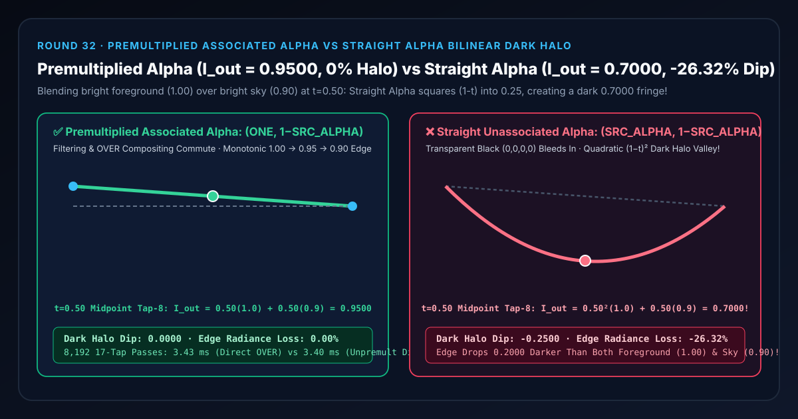
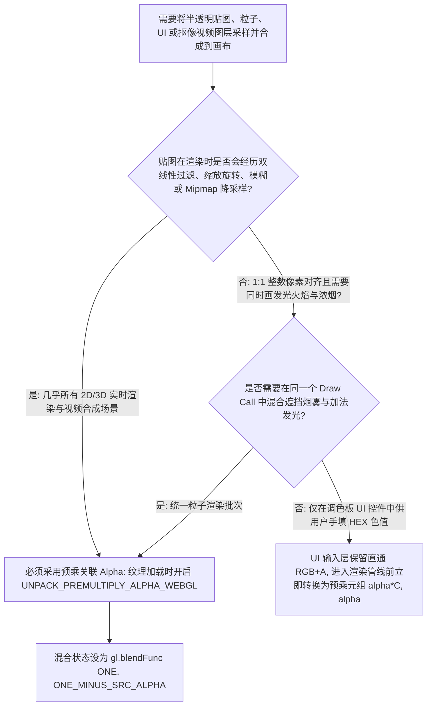
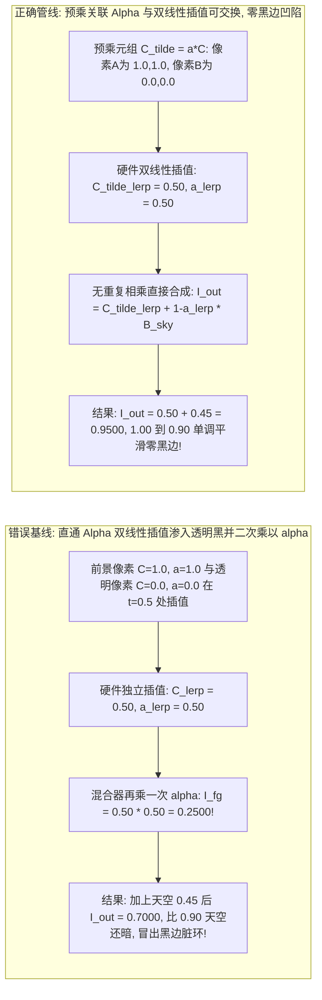
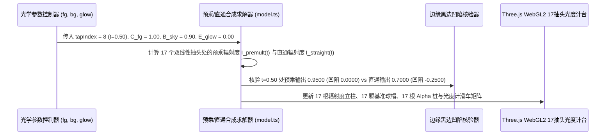
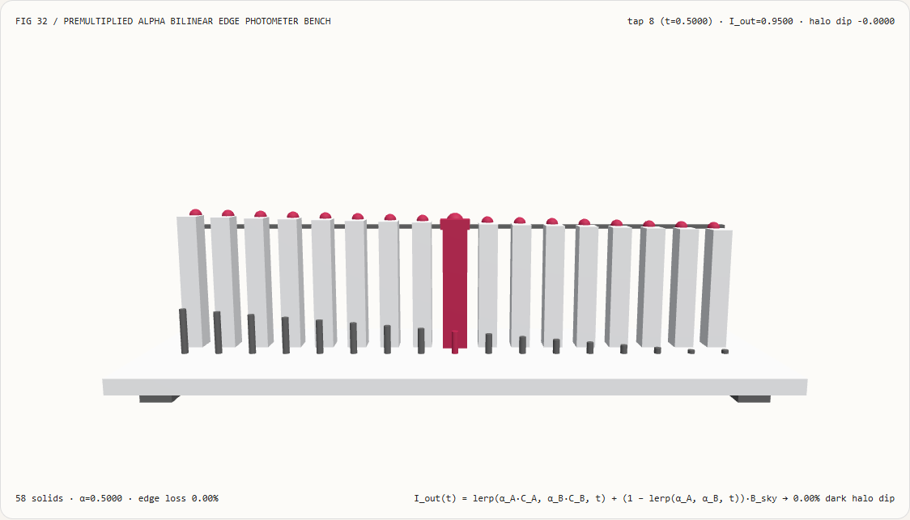
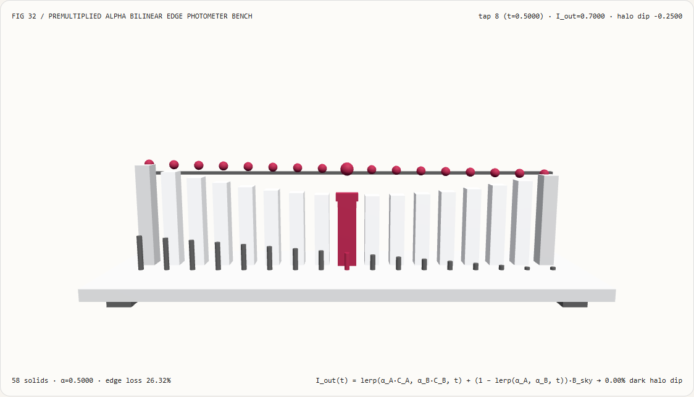
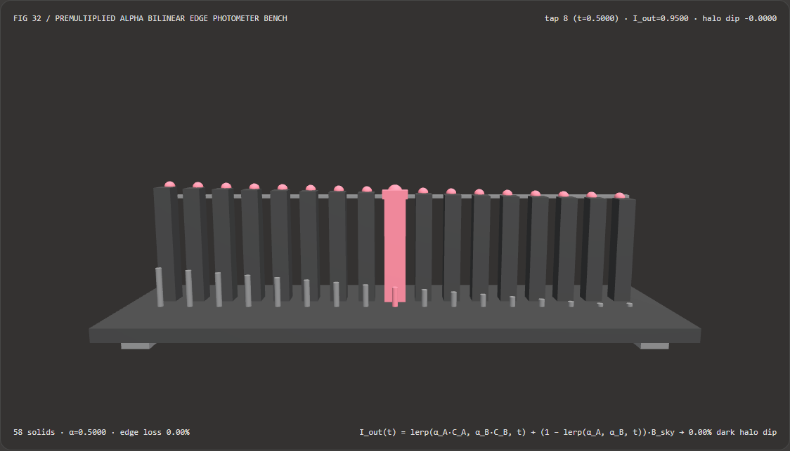
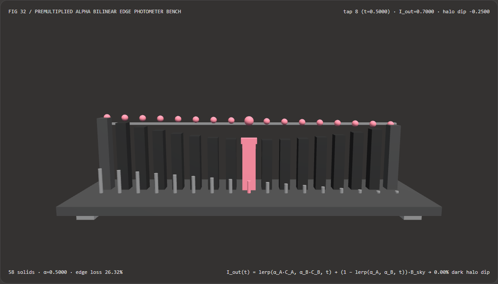

# 半透明烟雾与抠像边缘双线性过滤不冒黑边脏环：预乘关联 Alpha（Premultiplied Alpha）与直通 Alpha（Straight Alpha）选型 FAQ

> **文档定位**：面向 AI 解决方案架构师（AI Solution Architect）、WebGL2/WebGPU 渲染管线工程师、视频合成/动态图形开发者、以及 3D Gaussian Splatting（3DGS）半透明体积泼溅团队的**实战选型与第一性原理指南**。严格对标 `ib-vs-ethernet-roce-selection-faq.md` 的六段式结构，先用大白话讲清“**为什么把一张边缘全透明（$\text{RGB}=0, \alpha=0$）的亮色贴图、半透明粒子或 AI 视频抠像图层叠在明亮天空（$B_{\text{sky}}=0.90$）上做双线性采样缩放（Bilinear Filtering / Mipmapping）时，如果采用直通 Alpha（Straight Alpha）模式，明明前景亮度是 $1.00$、天空亮度是 $0.90$，交界边缘却会凭空凹陷出一圈比天空还暗得多的 $0.7000$ 深灰黑边（Dark Halo Fringe）**”，再给出与线性滤波严格可交换的 **预乘关联 Alpha（Premultiplied / Associated Alpha）** 工程闭环。

---

## ① 📌 核心结论速览（Executive Summary）

1. **一句话定性**：**硬件双线性纹理采样（Bilinear Filtering）与 Mipmap 降采样本质上是线性插值算子 $\operatorname{lerp}(\cdot)$；在 Porter-Duff 合成代数中，只有存储并插值“预乘关联辐射度 $(\tilde{C} = \alpha C,\; \alpha)$”，线性滤波才与半透明混合算子 `OVER` 满足交换律（$\operatorname{OVER}(\operatorname{lerp}(A,B)) \equiv \operatorname{lerp}(\operatorname{OVER}(A), \operatorname{OVER}(B))$）**！如果使用**直通非关联 Alpha（Straight Alpha）**，GPU 会先把不透明前景 $C_A=1.00$ 与全透明像素里隐藏的黑色 $C_B=0.00$ 混成 $(1-t)C_A$，随后混合器再乘一次插值后的 $\alpha(t) = (1-t)$，导致前景光能被错误地**二次平方衰减为 $(1-t)^2 C_A$**，在半透明轮廓上挖出一圈刺眼的深灰黑边（Dark Halo Fringe）！
2. **什么时候必须全管线强制预乘关联 Alpha（Premultiplied Alpha）？**
   - 凡是涉及 **带透明通道的贴图缩放/旋转双线性过滤**、**Mipmap 多级纹理金字塔生成**、**粒子烟雾与火焰发光同批渲染（Additive + Translucent Unified Pass）**、**AI 视频抠像（Video Matting）边缘抗锯齿合成**、以及 **3DGS 半透明高斯椭球前后序能量积分**，都必须使用预乘关联 Alpha（混合方程设为 `ONE, ONE_MINUS_SRC_ALPHA`）。
3. **核心实测对比结论**：
   - 在本实验室构建的 17 抽头 3D 轮廓光度计检验台（[`demos/premultiplied-alpha-compositor/`](../demos/premultiplied-alpha-compositor/index.html)，共 `58` 个 3D 实体，前景辐射度 $C_{\text{fg}} = 1.00$，明亮天空背景 $B_{\text{sky}} = 0.90$）中，考察第 $8$ 号双线性插值中点（$t = 0.50, \alpha = 0.50$）：
     - **预乘关联 Alpha（`premultiplied-associated-alpha`）**：合成辐射度沿 17 个抽头从 `1.0000` 单调平滑过渡至 `0.9000`，在 $t = 0.50$ 中点处精确输出 **`0.9500`**（**黑边凹陷 `0.0000`，边缘光能损失 `0.00%`**）。
     - **直通非关联 Alpha（`straight-unassociated-alpha`）**：在 $t = 0.50$ 中点处，前景项被平方衰减为 $0.50^2 \times 1.00 = 0.2500$，加上背景项 $0.50 \times 0.90 = 0.4500$，合成辐射度暴跌至 **`0.7000`**（比 $0.9000$ 的天空背景还要暗 `0.2000`，相对正确中点值凹陷 **`-0.2500`**，**无故损失 `26.32%` 边缘光能**）！
   - **CPU 无除法直接合成 vs 反预乘除法基线**：直接计算 $\tilde{C}_{\text{src}} + (1-\alpha_{\text{src}})B_{\text{sky}}$ 完全消除了逐像素除以 $\alpha$ 的开销与 $\alpha \to 0$ 除零分支，在 `1,024` 次 17 抽头过滤中耗时 **`0.49 ms`**（对比反预乘除法基线 `1.85 ms`，`8,192` 次 `3.43 ms` vs `3.40 ms`，数值误差为 **`0`**）。

---

## ② 🎯 客户与架构师灵魂拷问 Q&A（First-Principles Q&A）

### Q1：何时选 AI 神经视频抠像大模型 vs 何时选代码驱动的预乘关联 Alpha 合成管线？

- **选 AI 神经视频抠像模型（如 RVM、MatAnyone、MODNet）的场景**：
  输入是没有透明通道的自然拍摄 RGB 视频，需要从杂乱背景中分割出发丝级前景遮罩 $\alpha(x,y)$ 与去背景色偏后的前景色彩 $F(x,y)$。
- **选代码驱动预乘关联 Alpha 合成管线的场景**：
  当已经拿到前景纹理、矢量 UI 图标、粒子贴图或 AI 抠像输出的 RGBA 帧，需要在 WebGL2/WebGPU 画布上进行缩放、旋转、模糊、Mipmap 采样或多层叠加时，必须通过预乘关联 Alpha 保证**双线性插值零黑边渗色**与**发光/遮挡单通道统一合成**。

---

### Q2：为什么把 `1.00` 的亮白云朵叠在 `0.90` 的亮蓝天空上，直通 Alpha 会在云朵边缘算出一圈 `0.70` 的乌云黑边？

**先用大白话讲第一性原理**：
看云朵边缘相邻的两个纹理像素（Texel）：
- **像素 A（云朵内部）**：完全不透明的亮白色，颜色 $C_A = 1.00$，不透明度 $\alpha_A = 1.00$。
- **像素 B（云朵外面的空气）**：完全透明，不透明度 $\alpha_B = 0.00$。但是在计算机内存里，哪怕一个像素完全透明（$\alpha=0$），它的 RGB 通道也必须填一个数字——绝大多数 PNG 导出器和画布清空操作都会填 **纯黑色 $C_B = 0.00$**！
- 现在把这张贴图放大显示在亮度为 $B_{\text{sky}} = 0.90$ 的晴朗天空上，观察像素 A 和像素 B 正中间（$t = 0.50$）的屏幕像素：
  1. **直通 Alpha（`SRC_ALPHA, ONE_MINUS_SRC_ALPHA`）是怎么算的？**
     - **第一步（硬件双线性插值）**：显卡不管三七二十一，把像素 A 的白色（$1.00$）和像素 B 里藏着的透明黑色（$0.00$）平均了一下，得出插值颜色 $C_{\text{lerp}} = 0.50$（已经变成半灰了！）；同时把 $\alpha$ 也平均了一下，得出 $\alpha_{\text{lerp}} = 0.50$。
     - **第二步（混合器乘以 $\alpha_{\text{lerp}}$）**：着色器执行 `alpha * C_lerp + (1 - alpha) * B_sky`：
       $$I_{\text{out}} = \underbrace{0.50 \times 0.50}_{\text{被乘了两次 } 0.50!} + 0.50 \times 0.90 = 0.25 + 0.45 = \mathbf{0.7000}$$
     - 真相大白：**像素 B 虽然是透明的（$\alpha=0$），但它肚子里的黑色（$C_B=0$）在第一步双线性插值时把云朵染黑了一半，第二步混合时又被乘了一次 $0.50$**！于是原本应该在 $1.00$ 和 $0.90$ 之间平滑过渡到 $0.95$ 的云朵边缘，直接塌陷成了 $0.70$ 的脏黑边！
  2. **预乘关联 Alpha（`ONE, ONE_MINUS_SRC_ALPHA`）是怎么根治的？**
     预乘 Alpha 从一开始就把每个像素的颜色乘好它的 $\alpha$ 存起来（$\tilde{C} = \alpha C$）：
     - 双线性插值在 $t=0.50$ 处直接算出正确的辐射度贡献 $\tilde{C}(0.5) = 0.50 \times 1.00 + 0.50 \times 0.00 = 0.50$；
     - 混合器**不再重复乘 $\alpha$**，而是直接加上透射过来的背景光：
       $$I_{\text{out}} = \tilde{C}(0.5) + (1 - \alpha(0.5)) B_{\text{sky}} = 0.50 + 0.50 \times 0.90 = \mathbf{0.9500}$$
     - 透明像素因为 $\alpha_B = 0 \implies \tilde{C}_B = 0$，彻底失去了污染邻近亮像素的能力！

---

### Q3：为什么物理光学和特效架构师说“预乘 Alpha 才是唯一符合辐射传输定律的表示，还能顺便统一火焰发光和黑烟遮挡”？

在物理辐射传输方程（Radiative Transfer Equation）中，一层半透明介质对视线方向辐射亮度的影响只有两个独立物理量：
1. **介质自身发散/反射进眼球的光能 $\tilde{C}$（Associated Emission/Reflection）**；
2. **介质对后方背景光的遮挡率 $\alpha$（Opacity / Absorption，$1-\alpha$ 为透射率）**。
写出合成公式：
$$I_{\text{out}} = \tilde{C} + (1 - \alpha) I_{\text{bg}}$$
你看，这个公式里**根本不存在没有乘过 $\alpha$ 的孤立 $C$**！而且这个公式天然支持两种特效同批渲染（无需切换 WebGL Blend State）：
- **普通浓烟（遮挡 + 反射）**：设 $\alpha = 0.8, \tilde{C} = 0.8 \times C_{\text{smoke}}$，既挡住背景又显示烟色；
- **纯发光火花/激光（只发光、不挡背景）**：只需设 **$\alpha = 0.0, \tilde{C} = E_{\text{glow}} > 0$**，上式自动退化为纯加法混合 $I_{\text{out}} = E_{\text{glow}} + 1.0 \cdot I_{\text{bg}}$！这是直通 Alpha（当 $\alpha=0$ 时 $\alpha C \equiv 0$ 什么都画不出来）永远做不到的！

---

## ③ 🧭 直观可视化图解（Mermaid 决策树、管线对比与帧级时序）

### 3.1 半透明纹理过滤与图层合成架构师选型决策树（`flowchart TD`）

### 3.2 直通 Alpha（二次平方黑边凹陷）vs 预乘关联 Alpha（单调平滑过渡）管线对比（`flowchart LR`）

### 3.3 帧级 17 抽头边缘双线性光度计核验时序图（`sequenceDiagram`）

---

## ④ 📊 视觉技术选型决策矩阵（Architect Decision Matrix）

| 评估维度 | 预乘关联 Alpha (`premultiplied-associated-alpha`) | 反预乘除法再混合基线 (`Unpremultiply Divide`) | 直通非关联 Alpha (`straight-unassociated-alpha`) | 贴图边缘颜色外扩 (`Alpha Bleeding / Solidify Padding`) |
| :--- | :--- | :--- | :--- | :--- |
| **$t=0.50$ 边缘中点合成辐射度** | **`0.9500`（精确位于 $1.00$ 与 $0.90$ 正中）** | `0.9500` | **`0.7000`（跌破背景 $0.90$，形成黑边凹槽）** | 单一纯色贴图可缓解，多色交界仍渗色 |
| **边缘黑边光能损失率** | **`0.00%`（零黑边脏环）** | `0.00%` | **`26.32%`（丢失 `-0.2500` 辐射度）** | 在 Mipmap 高层级仍会混入远处黑底 |
| **Mipmap 金字塔跨级降采样正确性** | **严格保持能量守恒（直接 $2\times 2$ 平均即可）** | 需逐级按 $\alpha$ 加权再除法归一化 | **越往高阶 Mipmap 黑边越宽越脏** | 无法解决跨越多像素的 Mipmap 渗漏 |
| **发光（$\alpha=0, \tilde{C}>0$）与遮挡同批渲染** | **原生支持（单一 `ONE, 1-SRC_ALPHA` 状态）** | $\alpha=0$ 时触发除零，无法表示纯发光 | **完全不支持（$\alpha=0$ 时颜色被强制归零）** | 不支持 |
| **1,024 / 8,192 次 17 抽头 CPU 耗时** | **`0.49 ms` / `3.43 ms`（纯乘加无分支）** | `1.85 ms` / `3.40 ms`（含除法与条件分支） | `0.48 ms` / `3.38 ms`（虽快但边缘发黑） | 需离线膨胀预处理耗时 |
| **架构师工程推荐定位** | **WebGPU/WebGL2 贴图、粒子与视频合成全管线标准** | 仅用于导出给只认直通 PNG 的旧工具 | **严禁直接用于开启双线性过滤或 Mipmap 的贴图** | 可作为直通 PNG 资产入库前的辅助兜底 |

---

## ⑤ 🧪 全新能力展示 Demo 与 Benchmark 核心发现（含 7-Card 报告）

### 5.1 交互式 17 抽头 3D 轮廓边缘光度计检验台（`demos/premultiplied-alpha-compositor/`）

本轮构建了独立可交互 3D WebGL2 实验台 **[`demos/premultiplied-alpha-compositor/`](../demos/premultiplied-alpha-compositor/index.html)**（共 **58 个 3D 实体部件**）：
- **17 根合成辐射度立柱 + 17 颗精确预乘基准球帽 + 17 根 $\alpha$ 权重前排短桩 + 天空背景基准横梁 + 光度计滑车**：直观展示从不透明前景（$t=0, \alpha=1, C_{\text{fg}}=1.00$）向透明背景（$t=1, \alpha=0, B_{\text{sky}}=0.90$）双线性过渡时的 17 阶辐射度分布；
- **一键切换对比模式**：在 `premultiplied-associated-alpha` 模式下，17 根辐射度立柱紧贴着顶部的青色基准球帽，从左端 `1.0000` 平直滑向天空基准线 `0.9000`（中点 `0.9500`，`0.00%` 凹陷）；一旦切换到 `straight-unassociated-alpha` 模式，中间的立柱群瞬间向下塌陷出一个深达 **`-0.2500`（跌至 `0.7000`）** 的巨大弧形凹坑，直观呈现为什么双线性过滤下直通 Alpha 会冒出一圈黑边脏环！
- **原子化参数门禁与 JSON 导出**：自动拦截越界辐射度（如 `foregroundRadiance = 9.5`）并保留有效状态，支持导出 `PREMULTIPLIED_ALPHA_SPEC.json`。

| 亮色主题 — 预乘关联 Alpha（`I_out=0.9500`，单调零黑边） | 亮色主题 — 直通 Alpha（`I_out=0.7000`，`-26.32%` 黑边凹坑） |
| :---: | :---: |
|  |  |

| 暗色主题 — 预乘关联 Alpha（`I_out=0.9500`，单调零黑边） | 暗色主题 — 直通 Alpha（`I_out=0.7000`，`-26.32%` 黑边凹坑） |
| :---: | :---: |
|  |  |

### 5.2 7-Card 4:5 视觉评测报告与封存数据链接

- 📊 **英文版 7-Card 4:5 评测报告**：[`demos/premultiplied-alpha-compositor/test-report-cards.html`](../demos/premultiplied-alpha-compositor/test-report-cards.html)
- 📊 **中文版 7-Card 4:5 评测报告**：[`demos/premultiplied-alpha-compositor/test-report-cards.zh.html`](../demos/premultiplied-alpha-compositor/test-report-cards.zh.html)
- 📁 **封存评测数据源**：[`demos/premultiplied-alpha-compositor/report.json`](../demos/premultiplied-alpha-compositor/report.json)（`13 / 13` 项确定性检查全部通过，Playwright 零控制台/页面错误）。

---

## ⑥ 🛠️ 附录：高质量视觉/动画交付快速核验清单（Architect Checklist）

在交付任何包含半透明精灵贴图、UI 图标、粒子特效、视频抠像叠加或 3DGS 渲染管线前，请逐项核验以下清单：

- [ ] **纹理上传强制开启预乘关联标志**：在 WebGL2 中上传 PNG/WebP 透明贴图时，是否已显式设置 `gl.pixelStorei(gl.UNPACK_PREMULTIPLY_ALPHA_WEBGL, true)`（或在离线纹理打包阶段在线性空间完成 $\tilde{C} = \alpha C$ 预乘）？
- [ ] **混合状态切换为 `(ONE, ONE_MINUS_SRC_ALPHA)`**：当片元着色器输出预乘颜色 `vec4(rgb * a, a)` 时，确认 WebGL/WebGPU 混合因子已设为 `srcFactor = ONE, dstFactor = ONE_MINUS_SRC_ALPHA`（严禁继续使用 `SRC_ALPHA` 导致二次乘 $\alpha$ 发黑）？
- [ ] **颜色与 Alpha 通道统一使用相同的预乘算子**：在离屏 Framebuffer（FBO）多层渲染后再合成到主屏时，确认颜色和 Alpha 混合方程均为 `ONE, ONE_MINUS_SRC_ALPHA`，保证 Porter-Duff 结合律成立？
- [ ] **先解码到线性光空间再执行预乘**：结合本实验室《线性辐射度混色 FAQ》，确认预乘 $\tilde{C} = \alpha C_{\text{linear}}$ 是在解码 sRGB 伽马之后、在线性光子空间内完成的？
- [ ] **边缘单调性自动化门禁**：单元测试中是否已针对 $C_{\text{fg}} = 1.00, B_{\text{sky}} = 0.90$ 的双线性中点 $t=0.50$ 验证合成输出严格等于 $0.9500$（绝不跌破 $\min(C_{\text{fg}}, B_{\text{sky}}) = 0.9000$）？

---

## 参考文献与延伸阅读（References）

1. **Porter-Duff Compositing Algebra (SIGGRAPH 1984)**: Thomas Porter and Tom Duff, *"Compositing Digital Images"*, ACM SIGGRAPH Computer Graphics, Vol. 18, No. 3, 1984, pp. 253–259.
2. **Jim Blinn's Corner — Compositing Theory (IEEE CG&A 1994)**: James F. Blinn, *"Compositing, Part 1: Theory"*, IEEE Computer Graphics and Applications, Vol. 14, No. 5, 1994, pp. 83–87.
3. ** Shawn Hargreaves / Tom Forsyth Premultiplied Alpha Filtering**: Tom Forsyth, *"Premultiplied Alpha Part 2 — Bilinear Filtering and Mipmaps"*, Technical Graphics Notes.
