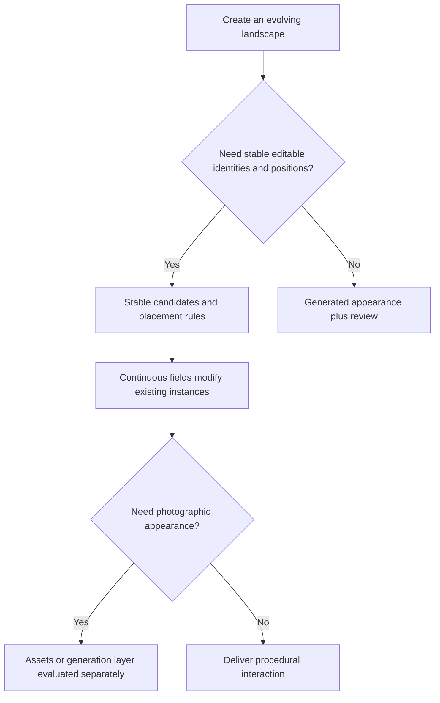
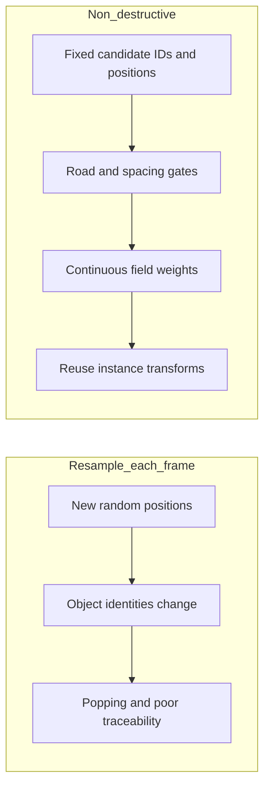
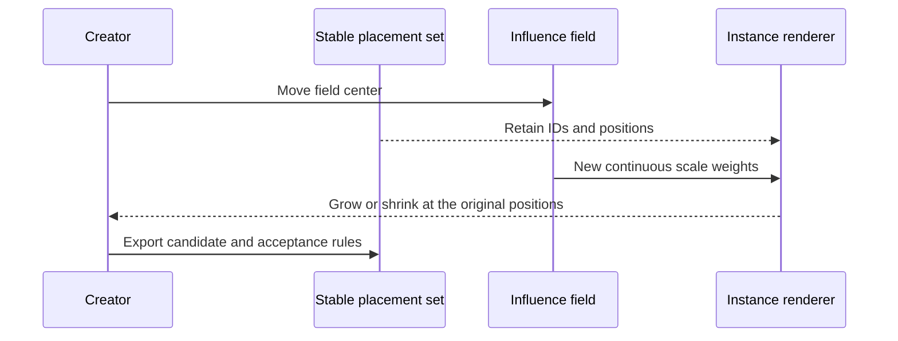

# Move the field, not the whole world: stable procedural scattering FAQ

**Three minutes for the decision; ten minutes for a stable-ID field exercise.**

[中文](procedural-scatter-fields-faq.md) · [Interactive demo](https://turbo998.github.io/animation/demos/procedural-field-lab/) · [Measured cards](../demos/procedural-field-lab/test-report-cards.html)

## ① 📌 Executive Summary

- **Placement and animation should be separate state layers.** Fix candidate identities and positions first, then let a field change scale. Moving a creative control should not reshuffle the forest.
- **Non-destructive does not mean every edit preserves everything.** Field edits preserve positions; changing seed or spacing changes the placement rule. Appending candidates retains the accepted prefix.
- **An algorithm name is not a performance guarantee.** Both samplers return identical output here, but the measured spatial-grid implementation is slower for these tested densities and sizes. No cherry-picked fastest run or weakened baseline.
- **A verified recent breakthrough: Maxon's October 14, 2026 release.** Cinema 4D 2027.0 Scatter supports distribution, filtering, clustering and transforms with MoGraph Fields/Effectors. This is an original browser concept, not Maxon software, plugin evaluation or a daily popularity ranking. Retrieved November 9, 2026.

## ② 🎯 Customer and architect Q&A

### Q1 When should I choose an AI video model versus code?

Video models can reduce manual work for natural landscapes, materials and performances. Code fields fit an interactive requirement where a customer drags an influence region and inspects exactly which objects change. Combine control and appearance layers if useful, but stable conditions do not prove stable generated pixels.

This demo runs no video model or Maxon software. It supplies inspectable rules: preserve a road, enforce center spacing, and change scale without resampling positions.

### Q2 Under which explicit constraints is code the better choice?

Requirements such as “this ID does not move,” “exclude the road,” “moving a field does not replace positions,” and “export accepted points and rules” map directly to code assertions. A beautiful natural clip without inspectable internals may favor generation; the comparison remains constraint-specific.

An SA can explain campus, shop or equipment digital-twin rules by letting customers adjust density and influence. Real foliage, canopy collision, wind, ecology and engineering constraints need separate models; the miniature cannot certify them.

### Q3 Why do older scatter animations pop, and how does this pipeline work?

A common failure resamples every position on every frame. Even if only tree height was meant to change, every tree's identity changes: it resembles scattering a new handful of beans. Mixing global placement and local animation in an opaque parameter list also makes edits hard to trace.

Here, numbered candidates are fixed first, then road and distance gates produce the accepted set. A continuous field computes scale per existing ID: stronger near the center, with a small visible minimum elsewhere. Moving the field changes weights, not the beans.

A spatial grid divides the site into cells and inspects nearby neighbors. An all-pairs reference scans already accepted points but can stop as soon as one is too close. In this small dense workload, string-key and neighborhood-management overhead makes the grid slower.

This is not a rejection of spatial indexing. Larger sparse worlds, different structures or different implementations may behave differently. These CPU results do not stand in for GPU performance, Maxon, or every scene.

### Q4 How can I reproduce the workflow in ten minutes?

1. Run `npm run dev`, open `/demos/procedural-field-lab/`, and keep seed 42, 1024 candidates and spacing 0.6.
2. Move field center and radius. Trees change scale while IDs and positions stay fixed.
3. Append candidates to preserve the old accepted prefix. Changing seed or spacing changes the placement rule; do not promise unchanged output then.
4. Export `PROCEDURAL_FIELD.json`, including rules, accepted positions and weights—not only a screenshot.
5. Run `npx vitest run tests\procedural-field.test.ts`; after building and previewing on 4335, run `node scripts\benchmark-fields.mjs`.
6. Replace illustrative trees with authorized assets for customer work and separately check center spacing, actual geometry collision and performance.

## ③ 🧭 Visual explanations

## ④ 📊 Architect Decision Matrix

| Requirement | Per-frame randomness | Stable IDs + fields | DCC Scatter/Fields | Video model |
| --- | --- | --- | --- | --- |
| Repeatable identity and placement | Poor fit | Directly checked here | Specify rules and assets | Evaluate output |
| Local continuous growth/scale | Prone to popping | Suitable | Professional authoring strength | Appearance is not exact rule control |
| Road exclusion and center spacing | Additional logic | Explicit gates | Configurable in professional tools | Pixels do not guarantee it |
| Photographic nature | Needs assets | Simplified shapes here | High-quality assets/rendering | Often useful, with review |
| Performance conclusion | Measure | Grid did not beat scan here | Commercial software unmeasured | Inference unmeasured |

**Capacity example:** retain one accepted placement set and animate its weights, rather than building another set each frame. Storage, GPU bytes and throughput depend on assets and implementation; tree counts are not invented VRAM estimates.

## ⑤ 🧪 New demo and measured findings, including seven cards

The [sealed report](../demos/procedural-field-lab/report.json) holds thirteen checks, three candidate-count tiers, seven Node CPU runs per algorithm, and actual browser identity/position invariants. The tested 1024-candidate configuration accepts 339 points with a measured minimum center spacing of about 0.601472 scene units.

Both methods return the same IDs and positions, but **the tested grid implementation is slower**. The finding is useful: do not add an index to a small dense scene on asymptotic complexity alone. Median bars use all raw repeats and retain outliers.

Field edits changing scale without moving positions are verified from actual browser state. Center spacing is not canopy collision safety; object counts are not memory bytes; Node sampling is not browser FPS.

[English cards](../demos/procedural-field-lab/test-report-cards.html) · [中文七卡](../demos/procedural-field-lab/test-report-cards.zh.html). Tree shapes: `synthetic`; local code: `measured`; Maxon, model inference, visual quality and physical behavior: `not_measured`.

## ⑥ 🛠️ Architect Checklist

- [ ] Export stable IDs, seed, units and candidate order.
- [ ] Separate placement rules from animation fields.
- [ ] State which edits retain identity and which change acceptance.
- [ ] Verify exclusion and minimum spacing against actual output.
- [ ] Separate center distance from real canopy/equipment collision.
- [ ] Compare algorithms with identical input, output and repeats.
- [ ] Measure index-management overhead, density and size.
- [ ] Keep CPU sampling, GPU rendering, memory bytes and inference separate.
- [ ] Preserve reduced motion, offscreen pause, keyboard controls and export.
- [ ] Label untested commercial software, assets and video models clearly.

**Primary source:** [Maxon Fall 2026 release, October 14](https://www.maxon.net/en/article/maxon-fall-2026-release-faster-workflows-more-creative-control): Scatter Generator/Tag with Fields/Effectors creative controls. Retrieved November 9, 2026; no vendor imagery, software code or demo reproduced and no same-day popularity claim.
