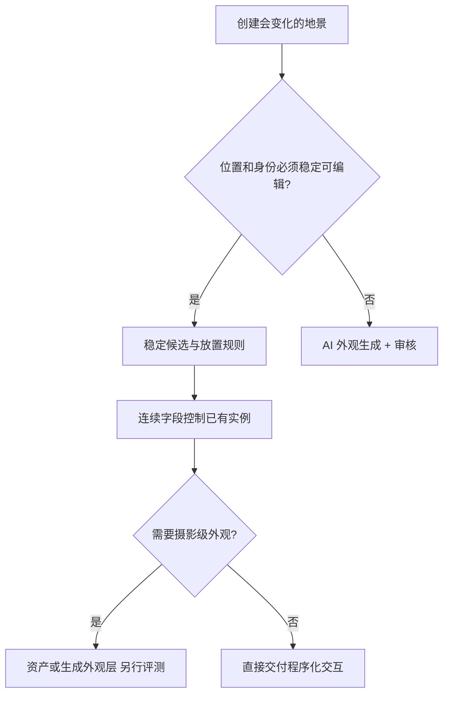
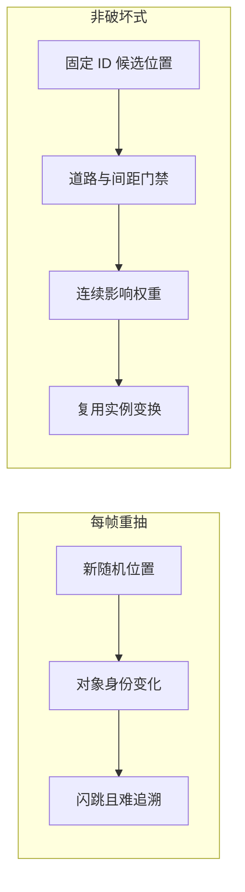
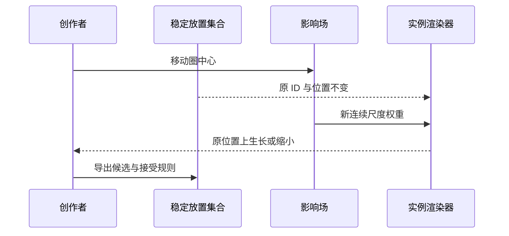

# 移动影响场，不重抽整个世界：程序化散布与稳定身份选型 FAQ

**3 分钟看结论；10 分钟操作稳定 ID 影响场。**

[English](procedural-scatter-fields-faq.en.md) · [交互 Demo](https://turbo998.github.io/animation/demos/procedural-field-lab/) · [中文七卡](../demos/procedural-field-lab/test-report-cards.zh.html)

## ① 📌 核心结论速览（Executive Summary）

- **放在哪里与怎么动，应是两层状态。** 先固定候选 ID 和位置，影响场再改变尺度；移动创意控制器就不必让整片森林重新洗牌、闪跳。
- **非破坏式不是“任何编辑都完全不变”。** 只调影响场时，位置不变；改变种子或最小间距是在改变放置规则，可能改变接受点。增加候选数量则保留已接受前缀。
- **算法名字不是性能保证。** 本机对相同样本比较空间网格与全对扫描；在已测密度/数量下，简单扫描更快。没有为了蓝色条好看挑选最快一次或改造基线。
- **近期真实突破：Maxon 2026-10-14 官方发布。** Cinema 4D 2027.0 Scatter System 支持分布、过滤、聚类与变换，并结合 MoGraph Fields/Effectors 控制动画。本例是原创浏览器概念实验，不是 Cinema 4D 的实现、插件评测或当日热度榜；检索日期为 2026-11-09。

## ② 🎯 客户与架构师灵魂拷问 Q&A

### Q1 何时选 AI 视频大模型 vs 何时选代码驱动交互式动画？

要自然风景、电影材质与人物动作，视频模型可以省大量手工美术；要让客户拖动一个影响圈、精确知道哪些对象改变了，代码字段更合适。程序动画与 AI 外观层可以组合，但不要把“条件输入稳定”当成“生成像素一定稳定”。

本例不生成视频，也没有测 Maxon 软件。它交付可检查的场景控制原型：道路不能种树、实例中心不能太近、影响场移动只改尺度。

### Q2 什么场景下代码驱动动画严格更优？

验收若要求“同一候选 ID 不搬家”“排除道路”“调一个字段时不重抽位置”“导出规则与已接受样本”，代码能直接给出结果与断言。对于只要一段漂亮自然画面的场景，生成模型可能更经济；严格更优仍取决于明确的控制约束。

SA 场景：园区、门店或设备数字孪生的方案讲解，让客户调密度与影响范围，直观看到规则如何作用到已有实例。真实植被、树冠碰撞、风、生态密度与工程设计另行建模，不能由示意小森林认证。

### Q3 原理是什么？为什么以前的散布动画会闪跳？

常见坏做法是在每帧重新随机出所有位置。即便想改变的只是树高，每棵树的“身份”也变了：画面像一把重新撒下的豆子。另一个坏做法是把全场放置和局部动画混在一套不可追溯参数里，编辑后不知道哪些对象本应保留。

本例先把“豆子”的编号与候选位置固定，再经过道路排除和中心间距门禁，生成接受集合。随后用一个连续影响场算每棵树的尺度：靠近圈中心影响更大，远处仍保留最低可见尺度。移动圈只改权重，不再换豆子。

“空间网格”像把场地分成小格：只检查附近格子的邻居。“全对扫描”是逐个与已有点比较，看起来笨，却可提前找到太近的点并停止。本机小而密的场景中，网格的字符串键和邻域管理开销超过了收益，所以更复杂的索引反而慢。

这不是反对空间索引；是提醒先测真实数量、密度与实现。大而稀疏的场景、不同数据结构或不同实现可能得到另一结果；我们没有拿本次 CPU 结果替代 GPU、Maxon 或所有场景的结论。

### Q4 10 分钟如何复刻应用？

1. `npm run dev` 后打开 `/demos/procedural-field-lab/`；保持种子 42、候选 1024、中心间距 0.6。
2. 拖影响场中心与半径，注意树变高/变矮，但位置与 ID 不换。
3. 增加候选数量，旧接受前缀保留；改变种子或间距时放置规则改变，不能宣称样本不变。
4. 导出 `PROCEDURAL_FIELD.json`，检查规则、接受位置与尺度，不只保存最终截图。
5. 运行 `npx vitest run tests\procedural-field.test.ts`；构建并预览 4335 后执行 `node scripts\benchmark-fields.mjs`。
6. 若用于实际客户场景，把示意树替换为有权使用的资产，并分别验中心间距、真实形状碰撞与性能。

## ③ 🧭 直观可视化图解

## ④ 📊 Architect Decision Matrix

| 需求 | 每帧随机 | 稳定 ID + 字段 | DCC Scatter/Fields | 视频模型 |
| --- | --- | --- | --- | --- |
| 身份与位置可复现 | 不适合 | 本例直接验收 | 需明确规则与资产 | 输出需另测 |
| 局部连续生长/缩放 | 容易闪跳 | 适合 | 专业创作强项 | 可生成外观，不等于精确规则 |
| 道路排除、中心间距 | 要额外逻辑 | 有直接门禁 | 专业工具可配置 | 像素结果不能保证 |
| 摄影级自然环境 | 需要资产 | 本例是简化形状 | 可用高质量资产/渲染 | 通常适合，仍要审核 |
| 性能结论 | 必须实测 | 本机 CPU 网格未胜过扫描 | 未测商业工具 | 推理未测 |

**容量算例：** 放置结果可以保留一个接受集合，动画只更新它的权重，而不是每帧生成另一个集合。具体存储、GPU 字节与性能依赖资产和实现；不从树数编造显存 GB。

## ⑤ 🧪 全新 Demo 与 Benchmark 核心发现（含 7-Card）

[封存数据](../demos/procedural-field-lab/report.json)记录 13 项验收、三个候选数量档、每算法 7 次 Node CPU 采样，以及浏览器位置/身份不变量。1024 候选在本次规则下接受 339 点；实测最小中心距离约 0.601472 示意单位。

两种算法的接受 ID 与位置完全相同，但**所测网格实现更慢**。这项发现有选择价值：小而密的场景不要只凭“大 O”就增加索引复杂度。条形图用全部原始重复的中位数；异常值保留，不挑最佳。

“影响场改了尺度、没有搬动位置”来自实际浏览器导出，不是从图片推断。中心间距不保证树冠不重叠；对象数量不等于显存字节；Node CPU 采样不等于浏览器 FPS。

[中文七卡](../demos/procedural-field-lab/test-report-cards.zh.html) · [English cards](../demos/procedural-field-lab/test-report-cards.html)。树形为 `synthetic`，本机代码为 `measured`；Maxon、模型推理、画质与真实物理为 `not_measured`。

## ⑥ 🛠️ Architect Checklist

- [ ] 稳定候选 ID、种子、单位与排序规则可导出。
- [ ] 放置规则与动画字段分层，不混成参数流水账。
- [ ] 明确哪些编辑保留身份，哪些编辑会改变接受集合。
- [ ] 排除区和最小距离按实际输出验证。
- [ ] 区分中心间距与真实树冠/设备碰撞。
- [ ] 比较算法必须给相同输入、相同结果与重复样本。
- [ ] 索引不是免费加速；测密度、数量与管理开销。
- [ ] CPU 采样、GPU 渲染、显存字节与视频推理分开计量。
- [ ] 缩小动态、离屏暂停、键盘与导出可用。
- [ ] 商业资产、Maxon 实现与视频模型未测就明确标注。

**来源：** [Maxon Fall 2026 官方发布，2026-10-14](https://www.maxon.net/en/article/maxon-fall-2026-release-faster-workflows-more-creative-control)：Scatter Generator/Tag 与 Fields/Effectors 的创作控制方向。检索于 2026-11-09，不转载其图像、软件代码或演示，也不声称当日热度排名。
