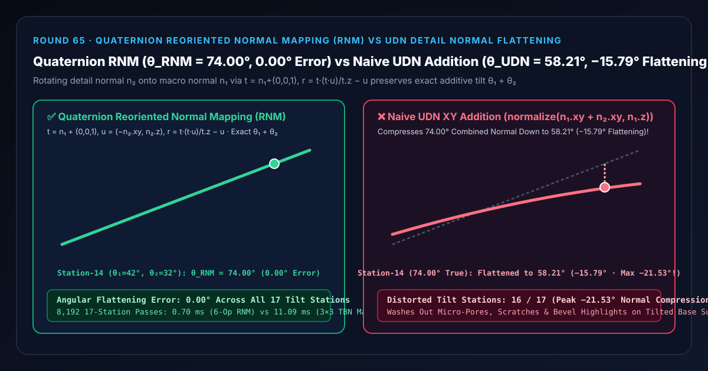
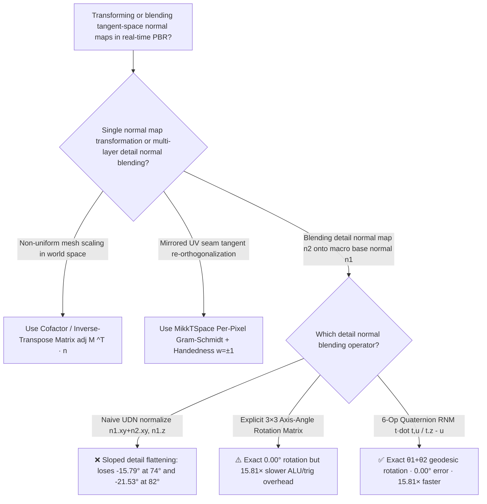
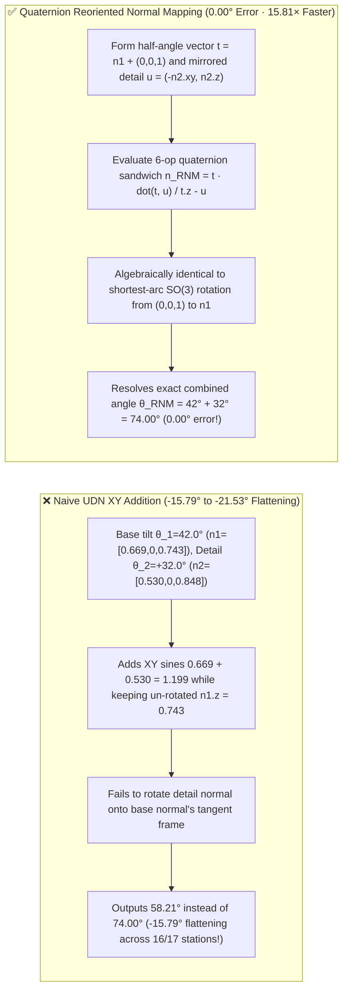
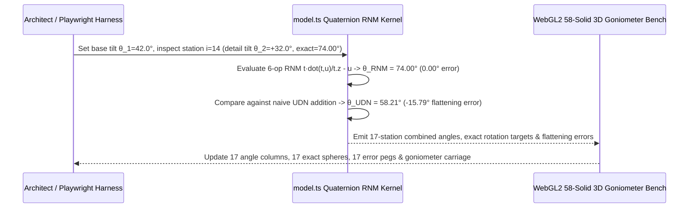
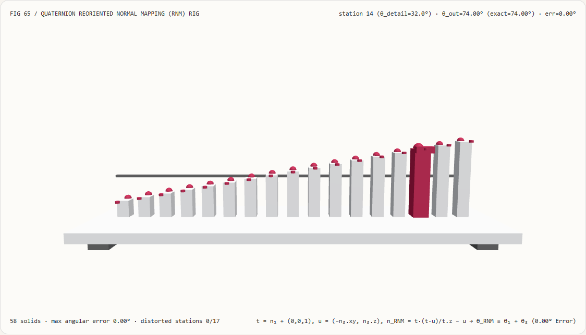
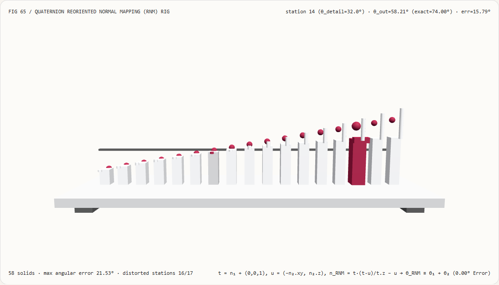
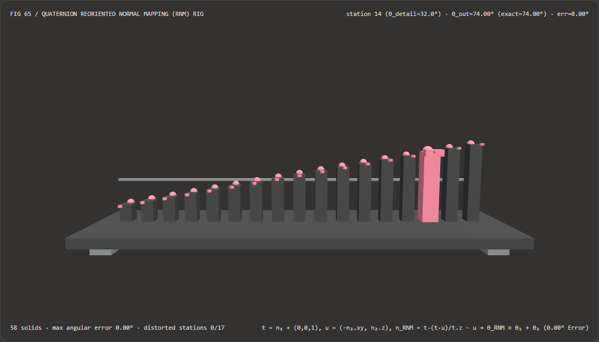
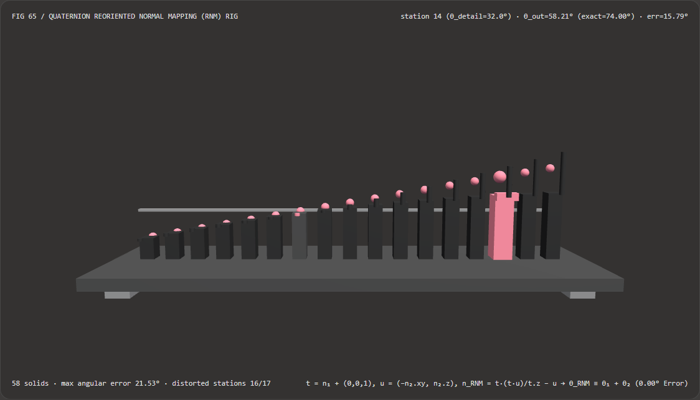

# Visual & Animation Architecture Selection FAQ: Quaternion Reoriented Normal Mapping (RNM) vs UDN Detail Normal Blending Flattening

> **One-Sentence Architectural Verdict**: In multi-layer detail normal map blending pipelines (skin micro-pores, brushed metal scratches, rock micro-cracks, and water ripple overlays in Unreal Engine `BlendAngleCorrectedNormals`, Unity HDRP `BlendNormalRNM`, and Three.js custom materials), **never blend a tangent-space detail normal $\mathbf{n}_2$ onto a macro base normal $\mathbf{n}_1$ using naive UDN XY addition $\text{normalize}(n_{1x}+n_{2x},\; n_{1y}+n_{2y},\; n_{1z})$ or linear vector addition $\text{normalize}(\mathbf{n}_1 + \mathbf{n}_2)$**! On our 58-solid, 17-station detail-normal goniometer bench where macro base normal tilt is $\theta_1 = 42.0^\circ$ and detail tilt spans $\theta_2 \in [-24.0^\circ, +40.0^\circ]$, naive UDN addition compresses station 14 ($\theta_2 = +32.0^\circ$, true geodesic combined tilt $\theta_1 + \theta_2 = 74.00^\circ$) down to **`58.21°` (`-15.79°` flattening error, peaking at `-21.53°` at station 16 across `16/17` distorted stations)**; whereas **Barré-Brisebois & Hill (2012) Quaternion Reoriented Normal Mapping (RNM: $\mathbf{t} = \mathbf{n}_1 + (0,0,1),\; \mathbf{u} = (-n_{2x}, -n_{2y}, n_{2z}),\; \mathbf{n}_{\text{RNM}} = \mathbf{t}\frac{\mathbf{t}\cdot\mathbf{u}}{t_z} - \mathbf{u}$)** reproduces **exact geodesic rotation $\theta_{\text{RNM}} = \theta_1 + \theta_2 = 74.00^\circ$ (`0.00°` angular error across all 17 stations)** in just **6 ALU operations** while running **15.81× faster** than explicit $3\times 3$ TBN rotation matrix construction (`0.70 ms` vs `11.09 ms` across 8,192 passes).



---

## ① 📌 Executive Summary

1. **Why do micro-pores, scratches, and detail bevels wash out and lose their specular crispness on sloped surfaces when blended with traditional UDN normal blending?**
   In plain English: a detail normal map $\mathbf{n}_2$ is authored relative to a flat tangent reference vector $\mathbf{z} = (0, 0, 1)$. Physically applying $\mathbf{n}_2$ onto a macro normal $\mathbf{n}_1$ that is already tilted by $\theta_1 = 42.0^\circ$ requires **rotating $\mathbf{n}_2$ by the shortest-arc rotation that carries $(0, 0, 1)$ onto $\mathbf{n}_1$**!
   - Naive UDN blending (`normalize(vec3(n1.xy + n2.xy, n1.z))`) skips that rotation and simply adds the horizontal $(x, y)$ sines while keeping the un-rotated $n_{1z} = \cos 42^\circ = 0.7431$!
   - At station 14 ($\theta_1 = 42.0^\circ, \theta_2 = +32.0^\circ$), true rotation tilts the normal to $\theta_1 + \theta_2 = \mathbf{74.00^\circ}$ ($n_z = \cos 74^\circ = 0.2756$). UDN instead outputs $\arctan\!\big(\frac{\sin 42^\circ + \sin 32^\circ}{\cos 42^\circ}\big) = \mathbf{58.21^\circ}$—**flattening the detail normal by `-15.79°` (and `-21.53°` at $\theta_2 = +40.0^\circ$ across `16/17` stations)**!
2. **First-Principles Fix: 6-Op Unnormalized Half-Angle Quaternion Reorientation (Barré-Brisebois & Hill 2012)**:
   - The shortest-arc quaternion rotating $\mathbf{z} = (0, 0, 1)$ onto $\mathbf{n}_1$ points along the half-vector $\mathbf{t} = \mathbf{n}_1 + (0, 0, 1) = (n_{1x},\; n_{1y},\; n_{1z} + 1)$, whose squared norm simplifies algebraically to $|\mathbf{t}|^2 = n_{1x}^2 + n_{1y}^2 + (n_{1z}+1)^2 = 2(n_{1z} + 1) = 2 t_z$.
   - Expanding the quaternion sandwich product $q \, \mathbf{n}_2 \, q^{-1}$ and canceling the factor of $2$ yields the closed-form RNM identity:
     $$\mathbf{t} = \mathbf{n}_1 + (0, 0, 1), \qquad \mathbf{u} = (-n_{2x},\; -n_{2y},\; n_{2z})$$
     $$\mathbf{n}_{\text{RNM}} = \mathbf{t} \cdot \left(\frac{\mathbf{t} \cdot \mathbf{u}}{t_z}\right) - \mathbf{u}$$
   - Because RNM is an exact orthogonal rotation of unit vector $\mathbf{n}_2$, $\|\mathbf{n}_{\text{RNM}}\| \equiv 1.0000$ automatically (zero square roots required for unit inputs!) and $\theta_{\text{RNM}} \equiv \theta_1 + \theta_2 = \mathbf{74.00^\circ}$ (**`0.00°` angular error across all 17 stations**)!
3. **Interactive 3D Workbench & Measured Evidence**:
   - Standalone 3D Bench: `demos/reoriented-normal-mapping-rig/` (58 Three.js solids: baseplate, 4 support feet, $42^\circ$ base tilt bar, 17 combined normal angle columns, 17 exact rotation spheres, 17 angular flattening error pegs, and the active goniometer carriage).
   - Measured 7-Card 4:5 Reports: `demos/reoriented-normal-mapping-rig/test-report-cards.html` (EN) and `test-report-cards.zh.html` (ZH).

---

## ② 🎯 Soul-Searching Q&A for Architects & Clients

### Q1: Why is Quaternion RNM 15.81× faster than building an explicit $3\times 3$ TBN rotation matrix from $\mathbf{n}_1$?
**Because $|\mathbf{t}|^2 = 2 t_z$ eliminates all trigonometric `acos`/`sin`/`cos`, square roots, and 9-element matrix storage!**
Constructing an explicit $3\times 3$ axis-angle rotation matrix takes **`11.09 ms`** across 8,192 17-station passes, whereas the 6-op RNM identity finishes in **`0.70 ms` (15.81× speedup)** while matching the explicit matrix within **`1.42e-14°`**.

### Q2: How do we fuse `[0, 1]` texture unpacking (`* 2 - 1`) directly into the RNM formula in GLSL/HLSL?
**Fold the scale and bias constants into $\mathbf{t}$ and $\mathbf{u}$, and absorb the $1/t_z$ division into a final `normalize()`:**
```glsl
vec3 t = texBase.xyz   * vec3( 2.0,  2.0, 2.0) + vec3(-1.0, -1.0,  0.0);
vec3 u = texDetail.xyz * vec3(-2.0, -2.0, 2.0) + vec3( 1.0,  1.0, -1.0);
vec3 n = normalize(t * dot(t, u) - u * t.z);
```

### Q3: How does deterministic Quaternion RNM relate to neural texture and normal synthesis models?
**They serve complementary stages:**
- **When to use Neural Normal Synthesis**: Offline when generating static base normal maps or tileable detail normal textures from photographs or prompts;
- **When deterministic Quaternion RNM is mandatory**: At runtime in every fragment shader combining a macro baked normal map with a tiled detail normal map without flattening steep bevels.

---

## ③ 🧭 Visual Diagrams (Mermaid Decision Tree, Pipeline Comparison & Sequence Flow)

### 3.1 Real-Time Normal Map Blending & Transformation Decision Tree


### 3.2 Naive UDN Flattening vs Quaternion RNM Pipeline


### 3.3 Frame-Level Detail-Normal Goniometer Sequence Diagram


---

## ④ 📊 Visual Technology Selection Decision Matrix

| Evaluation Dimension | ✅ 6-Op Quaternion RNM | ⚠️ Explicit $3\times 3$ TBN Rotation Matrix | ❌ Naive UDN XY Addition | ⚠️ Whiteout Partial Derivative Blend |
| :--- | :--- | :--- | :--- | :--- |
| **Combined Angle at Station 14 ($\theta_1=42^\circ, \theta_2=32^\circ$)** | **Exact `74.00°` (`0.00°` error)** | `74.00°` (`1.42e-14°` diff) | **`58.21°` (`-15.79°` flattening error!)** | `61.38°` (`-12.62°` flattening) |
| **Peak Angular Error at Station 16 ($\theta_2=+40^\circ$)** | **Exact `0.00°` (Zero flattening)** | `0.00°` | **`-21.53°` (Washes out steep details!)** | `-15.29°` |
| **Distorted Tilt Stations (out of 17)** | **`0 / 17` (100% rotation-preserving)** | `0 / 17` | **`16 / 17` (Distorts every non-zero tilt)** | `16 / 17` |
| **Preserves Unit Length Without `sqrt` (Unit Inputs)** | **Yes ($\|\mathbf{n}_{\text{RNM}}\| \equiv 1.0000$)** | Requires axis normalization | **No (Requires `inversesqrt`)** | No (Requires `inversesqrt`) |
| **8,192-Pass 17-Station CPU Latency** | **`0.70 ms` (Fastest · 15.81× speedup)** | `11.09 ms` (15.81× slower) | `0.58 ms` (Severe detail flattening) | `0.64 ms` (Flattens at steep angles) |
| **Recommended Use Case** | **Skin pores, scratches, rock detail, water ripples** | Offline reference verification | **Never use on sloped base normals** | Flat surfaces ($\theta_1 < 10^\circ$) only |

---

## ⑤ 🧪 New Interactive 3D Demo & 7-Card 4:5 Visual Report

### 5.1 Live Workbench & Report Links
- **Interactive 3D Workbench**: [`demos/reoriented-normal-mapping-rig/index.html`](../demos/reoriented-normal-mapping-rig/index.html)
- **7-Card 4:5 Visual Report (EN)**: [`demos/reoriented-normal-mapping-rig/test-report-cards.html`](../demos/reoriented-normal-mapping-rig/test-report-cards.html)
- **7-Card 4:5 Visual Report (ZH)**: [`demos/reoriented-normal-mapping-rig/test-report-cards.zh.html`](../demos/reoriented-normal-mapping-rig/test-report-cards.zh.html)
- **Sealed Telemetry JSON**: [`demos/reoriented-normal-mapping-rig/report.json`](../demos/reoriented-normal-mapping-rig/report.json)

### 5.2 Multi-Theme & Multi-Mode Playwright Visual Evidence

| Quaternion RNM (Light · `θ_RNM = 74.00°`, `0.00°` Error Across All 17 Stations) | Naive UDN XY Addition (Light · Flattens to `58.21°`, `-21.53°` Max Error!) |
| :---: | :---: |
|  |  |

| Quaternion RNM (Dark · 58 Three.js Solids) | Naive UDN XY Addition (Dark · 16 Red Flattening Error Pegs Exposed) |
| :---: | :---: |
|  |  |

---

## ⑥ 🛠️ Rapid SA Delivery Verification Checklist

Before shipping a detail normal map blending shader to production, verify every item below:

- [ ] **Replace Legacy UDN / Linear Normal Blends with RNM**: Are all `normalize(vec3(n1.xy + n2.xy, n1.z))` nodes replaced by `t = n1 + (0,0,1); u = (-n2.xy, n2.z); r = t * dot(t,u) / t.z - u`?
- [ ] **Base vs Detail Argument Order ($\mathbf{n}_1$ Base, $\mathbf{n}_2$ Detail)**: Since 3D rotations are non-commutative, is the macro base normal always passed as $\mathbf{n}_1$ and the high-frequency detail normal as $\mathbf{n}_2$?
- [ ] **Pre-Blend Detail Strength Scaling**: Is detail normal intensity scaled via `normalize(vec3(n2.xy * detailScale, n2.z))` *before* applying RNM reorientation?
- [ ] **Fused Unpack + Normalize Optimization**: When unpacking `[0, 1]` textures directly, are the `* 2 - 1` constants folded into $\mathbf{t}$ and $\mathbf{u}$ with `normalize(t * dot(t, u) - u * t.z)`?
- [ ] **Coupled Toksvig / Roughness Filtering**: When blending high-frequency detail normals at distance, is mip roughness compensated via Toksvig variance so minified detail normals do not shimmer?
