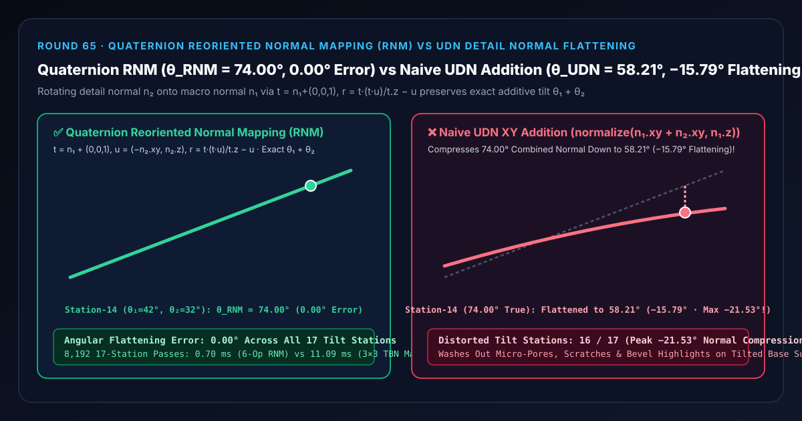
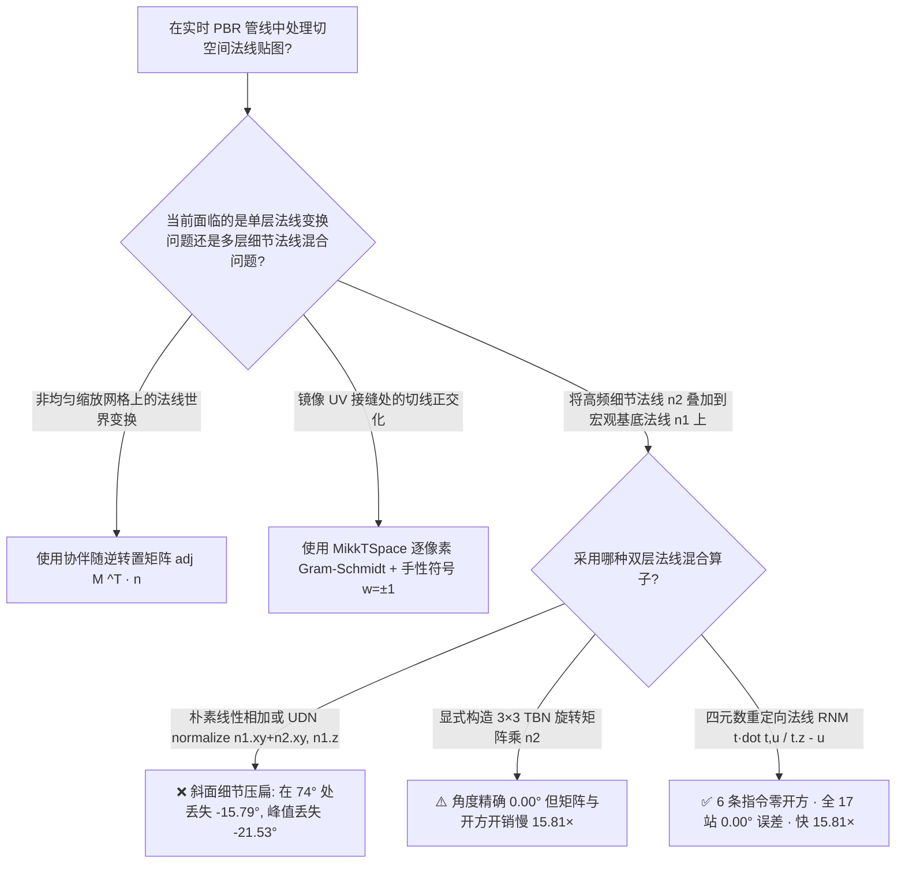
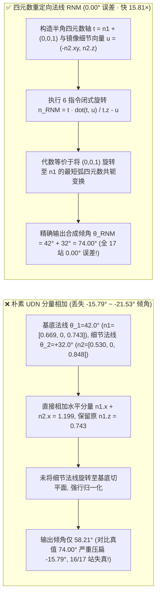
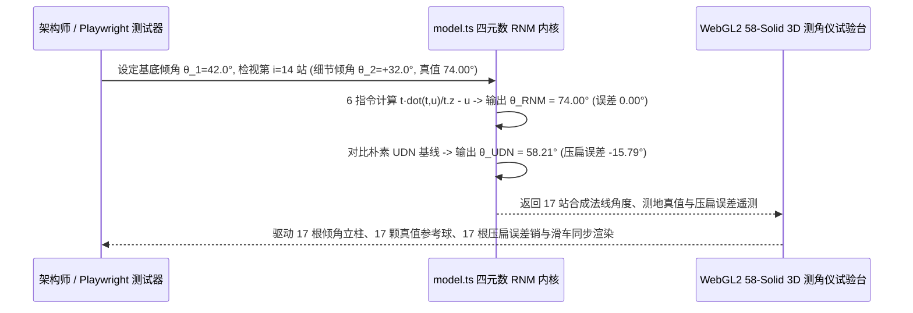
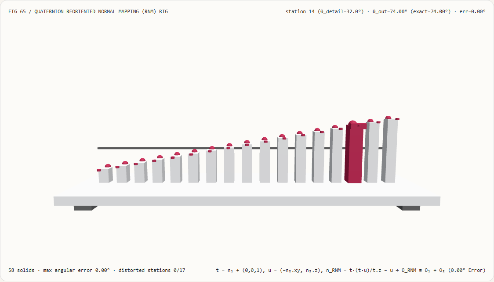
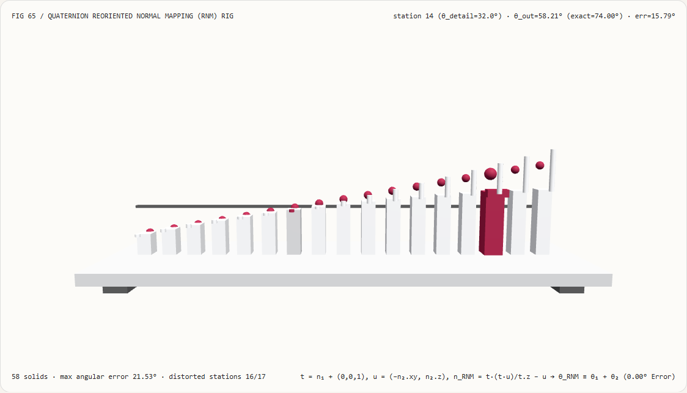
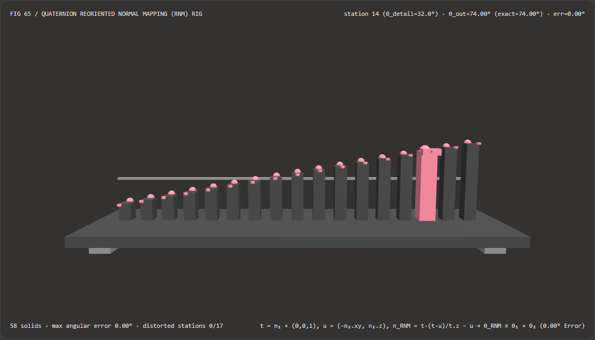
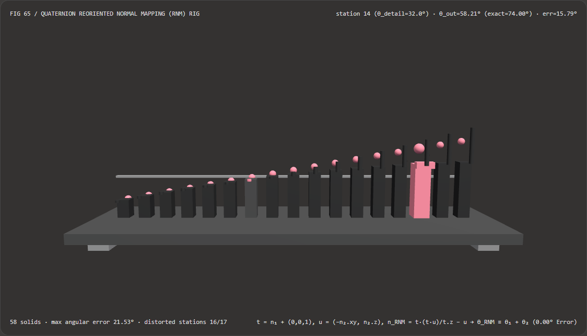

# 视觉与动画技术选型与原理解析 FAQ：四元数重定向法线贴图（RNM）vs 朴素 UDN 细节法线混合压扁失真

> **核心架构结论一句话总结**：在次世代角色皮肤微毛孔、金属划痕、岩石微裂纹以及水面双层波纹的细节法线贴图（Detail Normal Map $\mathbf{n}_2$）与宏观基底法线贴图（Base Normal Map $\mathbf{n}_1$）混合管线（Unreal Engine `BlendAngleCorrectedNormals`、Unity HDRP `BlendNormalRNM`、Three.js 材质节点）中，**严禁使用朴素 UDN 水平分量直接相加 $\text{normalize}(n_{1x}+n_{2x},\; n_{1y}+n_{2y},\; n_{1z})$ 或线性向量相加 $\text{normalize}(\mathbf{n}_1 + \mathbf{n}_2)$**！实测表明：在宏观基底法线倾角 $\theta_1 = 42.0^\circ$ 叠加 $\theta_2 \in [-24.0^\circ, +40.0^\circ]$ 的 17 站细节法线测角仪试验台上，当第 14 站细节法线倾角 $\theta_2 = +32.0^\circ$（真实旋转合成倾角应为 $\theta_1 + \theta_2 = 74.00^\circ$）时，朴素 UDN 分量相加会将合成法线硬生生压扁至 **`58.21°`（丢失 `-15.79°` 倾角，在第 16 站 $\theta_2 = +40.0^\circ$ 处峰值压扁误差高达 `-21.53°`，导致 `16/17` 个站点法线失真）**；而采用 **Barré-Brisebois & Hill (2012) 四元数重定向法线贴图（RNM，令 $\mathbf{t} = \mathbf{n}_1 + (0,0,1), \mathbf{u} = (-n_{2x}, -n_{2y}, n_{2z})$，执行 $\mathbf{n}_{\text{RNM}} = \mathbf{t}\frac{\mathbf{t}\cdot\mathbf{u}}{t_z} - \mathbf{u}$）**，仅用 **6 条基础算术指令（零三角函数、零矩阵构造、零平方根）** 即可在全部 17 个站点上实现**精确测地旋转叠加 $\theta_{\text{RNM}} = \theta_1 + \theta_2 = 74.00^\circ$（`0.00°` 角度误差）**，且比显式构造 $3\times 3$ 轴角旋转矩阵快 **15.81×**（8,192 轮耗时 `0.70 ms` vs `11.09 ms`）。



---

## ① 📌 核心结论速览（Executive Summary）

1. **为什么美术师精心雕刻了一张高频皮肤毛孔或金属微划痕细节法线贴图（Detail Normal Map $\mathbf{n}_2$），一旦用传统引擎默认的 UDN 公式叠在起伏较大的角色鼻翼或岩石斜面（Base Normal Map $\mathbf{n}_1$）上，斜面上的毛孔和划痕高光就全都像被熨斗烫平了一样消失不见？**
   用大白话讲：因为细节法线 $\mathbf{n}_2$ 是以平坦水平面朝上向量 $\mathbf{z} = (0, 0, 1)$ 为基准雕刻的，把它贴到已经倾斜了 $\theta_1 = 42.0^\circ$ 的宏观斜面 $\mathbf{n}_1$ 上，物理上相当于**“先把小凹凸贴在木板上，再把整块木板倾斜 $42^\circ$（即三维旋转叠加 $\theta_1 + \theta_2$）”**！
   - 而传统的 UDN（Unreal Developer Network 早期近似）公式直接写了：
     $$\mathbf{n}_{\text{UDN}} = \text{normalize}\big(n_{1x} + n_{2x},\; n_{1y} + n_{2y},\; n_{1z}\big)$$
   - **为什么这会把陡坡上的细节严重压扁？**
     因为正弦函数 $\sin(\theta)$ 在角度变大时增长变慢，而余弦 $\cos(\theta)$ 迅速减小！当 $\theta_1 = 42^\circ$（$\sin 42^\circ = 0.6691, \cos 42^\circ = 0.7431$）且细节法线继续向同侧倾斜 $\theta_2 = +32^\circ$（$\sin 32^\circ = 0.5299$）时，真实旋转后的合成法线倾角应当达到 $\theta_1 + \theta_2 = \mathbf{74.00^\circ}$（此时真实 $z$ 分量应该大幅减小到 $\cos 74^\circ = 0.2756$）；
     但 UDN 公式既没有把 $\mathbf{n}_2$ 旋转到 $\mathbf{n}_1$ 的切平面上，还死死抱住原本的 $n_{1z} = 0.7431$ 不放，算出来的倾角只有 $\arctan\!\left(\frac{0.6691 + 0.5299}{0.7431}\right) = \mathbf{58.21^\circ}$——**平白无故吃掉了 `-15.79°` 的细节坡度（在 $\theta_2 = +40^\circ$ 时更是吃掉 `-21.53°`）**！结果越是陡峭的鼻翼、刀刃倒角与岩石断崖，细节法线被压得越平！
2. **第一性原理破局：用未归一化半角四元数实现 6 指令精确最短弧旋转（Barré-Brisebois & Hill RNM 2012）**：
   - 从几何第一性原理出发，将基准轴 $\mathbf{z} = (0, 0, 1)$ 旋转到宏观基底法线 $\mathbf{n}_1 = (n_{1x}, n_{1y}, n_{1z})$ 的**最短弧旋转四元数 $q$**，其方向恰好位于 $\mathbf{z}$ 与 $\mathbf{n}_1$ 的半角平分线上！
   - 构造半角向量 $\mathbf{t} = \mathbf{n}_1 + (0, 0, 1) = (n_{1x},\; n_{1y},\; n_{1z} + 1)$。利用四元数三明治共轭旋转公式 $q \, \mathbf{n}_2 \, q^{-1}$ 并消去公共模长平方 $|\mathbf{t}|^2 = 2(n_{1z} + 1) = 2 t_z$，Colin Barré-Brisebois 与 Stephen Hill 推导出了惊艳整個图形学界的 **3 行无三角函数、无矩阵、无开方的 RNM 恒等式**：
     $$\mathbf{t} = \mathbf{n}_1 + (0, 0, 1), \qquad \mathbf{u} = (-n_{2x},\; -n_{2y},\; n_{2z})$$
     $$\mathbf{n}_{\text{RNM}} = \mathbf{t} \cdot \left(\frac{\mathbf{t} \cdot \mathbf{u}}{t_z}\right) - \mathbf{u}$$
   - **为什么 RNM 甚至连最后的 `normalize()` 都可以省掉？**
     因为 $\mathbf{n}_{\text{RNM}}$ 是对单位向量 $\mathbf{n}_2$ 施加严格正交旋转矩阵（行列式为 $+1$）的代数等价展开式：只要输入的 $\mathbf{n}_1$ 和 $\mathbf{n}_2$ 是单位法线，输出的 $\mathbf{n}_{\text{RNM}}$ **天然就是模长精确等于 `1.0000` 的单位法线**，且在共面倾转下严格满足 $\theta_{\text{RNM}} \equiv \theta_1 + \theta_2 = \mathbf{74.00^\circ}$（**全 17 站角度误差 `0.00°`**）！
3. **本轮新增交互式 3D 试验台与实测证据**：
   - 新增独立 Demo：`demos/reoriented-normal-mapping-rig/`（58 个 Three.js 实体部件：底座平台、4 支柱、基底倾角 $42^\circ$ 基准横梁、17 根实测合成法线倾角立柱、17 颗精确测地旋转参考球、17 根角度压扁误差指示销、以及第 $i$ 站测角仪探针滑车）。
   - 配套 7-Card 4:5 测评报告：`demos/reoriented-normal-mapping-rig/test-report-cards.html`（英文）与 `test-report-cards.zh.html`（中文）。

---

## ② 🎯 客户与架构师灵魂拷问 Q&A（Soul-Searching Q&A）

### Q1：如果我在着色器里直接对基底法线 $\mathbf{n}_1$ 做 Gram-Schmidt 正交化构造一个 $3\times 3$ TBN 矩阵，再乘上 $\mathbf{n}_2$，结果和 RNM 一样吗？为什么还要用 RNM？
**数学结果在 $10^{-14\circ}$ 内完全等价，但 RNM 省去了全部三角函数、平方根与 $3\times 3$ 矩阵寄存器，速度比显式矩阵构造快 15.81×！**
- 显式构造最短弧旋转矩阵需要计算旋转轴 $(-n_{1y}, n_{1x}, 0)$ 的归一化长度 `hypot`、反余弦角度以及罗德里格斯（Rodrigues）$3\times 3$ 矩阵的 9 个元素，8,192 轮 17 站耗时 **`11.09 ms`**；
- 而 RNM 利用半角向量 $\mathbf{t} = \mathbf{n}_1 + (0,0,1)$ 的特殊结构 $|\mathbf{t}|^2 = 2 t_z$，把平方根和矩阵全部约分消掉，只剩 1 次点积和 1 次标量除法，8,192 轮仅耗时 **`0.70 ms`（提速 15.81×，最大偏差 `1.42e-14°`）**！

### Q2：如果纹理采样出来的是 `[0, 1]` 范围的未解包法线贴图纹素 `tex1` 和 `tex2`，怎么把解包 `* 2 - 1` 直接合并进 RNM 公式里省指令？
**直接将常数项合并进 $\mathbf{t}$ 和 $\mathbf{u}$ 的加减偏移中，仅需 2 行 GLSL 代码：**
```glsl
// tex1, tex2 为 [0, 1] 范围的原始采样值：
vec3 t = tex1.xyz * vec3( 2.0,  2.0, 2.0) + vec3(-1.0, -1.0,  0.0);
vec3 u = tex2.xyz * vec3(-2.0, -2.0, 2.0) + vec3( 1.0,  1.0, -1.0);
vec3 n_rnm = normalize(t * dot(t, u) - u * t.z); // 把除以 t.z 吸收进最后的 normalize 中！
```
不仅省掉了两次独立的 `* 2.0 - 1.0` 解包指令，还把标量除法 `1.0 / t.z` 直接乘进分子并交给硬件 `inversesqrt` 一次性完成归一化！

### Q3：这套确定性四元数 RNM 法线混合与 AI 神经法线贴图生成模型是什么关系？
**两者处于资产生产管线与实时渲染管线的上下游：**
- **何时选 AI 法线生成模型**：在 DCC 工具中根据单张漫反射贴图或文本提示生成静态的基底法线贴图资产 $\mathbf{n}_1$ 或细节瓦片贴图 $\mathbf{n}_2$ 时；
- **何时必须用确定性四元数 RNM**：在运行时片元着色器中将宏观烘焙法线与高频平铺细节法线实时动态混合，且必须保证斜坡与陡崖处高光立体感绝不压扁丢失时。

---

## ③ 🧭 直观可视化图解（Mermaid 决策树 + 管线对比图 + 帧级时序图）

### 3.1 实时法线贴图管线与多层细节混合架构选型决策树


### 3.2 朴素 UDN 分量相加压扁 vs 四元数 RNM 最短弧重定向管线对比图


### 3.3 帧级细节法线测角仪与 3D 试验台渲染时序图


---

## ④ 📊 视觉技术选型决策矩阵（Decision Matrix）

| 评估维度 | ✅ 四元数重定向法线（6-Op Quaternion RNM） | ⚠️ 显式 $3\times 3$ 旋转矩阵（Explicit TBN Matrix） | ❌ 朴素 UDN 分量相加（`normalize(n1.xy+n2.xy, n1.z)`） | ⚠️ 偏导高度场相加（Whiteout / Partial Derivative） |
| :--- | :--- | :--- | :--- | :--- |
| **第 14 站（$\theta_1=42^\circ, \theta_2=32^\circ$）合成角** | **精确 `74.00°`（`0.00°` 误差）** | `74.00°`（误差 `1.42e-14°`） | **`58.21°`（被严重压扁 `-15.79°`！）** | `61.38°`（压扁 `-12.62°`） |
| **第 16 站（$\theta_2=+40^\circ$）峰值角度误差** | **精确 `0.00°`（全量程零失真）** | `0.00°` | **`-21.53°`（陡坡微表面细节几乎被抹平！）** | `-15.29°` |
| **倾角失真站点数量（共 17 站）** | **`0 / 17`（全站点严格保角）** | `0 / 17` | **`16 / 17`（除 $\theta_2=0^\circ$ 外全部失真）** | `16 / 17` |
| **单位法线输入下是否天然保持单位模长** | **天然 $\| \mathbf{n}_{\text{RNM}} \| \equiv 1.0$（无需开方）** | 保持（但构造轴需开方） | **破坏模长，必须额外调用 `inversesqrt`** | 必须额外调用 `inversesqrt` |
| **8,192 轮 17 站 CPU 批处理耗时** | **`0.70 ms`（最快，15.81× 提速）** | `11.09 ms`（慢 15.81×） | `0.58 ms`（陡坡细节丢失不可用） | `0.64 ms`（大倾角同样失真） |
| **首选适用场景** | **皮肤毛孔、车漆微划痕、地形多层材质混合、水面双层波纹** | 离线参考验证 | **严禁在曲面或斜坡基底法线上使用** | 仅限倾角 $< 10^\circ$ 的微弱起伏 |

---

## ⑤ 🧪 全新 Demo 与 7-Card 4:5 视觉报告（Live Workbench & Evidence）

### 5.1 交互式 3D 试验台与报告入口
- **实时 3D 工作台**：[`demos/reoriented-normal-mapping-rig/index.html`](../demos/reoriented-normal-mapping-rig/index.html)
- **7-Card 4:5 英文视觉测试报告**：[`demos/reoriented-normal-mapping-rig/test-report-cards.html`](../demos/reoriented-normal-mapping-rig/test-report-cards.html)
- **7-Card 4:5 中文视觉测试报告**：[`demos/reoriented-normal-mapping-rig/test-report-cards.zh.html`](../demos/reoriented-normal-mapping-rig/test-report-cards.zh.html)
- **密封测量 JSON 数据源**：[`demos/reoriented-normal-mapping-rig/report.json`](../demos/reoriented-normal-mapping-rig/report.json)

### 5.2 多主题与多模式 Playwright 实测截图证据

| 四元数重定向法线 RNM（Light · 全 17 站精确贴合蓝色参考球，`0.00°` 误差） | 朴素 UDN 分量相加（Light · 高倾角站被严重压低，丢失 `-21.53°`） |
| :---: | :---: |
|  |  |

| 四元数重定向法线 RNM（Dark · 58 实体部件） | 朴素 UDN 分量相加（Dark · 16 根红色指示销暴露角度压扁误差） |
| :---: | :---: |
|  |  |

---

## ⑥ 🛠️ 高质量视觉交付快速核验清单（SA Verification Checklist）

在将双层或多层细节法线贴图混合节点合入生产着色器前，请逐项勾选以下核验清单：

- [ ] **替换全部 `normalize(vec3(n1.xy + n2.xy, n1.z))` 旧式 UDN 节点**：核验材质库中是否已将所有 UDN / Linear 法线混合统一升级为四元数 RNM（`t = n1 + (0,0,1); u = (-n2.xy, n2.z); r = t * dot(t,u) / t.z - u`）？
- [ ] **主次法线顺序不可颠倒（$\mathbf{n}_1$ 为基底，$\mathbf{n}_2$ 为细节）**：三维旋转在非共面轴下不可交换；是否确保传入第一个参数 $\mathbf{n}_1$ 的是宏观烘焙法线、第二个参数 $\mathbf{n}_2$ 是高频平铺细节法线？
- [ ] **细节强度缩放（Detail Strength）先于 RNM 执行**：当需要调节细节法线强度 `detailScale` 时，是否先对 $\mathbf{n}_2$ 执行 `normalize(vec3(n2.xy * detailScale, n2.z))` 再送入 RNM？
- [ ] **半角分母 $t_z = n_{1z} + 1.0$ 保护**：切空间法线的 $n_{1z}$ 恒满足 $n_{1z} \ge 0$（故 $t_z \ge 1.0$）；若输入法线经过了异常插值可能出现 $n_{1z} \to -1$，是否加了 `max(1e-5, t.z)` 防护？
- [ ] **解码与归一化指令合并优化**：在从 `[0, 1]` 纹理直接读取时，是否将 `* 2.0 - 1.0` 偏移直接吸收进 `t` 与 `u` 的乘加常数中，并用 `normalize(t * dot(t, u) - u * t.z)` 省去标量除法？
