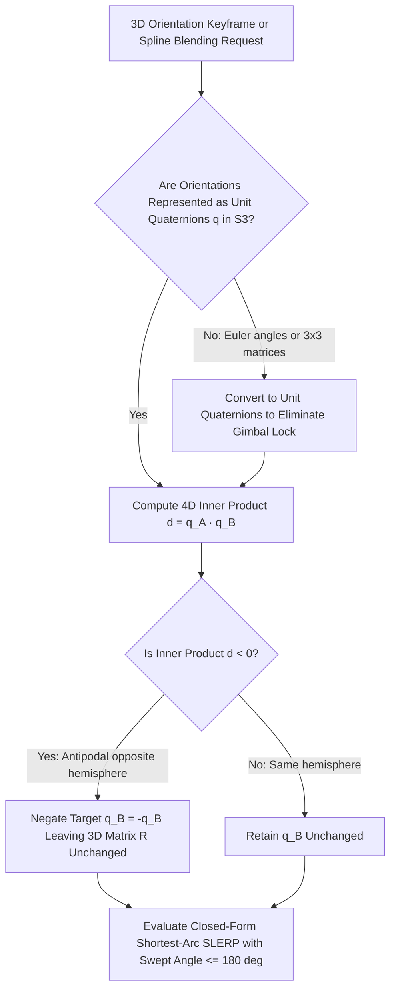
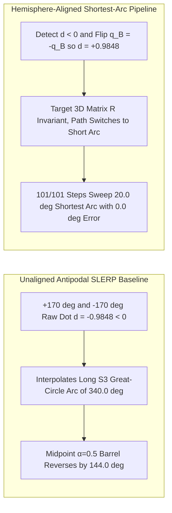
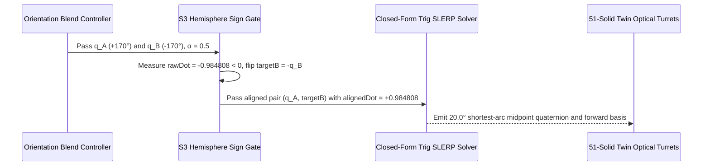

# Rotation blending without 340-degree spin spikes: quaternion double-cover hemisphere alignment vs unaligned SLERP FAQ

**Understand in 3 minutes why cameras and joints whip 340° the wrong way across the ±180° yaw seam, and reproduce a hemisphere-aligned shortest-arc turret rig in 10 minutes.**

[中文](quaternion-antipodal-slerp-faq.md) · [Interactive Demo](https://turbo998.github.io/animation/demos/quaternion-hemisphere-turret/) · [Measured 7-Card Report](../demos/quaternion-hemisphere-turret/test-report-cards.html)

## ① 📌 Executive Summary

- **Unit quaternions $\mathbf{q}$ and $-\mathbf{q}$ encode the exact same 3D rotation matrix, yet sit at antipodal poles on the 4D hypersphere $S^3$.** Because $S^3$ is a 2-to-1 double cover of $SO(3)$, $\mathbf{R}(\mathbf{q}) = \mathbf{R}(-\mathbf{q})$.
- **Unaligned SLERP takes the `340.00°` long way around whenever $\mathbf{q}_A \cdot \mathbf{q}_B < 0$.** Rotating from yaw `+170°` to `-170°` (at `+18°` pitch) requires only a `20.00°` spatial turn, but half-angle signs yield $\mathbf{q}_A \cdot \mathbf{q}_B = -0.984808 < 0$; unaligned SLERP sweeps `340.00°` the wrong way around and points `144.00°` away from the true midpoint at $\alpha = 0.5$.
- **Flipping $\mathbf{q}_B \leftarrow -\mathbf{q}_B$ when $\mathbf{q}_A \cdot \mathbf{q}_B < 0$ locks the `20.00°` shortest geodesic arc.** Across all 101 blend steps, midpoint error drops to `0.00°`; closed-form trigonometric SLERP agrees with 32-step Lie-group geodesic stepping within `1.86e-15` while running `8.22×` faster (`2.80 ms` vs `22.99 ms` for 8192 queries).
- **51-solid twin-turret optical tracker, 13 local acceptance checks.** Scene geometry is `synthetic`; quaternion algebra and Node CPU timings are `measured`; `SplineGS` dynamic 3D Gaussian optimization and physical servo gimbal control are `not_measured`.

**Daily capability direction check:** CVPR 2025 paper *SplineGS: Robust Motion-Adaptive Spline for Real-Time Dynamic 3D Gaussians from Monocular Video* ([arXiv:2412.09982](https://arxiv.org/abs/2412.09982)) and *Mathematical Supplement for the gsplat Library* ([arXiv:2312.02121](https://arxiv.org/abs/2312.02121)) parameterize 3D Gaussian and camera orientations with unit quaternions $\mathbf{q} \in S^3$. Whenever quaternion control points are interpolated across keyframes or splines, resolving the $\mathbf{q} \sim -\mathbf{q}$ double-cover sign ambiguity is mandatory to prevent sudden $360^\circ - \theta$ spin spikes. Verified 2026-11-10; this demo implements deterministic $S^3$ hemisphere alignment and geodesic SLERP without running 3DGS optimization.

## ② 🎯 Architect & Client Q&A

### Q1 When should we choose neural motion / 4D Gaussian models vs deterministic quaternion hemisphere alignment?

Evaluate dynamic 3D Gaussian frameworks (`SplineGS`) or motion diffusion models when reconstructing unknown 3D scene deformations and camera trajectories from video.

Enforce deterministic quaternion hemisphere alignment (`if (dot(qA, qB) < 0) qB = -qB`) at the boundary of *every* keyframe interpolator, skeletal animation blender, and spline evaluator—because whether orientations come from a neural network, an IK solver, or `Euler` conversion, opposite-hemisphere quaternions will cause a violent spin spike if interpolated directly.

### Q2 Under what constraints is hemisphere-aligned SLERP strictly superior to Euler interpolation or raw SLERP?

Linearly interpolating Euler angles from `+170°` to `-170°` sweeps backward across `0°` (`340°` travel) and suffers from Gimbal Lock near $\pm 90^\circ$ pitch.

Switching to quaternions fixes Gimbal Lock, but because quaternion conversion uses half-angles ($\pm 170^\circ / 2 = \pm 85^\circ$), $\sin(+85^\circ)$ and $\sin(-85^\circ)$ have opposite signs, producing $\mathbf{q}_A \cdot \mathbf{q}_B = \cos(170^\circ) = -0.984808 < 0$. Raw SLERP without a hemisphere check travels $2\arccos(-0.984808) = 340^\circ$! Only **unit quaternions + hemisphere sign alignment** guarantees both gimbal-free rotation and shortest-arc geodesic travel.

### Q3 Why does negating all four components of $\mathbf{q}_B$ leave the target 3D orientation completely unchanged?

A unit quaternion rotates any 3D vector $\mathbf{v}$ (treated as a pure quaternion $(v_x, v_y, v_z, 0)$) via the two-sided sandwich product:

$$\mathbf{v}' = \mathbf{q} \, \mathbf{v} \, \mathbf{q}^{-1}$$

Replacing $\mathbf{q}$ with $-\mathbf{q}$ negates both factors simultaneously, so the two minus signs cancel out identically:

$$(-\mathbf{q}) \, \mathbf{v} \, (-\mathbf{q}^{-1}) = (-1)^2 \, \mathbf{q} \, \mathbf{v} \, \mathbf{q}^{-1} = \mathbf{v}'$$

Thus $-\mathbf{q}_B$ produces the exact same 3D rotation matrix at $\alpha = 1$ as $\mathbf{q}_B$, while flipping the 4D dot product from $-0.984808$ to $+0.984808$ and switching the $S^3$ great-circle arc from the $170^\circ$ long path ($340^\circ$ in 3D) to the $10^\circ$ short path ($20^\circ$ in 3D).

### Q4 How can I reproduce this in 10 minutes?

1. Run `npm run dev` and open `/demos/quaternion-hemisphere-turret/`, initialized at midpoint `α = 0.50` (`startYaw = +170°`, `targetYaw = -170°`, `pitch = +18°`).
2. In `hemisphere-aligned` mode, observe the left test turret and right reference turret pointing together across the rear $\pm 180^\circ$ compass ticks (`swept 20.0°`, `mid error 0.0°`).
3. Switch to `unaligned-antipodal` mode at `α = 0.50`: the left turret flips backward toward the front of the stage (`mid error 144.0°`), sweeping a `340.0°` spin!
4. Adjust Start yaw (`90°..179°`), End yaw (`-179°..-90°`), and Pitch (`-45°..45°`); test an out-of-sector angle such as `20°` to verify atomic rejection and state retention.
5. Click `Export quat` to download `QUATERNION_HEMISPHERE_SPEC.json` with `rawDot`, `alignedDot`, `sweptAngleDeg`, and turret world matrices.
6. Run `npx vitest run tests/quaternion-turret.test.ts`, then build and run `node scripts/benchmark-quaternion-turret.mjs` against a port 4335 preview server.

## ③ 🧭 Visual Diagrams

## ④ 📊 Architect Decision Matrix

| Criterion | Linear Euler Angle Interpolation | Unaligned Quaternion SLERP (`unaligned-antipodal`) | 32-Step Lie-Group Geodesic Stepping | Hemisphere-Aligned Closed-Form SLERP (`hemisphere-aligned`) |
| --- | --- | --- | --- | --- |
| Total swept angle (`+170° → -170°`) | `340.0°` (spins backward across `0°`) | `340.00°` (follows long arc because $d = -0.9848 < 0$) | `20.00°` (once hemisphere-aligned) | Measured `20.00°` (shortest geodesic arc) |
| Midpoint ($\alpha=0.5$) angular error | `> 140°` reversal with uneven speed | Measured `144.00°` barrel reversal | Agrees with exact SLERP within `1.86e-15` | Measured `0.00°` (constant angular speed) |
| Gimbal Lock immunity | Loses degree of freedom at $\pm 90^\circ$ pitch | Gimbal-free (but suffers antipodal spin) | Gimbal-free | Gimbal-free and spin-spike-free |
| 8192-query Node CPU solve median | Fast arithmetic (broken geometry) | `~2.8 ms` (wrong geodesic branch) | `22.99 ms` (32-step multiplication loop) | `2.80 ms` (`8.22×` faster than 32-step stepping) |
| Best architectural role | Never use for cross-quadrant 3D orientations | Latent bug when hemisphere check is omitted | Lie-group numerical verification | Camera rigs, skeletal blending, 4DGS rotation splines |

**Quantitative example:** Between yaw `+170°` and `-170°` at `+18°` pitch, $\mathbf{q}_A \cdot \mathbf{q}_B = \cos(170^\circ) = -0.984808$. Unaligned SLERP computes half-angle $\Omega = \arccos(-0.984808) = 170^\circ$, sweeping $2\Omega = 340.00^\circ$ and pointing `144.00°` away from the true midpoint at $\alpha = 0.5$. Negating $\mathbf{q}_B \leftarrow -\mathbf{q}_B$ yields $\Omega = \arccos(+0.984808) = 10^\circ$, sweeping only $2\Omega = 20.00^\circ$.

## ⑤ 🧪 New Capability Demo & Benchmark Findings (with 7-Card)

[Sealed data](../demos/quaternion-hemisphere-turret/report.json) records 51 3D solids, 101 sampled blend steps comparing shortest-arc and antipodal spin behavior, and solver equivalence between closed-form trigonometric SLERP and 32-step incremental Lie-group geodesic stepping (`maximum_solver_error = 1.86e-15`, threshold `< 1e-10`).

| Node CPU SLERP Queries | Closed-Form Trig SLERP Median | 32-Step Geodesic Stepping Median |
| --- | --- | --- |
| 128 | 0.09 ms | 0.45 ms |
| 1024 | 0.61 ms | 2.87 ms |
| 8192 | 2.80 ms | 22.99 ms |

Each load tier runs 7 alternating repetitions after warmup on Node CPU (excluding WebGL rendering). At 8192 SLERP evaluations, closed-form trigonometric SLERP is `8.22×` faster than 32-step geodesic stepping while preventing the `340.00°` unaligned spin spike.

[Measured 7-Card Report (EN)](../demos/quaternion-hemisphere-turret/test-report-cards.html) · [中文七卡](../demos/quaternion-hemisphere-turret/test-report-cards.zh.html). Scene geometry is `synthetic`, quaternion checks and CPU timings are `measured`, and `SplineGS` neural 3DGS training and physical gimbal control are `not_measured`.

## ⑥ 🛠️ Architect Checklist

- [ ] Check the 4D dot product $d = \mathbf{q}_i \cdot \mathbf{q}_{i+1}$ before every quaternion SLERP, NLERP, or spline segment evaluation.
- [ ] Negate $\mathbf{q}_{i+1} \leftarrow -\mathbf{q}_{i+1}$ whenever $d < 0$ so consecutive keyframes stay in the same $S^3$ hemisphere.
- [ ] Verify that $\mathbf{R}(\mathbf{q})$ and $\mathbf{R}(-\mathbf{q})$ produce identical $3\times 3$ rotation matrices at $\alpha = 1$.
- [ ] Include a $\pm 180^\circ$ seam-crossing test case (`+170°` to `-170°`) in automated test suites and assert swept angle $\le 180^\circ$.
- [ ] Fall back smoothly to normalized linear interpolation (NLERP) when $1 - |d| < 10^{-7}$ to avoid $\sin\Omega \to 0$ division by zero.
- [ ] Compute angles between unit vectors with `2 * atan2(||u - v||, ||u + v||)` rather than `acos(dot(u, v))` to avoid precision loss near $0^\circ$.
- [ ] Validate yaw and pitch bounds and reject out-of-sector inputs (`startYawDeg = 20`) atomically.
- [ ] Verify that forward and reverse $\alpha$ scrubbing produce identical turret head world matrices.
- [ ] Use unwrapped cumulative angle tracks when authoring intentional multi-revolution ($> 360^\circ$) rotor spins.
- [ ] Label unexecuted dynamic 3DGS reconstruction (`SplineGS`) and physical servo backlash loops explicitly as `not_measured`.

**Primary sources:** [SplineGS (arXiv:2412.09982)](https://arxiv.org/abs/2412.09982) (CVPR 2025) models continuous dynamic 3D Gaussian trajectories with spline control points; [gsplat Mathematical Supplement (arXiv:2312.02121)](https://arxiv.org/abs/2312.02121) details the unit-quaternion double-cover parameterization of $SO(3)$ rotations. Verified 2026-11-10; this demo is an original deterministic quaternion hemisphere workbench and does not run neural 3DGS optimization.
