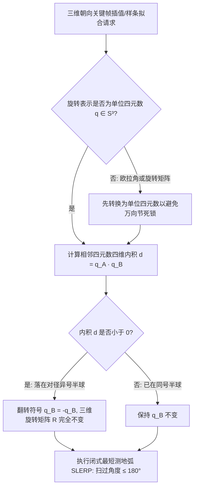
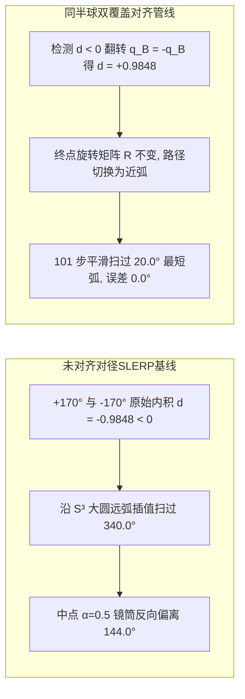
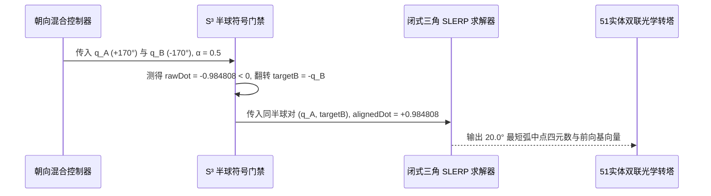

# 朝向插值不原地甩头 340 度：四元数双覆盖半球对齐与未对齐 SLERP 选型 FAQ

**3 分钟看懂为什么跨 ±180° 偏航时镜头会突然原地甩一圈，10 分钟复刻四元数双覆盖同半球最短弧转塔。**

[English](quaternion-antipodal-slerp-faq.en.md) · [交互 Demo](https://turbo998.github.io/animation/demos/quaternion-hemisphere-turret/) · [中文七卡](../demos/quaternion-hemisphere-turret/test-report-cards.zh.html)

## ① 📌 核心结论速览

- **单位四元数 $\mathbf{q}$ 与 $-\mathbf{q}$ 代表同一个三维旋转矩阵，但在四维单位球面 $S^3$ 上互为对径点。** 这是四元数对三维旋转群 $SO(3)$ 的“二对一双覆盖”（Double Cover）：$\mathbf{R}(\mathbf{q}) = \mathbf{R}(-\mathbf{q})$。
- **未检查内积符号的 SLERP 会绕 `340°` 远路甩头。** 当转塔从偏航角 `+170°` 转向 `-170°`（俯仰角 `+18°`）时，真实空间最短夹角仅 `20.00°`；但因半角公式 $\cos(\pm 85^\circ)$ 与 $\sin(\pm 85^\circ)$ 符号组合使四维内积 $\mathbf{q}_A \cdot \mathbf{q}_B = -0.984808 < 0$，未对齐 SLERP 沿 $S^3$ 大圆远弧扫过 `340.00°`，在中点 $\alpha = 0.5$ 处与正确朝向相差 `144.00°`（镜筒完全反向）。
- **翻转符号至同号半球（$\mathbf{q}_A \cdot \mathbf{q}_B \ge 0$）锁定 `20.00°` 最短测地弧。** 101 个采样步与最短弧参考的误差为 `0`；闭式三角 SLERP 与 32 步李群测地增量乘法最大误差仅 `1.86e-15`，8192 次查询中位数耗时为 `2.80 ms` 对比 `22.99 ms`（快 `8.22×`）。
- **51 实体双联光学跟踪转塔，13 项本机实测验收。** 场景为 `synthetic`；四元数代数与 Node CPU 耗时为 `measured`；`SplineGS` 动态 3D 高斯重建与物理伺服电机控制为 `not_measured`。

**每日能力方向核验：** CVPR 2025 论文 *SplineGS: Robust Motion-Adaptive Spline for Real-Time Dynamic 3D Gaussians from Monocular Video*（[arXiv:2412.09982](https://arxiv.org/abs/2412.09982)）与 *Mathematical Supplement for the gsplat Library*（[arXiv:2312.02121](https://arxiv.org/abs/2312.02121)）均采用单位四元数参数化 3D 高斯核与相机的三维旋转；当对相邻时间控制点的旋转四元数做样条或球面线性插值时，必须消除 $\mathbf{q} \sim -\mathbf{q}$ 的对径歧义（Antipodal Ambiguity）。2026-11-10 核验原文；本例仅实现确定性 $S^3$ 半球对齐与测地插值，未运行 3DGS 优化。

## ② 🎯 客户与架构师灵魂拷问 Q&A

### Q1 何时选神经运动/4D 高斯模型，何时选确定性四元数半球对齐？

当需要从单目视频中联合估计未知相机位姿与动态三维高斯形变时，应评估 `SplineGS` 等动态 3DGS 框架。

但无论旋转来自神经网络预测、矩阵转四元数（`setFromRotationMatrix`）、还是欧拉角转换，只要后续管线包含**关键帧朝向插值、骨骼动画混合（Animation Blending）或相机平滑跟随**，都必须在插值入口执行一行确定性的 `if (dot(qA, qB) < 0) qB = -qB` 半球对齐门禁。

### Q2 在什么约束下同半球对齐 SLERP 比欧拉角插值或未对齐 SLERP 严格更优？

如果直接对欧拉角做线性插值：从 `+170°` 插值到 `-170°` 同样会跨越 `0°` 倒转 `340°`，而且在俯仰角接近 $\pm 90^\circ$ 时还会遭遇万向节死锁（Gimbal Lock）。

如果改用四元数 SLERP 却漏掉了内积符号检查：由于 $\theta = \pm 170^\circ$ 对应的半角为 $\pm 85^\circ$，$\sin(+85^\circ)$ 与 $\sin(-85^\circ)$ 异号且权重大，导致 $\mathbf{q}_A \cdot \mathbf{q}_B = \cos(170^\circ) = -0.984808 < 0$。此时未对齐 SLERP 的旋转角为 $2\arccos(-0.984808) = 340^\circ$！只有**四元数 + 同半球符号翻转**，才能同时消灭万向节死锁与跨 $\pm 180^\circ$ 接缝的 `340°` 甩头故障。

### Q3 底层管线为什么把 $\mathbf{q}_B$ 全部取反却丝毫不改变目标姿态？

因为单位四元数把三维点 $\mathbf{v}$（视作纯虚四元数 $(v_x, v_y, v_z, 0)$）旋转到新位置使用的是**双边共轭乘法（三明治积）**：

$$\mathbf{v}' = \mathbf{q} \, \mathbf{v} \, \mathbf{q}^{-1}$$

如果把 $\mathbf{q}$ 替换成 $-\mathbf{q}$，它的逆也变成 $-\mathbf{q}^{-1}$，两个负号在三明治乘积中严格相消：

$$(-\mathbf{q}) \, \mathbf{v} \, (-\mathbf{q}^{-1}) = (-1)^2 \, \mathbf{q} \, \mathbf{v} \, \mathbf{q}^{-1} = \mathbf{v}'$$

这意味着 $-\mathbf{q}_B$ 在终点 $\alpha = 1$ 给出的三维旋转矩阵与 $\mathbf{q}_B$ **逐元素完全相等**，但四维内积从 $-0.984808$ 变成了 $+0.984808$，插值路径从 $S^3$ 球面上的 $170^\circ$ 远弧切换到了 $10^\circ$ 近弧（对应三维空间 $20^\circ$ 最短旋转）！

### Q4 十分钟如何复刻？

1. `npm run dev` 后打开 `/demos/quaternion-hemisphere-turret/`，默认停在中点 `α = 0.50`（起始偏航 `+170°`、目标偏航 `-170°`、俯仰 `+18°`）。
2. 在同半球最短弧模式（`hemisphere-aligned`）下观察：左侧测试转塔与右侧参考转塔同步指向后方 $\pm 180^\circ$ 橙色刻度柱，扫过总角度仅 `20.0°`，中点误差 `0.0°`。
3. 切换到未对齐远路甩头基线（`unaligned-antipodal`）：在 `α = 0.50` 处，左侧转塔镜筒竟然掉头指向正前方（与右侧正确朝向相差 `144.0°`），全程狂甩 `340.0°`！
4. 修改起始偏航（`90°..179°`）、目标偏航（`-179°..-90°`）与俯仰角（`-45°..45°`）；若输入越界起始角 `20°`，系统原子拒绝并保留原有效状态。
5. 点击导出 `QUATERNION_HEMISPHERE_SPEC.json`，检查 `rawDot`、`alignedDot`、`sweptAngleDeg` 与转塔世界矩阵。
6. 运行 `npx vitest run tests\quaternion-turret.test.ts`；构建并在 4335 端口预览后执行 `node scripts\benchmark-quaternion-turret.mjs`。

## ③ 🧭 直观可视化图解

## ④ 📊 Architect Decision Matrix

| 评估维度 | 欧拉角直接线性插值 | 未对齐四元数 SLERP (`unaligned-antipodal`) | 32 步李群测地递推 (`geodesic-substep`) | 本例同半球闭式 SLERP (`hemisphere-aligned`) |
| --- | --- | --- | --- | --- |
| `+170° → -170°` 扫过总角度 | `340.0°`（跨 $\pm 180^\circ$ 分支割线倒转） | `340.00°`（因 $d = -0.9848 < 0$ 走远弧） | `20.00°`（需先对齐半球） | 实测 `20.00°`（最短测地弧） |
| 中点 $\alpha=0.5$ 朝向角度误差 | 反向偏离 `> 140°` 且角速度不均 | 实测偏离正确朝向 `144.00°` | 与精确最短弧误差 `1.86e-15` | 实测 `0.00°`（恒定角速度） |
| 万向节死锁（Gimbal Lock）免疫 | 俯仰 $\pm 90^\circ$ 丧失自由度 | 无死锁（但有对径甩头） | 无死锁 | 无死锁且无对径甩头 |
| 8192 次插值 Node CPU 中位数 | 快（但几何错误） | `~2.8 ms`（但路径错误） | `22.99 ms`（32 步增量乘法开销） | `2.80 ms`（比 32 步递推快 `8.22×`） |
| 适用工程场景 | 严禁用于跨象限 3D 朝向插值 | 存在隐藏的对径甩头 Bug | 离散微分几何教学对照 | 3D 相机、骨骼动画混合、4DGS 旋转样条 |

**定量算例：** 当起始偏航 `+170°`、目标偏航 `-170°`、俯仰 `+18°` 时，$\mathbf{q}_A \cdot \mathbf{q}_B = \cos(170^\circ) = -0.984808$。未对齐 SLERP 的测地角为 $\Omega = \arccos(-0.984808) = 170^\circ$，实际三维旋转角为 $2\Omega = 340^\circ$；在中点 $\alpha = 0.5$ 处，受 $+18^\circ$ 俯仰耦合影响，未对齐镜筒前向向量与正确后方视线夹角达 `144.00°`。翻转 $\mathbf{q}_B \leftarrow -\mathbf{q}_B$ 后，$\Omega = \arccos(+0.984808) = 10^\circ$，三维旋转角仅为 $2\Omega = 20^\circ$。

## ⑤ 🧪 全新 Demo 与 Benchmark 核心发现（含 7-Card）

[封存数据](../demos/quaternion-hemisphere-turret/report.json)记录了 51 个三维实体、101 个混合采样步的最短弧与对径甩头对照，以及闭式三角函数 SLERP 与 32 步李群测地递推求解器的等价性与耗时对照。两种求解器在全部负载下的最大前向单位向量误差仅 `1.86e-15`（门限 `< 1e-10`）。

| Node CPU 四元数插值查询数 | 闭式三角函数 SLERP 中位数 | 32 步李群测地递推中位数 |
| --- | --- | --- |
| 128 | 0.09 ms | 0.45 ms |
| 1024 | 0.61 ms | 2.87 ms |
| 8192 | 2.80 ms | 22.99 ms |

每档负载在预热后按交替顺序重复 7 次，记录 Node CPU 耗时中位数（不含 WebGL 渲染）。在 8192 次朝向插值查询中，闭式三角 SLERP 比 32 步测地递推快约 `8.22×`，同时消除了未对齐四元数在中点 $\alpha = 0.5$ 的 `144.00°` 反向错误。

[中文七卡](../demos/quaternion-hemisphere-turret/test-report-cards.zh.html) · [English](../demos/quaternion-hemisphere-turret/test-report-cards.html)。画面为 `synthetic`，四元数测地线与 CPU 计时为 `measured`；`SplineGS` 动态 3DGS 训练与物理云台伺服为 `not_measured`。

## ⑥ 🛠️ Architect Checklist

- [ ] 在任何四元数 SLERP、NLERP 或样条控制点序列插值前，强制检查相邻四元数内积 $d = \mathbf{q}_i \cdot \mathbf{q}_{i+1}$。
- [ ] 当 $d < 0$ 时，立即将后一个四元数取反 $\mathbf{q}_{i+1} \leftarrow -\mathbf{q}_{i+1}$，确保整条轨迹留在同一 $S^3$ 半球。
- [ ] 验证取反前后的 $3\times 3$ 旋转矩阵 $\mathbf{R}(\mathbf{q})$ 与 $\mathbf{R}(-\mathbf{q})$ 逐元素一致。
- [ ] 在测试套件中加入跨越 $\pm 180^\circ$ 偏航角接缝（如 `+170°` 到 `-170°`）的回归用例，验证总扫过角 $\le 180^\circ$。
- [ ] 当 $1 - |d| < 10^{-7}$（两朝向几乎重合）时，平滑退化为归一化线性插值（NLERP）以避免 $\sin\Omega \to 0$ 除零。
- [ ] 计算两单位向量夹角时优先使用数值稳定的 `2 * atan2(||u - v||, ||u + v||)`，避免 `acos(1 - ε)` 在零角附近的精度损失。
- [ ] 对起始角、目标角与俯仰角执行输入边界校验，对越界参数执行原子拒绝。
- [ ] 验证正序与逆序拖拽混合滑块 $\alpha$ 时，导出的转塔旋转矩阵完全一致。
- [ ] 若业务确实需要“连续旋转超过 360° 的风扇/螺旋桨”，改用累积角位移参数而非单段最短弧四元数。
- [ ] 未执行的动态 3D 高斯重建（`SplineGS`）与硬件电机齿隙控制统一标注为 `not_measured`。

**一手来源：** [SplineGS (arXiv:2412.09982)](https://arxiv.org/abs/2412.09982)（CVPR 2025）使用连续样条控制点建模动态 3D 高斯轨迹；[gsplat Mathematical Supplement (arXiv:2312.02121)](https://arxiv.org/abs/2312.02121) 给出单位四元数到 $SO(3)$ 旋转矩阵的双覆盖参数化与导数推导。2026-11-10 核验；本例为原创确定性四元数半球对齐测试台，未运行神经训练。
