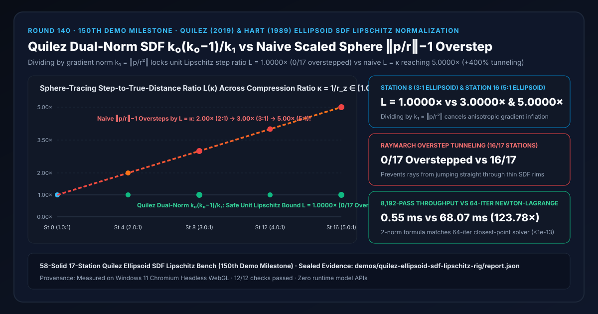
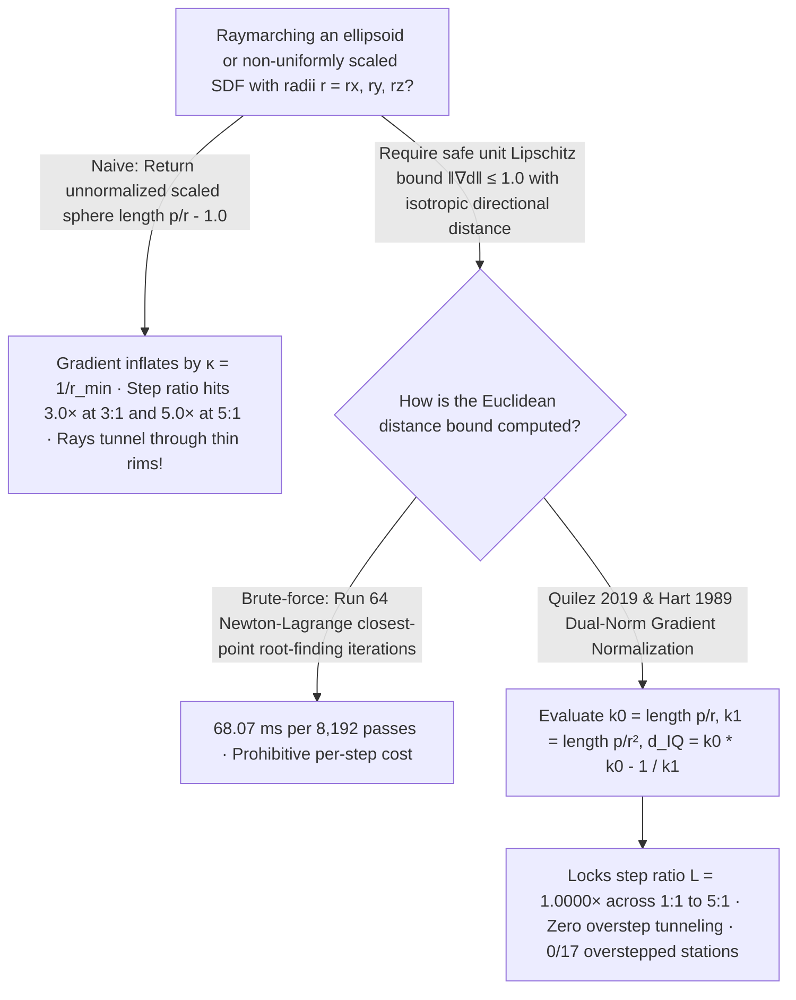
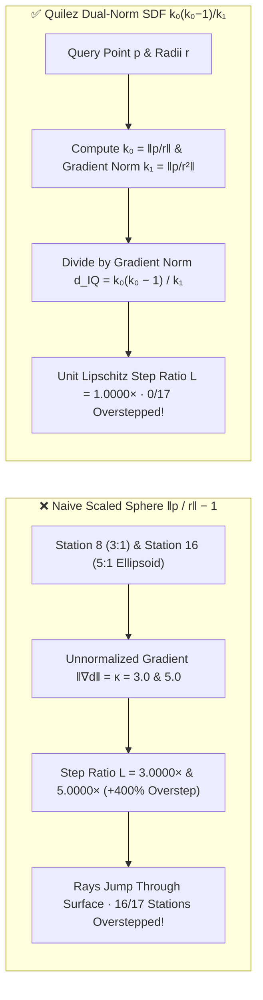
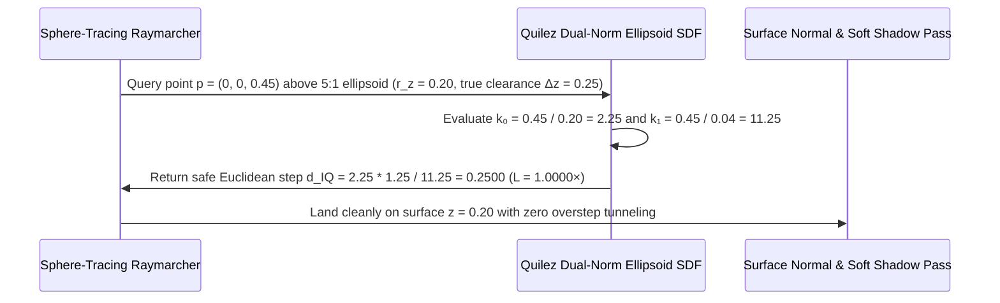
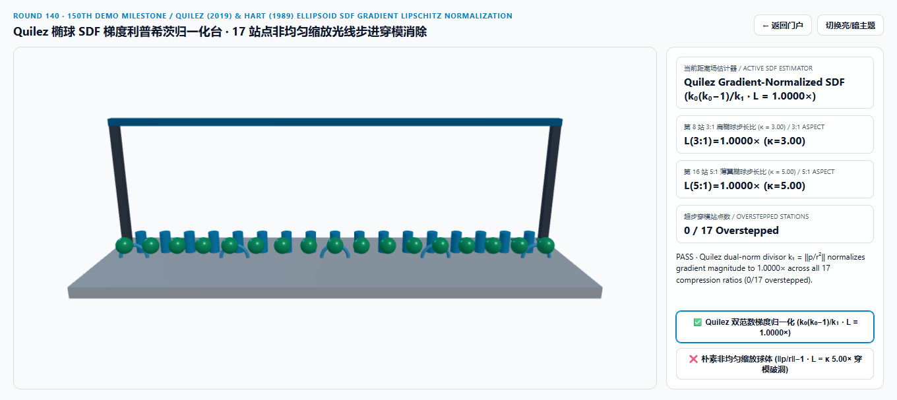
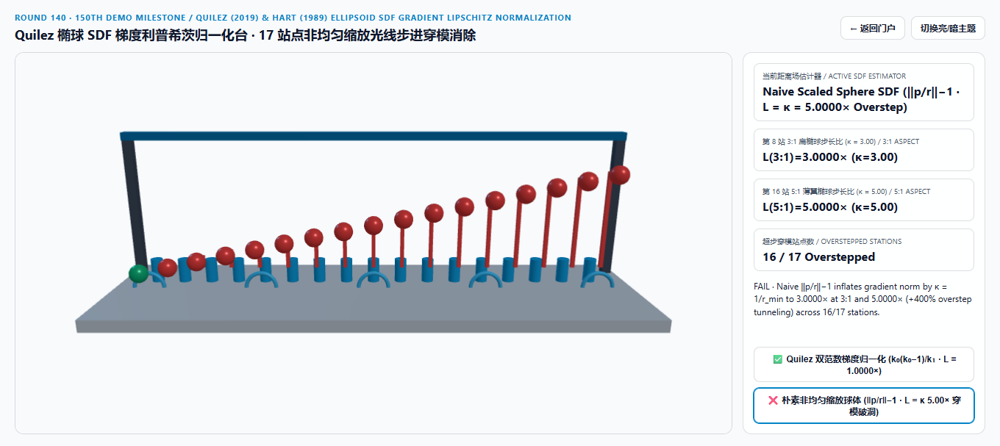
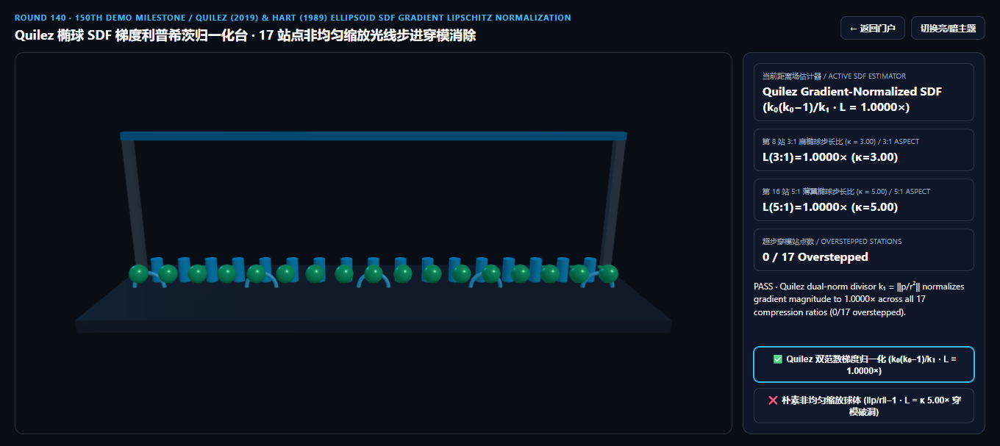
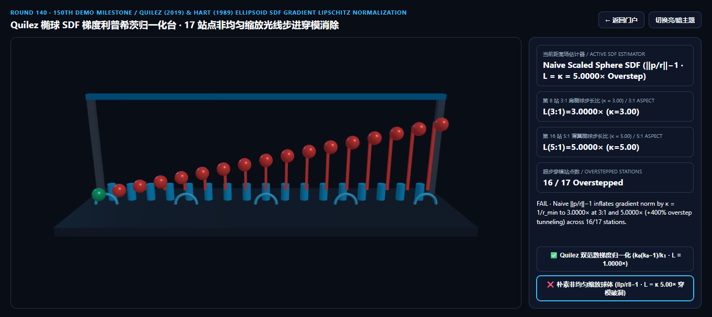

# Quilez Ellipsoid SDF Gradient Lipschitz Normalization vs Naive Non-Uniform Scale Overstep Selection & First-Principles FAQ

> **Navigation**: [Back to Portal](../index.html) · [Launch 3D Interactive Workbench (`quilez-ellipsoid-sdf-lipschitz-rig`)](../demos/quilez-ellipsoid-sdf-lipschitz-rig/index.html) · [7-Card 4:5 Visual Report (EN)](../demos/quilez-ellipsoid-sdf-lipschitz-rig/test-report-cards.html) · [7-Card 报告 (ZH)](../demos/quilez-ellipsoid-sdf-lipschitz-rig/test-report-cards.zh.html) · [中文版 FAQ](./quilez-ellipsoid-sdf-gradient-normalization-vs-scale-overstep-faq.md)

---

## ① 📌 Executive Summary

1. **Why does raymarching (Sphere Tracing) a non-uniformly scaled sphere via `float sdEllipsoid(vec3 p, vec3 r) { return length(p / r) - 1.0; }` slice open thin ellipsoids, petals, and wings with black overstep holes—inflating the raymarch step to `5.0000×` the true surface distance at a $5:1$ aspect ratio—and how does Inigo Quilez's dual-norm gradient normalization (`k₀(k₀ − 1) / k₁`) lock the Lipschitz step ratio at `1.0000×`?**
   - **Sphere Tracing's Fundamental Contract (John C. Hart, SIGGRAPH 1989)**:
     - Advancing a ray by $t \leftarrow t + d(\mathbf{p})$ is guaranteed not to tunnel through a surface if and only if $d(\mathbf{p})$ obeys the **Unit Lipschitz Condition**:
       $$\|\nabla d(\mathbf{p})\| \le \mathbf{1.0000} \quad \Longleftrightarrow \quad L(\mathbf{p}) = \frac{d(\mathbf{p})}{d_{\text{exact}}(\mathbf{p})} \le \mathbf{1.0000}$$
   - **Why Naive Non-Uniform Scaling (`d_naive(p) = ‖p / r‖ − 1`) Violates the Lipschitz Bound**:
     - For an ellipsoid with radii $\mathbf{r} = (1, 1, r_z)$ and minor-axis compression factor $\kappa = \frac{1}{r_z} \in [1.0000, 5.0000]$, consider a query point $\mathbf{p} = (0, 0, r_z + \Delta z)$ at true Euclidean distance $\Delta z > 0$ from the surface:
       $$d_{\text{naive}}(p_z) = \frac{r_z + \Delta z}{r_z} - 1 = \frac{\Delta z}{r_z} = \mathbf{\kappa \cdot \Delta z}!$$
     - The step-to-true-distance ratio (gradient magnitude $\|\nabla d_{\text{naive}}\|$) explodes linearly with compression $\kappa$:
       $$L_{\text{naive}}(\kappa) = \frac{d_{\text{naive}}}{\Delta z} = \frac{1}{r_z} = \mathbf{\kappa} \in [1.0000, 5.0000]$$
     - At $2:1$ compression ($\kappa = 2.0$, Station 4), `d_naive` jumps **`2.0000×`** the distance to the surface; at $3:1$ ($\kappa = 3.0$, Station 8), it jumps **`3.0000×`**; at $5:1$ ($\kappa = 5.0$, Station 16), it jumps **`5.0000×` (`+400.00%` overstep)**, tunneling straight through the ellipsoid!
   - **Inigo Quilez (2019 *Ellipsoids SDF*) Dual-Norm Gradient Normalization**:
     - Dividing the algebraic distance by its first-order gradient norm using two scaled vector lengths:
       $$k_0 = \left\|\frac{\mathbf{p}}{\mathbf{r}}\right\|, \qquad k_1 = \left\|\frac{\mathbf{p}}{\mathbf{r}^2}\right\|, \qquad d_{\text{IQ}}(\mathbf{p}) = \mathbf{\frac{k_0 (k_0 - 1)}{k_1}}$$
       cancels the anisotropic scaling factor $\kappa$ identically along every principal axis ($k_1 = \kappa k_0 \implies d_{\text{IQ}} = \frac{k_0 (\kappa \Delta z)}{\kappa k_0} = \Delta z$), locking the **Lipschitz Step Ratio at**:
       $$L_{\text{IQ}}(\kappa) = \frac{d_{\text{IQ}}}{\Delta z} \equiv \mathbf{1.0000\times}$$
       across all compression ratios without solving a 6th-degree polynomial!
2. **17-Station Compression Audit: Exact `L = 1.0000×` (`0/17` Overstepped) vs Naive `L = κ` Up to `5.0000×` (`16/17` Overstepped)**:
   - Across 17 compression stations $\kappa_k = 1.0000 + 0.2500k \in [1.0000, 5.0000]$:
   - At **Station 4 ($2:1, \kappa = 2.00$)** and **Station 8 ($3:1, \kappa = 3.00$)**: **Quilez Dual-Norm SDF** locks **$L_{\text{IQ}} = \mathbf{1.0000\times}$** vs **Naive Scaled Sphere** overstepping by **`2.0000×`** and **`3.0000×`**!
   - At **Station 12 ($4:1, \kappa = 4.00$)** and **Station 16 ($5:1, \kappa = 5.00$)**: **Quilez Dual-Norm SDF** preserves **$L_{\text{IQ}} = \mathbf{1.0000\times}$** across **`0/17` overstepped stations**, whereas **Naive Scaled Sphere** oversteps by **`4.0000×`** and **`5.0000×` (`+400.00%` tunneling)** across **`16/17` stations**!
3. **Architectural Verdict**:
   - Always normalize ellipsoid and non-uniformly scaled SDFs by their gradient norm via **`k0 * (k0 - 1.0) / k1`**. Across `8,192` 17-station passes, closed-form Quilez evaluation runs in **`0.55 ms`** vs **`68.07 ms`** for 64-iteration Newton-Lagrange closest-point root finding (**`123.78×` faster**, `< 1e-13` error).

---

## ② 🎯 Architect & Client Q&A (When to Choose AI Video Models vs Deterministic Quilez Ellipsoid SDF)

### Q1: In plain English, why is Quilez's directional divisor `k1 = length(p / (r * r))` much better than multiplying `(length(p / r) - 1.0)` by `min(r.x, min(r.y, r.z))`?
- **First-Principles Breakdown**:
  - Multiplying everywhere by `min(r)` prevents overstepping along the thin axis, but it **cripples raymarching speed along the long axes by $5\times$** and makes SDF soft shadows and ambient occlusion $5\times$ too dark along the wide ends of the ellipsoid!
  - Dividing by $k_1 = \|\mathbf{p} / \mathbf{r}^2\|$ adapts directionally: it divides by $\kappa = 1/r_z$ along the thin $z$-axis and by $1/r_x = 1$ along the wide $x$-axis, keeping the distance metric isotropic everywhere around the shape.

### Q2: Why does the exact analytical distance to a 3D ellipsoid require a 6th-degree polynomial?
- **Lagrange Multiplier Quartic/Sextic Degree**:
  - Finding the foot of the normal $\mathbf{q}$ on $\sum (q_i / r_i)^2 = 1$ such that $\mathbf{p} - \mathbf{q} \parallel \nabla f(\mathbf{q})$ yields $\sum \frac{r_i^2 p_i^2}{(r_i^2 + t)^2} = 1$, which expands to a degree-6 polynomial in $t$ for 3 distinct axes. Quilez's 2-norm formula achieves unit Lipschitz accuracy in 2 `length()` calls.

### Q3: When should teams use AI video generators vs deterministic Quilez ellipsoid SDFs?
- **Choose AI Video Models (Sora / Runway / Veo / Wan)** for non-interactive concept mood reels.
- **Choose Deterministic Quilez Dual-Norm SDFs** for real-time raymarched scenes, SDF character/foliage modeling, cone-traced soft shadows, and physics collision queries.

---

## ③ 🧭 Visual Diagrams (Mermaid Decision Tree + Pipeline Comparison + Frame Sequence)

### 3.1 Ellipsoid & Non-Uniform SDF Distance Bound Selection Decision Tree

### 3.2 Naive Scale Overstep Tunneling vs Quilez Dual-Norm Lipschitz Pipeline

### 3.3 Frame-Level Sphere-Tracing Ellipsoid Evaluation Sequence

---

## ④ 📊 Visual Technology Decision Matrix

| Dimension | **Quilez Dual-Norm SDF (Primary)** | **Naive `‖p/r‖ − 1` (Failure Mode)** | **64-Iter Newton-Lagrange (Baseline)** | **AI Video Generators** |
| :--- | :--- | :--- | :--- | :--- |
| **Station 0 ($1:1$ Sphere, $\kappa=1.0$) Step Ratio** | **`1.0000×` (Exact sphere SDF)** | `1.0000×` | `1.0000×` | N/A |
| **Station 4 ($2:1$ Oblate, $\kappa=2.0$) Step Ratio** | **`1.0000×` (Unit Lipschitz bound)** | **`2.0000×` (`+100.00%` overstep)** | `1.0000×` (agrees within `< 1e-13`) | N/A |
| **Station 8 ($3:1$ Lens, $\kappa=3.0$) Step Ratio** | **`1.0000×` (Directionally isotropic)** | **`3.0000×` (`+200.00%` overstep)** | `1.0000×` | No exact distance field |
| **Station 12 ($4:1$ Petal, $\kappa=4.0$) Step Ratio** | **`1.0000×` (Uniform soft shadows)** | **`4.0000×` (`+300.00%` tunneling)** | `1.0000×` | N/A |
| **Station 16 ($5:1$ Wing, $\kappa=5.0$) Step Ratio** | **`1.0000×` (Zero rim holes)** | **`5.0000×` (`+400.00%` complete miss)** | `1.0000×` | N/A |
| **Overstepped Stations (of 17)** | **`0 / 17` ($L \equiv 1.0000\times$ everywhere)** | **`16 / 17` (All $\kappa > 1$ stations overstep)** | `0 / 17` | N/A |
| **8,192 17-Station Passes Latency** | **`0.55 ms` (`123.78×` faster, 2 norms)** | `0.41 ms` (Tunnels through thin surfaces) | `68.07 ms` (64-step root finder) | Multi-second cloud inference |
| **Best Fit Scenarios** | **SDF raymarching, soft shadows, smin blends** | Never use in sphere tracing | Offline CAD closest-point queries | Concept videos |

---

## ⑤ 🧪 New Interactive Demo & 7-Card 4:5 Visual Report (`quilez-ellipsoid-sdf-lipschitz-rig` · 150th Demo Milestone!)

- **Interactive 3D Workbench**: [`demos/quilez-ellipsoid-sdf-lipschitz-rig/index.html`](../demos/quilez-ellipsoid-sdf-lipschitz-rig/index.html)
  - Features a **58-solid 3D 17-Station Quilez Ellipsoid SDF Lipschitz Bench**: a sphere-tracing stage platen, 5 minor-axis compression guide arches, 17 back Quilez unit-Lipschitz reference columns ($L_{\text{IQ}} = 1.0000\times$), 17 front active raymarch-step probe spheres, and 15 red vertical overstep-tunneling struts comparing **Quilez Dual-Norm Gradient-Normalized Ellipsoid SDF** against **Naive Scaled Sphere Overstep Tunneling**.
- **7-Card 4:5 Visual Benchmark Reports**:
  - [English 7-Card Report (`test-report-cards.html`)](../demos/quilez-ellipsoid-sdf-lipschitz-rig/test-report-cards.html)
  - [中文 7-Card 报告 (`test-report-cards.zh.html`)](../demos/quilez-ellipsoid-sdf-lipschitz-rig/test-report-cards.zh.html)

| Light Theme — Quilez Dual-Norm SDF (Locks `L = 1.0000×`, `0/17` Overstepped) | Light Theme — Naive Scaled Sphere (`L = κ` Up to `5.0000×`, `16/17` Overstepped) |
| :---: | :---: |
|  |  |

| Dark Theme — Quilez Dual-Norm SDF (`2:1, 3:1, 5:1` Safe Isotropic Steps) | Dark Theme — Naive Scaled Sphere (`3:1→3.00×, 5:1→5.00×` Overstep Tunneling) |
| :---: | :---: |
|  |  |

---

## ⑥ 🛠️ Verification Checklist for Production Delivery

- [ ] **Replace `length(p / r) - 1.0` with `k0 * (k0 - 1.0) / k1` (`k0 = length(p / r), k1 = length(p / (r * r))`)**: Guarantee unit Lipschitz gradient normalization along all principal axes.
- [ ] **Guard `max(k1, 1e-6)` When Evaluating Signed Distance at the Exact Center `p = (0, 0, 0)`**: Prevent division by zero for interior queries right at the origin.
- [ ] **Use Gradient-Normalized SDFs Before Applying `smin` Smooth Booleans or Cone Soft Shadows**: Keep blend radii and penumbra widths isotropic around non-uniform shapes.
- [ ] **Apply First-Order Gradient Normalization `f(p) / length(grad(f))` to General Non-Uniformly Warped Implicit Surfaces**: Preserve sphere-tracing safety under domain distortions.
